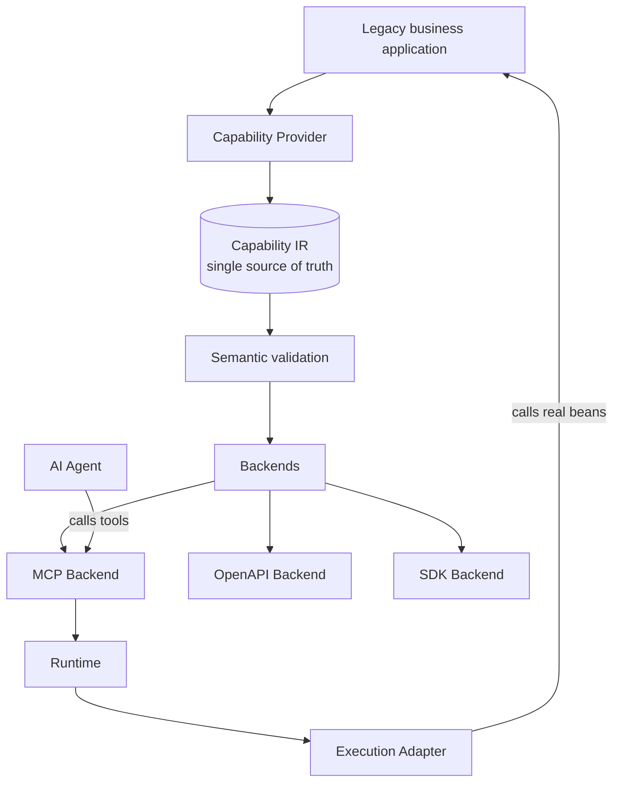
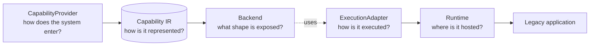

# Tibyan

**An Application Modernization Platform. It turns an existing legacy business system into an AI-operable business platform without rewriting the system.**

> Tibyan is not a code generator, not a Spring generator, not a CRUD generator, and not an ERP framework. Those are categories it deliberately rejects. Tibyan adds a modern, AI-ready layer on top of software that already runs in production.

This repository is the **single source of truth** for the project. It is written for contributors from anywhere in the world. Every architectural decision here is intentional and is justified in Volume 14 (Architecture Decision Records).

> To **adopt** Tibyan (add it to your app and serve your capabilities), start at the [root README](../README.md), read [docs/SECURITY.md](SECURITY.md) before exposing anything, and see [docs/RELEASING.md](RELEASING.md) for the publish status. To have an AI agent run the whole adoption, from the first survey through the attestation workflow to a chat assistant on top of it, hand it [docs/AI-ADOPTION-PROMPT.md](AI-ADOPTION-PROMPT.md). This hub is the **design** documentation: the reasoning behind what the tool does. Where the build actually stands is [docs/STATUS.md](STATUS.md).

---

## The one-sentence mission

Modernize instead of rewrite: take a business application that already exists, understand its capabilities, and make them operable by AI agents and modern clients through a generated, governed layer, without changing the original system. The goal is not only to expose the system over a protocol, it is to let AI operate it: read data, take actions, and run workflows.

---

## The canonical flow

Read it top to bottom: a Provider reads the legacy system and produces the Capability IR. The IR is validated. Backends turn the IR into output shapes such as an MCP server. A Runtime hosts that output inside or beside the legacy application, and an Execution Adapter routes each call to the real implementation that already exists. An AI agent then talks to the system through the generated MCP layer.

---

## The five abstractions

Tibyan is built from five orthogonal abstractions. Each one answers a single question, and each one can evolve on its own.

| Abstraction | Question it answers | Examples |
|---|---|---|
| CapabilityProvider | How does an existing system enter Tibyan? | Spring source analyzer, OpenAPI import, database import, manual builder |
| Capability IR | How is the system represented? | The neutral model: entities, capabilities, types, relations |
| Backend | What shape is exposed to the outside? | MCP, OpenAPI, SDKs, documentation |
| ExecutionAdapter | How is a capability actually executed? | Spring bean call, REST call, message queue, gRPC |
| Runtime | Where and how is the generated layer hosted? | Spring runtime, Quarkus, Micronaut, .NET |

The Capability IR sits in the center. Everything else is an entry into the IR or an exit from it. This is the most important property of the whole design.

---

## Core principles

These are repeated across every volume because they constrain every decision.

1. The IR is the heart of the system.
2. Providers only feed the IR. They never produce output.
3. Backends only expose the IR. They never know where the IR came from, and they never call a framework directly.
4. The Runtime executes capabilities. It hosts the generated layer and connects it to the real system.
5. Everything is plugin based. Providers, backends, adapters, and runtimes are plugins around a stable core.
6. Frameworks are adapters, not architecture. Spring is one adapter among many, never the foundation.
7. Zero vendor lock-in. No framework concept is allowed to leak into the IR.
8. Brownfield first. The primary input is a system that already exists.
9. AI-operable by design. AI agents can operate the system, not just read it, and the MCP layer is a first-class output rather than an afterthought.
10. Modernize instead of rewrite. The original system is never edited.

---

## Why Tibyan is hard to replace

The durable asset is not MCP generation. When frameworks such as Spring or .NET add native MCP support, the protocol output becomes a commodity that Tibyan can simply target. The defensible layer is the semantic understanding of the business system: a framework-neutral model of capabilities, relationships, policies, and domain meaning, built by analysis and deepened over time. MCP support inside one framework is a feature; understanding a company's whole system across frameworks is a platform. Volume 1 develops this as the competitive moat.

---

## Documentation map

The documentation is organized into volumes. All volumes exist. The MVP they describe has been built and verified (docs/STATUS.md); volumes whose subject is complete say so in their status line and are preserved as the record.

| Volume | Title | Status |
|---|---|---|
| Hub | This document | Done |
| 1 | Vision and Strategy | Done |
| 2 | Software Requirements Specification (SRS) | Done |
| 3 | Software Requirements Design (SRD) | Done |
| 4 | Capability IR Specification | Done |
| 5 | Capability Providers | Done |
| 6 | Backends | Done |
| 7 | Runtime | Done |
| 8 | Technical Spike | Done (spike complete) |
| 9 | Compiler Pipeline | Done |
| 10 | Plugin System | Done |
| 11 | CLI Specification | Done |
| 12 | Project Structure | Done |
| 13 | Development Roadmap | Done (the living plan, in three tiers) |
| 14 | Architecture Decision Records (ADR) | Done |
| 15 | Future RFCs | Done |
| 16 | Technology Stack | Done |
| 17 | Implementation Guide | Done (executed) |

## Suggested reading order

1. Volume 1 to understand why the project exists.
2. Volume 14 to understand every decision and its justification.
3. Volume 2 for the formal requirements.
4. docs/STATUS.md for where the build actually stands, and Volume 8 for the spike that started it.
5. Volume 13 for the plan: what was built (Tier 1), what the evidence says to build next (Tier 2), and the direction beyond (Tier 3).

## Glossary (quick reference)

| Term | Meaning |
|---|---|
| Capability IR | The neutral, framework-free model of a system's entities and capabilities |
| Capability | An action the system can perform, such as getProduct or createOrder |
| Provider | A plugin that reads a source and produces IR |
| Backend | A plugin that turns IR into an output shape |
| ExecutionAdapter | The interface a generated tool uses to invoke real logic |
| Runtime | The host that runs the generated layer and binds it to the real system |
| Brownfield | Working on a system that already exists, as opposed to greenfield |
| MCP | Model Context Protocol, the open standard that lets AI agents call tools |
| Spike | A throwaway experiment whose only goal is to remove a technical unknown |
