# Tibyan: Complete Documentation

**Application Modernization Platform. Turn an existing legacy business system into an AI-operable business platform without rewriting it.**

> SNAPSHOT, NOT CURRENT. This single-file edition was consolidated before any code existed and is preserved unchanged as the pre-build record. It is not maintained. The individual volume files in this directory are the single source of truth, and several of them have since been corrected against the built reality (the reconciliation is recorded in docs/PLAN-REVIEW.md; the current plan is docs/volume-13-roadmap.md; the current build status is docs/STATUS.md). Read this file only to see what the design said before it met code.

> This is the consolidated single-file edition of the Tibyan documentation. It uses GitHub-flavored Markdown with Mermaid diagrams. This edition contains the complete volume set, 1 through 17, covering vision, requirements, design, the IR, providers, backends, the runtime, the spike, the pipeline, the plugin system, the CLI, project structure, roadmap, decision records, future RFCs, the technology stack, and the implementation guide.

## Table of contents

- [Overview](#overview)
- [Volume 1: Vision and Strategy](#volume-1-vision-and-strategy)
- [Volume 2: Software Requirements Specification (SRS)](#volume-2-software-requirements-specification-srs)
- [Volume 3: Software Requirements Design (SRD)](#volume-3-software-requirements-design-srd)
- [Volume 4: Capability IR Specification](#volume-4-capability-ir-specification)
- [Volume 5: Capability Providers](#volume-5-capability-providers)
- [Volume 6: Backends](#volume-6-backends)
- [Volume 7: Runtime](#volume-7-runtime)
- [Volume 8: Technical Spike](#volume-8-technical-spike)
- [Volume 9: Compiler Pipeline](#volume-9-compiler-pipeline)
- [Volume 10: Plugin System](#volume-10-plugin-system)
- [Volume 11: CLI Specification](#volume-11-cli-specification)
- [Volume 12: Project Structure](#volume-12-project-structure)
- [Volume 13: Development Roadmap](#volume-13-development-roadmap)
- [Volume 14: Architecture Decision Records (ADR)](#volume-14-architecture-decision-records-adr)
- [Volume 15: Future RFCs](#volume-15-future-rfcs)
- [Volume 16: Technology Stack](#volume-16-technology-stack)
- [Volume 17: Implementation Guide](#volume-17-implementation-guide)

---

## Overview

**An Application Modernization Platform. It turns an existing legacy business system into an AI-operable business platform without rewriting the system.**

> Tibyan is not a code generator, not a Spring generator, not a CRUD generator, and not an ERP framework. Those are categories it deliberately rejects. Tibyan adds a modern, AI-ready layer on top of software that already runs in production.

This repository is the **single source of truth** for the project. It is written for contributors from anywhere in the world. Every architectural decision here is intentional and is justified in Volume 14 (Architecture Decision Records).

---

### The one-sentence mission

Modernize instead of rewrite: take a business application that already exists, understand its capabilities, and make them operable by AI agents and modern clients through a generated, governed layer, without changing the original system. The goal is not only to expose the system over a protocol, it is to let AI operate it: read data, take actions, and run workflows.

---

### The canonical flow

```mermaid
flowchart TD
    L[Legacy business application]
    L --> P[Capability Provider]
    P --> IR[(Capability IR<br/>single source of truth)]
    IR --> SEM[Semantic validation]
    SEM --> B[Backends]
    B --> MCP[MCP Backend]
    B --> OAPI[OpenAPI Backend]
    B --> SDK[SDK Backend]
    MCP --> RT[Runtime]
    RT --> EA[Execution Adapter]
    EA -->|calls real beans| L
    AI[AI Agent] -->|calls tools| MCP
```

Read it top to bottom: a Provider reads the legacy system and produces the Capability IR. The IR is validated. Backends turn the IR into output shapes such as an MCP server. A Runtime hosts that output inside or beside the legacy application, and an Execution Adapter routes each call to the real implementation that already exists. An AI agent then talks to the system through the generated MCP layer.

---

### The five abstractions

Tibyan is built from five orthogonal abstractions. Each one answers a single question, and each one can evolve on its own.

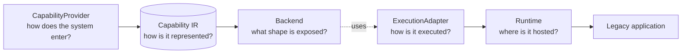

| Abstraction | Question it answers | Examples |
|---|---|---|
| CapabilityProvider | How does an existing system enter Tibyan? | Spring source analyzer, OpenAPI import, database import, manual builder |
| Capability IR | How is the system represented? | The neutral model: entities, capabilities, types, relations |
| Backend | What shape is exposed to the outside? | MCP, OpenAPI, SDKs, documentation |
| ExecutionAdapter | How is a capability actually executed? | Spring bean call, REST call, message queue, gRPC |
| Runtime | Where and how is the generated layer hosted? | Spring runtime, Quarkus, Micronaut, .NET |

The Capability IR sits in the center. Everything else is an entry into the IR or an exit from it. This is the most important property of the whole design.

---

### Core principles

These are repeated across every volume because they constrain every decision.

1. The IR is the heart of the system.
2. Providers only feed the IR. They never produce output.
3. Backends only expose the IR. They never know where the IR came from, and they never call a framework directly.
4. The Runtime executes capabilities. It hosts the generated layer and connects it to the real system.
5. Everything is plugin based. Providers, backends, adapters, and runtimes are plugins around a stable core.
6. Frameworks are adapters, not architecture. Spring is one adapter among many, never the foundation.
7. Zero vendor lock-in. No framework concept is allowed to leak into the IR.
8. Brownfield first. The primary input is a system that already exists.
9. AI-operable by design. AI agents can operate the system, not just read it, and the MCP layer is a first-class output rather than an afterthought.
10. Modernize instead of rewrite. The original system is never edited.

---

### Why Tibyan is hard to replace

The durable asset is not MCP generation. When frameworks such as Spring or .NET add native MCP support, the protocol output becomes a commodity that Tibyan can simply target. The defensible layer is the semantic understanding of the business system: a framework-neutral model of capabilities, relationships, policies, and domain meaning, built by analysis and deepened over time. MCP support inside one framework is a feature; understanding a company's whole system across frameworks is a platform. Volume 1 develops this as the competitive moat.

---

### Documentation map

The documentation is organized into volumes. This installment delivers the spine. The remaining volumes follow in the same structure and style.

| Volume | Title | Status |
|---|---|---|
| Hub | This document | Done |
| 1 | Vision and Strategy | Done |
| 2 | Software Requirements Specification (SRS) | Done |
| 3 | Software Requirements Design (SRD) | Done |
| 4 | Capability IR Specification | Done |
| 5 | Capability Providers | Done |
| 6 | Backends | Done |
| 7 | Runtime | Done |
| 8 | Technical Spike | Done |
| 9 | Compiler Pipeline | Done |
| 10 | Plugin System | Done |
| 11 | CLI Specification | Done |
| 12 | Project Structure | Done |
| 13 | Development Roadmap | Done |
| 14 | Architecture Decision Records (ADR) | Done |
| 15 | Future RFCs | Done |
| 16 | Technology Stack | Done |
| 17 | Implementation Guide | Done |
| 16 | Technology Stack | Done |
| 17 | Implementation Guide | Done |

### Suggested reading order

1. Volume 1 to understand why the project exists.
2. Volume 14 to understand every decision and its justification.
3. Volume 2 for the formal requirements.
4. Volume 8 for the first thing that will actually be built.
5. Volume 13 for the path from the spike to a full platform.

### Glossary (quick reference)

| Term | Meaning |
|---|---|
| Capability IR | The neutral, framework-free model of a system's entities and capabilities |
| Capability | An action the system can perform, such as getProduct or createOrder |
| Provider | A plugin that reads a source and produces IR |
| Backend | A plugin that turns IR into an output shape |
| ExecutionAdapter | The interface a generated tool uses to invoke real logic |
| Runtime | The host that runs the generated layer and binds it to the real system |
| Brownfield | Working on a system that already exists, as opposed to greenfield |
| MCP | Model Context Protocol, the open standard that lets AI agents call tools |
| Spike | A throwaway experiment whose only goal is to remove a technical unknown |

---

## Volume 1: Vision and Strategy

Status: Stable. This volume defines why Tibyan exists and what it is trying to become. It is the lens through which every later decision should be read.

---

### 1. Vision

Most valuable business software in the world is not new. It is years or decades old, it runs in production, and it cannot be rewritten safely or cheaply. At the same time, the most important shift in software right now is that systems are expected to talk to AI agents, expose typed interfaces, and integrate through open protocols.

There is a large gap between those two facts. Legacy systems were never designed for AI, and rewriting them to add it is rarely justified.

Tibyan's vision is to close that gap from the outside. It treats an existing system as the input, builds a neutral model of what that system can do, and generates a modern, AI-ready layer on top of it. The original system is never edited.

The end state Tibyan aims for:

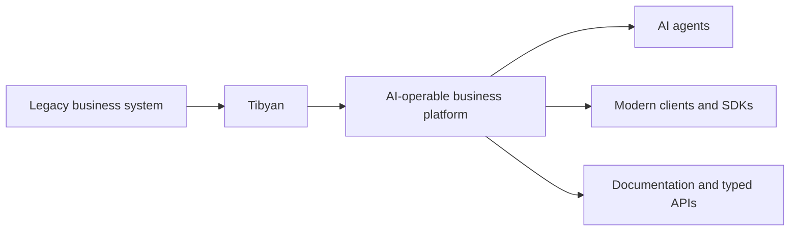

The phrase that captures the goal is AI-operable. An AI-operable system is one that agents can operate, not merely read: they can pull data, take actions, and run multi-step workflows against it, through a generated and governed layer, while the original system stays untouched. Exposing an MCP endpoint is the beginning of operability, not the whole of it.

### 2. Mission

> Transform existing legacy business applications into AI-operable business platforms without rewriting the existing system.

The mission contains three non-negotiable commitments:

1. Existing systems are the primary input, not new projects.
2. The original system is never modified.
3. The output is genuinely AI-operable, meaning AI agents can understand and operate the system, reading data, taking actions, and running workflows, through generated and governed tools.

### 3. Problem statement

| Problem | Why it hurts |
|---|---|
| Legacy systems cannot talk to AI agents | They predate MCP, typed APIs, and the agent era, and adding this by hand is slow and error-prone |
| Rewriting is the usual answer, and it is the wrong one | Rewrites of large business systems are among the most expensive and risky projects a company can take on |
| Every integration is duplicated | An MCP server, an SDK, an OpenAPI spec, and documentation are all written and maintained separately for the same capability |
| Duplication grows with the system | Each new capability multiplies the surfaces that must be kept in sync by hand |
| The market is full of greenfield code generators | They help start new projects, but they do nothing for the systems that actually run the business |

The single sentence that frames the problem: the most expensive software a company owns is the software it already has, and that software is exactly the software that cannot talk to AI.

### 4. Goals

1. Read an existing business system and build a faithful, neutral model of its capabilities.
2. Generate an AI-ready layer, beginning with an MCP server, from that model.
3. Host that layer so it executes against the real system, not a copy.
4. Require no change to the original system, ideally nothing more than adding one dependency.
5. Keep the model independent of any framework, so the same model serves many outputs and many source technologies.
6. Make every part a plugin, so new sources, outputs, and runtimes are added without touching the core.

### 5. Non-goals

| Non-goal | Reason |
|---|---|
| Being a greenfield code generator | The market is saturated and the value is low. Greenfield is at most a stepping stone, not the product |
| Rewriting or refactoring the legacy system | The whole point is to avoid the rewrite |
| Being a Spring or Java tool | Spring is the first target only. The architecture treats every framework as a replaceable adapter |
| Being a documentation scanner | Producing docs or an OpenAPI file is a side output, not the goal. The goal is a shared model that many outputs depend on |
| Locking users into Tibyan at runtime | The generated layer wraps the system; it does not replace or capture it |

### 6. Value proposition

For an organization that owns a working but aging business system:

> Add one dependency, point Tibyan at your system, and your system can now talk to AI agents and modern clients, without a rewrite and without editing your code.

The value is highest exactly where the pain is highest: large, old, business-critical systems that cannot be replaced but must stay relevant.

#### Why a CTO should adopt Tibyan today

The case is about business outcomes, not technical features.

| Outcome | What it means for the business |
|---|---|
| Modernize without rewriting | Avoid the cost, time, and risk of replacing a system that already works |
| Eliminate duplicated integration work | One model generates and keeps in sync the MCP server, the OpenAPI spec, the SDKs, and the docs, instead of hand-building and maintaining each surface separately |
| Make existing systems AI-operable | AI initiatives ship on the software the business already runs, instead of waiting for a rewrite |
| Lower integration cost over time | Each capability is described once, not re-implemented per surface, so cost falls as coverage grows |
| Govern AI access centrally | Permissions and policies live in the model, so AI access to the business is controlled rather than ad hoc |
| Reduce framework and vendor risk | The model is framework-neutral, so it outlives any single framework or protocol |

In one line for the CTO: get measurable AI capability on top of the systems you already depend on, in weeks, without a rewrite and without editing those systems.

### 7. Target customers

| Segment | Why Tibyan fits |
|---|---|
| Enterprises with large legacy business systems | They have the most to lose from a rewrite and the most to gain from modernization |
| Teams maintaining a long-lived Spring or Java backend | The first supported stack, and the fastest path to value |
| Companies adopting AI agents | They need their existing systems to be callable by agents safely |
| System integrators and consultancies | They modernize client systems for a living and need a repeatable tool |

The first concrete user, used to anchor the MVP: a team that owns a running Spring Boot system and wants an AI agent to operate it, without changing that system.

### 8. Market position

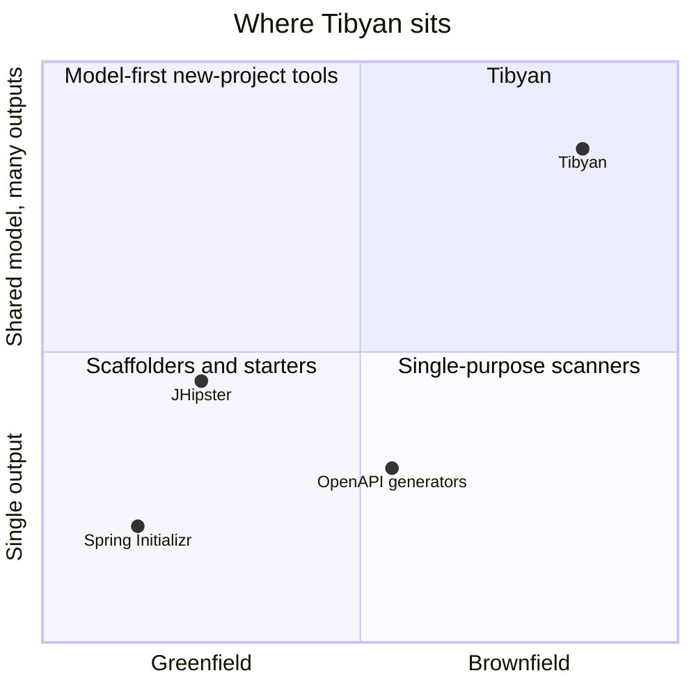

Tibyan is deliberately in the corner that almost no one occupies: brownfield input combined with a shared model that feeds many outputs. Greenfield generators sit in the opposite corner. Single-purpose scanners sit low on the model axis. The brownfield, shared-model corner is both the hardest to build and the most defensible.

### 9. Future vision and differentiation

The long-term shape of Tibyan, stated so that near-term decisions can be checked against it:

1. Many providers feed one IR: Spring source today, then OpenAPI, databases, bytecode, and other languages such as .NET and PHP.
2. Many backends consume one IR: MCP today, then OpenAPI, SDKs, documentation, and others such as GraphQL.
3. Many runtimes host the layer: Spring today, then Quarkus, Micronaut, and .NET.
4. A plugin ecosystem grows around the stable core, eventually with a marketplace of providers, backends, and runtimes.
5. The IR becomes a durable, framework-neutral description of business capabilities that outlives any single framework or protocol.

The strategic bet: protocols and frameworks will keep changing, but the description of what a business system can do is comparatively stable. Tibyan owns that description, the Capability IR, and treats everything else as a replaceable edge.


#### 9.1 The Semantic Business Capability Model

Today the Capability IR is small: entities, fields, types, and capabilities. That is correct for the MVP. The long-term target is larger. The IR grows into a Semantic Business Capability Model, a framework-neutral, machine-readable description of what a business system is and does, not only the methods and entities that were extracted from it.

The model eventually represents:

| Element | What it captures |
|---|---|
| Business capabilities | The actions the business can perform, named in business terms |
| Business entities | The core objects the business operates on |
| Relationships | How entities relate to and depend on each other |
| Workflows | Multi-step business processes that span capabilities |
| Events | Significant occurrences the system emits or reacts to |
| Policies | The rules that constrain how capabilities may be used |
| Permissions | Who or what may invoke each capability |
| Dependencies | How capabilities and systems depend on one another |
| Domain knowledge | The meaning and context that make the model understandable, not only its structure |

> Discipline note: this is the north star, not the MVP. The MVP IR stays minimal, entities and read capabilities only. Each later element is added only when a phase needs it. Stating the target now lets every early decision be checked against it, so the small IR grows into the full model without a redesign. The architecture (Provider, IR, Backend, Runtime) does not change; only what the IR can hold grows.

#### 9.2 The long-term flow

The near-term pipeline (Provider, IR, Backends) is the first step of a longer arc. As the IR grows into the Semantic Business Capability Model, the same neutral model becomes a Semantic Capability Graph, and Tibyan becomes the platform that sits between a legacy system and the AI era.

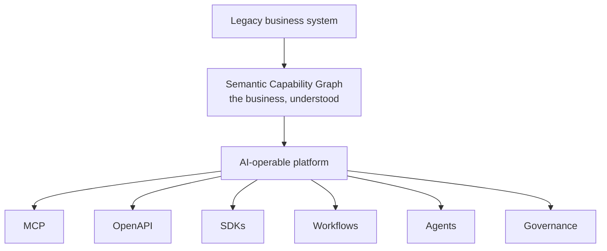

The Capability IR is the seed of the Semantic Capability Graph. MCP becomes one output among many. Governance and agents become first-class outputs rather than afterthoughts, because the model already carries policies, permissions, and relationships. This is the same architecture as today, with a richer model in the center and more backends around it.

#### 9.3 The competitive moat

A fair challenge: what happens when Spring, or Microsoft, or the frameworks themselves add native MCP support? If the product were only MCP generation, that day would erase it. So the moat is deliberately not MCP generation.

The moat is the semantic understanding of business systems. It is hard to copy and it compounds over time.

| Layer | Why it is defensible |
|---|---|
| The semantic model | A framework-neutral, cross-system description of capabilities, relationships, policies, and domain meaning is far harder to build than a single MCP endpoint, and it is the same model behind every output |
| Cross-stack analysis | Understanding Spring, then .NET, then databases, and unifying them into one model is deep work that a single-framework vendor will not do for its competitors' stacks |
| Governance and policy | Because the model carries permissions and policies, Tibyan can govern AI access centrally, which a native MCP endpoint bolted onto one framework does not |
| Accumulated coverage | Every analyzer, extractor, and supported pattern adds to a body of understanding that a new entrant must rebuild from zero |

When frameworks add native MCP, that helps Tibyan rather than harming it: the protocol output becomes a commodity Tibyan can simply target, while the value moves to the layer Tibyan owns, the model. MCP support inside a framework is a feature. Understanding a company's whole system across frameworks is a platform.

> Honest caveat: this moat is real, but it must be earned. Early on, before the semantic depth accrues, Tibyan will look like an MCP generator. The strategy only works if the analysis and the model keep deepening, phase after phase. The moat is a destination, not a starting position.

---

## Volume 2: Software Requirements Specification (SRS)

Status: Stable for the MVP scope. Written in an IEEE 830 style. Requirements that belong to later phases are marked with their phase.

---

### 1. Introduction

#### 1.1 Purpose
This document specifies the requirements for Tibyan, an application modernization platform that adds an AI-ready layer to an existing business system without rewriting it. It defines the actors, assumptions, constraints, functional and non-functional requirements, acceptance criteria, use cases, and external interfaces.

#### 1.2 Scope
Tibyan reads an existing system through a Capability Provider, builds a neutral Capability IR, validates it, and exposes it through Backends. A Runtime hosts the generated layer and connects it to the real system through an Execution Adapter. The MVP scope is a single source technology (Spring Boot and Java) and a single backend (MCP), with a real binding to existing logic.

#### 1.3 Definitions, acronyms, abbreviations
| Term | Definition |
|---|---|
| IR | Capability Intermediate Representation, the neutral model of a system |
| Provider | A plugin that reads a source and produces IR |
| Backend | A plugin that turns IR into an output shape |
| ExecutionAdapter | The interface a generated tool uses to invoke real logic |
| Runtime | The host that runs the generated layer and binds it to the real system |
| MCP | Model Context Protocol |
| Capability | An action the system can perform |
| Brownfield | Modernizing a system that already exists |

#### 1.4 References
Volume 1 (Vision), Volume 8 (Technical Spike), Volume 13 (Roadmap), Volume 14 (ADRs).

---

### 2. Overall description

#### 2.1 Product perspective
Tibyan is a plugin-based platform built around a central Capability IR. It is not a monolith. Providers and backends and runtimes are independent modules that depend only on a small core and a plugin API.

#### 2.2 Actors
| Actor | Description | Goals |
|---|---|---|
| Modernizing developer | A developer who runs Tibyan against a legacy system | Add an AI layer with minimal effort and zero edits to the system |
| Legacy system | The existing application being modernized | Be read and called, never modified |
| AI agent | An MCP client such as Claude Desktop | Discover and call the system's capabilities as tools |
| Plugin author | A contributor adding a provider, backend, or runtime | Extend Tibyan without touching the core |

#### 2.3 Assumptions
1. The source code of the legacy system is available for the MVP provider.
2. The legacy system is a Spring Boot and Java application for the MVP.
3. The team can add one dependency to the legacy build for the MVP runtime.
4. An MCP-capable client is available to call the generated tools.

#### 2.4 Constraints
1. The original system must not be edited, beyond adding one dependency for the runtime.
2. No framework concept may leak into the Capability IR.
3. Backends must not depend on any provider, on any runtime, or on any framework.
4. The MVP must prove a real binding to existing logic, not a stub.

---

### 3. Functional requirements

#### 3.1 Core and IR
| ID | Requirement | Phase |
|---|---|---|
| FR1 | Represent a system as a Capability IR of entities, fields, types, capabilities, and relations | P0 |
| FR2 | Provide a closed, well-defined primitive type system (for example string, long, uuid, boolean, decimal, timestamp) | P0 |
| FR3 | Validate the IR for duplicate names, unresolved references, and invalid types | P0 |
| FR4 | Keep the IR free of any framework, protocol, or language specific concept | P0 |

#### 3.2 Providers
| ID | Requirement | Phase |
|---|---|---|
| FR5 | Read a Spring Boot and Java project from source and produce IR | P1 |
| FR6 | Extract entities and their fields from the source (Entity extractor) | P1 |
| FR7 | Organize provider logic as independent extractors that can be enabled separately | P1 |
| FR8 | Extract repositories, services, and controllers to enrich capabilities | P2 |
| FR9 | Support additional providers (OpenAPI, database, bytecode, other languages) without changing the core | P4 and later |

#### 3.3 Backends
| ID | Requirement | Phase |
|---|---|---|
| FR10 | Generate an MCP server that exposes one tool per capability | P2 |
| FR11 | Generate tools that invoke logic only through an Execution Adapter, never a framework directly | P2 |
| FR12 | Generate an OpenAPI description from the IR | P4 |
| FR13 | Generate typed client SDKs from the IR | P5 |
| FR14 | Never read or depend on the provider or the source technology | P2 |

#### 3.4 Runtime and execution
| ID | Requirement | Phase |
|---|---|---|
| FR15 | Host the generated MCP layer inside the legacy application's context | P1 to P2 |
| FR16 | Distribute the Spring runtime as a Spring Boot starter that activates by adding one dependency | P1 to P2 |
| FR17 | Bind a generated tool to a real bean and invoke real logic through the Execution Adapter | P2 |
| FR18 | Register generated tools with the running MCP server | P2 |
| FR19 | Support additional runtimes (Quarkus, Micronaut, .NET) without changing backends | Later |

#### 3.5 CLI and pipeline
| ID | Requirement | Phase |
|---|---|---|
| FR20 | Provide a command to scan a system and produce IR | P3 |
| FR21 | Provide a command to generate a chosen backend from the IR | P3 |
| FR22 | Run the full pipeline: provide, validate, generate | P3 |

---

### 4. Non-functional requirements

#### 4.1 Security
| ID | Requirement |
|---|---|
| NFR-S1 | The generated layer must respect the access rules of the underlying system; it must not bypass existing authentication or authorization |
| NFR-S2 | Side-effecting capabilities must be distinguishable from read-only ones in the IR, so policy can be applied later |
| NFR-S3 | The runtime must not expose any capability that was not derived from the system and validated |

#### 4.2 Performance
| ID | Requirement |
|---|---|
| NFR-P1 | A scan of a typical module must complete in seconds to a few minutes on a developer machine |
| NFR-P2 | A generated tool call must add negligible overhead over a direct call to the underlying logic |

#### 4.3 Reliability
| ID | Requirement |
|---|---|
| NFR-R1 | The same input must always produce the same IR and the same generated output (determinism) |
| NFR-R2 | A failure in one plugin must not corrupt the IR or crash unrelated plugins |

#### 4.4 Compatibility
| ID | Requirement |
|---|---|
| NFR-C1 | Generated MCP servers must conform to a pinned MCP specification version |
| NFR-C2 | Adding a new source technology must not require changes to existing backends |

#### 4.5 Maintainability
| ID | Requirement |
|---|---|
| NFR-M1 | The core must have zero dependencies on frameworks, providers, backends, or runtimes |
| NFR-M2 | Each generator must be covered by golden-file tests |

#### 4.6 Extensibility
| ID | Requirement |
|---|---|
| NFR-E1 | New providers, backends, adapters, and runtimes must be addable as plugins without modifying the core |
| NFR-E2 | The plugin API must be small and stable, depending only on the core |

---

### 5. Acceptance criteria (MVP)

The MVP is accepted when all of the following hold against a real Spring Boot system that is not modified:

1. Tibyan reads the system and produces a Capability IR containing at least one entity and one capability.
2. The MCP backend generates a server exposing that capability as a tool.
3. The Spring runtime, added as a single dependency, hosts the server inside the application's context.
4. An AI agent calls the capability and the generated tool invokes the real existing logic through the Execution Adapter.
5. The result returned to the agent is the real result from the underlying system, read from its real data store.
6. No file of the original system was edited beyond adding one dependency.

---

### 6. Use cases

#### 6.1 UC1: Modernize a Spring service for AI

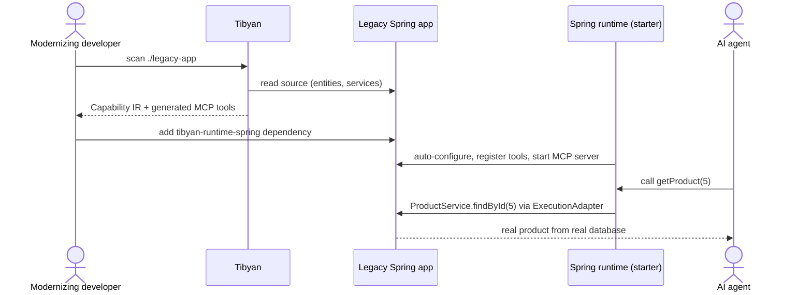

#### 6.2 UC2: Add a new source technology (future)
A plugin author writes a new provider, for example a database provider, that produces the same Capability IR. All existing backends and runtimes work against it unchanged.

#### 6.3 UC3: Add a new output (future)
A plugin author writes a new backend, for example GraphQL, that reads the IR. It works for every system any provider can describe, with no provider changes.

---

### 7. External interfaces

| Interface | Description |
|---|---|
| Source code input | A path to a Spring Boot and Java project (MVP) |
| MCP interface | A standards-conformant MCP server exposing tools to agents |
| CLI | Commands to scan and generate (Volume 11) |
| Plugin API | The contracts CapabilityProvider, Backend, ExecutionAdapter, Runtime (Volumes 5, 6, 7, 10) |

---

### 8. Requirement to ADR traceability

| Requirement theme | Justifying ADR |
|---|---|
| Framework-free IR (FR4, NFR-M1) | ADR-0001, ADR-0013 |
| Brownfield input (FR5) | ADR-0002 |
| Provider abstraction (FR5 to FR9) | ADR-0003 |
| Backends never know the source (FR14) | ADR-0004 |
| Execution through an adapter (FR11, FR17) | ADR-0005 |
| Runtime as a first-class host (FR15 to FR19) | ADR-0006 |
| Spring Boot starter (FR16) | ADR-0007 |
| Real binding, not stub (acceptance criteria) | ADR-0014 |

---

## Volume 3: Software Requirements Design (SRD)

Status: Stable. This volume describes how the requirements in Volume 2 are realized in design: the layered architecture, the modules and their responsibilities, the dependency rule, the design patterns, the extension points, and the tradeoffs. Where Volume 12 gives the physical module tree, this volume gives the reasoning that the tree encodes.

---

### 1. Architectural overview

Tibyan is organized around one center, the Capability IR, with everything else arranged as inputs into it or outputs from it. There are five abstractions (CapabilityProvider, Capability IR, Backend, ExecutionAdapter, Runtime). The design goal is that each can change independently, so the system grows by addition rather than by modification.

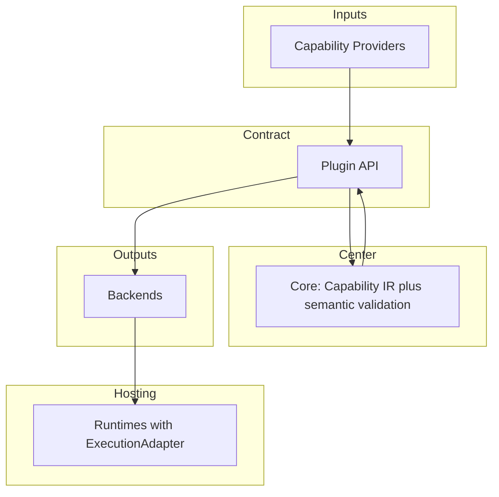

### 2. Layering and the dependency rule

The layers, from the inside out: the core holds the IR and validation and depends on nothing. The plugin API defines the contracts and depends on the core only. Providers, backends, and runtimes depend on the plugin API and the core, never on each other. The pipeline composes them. The single rule that protects the whole design: dependencies point inward, toward the core, and never sideways between plugins. Volume 12, section 5, lists the allowed and forbidden edges.

### 3. Design patterns

| Pattern | Where it is used | Why |
|---|---|---|
| Strategy | CapabilityProvider, Backend, ExecutionAdapter, Runtime | Each is an interchangeable family of implementations behind one interface |
| Pipeline | provide, validate, generate | A linear sequence of stages, each with one responsibility |
| Plugin and service discovery (SPI) | Providers and backends found at run time | New capabilities added without editing the composition root |
| Template method | Source extractors | A common extraction skeleton with per-concern steps |
| Adapter | ExecutionAdapter, and frameworks in general | Frameworks are adapters at the edge, never the architecture |
| Builder | IR construction inside providers | Assemble a valid IR step by step |

### 4. Extension points

| Extension point | Add this to | Without changing |
|---|---|---|
| A new source technology | A CapabilityProvider | The IR, backends, runtimes |
| A new output shape | A Backend | Providers, runtimes |
| A new execution mechanism | An ExecutionAdapter | Backends |
| A new host platform | A Runtime | Backends, the IR |
| A new IR element (future) | The core model plus a validator | Existing providers and backends until they opt in |

### 5. Key design decisions and tradeoffs

The decisions are recorded as ADRs in Volume 14. The dominant tradeoff across all of them is the same: Tibyan accepts an extra layer of indirection (a neutral IR, an execution adapter, a separate runtime) in exchange for independence between the parts. This costs more design up front and a little more ceremony, and it buys the ability to add a provider, a backend, or a runtime without a redesign. For a platform that must eventually span many stacks and outputs, that trade is correct.

### 6. Quality attributes

| Attribute | How the design serves it |
|---|---|
| Extensibility | Plugins behind a small, stable plugin API |
| Maintainability | A core with zero framework dependencies; golden-file tests per backend |
| Reliability | Deterministic IR and output; validation before generation |
| Portability | A framework-neutral IR; frameworks isolated at the edges |
| Testability | Each stage has a defined input and output, testable in isolation |

---

## Volume 4: Capability IR Specification

Status: Stable for the MVP shape. Future elements are marked clearly and are out of MVP scope. The Capability IR is the heart of Tibyan: the single, framework-neutral artifact that every provider produces and every backend consumes. If a concept does not belong in a neutral description of a business system, it does not belong in the IR.

---

### 1. Principles

1. The IR is neutral. It contains no framework, protocol, or language concept (ADR-0001, ADR-0013).
2. The IR is the only artifact backends read. Nothing downstream reads the original source.
3. The IR is deterministic. The same input yields the same IR, so it can be golden-file tested.
4. The IR starts small and grows. The MVP holds entities and read capabilities; later elements are added per phase, never all at once (Volume 1, section 9.1).

### 2. The object model

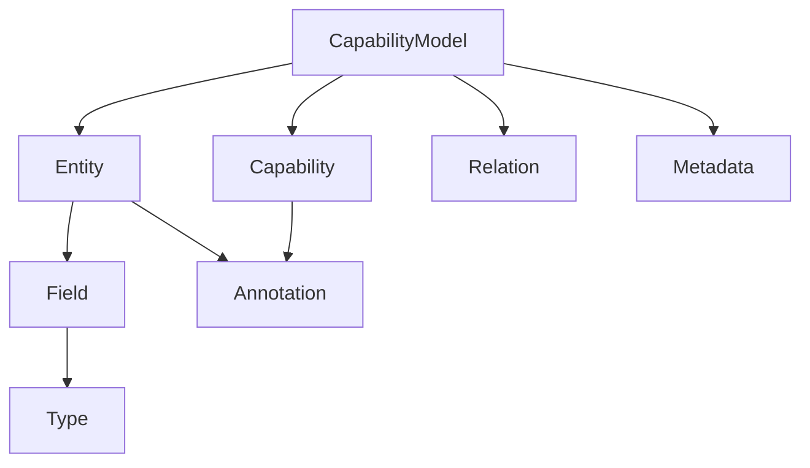

### 3. Objects, field by field (MVP)

#### 3.1 CapabilityModel (root)
| Field | Type | Meaning |
|---|---|---|
| module | string | The name of the modeled module or system |
| version | string | The IR schema version |
| entities | Entity[] | The business objects |
| capabilities | Capability[] | The actions the system can perform |
| relations | Relation[] | How entities relate |
| metadata | Metadata | Free-form, non-semantic annotations |

#### 3.2 Entity
| Field | Type | Meaning |
|---|---|---|
| name | string | Unique entity name within the module |
| fields | Field[] | The entity's fields |
| annotations | Annotation[] | Generic extension hooks |
| metadata | Metadata | Free-form |

#### 3.3 Field
| Field | Type | Meaning |
|---|---|---|
| name | string | Unique field name within the entity |
| type | Type | A primitive, or a reference to another entity |
| nullable | boolean | Whether the field may be absent |
| annotations | Annotation[] | Generic extension hooks |

#### 3.4 Capability
| Field | Type | Meaning |
|---|---|---|
| name | string | Unique capability name, in business terms (for example getProduct) |
| kind | enum | READ, WRITE, or ACTION. MVP uses READ only |
| inputs | map of string to Type | Named, typed inputs |
| output | Type | The result type, often an entity reference |
| readOnly | boolean | True if the capability has no side effects |
| binding | BindingRef | An opaque reference the runtime resolves to real logic. The IR never holds framework details |
| annotations | Annotation[] | Generic extension hooks |

> The binding is deliberately opaque in the IR. It names what to invoke, not how. The runtime and its ExecutionAdapter resolve it to a real bean or call. This keeps the IR neutral while still being executable.

#### 3.5 Relation
| Field | Type | Meaning |
|---|---|---|
| from | string | Source entity name |
| to | string | Target entity name |
| kind | enum | ONE_TO_ONE, ONE_TO_MANY, MANY_TO_ONE, MANY_TO_MANY |

#### 3.6 Annotation and Metadata
Annotation is a generic key with values, used as an extension hook so the IR can carry hints without growing new typed fields prematurely. Metadata is free-form key and value data that carries no semantic weight (for example, the source file a thing came from). Neither may smuggle framework concepts into semantics.

### 4. The primitive type system

The type system is closed. A type is either one of these primitives or a reference to an entity defined in the same model.

| Primitive | Notes |
|---|---|
| STRING | Text |
| LONG | 64-bit integer; common for identifiers |
| INTEGER | 32-bit integer |
| DECIMAL | Exact decimal, for money and quantities |
| BOOLEAN | True or false |
| UUID | Universally unique identifier |
| TIMESTAMP | A point in time |
| ENTITY_REF(name) | A reference to another entity in the model |

A closed set is chosen on purpose: it forces providers to map source types into a small, well-understood vocabulary, which keeps backends simple and the IR portable.

### 5. Validation rules

Structural rules, checked in `tibyan-core`:

1. Entity names are unique within the module; field names are unique within an entity.
2. Capability names are unique within the module.
3. Every type is a known primitive or an ENTITY_REF to an entity that exists.
4. Every relation's from and to refer to entities that exist.
5. A capability marked readOnly must not be of kind WRITE or ACTION.

A validation failure stops the pipeline before any generation, with a located, human-readable message.

### 6. Example IR (JSON)

```json
{
  "module": "inventory",
  "version": "0.1",
  "entities": [
    {
      "name": "Product",
      "fields": [
        { "name": "id",    "type": "LONG",    "nullable": false },
        { "name": "name",  "type": "STRING",  "nullable": false },
        { "name": "price", "type": "DECIMAL", "nullable": false }
      ]
    }
  ],
  "capabilities": [
    {
      "name": "getProduct",
      "kind": "READ",
      "inputs": { "id": "LONG" },
      "output": "ENTITY_REF(Product)",
      "readOnly": true,
      "binding": "inventory.ProductService#findById"
    }
  ],
  "relations": []
}
```

This is the MVP target: one entity, one read-only capability, a binding the runtime resolves to a real method.

### 7. Future elements (out of MVP scope)

These are the north star from Volume 1, section 9.1. They are specified here only as direction, and each enters through its own RFC (Volume 15) and a phase, never all at once.

| Element | What it will add | Enters via |
|---|---|---|
| Workflows | Multi-step processes spanning capabilities | RFC, later phase |
| Events | Occurrences the system emits or reacts to | RFC, later phase |
| Policies | Rules constraining how capabilities are used | RFC, later phase |
| Permissions | Who or what may invoke a capability | RFC, later phase |
| Dependencies | How capabilities and systems depend on each other | RFC, later phase |
| Domain knowledge | Meaning and context beyond structure | RFC, later phase |

> Discipline note: adding any of these to the core model is a deliberate, validated step with its own validators and tests. Until a phase needs an element, it stays out, so the MVP IR remains small and provable.

---

## Volume 5: Capability Providers

Status: Stable for the abstraction and the Spring provider. Future providers are described as direction. A Capability Provider is any source that produces Capability IR. It is the only part of the system that reads the original system, and it produces IR and nothing else.

---

### 1. The abstraction

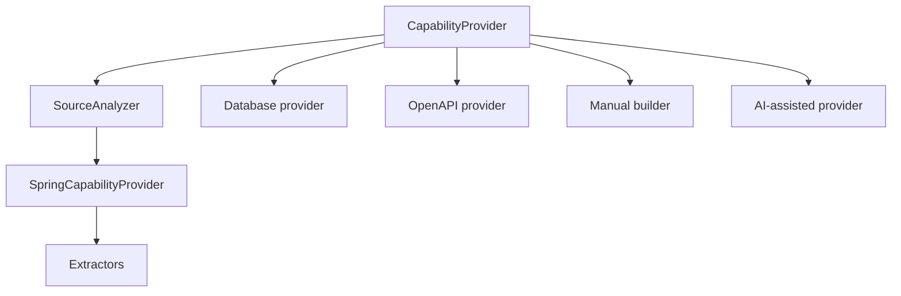

```java
public interface CapabilityProvider {
    CapabilityModel provide(ProviderInput input);
}
public interface SourceAnalyzer extends CapabilityProvider { }   // a provider that reads code
```

### 2. Why provider is broader than analyzer

Not every input analyzes source code. An OpenAPI file, a database schema, or a human using a manual builder all describe a system without any code analysis. If the top abstraction were named Analyzer, those inputs would not fit it, and the name would have to change later. CapabilityProvider is the general contract; SourceAnalyzer is the specialization for inputs that read code (ADR-0003).

### 3. The provider contract

A provider takes an input that identifies a source and returns a Capability IR. It must:

1. Produce only IR. It never generates output and never knows what backends exist.
2. Map source types into the closed primitive type system (Volume 4, section 4).
3. Be deterministic. The same source yields the same IR.
4. Depend only on the plugin API and the core, never on a backend or a runtime (Volume 12, section 5).

### 4. The Spring provider (MVP)

`SpringCapabilityProvider` is a SourceAnalyzer that reads a Spring and Java project from source using JavaParser (ADR-0010). It is organized as independent extractors, of which only the Entity extractor is enabled for the MVP (ADR-0011).

| Extractor | Reads | Status |
|---|---|---|
| EntityExtractor | Classes annotated as entities and their fields | MVP, enabled |
| RepositoryExtractor | Repository interfaces and their queries | Placeholder |
| ServiceExtractor | Service methods, to enrich capabilities | Placeholder |
| ControllerExtractor | Controllers, to learn exposed operations | Placeholder |
| AnnotationExtractor | Annotations, as generic hints | Placeholder |

The extractor pattern keeps the provider correct from day one and lets coverage grow without reshaping the module. Each extractor contributes part of the IR; the provider assembles and returns the whole.

### 5. Future providers

| Provider | Source | Why it matters |
|---|---|---|
| Database provider | A database schema | Proves the IR accepts a non-code source (Volume 13, P6) |
| OpenAPI provider | An OpenAPI document | Imports systems that already publish a contract |
| Manual builder | A human-authored definition | A fallback when no readable source exists |
| AI-assisted provider | Mixed or unclear sources, with model assistance | Helps where structure is implicit, with human review |
| Bytecode analyzer | Compiled classes | Reads systems whose source is unavailable |

Each new provider produces the same IR, so every existing backend and runtime works against it with no change. That is the entire point of the abstraction.

### 6. Rules

1. A provider feeds the IR and stops. It produces no output.
2. A provider never depends on a backend or a runtime.
3. A provider maps all source types into the closed primitive set; unknown types are a validation concern, not a silent passthrough.

---

## Volume 6: Backends

Status: Stable for the abstraction and the MCP backend. Future backends are described as direction. A Backend turns the Capability IR into an output shape. It reads only the IR, it never learns where the IR came from, and it never calls a framework directly.

---

### 1. The abstraction

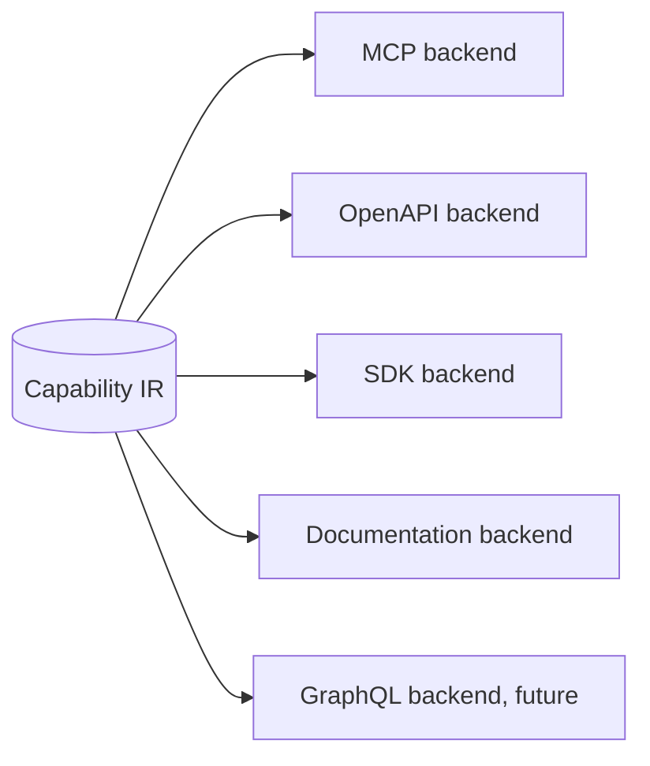

```java
public interface Backend {
    void generate(CapabilityModel ir, GenerationContext ctx);
}
```

The `GenerationContext` carries everything the backend needs that is not the IR: the output directory, the template settings, and the naming of the ExecutionAdapter the generated code will call. It does not carry any source or framework information.

### 2. Why backends never know the source

If a backend knew the system was Spring, that knowledge would leak into the backend, and every backend would need a branch per source technology. By reading only the IR, the MCP backend is identical whether the underlying system is Spring, .NET, or a database (ADR-0004). The cost of this rule is that execution must be indirected through the ExecutionAdapter rather than calling a service directly. That indirection is exactly what keeps backends portable.

### 3. The MCP backend (MVP)

The MCP backend emits a standards-conformant MCP server that exposes one tool per capability. Each generated tool:

1. Declares its inputs and output from the capability's typed signature.
2. On invocation, calls `ExecutionAdapter.invoke(capability, args)`. It never imports or calls a service class.
3. Returns the adapter's result to the agent.

```java
// generated tool body (sketch)
public Object call(Map<String,Object> args) {
    return executionAdapter.invoke(new CapabilityRef("getProduct"), args);
}
```

### 4. Future backends

| Backend | Output | Note |
|---|---|---|
| OpenAPI | An OpenAPI document | Proves the IR feeds more than one backend (Volume 13, P4) |
| SDK | Typed client libraries | Generated clients for the same capabilities (P5) |
| Documentation | Human-readable API docs | A side output from the same model |
| GraphQL | A GraphQL schema and resolvers | Has no controllers, which is why the IR must stay neutral (ADR-0013) |
| REST | A conventional REST surface | For systems that want a fresh, generated API |

Because each backend derives its own surface (a tool, an operation, a resolver) from capabilities, the IR never needs an Endpoint or Service concept. Those were deliberately removed from the IR (ADR-0013).

### 5. Templates and testing

Backends generate code from templates (Volume 16). Every backend is covered by golden-file tests: a fixed IR produces a fixed set of files, and any change to the output is a visible diff. This makes generation deterministic and reviewable.

### 6. Rules

1. A backend reads only the IR plus its GenerationContext.
2. A backend never depends on a provider, never depends on a runtime, and never calls a framework directly.
3. Generated code invokes logic only through the ExecutionAdapter.

---

## Volume 7: Runtime

Status: Stable for the Spring runtime's MVP responsibilities; later responsibilities are described as direction. This volume is intentionally detailed, because the runtime is where the generated layer meets the real system, and it is the part the Technical Spike (Volume 8) exists to prove.

---

### 1. Why the runtime exists

A backend produces generated code, but generated code does not run itself. Something must host it, connect it to the real system, and keep it alive. That something is the Runtime. In Tibyan's model, the runtime is what makes a legacy system AI-operable in practice: it places the generated MCP layer inside or beside the real application and binds each tool to real logic.

### 2. Why the runtime is not an ExecutionAdapter

These are often confused, so the distinction is stated plainly. The ExecutionAdapter is a small, stateless interface that answers one question: given a capability and arguments, run it and return a result. The Runtime is a whole hosting environment with many responsibilities, of which invoking a capability is only one. Folding the runtime into the adapter would mislabel an environment as a function and would, over time, stuff lifecycle and observability concerns into a place never meant to hold them (ADR-0006). A runtime contains an ExecutionAdapter; it is not one.

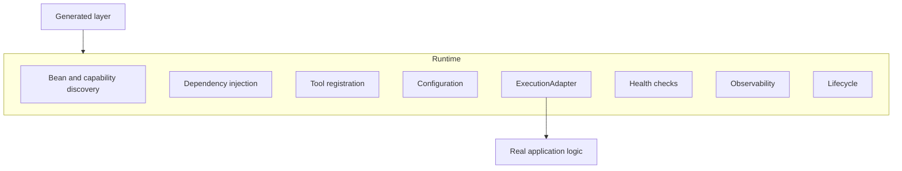

### 3. Runtime responsibilities

| Responsibility | What it does |
|---|---|
| Discovery | Finds the real beans and the capabilities the tools must reach |
| Dependency injection | Resolves the dependencies the generated and host code need |
| Tool registration | Registers the generated tools with the running MCP server |
| Configuration | Reads settings (transport, exposure, limits) from the host application |
| Execution | Invokes real logic through the ExecutionAdapter |
| Health checks | Reports whether the layer and its targets are ready and live |
| Observability | Emits logs, metrics, and traces for tool calls |
| Lifecycle | Starts the MCP server at startup and shuts it down cleanly |
| Runtime plugins | Allows runtime-level extensions (for example, an auth interceptor) later |

### 4. The Spring runtime (MVP)

`tibyan-runtime-spring` is distributed as a Spring Boot starter (ADR-0007). Adding one dependency activates auto-configuration, which discovers the target bean, registers the generated tools, provides the `SpringExecutionAdapter`, and starts the MCP server inside the application's own context. For the MVP, the responsibilities exercised are discovery, tool registration, bean access, and running the MCP server. Health, observability, and lifecycle hardening come later, but the structure is in place from the start.

```java
@AutoConfiguration
public class TibyanAutoConfiguration {
    @Bean ToolRegistrar toolRegistrar(ApplicationContext ctx) { /* register generated tools */ }
    @Bean SpringExecutionAdapter executionAdapter(ApplicationContext ctx) { /* resolve and invoke beans */ }
    @Bean McpServer tibyanMcpServer(ToolRegistrar reg) { /* start MCP inside this context */ }
}
```

### 5. Lifecycle

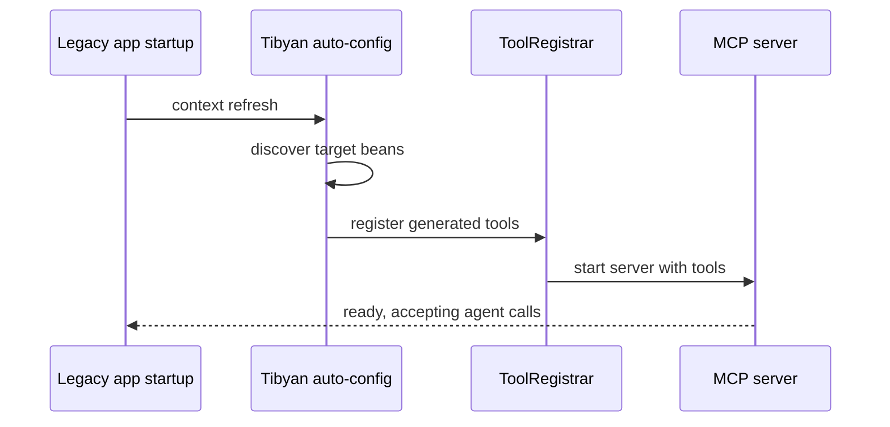

### 6. Future runtimes

| Runtime | Host | Note |
|---|---|---|
| Quarkus | A Quarkus application | Same role, different host (build-time DI) |
| Micronaut | A Micronaut application | Same role, compile-time injection |
| .NET | A .NET application | Crosses ecosystems; proves the runtime concept is not Java-only |

A new runtime is a peer that hosts the same generated layer. Backends do not change when a runtime is added (ADR-0006), because backends target the ExecutionAdapter contract, not a specific host.

### 7. Rules

1. The runtime hosts and binds; it contains no IR and no generation logic.
2. The runtime owns the ExecutionAdapter implementation for its host.
3. The runtime is the only place that knows how a capability's opaque binding maps to a real call.

---

## Volume 8: Technical Spike

Status: Active decision. This is the first thing that will be built. It comes before P0 and before the MVP.

> Note: A spike is a throwaway experiment. Its only purpose is to remove a technical unknown. Its code is not expected to ship. Lessons from it feed the real architecture.

---

### 1. Why a spike, and why before the MVP

The architecture is now well understood. The five abstractions (Provider, IR, Backend, ExecutionAdapter, Runtime) are agreed, and their responsibilities and dependency rules are clear. Continuing to refine names and interfaces on paper has reached diminishing returns.

One large unknown remains, and it cannot be answered by a diagram. It can only be answered by running code:

> Can a generated MCP layer be hosted inside a real legacy Spring application and call that application's real beans, so that an AI agent receives a real result, without modifying the application?

If the answer is no, the architecture changes. If the answer is yes, everything after it is ordinary engineering. A principle from large engineering organizations applies directly here: prove the hardest assumption first.

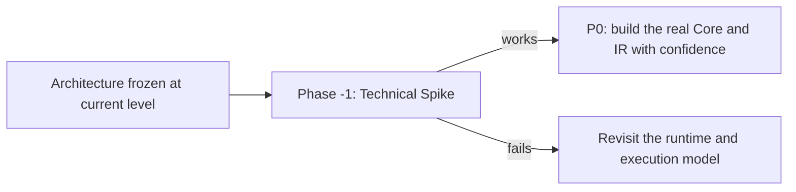

### 2. Goal

Demonstrate, with the smallest possible amount of code, that a Spring Boot application can expose one real capability to an AI agent through an MCP server that runs inside its own context.

### 3. Scope

#### 3.1 In scope
A tiny, hand-written setup:

```
legacy-app/
    Product.java
    ProductService.java        // findById returns a real product
    ProductController.java
tibyan-runtime-spring/          // hand written for the spike, not generated
    auto-configuration
    discovers ProductService
    registers ONE tool
    starts an MCP server inside the app context
```

The end-to-end path the spike must light up:

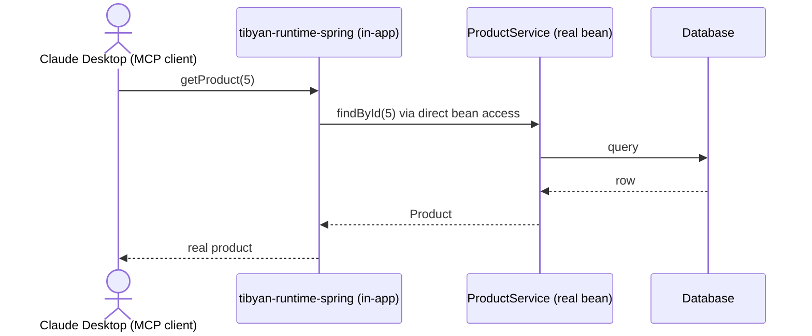

#### 3.2 Explicitly out of scope
The spike deliberately contains none of the real architecture:

| Excluded | Reason |
|---|---|
| Capability IR | Not needed to test runtime feasibility |
| Provider or Analyzer | The tool is hand-written, not derived |
| JavaParser | No source analysis in the spike |
| Backend or Generator | The tool is hand-written, not generated |
| CLI | Not needed |
| Plugin system | Not needed |

Everything above is hand-written and hard-coded. The spike answers one question only.

### 4. Success criteria

The spike succeeds when all of the following are true:

1. The Spring application starts normally with the runtime added.
2. The runtime discovers the real `ProductService` bean.
3. The runtime registers one tool and starts an MCP server inside the application context.
4. An MCP client (Claude Desktop) calls `getProduct(5)`.
5. The call reaches the real `ProductService.findById(5)`.
6. The real product is returned to the client from the real data store.
7. No file of the legacy app was edited other than adding the runtime dependency and minimal configuration.

### 5. Unknowns the spike will resolve

These are concrete questions that the spike, and only the spike, will answer:

| Unknown | What we will learn |
|---|---|
| Is the official MCP Java SDK suitable, or is the Spring AI MCP server starter a better base? | Which library to standardize on |
| Is a Spring Boot starter enough to host the MCP server in-context? | Whether the one-dependency promise holds |
| Is bean discovery straightforward? | How the runtime should find existing services |
| Is tool registration dynamic enough? | Whether tools can be registered at startup from data |
| Are there context or classloader problems running the server in-app? | Whether the in-context model is viable |
| Is reflection enough, or is bytecode tooling such as ByteBuddy needed? | The technique for binding tools to beans |
| Is auto-configuration enough to activate everything? | The activation model for the runtime |
| Transport: stdio for Claude Desktop, or HTTP? | The default transport for the runtime |

### 6. Risks

| Risk | Mitigation |
|---|---|
| Running an MCP server inside the app context causes conflicts | Keep the spike minimal; if it fails, switch the runtime model to a separate process and document the change |
| The chosen MCP library is immature | The spike tests exactly this; switching libraries is cheap at spike stage |
| Bean access requires intrusive configuration | If a single dependency is not enough, document the true minimal footprint honestly |

### 7. Expected result and exit

The expected result is that adding one dependency and minimal configuration is enough to host the MCP server and reach a real bean. If so, the runtime model in Volume 7 is validated and the project proceeds to P0 with confidence.

> Important environment note: this spike requires a live Spring context and a real MCP client connection. It must be run on a developer machine. It cannot be executed inside a documentation or sandbox environment. The deliverable for the spike is therefore a complete, copy-paste runnable package plus a runbook.

### 8. After the spike

Once the hardest assumption is proven, the build order follows Volume 13: P0 builds the real Core and IR, P1 builds the Spring provider, P2 builds the MCP backend, and the lessons from the spike are folded into `tibyan-runtime-spring`.

---

## Volume 9: Compiler Pipeline

Status: Stable. This volume explains the stages a run passes through, from a legacy system to a hosted, callable layer. It connects the abstractions in Volumes 5, 6, and 7 into one flow.

---

### 1. The pipeline at a glance

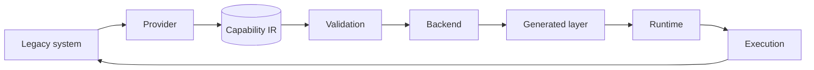

The pipeline is a straight line with one feedback edge: execution runs back against the original system. Each stage has a single responsibility and hands a well-defined artifact to the next.

### 2. The stages

#### 2.1 Provide
A `CapabilityProvider` reads a source and produces IR. For the MVP this is `SpringCapabilityProvider`, which uses JavaParser to read `.java` files and the enabled `EntityExtractor` to find entities and basic capabilities. The provider's only output is IR. It does not generate anything and does not know what backends exist.

Input: a path to a system. Output: an in-memory Capability IR.

#### 2.2 Represent
The IR is the neutral model: entities, fields, types, capabilities, relations. It is the single artifact every later stage reads. Nothing downstream ever reads the original source again. This is the property that makes the pipeline composable.

#### 2.3 Validate
Semantic validation runs over the IR only: duplicate names, unresolved references, unknown types against the closed primitive type system, and capability shape. Validation belongs to `tibyan-core` and has no framework knowledge. A failure here stops the pipeline with a located, human-readable error before any code is generated.

Input: IR. Output: the same IR, proven well-formed, or a validation error.

#### 2.4 Generate
A `Backend` reads the validated IR and produces an output shape. For the MVP this is `tibyan-backend-mcp`, which emits an MCP server exposing one tool per capability. The generated tool does not call a framework. It calls the `ExecutionAdapter`. The backend never learns that the source was Spring.

Input: validated IR plus a `GenerationContext`. Output: generated source files.

#### 2.5 Host and execute
A `Runtime` hosts the generated layer and binds it to the real system. For the MVP this is `tibyan-runtime-spring`, a Spring Boot starter that auto-configures inside the legacy application's context, registers the generated tools, and provides the `SpringExecutionAdapter`. When an agent calls a tool, the adapter invokes the real bean, for example `ProductService.findById`, and returns the real result.

Input: the generated layer plus the live application context. Output: a running, callable MCP layer over the real system.

### 3. Orchestration

`tibyan-pipeline` owns the sequence: provide, validate, generate. It does not contain provider, backend, or runtime logic; it composes them. Hosting is the runtime's job and happens in the target application, not in the pipeline. The CLI (Volume 11) is a thin caller of the pipeline.

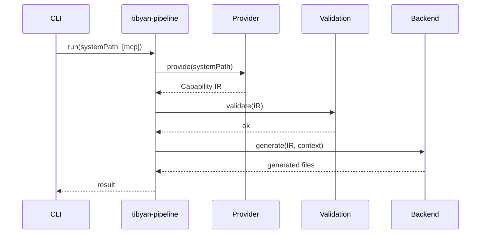

### 4. Where future stages attach

The pipeline does not change when the project grows. A second provider attaches at Provide. A second backend attaches at Generate. A second runtime attaches at Host. Workflows, permissions, and events enter as richer IR at Represent, and the validators that check them are added at Validate. No stage is rewritten; each simply gains more of the same kind of plugin.

---

## Volume 10: Plugin System

Status: Stable for the model; service discovery and versioning details are pinned as the first plugins are built. Tibyan is plugin based by design: providers, backends, and runtimes are plugins around a small, stable core. This volume defines how plugins are discovered, loaded, isolated, versioned, and, eventually, shared.

---

### 1. Why plugins

A platform that must span many sources, outputs, and hosts cannot be a monolith. If every new source or output required editing a central file, the core would never be stable. Plugins invert this: the core and the plugin API stay fixed, and capability is added from the outside. This is what lets a contributor add a backend or a provider without touching anything else (ADR-0012).

### 2. Discovery

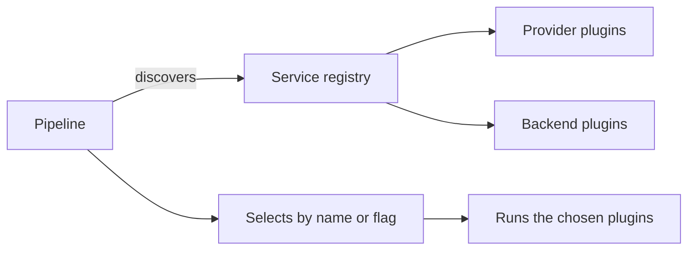

Plugins are discovered at run time through a service registry. On the JVM this is the standard service-provider mechanism (the Java ServiceLoader, or Spring's equivalent). Each plugin module declares which contract it implements. The pipeline asks the registry for available providers and backends and selects the ones the run needs, by name or by a command-line flag. The composition root never hard-codes a list of plugins.

### 3. Loading and isolation

Each plugin is its own module with its own dependencies (Volume 12, section 4). A plugin carries the libraries it needs (JavaParser for the Spring provider, an MCP library for the runtime) without forcing those libraries on any other plugin. The rule that one module contains exactly one plugin is what keeps dependencies isolated; bundling two plugins would merge their dependency trees and defeat the purpose.

### 4. Lifecycle

| Phase | What happens |
|---|---|
| Register | The plugin declares its contract in the service registry |
| Discover | The pipeline finds it at run time |
| Select | The run chooses it by name or flag |
| Execute | The plugin runs its single responsibility (provide, generate, or host) |

Plugins are stateless with respect to each other. A provider does not know which backend will consume its IR, and a backend does not know which provider produced it.

### 5. Dependency rules

1. A plugin depends only on the plugin API and the core.
2. A plugin never depends on another plugin.
3. One plugin per module, so dependency trees stay separate.

### 6. Versioning

The plugin API is the compatibility boundary. It is kept small on purpose, so it can stay stable while implementations evolve. A plugin declares the plugin API version it targets. A breaking change to the plugin API is a deliberate, versioned event with its own migration notes, because every plugin depends on it. The core's stability is the whole reason plugins are safe to write.

### 7. Future: a plugin marketplace

Once the plugin API has proven stable across several providers, backends, and runtimes, third-party plugins become viable, and a marketplace of community providers, backends, and runtimes can grow around the core. This is a long-term outcome, not an MVP feature, and it depends entirely on the plugin API having earned its stability first.

---

## Volume 11: CLI Specification

Status: Stable for the MVP commands; future commands are listed as direction. The CLI is a thin caller of the pipeline (Volume 9). It parses arguments and invokes provide, validate, and generate. It contains no compiler logic of its own. It is built with picocli (Volume 16).

---

### 1. Overview

The CLI binary is `tibyan`. It exposes a small set of commands that map directly onto pipeline stages. Hosting the generated layer is the runtime's job inside the target application, so the CLI stops at generation.

### 2. Commands (MVP)

| Command | Purpose | Key options |
|---|---|---|
| tibyan scan | Read a system and produce IR | path (positional), --out (IR JSON file) |
| tibyan generate | Generate a backend from IR | --backend (for example mcp), --ir (IR file) or path, --out (output dir) |
| tibyan validate | Validate an IR without generating | --ir (IR file) |
| tibyan version | Print the tool and IR schema versions | none |

### 3. Examples and expected output

```text
$ tibyan scan ./legacy-spring-app --out inventory.ir.json
Scanning ./legacy-spring-app
Provider: spring (entity extractor)
Found 1 entity (Product), 1 capability (getProduct)
Validation: ok
Wrote IR to inventory.ir.json
```

```text
$ tibyan generate --backend mcp --ir inventory.ir.json --out ./generated/inventory-mcp
Loading IR inventory.ir.json
Validation: ok
Backend: mcp
Generated 1 tool (getProduct)
Wrote 3 files to ./generated/inventory-mcp
```

```text
$ tibyan validate --ir inventory.ir.json
Validation: ok (1 entity, 1 capability, 0 relations)
```

```text
$ tibyan scan ./broken-app --out out.ir.json
Scanning ./broken-app
Validation: FAILED
  - capability 'getOrder' returns ENTITY_REF(Order) but no entity 'Order' is defined
Exit code 2
```

### 4. Exit codes

| Code | Meaning |
|---|---|
| 0 | Success |
| 1 | Usage error (bad arguments) |
| 2 | Validation failure |
| 3 | Provider or backend error |

### 5. Future commands

| Command | Purpose |
|---|---|
| tibyan diff | Show what changed in the IR or the generated output between two runs |
| tibyan init | Scaffold a Tibyan configuration in a project |
| tibyan serve | Run a generated layer locally for testing, outside a host application |
| tibyan list | List available providers and backends discovered as plugins |

Future commands follow the same rule: they call the pipeline or the plugin registry, and they hold no compiler logic themselves.

---

## Volume 12: Project Structure

Status: Stable for the MVP and its near neighbors. This volume defines the final module layout, what each module is for, and the dependency rules that protect the architecture. The structure is the architecture made physical: if the modules and their allowed dependencies are correct, the design in Volumes 3 to 7 cannot quietly rot.

---

### 1. Build system

Maven multi-module, with a parent aggregator POM. Gradle would work identically; Maven is chosen because it is the most common in the Spring and Java world that the first provider and runtime target, so generated and host projects feel native.

Package root for all modules: `com.tibyaan`.

### 2. The module map at a glance

The top-level module layout, which is the structure most contributors need day to day:

```
tibyan/
├── tibyan-core/                  # IR + semantic validation, zero dependencies
├── tibyan-plugin-api/            # CapabilityProvider · Backend · ExecutionAdapter
├── tibyan-provider-spring/       # JavaParser + EntityExtractor (the rest are placeholders)
├── tibyan-backend-mcp/           # IR -> MCP tools (talks to ExecutionAdapter)
├── tibyan-runtime-spring/        # Spring Boot starter:
│                                 #   MVP:   auto-config + tool registration + bean access + run MCP
│                                 #   later: discovery · health · observability · lifecycle
├── tibyan-pipeline/              # provide -> IR -> generate
├── tibyan-cli/                   # tibyan scan / tibyan generate
├── tibyan-it/                    # end-to-end: a real product comes back from ProductService
└── generated/                    # gitignored
```

The expanded version below shows the same modules with their internal package layout.

### 3. The expanded tree

```
tibyan/
|-- pom.xml                         # parent / aggregator, dependency management
|-- README.md
|-- docs/                           # this documentation set
|-- examples/
|   `-- legacy-spring-app/          # a small real Spring app used by tests and the spike
|
|-- tibyan-core/                    # IR + semantic validation. ZERO external deps
|   `-- src/main/java/com/tibyaan/core/
|       |-- ir/                     # the model: Module, Entity, Field, Type,
|       |                           #            Capability, Relation, Annotation, Metadata
|       `-- semantic/               # validators over the IR only
|
|-- tibyan-plugin-api/              # the three contracts. Depends on core only
|   `-- src/main/java/com/tibyaan/plugin/
|       |-- CapabilityProvider.java # input abstraction (broadest)
|       |-- SourceAnalyzer.java     #   a CapabilityProvider that reads code
|       |-- Backend.java            # output abstraction
|       |-- ExecutionAdapter.java   # how a capability is executed
|       `-- GenerationContext.java  # what a Backend receives
|
|-- tibyan-provider-spring/         # Spring source -> IR (JavaParser)
|   `-- src/main/java/com/tibyaan/provider/spring/
|       |-- SpringCapabilityProvider.java
|       `-- extractors/
|           |-- EntityExtractor.java        # MVP: enabled
|           |-- RepositoryExtractor.java     # placeholder
|           |-- ServiceExtractor.java        # placeholder
|           |-- ControllerExtractor.java     # placeholder
|           `-- AnnotationExtractor.java      # placeholder
|
|-- tibyan-backend-mcp/             # IR -> MCP server code. Talks to ExecutionAdapter
|   `-- src/main/
|       |-- java/com/tibyaan/backend/mcp/
|       `-- resources/templates/mcp/
|
|-- tibyan-runtime-spring/          # Spring Boot starter that hosts the layer in-context
|   `-- src/main/
|       |-- java/com/tibyaan/runtime/spring/
|       |   |-- TibyanAutoConfiguration.java
|       |   |-- ToolRegistrar.java
|       |   `-- SpringExecutionAdapter.java   # the MVP ExecutionAdapter implementation
|       `-- resources/META-INF/spring/        # auto-configuration registration
|
|-- tibyan-pipeline/                # orchestration: provide -> validate -> generate
|   `-- src/main/java/com/tibyaan/pipeline/
|       `-- TibyanCompiler.java
|
|-- tibyan-cli/                     # picocli entry point
|   `-- src/main/java/com/tibyaan/cli/
|       `-- TibyanCli.java          # tibyan scan / tibyan generate
|
|-- tibyan-it/                      # integration + golden-file + end-to-end tests
|   `-- src/test/...
|
`-- generated/                     # output of a run. gitignored
```

Later modules slot in without changing anything above: `tibyan-backend-openapi`, `tibyan-backend-sdk`, `tibyan-provider-database`, `tibyan-provider-dotnet`, `tibyan-runtime-quarkus`, each as its own module depending only on the plugin API and core.

### 4. Module responsibilities

| Module | Responsibility | Must not |
|---|---|---|
| tibyan-core | Hold the IR and validate it | Depend on any framework, provider, backend, or runtime |
| tibyan-plugin-api | Define CapabilityProvider, Backend, ExecutionAdapter | Depend on any concrete provider, backend, or runtime |
| tibyan-provider-spring | Read Spring source and produce IR | Depend on any backend or runtime; produce any output |
| tibyan-backend-mcp | Turn IR into MCP server code | Know the source; call a framework directly; depend on a runtime |
| tibyan-runtime-spring | Host the generated layer and bind to real beans | Contain IR or generation logic |
| tibyan-pipeline | Orchestrate provide, validate, generate | Contain provider, backend, or runtime logic itself |
| tibyan-cli | Parse commands and call the pipeline | Contain compiler logic |
| tibyan-it | Test across modules end to end | Be depended on by any production module |

### 5. Dependency rules

The dependency graph is intentionally a shallow tree with the core at the root. Arrows mean "is allowed to depend on."

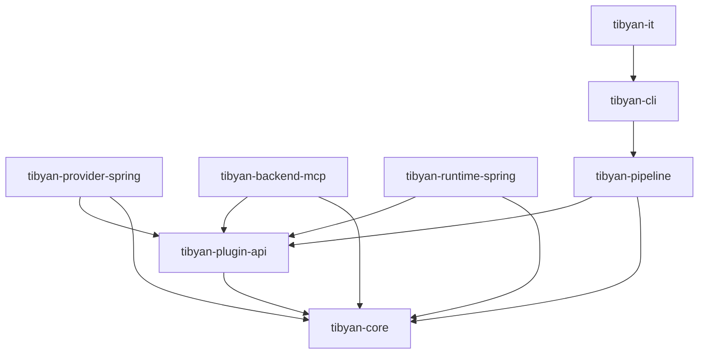

Allowed:

| From | May depend on |
|---|---|
| plugin-api | core |
| any provider | plugin-api, core |
| any backend | plugin-api, core |
| any runtime | plugin-api, core |
| pipeline | plugin-api, core (and discovers providers and backends at run time) |
| cli | pipeline |
| it | cli and everything, for tests only |

Forbidden, and these are the rules that keep the architecture honest:

1. core depends on nothing. Not Spring, not JavaParser, not an MCP library. If core needs an import from any of those, a concept has leaked and must move out.
2. A backend never depends on a provider. Backends read IR, never source.
3. A backend never depends on a runtime, and never calls a framework directly. It goes through ExecutionAdapter.
4. A provider never depends on a backend. Providers feed the IR and stop.
5. No module bundles two plugins. One provider, one backend, or one runtime per module, so dependencies stay isolated.

A simple test for any proposed dependency: if it would let a framework name appear inside `tibyan-core`, or let a backend learn what the source technology was, it is forbidden.

### 6. What the runtime produces, and where

A run writes a normal, runnable Spring project into `generated/`, for example:

```
generated/inventory-mcp/
|-- pom.xml
`-- src/main/
    |-- java/com/example/inventory/mcp/
    |   |-- GetProductTool.java        # generated MCP tool, calls ExecutionAdapter
    |   `-- McpServerConfig.java        # registers tools
    `-- resources/
        `-- application.yml
```

In the starter model (MVP), this generated code is hosted by `tibyan-runtime-spring` inside the legacy application's own context, so the tool reaches the real `ProductService` bean. The generated code never imports Spring service classes directly; it asks the ExecutionAdapter to invoke the capability.

### 7. Why this structure and not a simpler one

A single module would be faster to start and would destroy the architecture within weeks, because nothing would stop the IR from importing Spring or a backend from calling a service. The module boundaries are not bureaucracy; they are the compiler that enforces the design. The cost is more POM files. The benefit is that the rules in section 4 are checked by the build, not by discipline alone.

---

## Volume 13: Development Roadmap

Status: Stable. This roadmap is brownfield-first and spike-first. Each phase has milestones, deliverables, and exit criteria. A phase is not started until the previous phase meets its exit criteria.

---

### 1. Sequencing principle

Two rules order everything:

1. Prove the hardest assumption first. The runtime binding is the largest unknown, so a Technical Spike comes before any other work (Volume 8).
2. Build in thin vertical slices. Each phase keeps something that runs end to end and grows it, rather than building a layer in isolation.

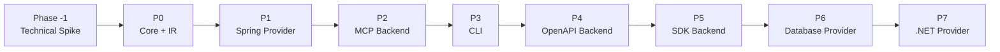

### 2. Phases

#### Phase -1: Technical Spike
| Field | Detail |
|---|---|
| Goal | Prove a generated MCP layer can run inside a real Spring app and call a real bean |
| Deliverables | A runnable spike package and a runbook (Volume 8) |
| Milestone | An AI agent calls getProduct(5) and gets a real result |
| Exit criteria | All Volume 8 success criteria met, or a documented decision to change the runtime model |

#### P0: Core and IR
| Field | Detail |
|---|---|
| Goal | Build the real Capability IR and its semantic validation, with zero framework dependencies |
| Deliverables | `tibyan-core` with IR types and validators; `tibyan-plugin-api` with the three contracts |
| Milestone | A hand-built IR validates and round-trips to and from JSON |
| Exit criteria | IR documented (Volume 4); a sample IR validates; core has zero forbidden dependencies |

#### P1: Spring Provider
| Field | Detail |
|---|---|
| Goal | Read a real Spring project from source and produce IR |
| Deliverables | `tibyan-provider-spring` using JavaParser; the Entity extractor enabled, others as placeholders |
| Milestone | Scanning a real project yields a correct IR for at least one entity and one capability |
| Exit criteria | A real Spring module produces a valid IR; provider has no backend or runtime dependency |

#### P2: MCP Backend
| Field | Detail |
|---|---|
| Goal | Generate an MCP server from the IR, executing through the Execution Adapter |
| Deliverables | `tibyan-backend-mcp`; `tibyan-runtime-spring` graduated from the spike; `SpringExecutionAdapter` |
| Milestone | One definition flows scan to IR to MCP to a real bean call, end to end |
| Exit criteria | The MVP acceptance criteria in Volume 2 are met against a real, unmodified Spring system |

#### P3: CLI
| Field | Detail |
|---|---|
| Goal | Make the pipeline usable from the command line |
| Deliverables | `tibyan-cli` with scan and generate commands; `tibyan-pipeline` orchestration |
| Milestone | `tibyan scan` and `tibyan generate` run the full flow |
| Exit criteria | A developer can modernize a system using only the CLI |

#### P4: OpenAPI Backend
| Field | Detail |
|---|---|
| Goal | Prove the IR feeds more than one backend |
| Deliverables | `tibyan-backend-openapi` |
| Milestone | The same IR produces both MCP and OpenAPI |
| Exit criteria | OpenAPI output is generated with no provider changes |

#### P5: SDK Backend
| Field | Detail |
|---|---|
| Goal | Generate typed client SDKs from the IR |
| Deliverables | `tibyan-backend-sdk` |
| Milestone | A typed client is generated and calls a generated server |
| Exit criteria | SDK output is generated with no provider or runtime changes |

#### P6: Database Provider
| Field | Detail |
|---|---|
| Goal | Prove the IR accepts more than one source |
| Deliverables | A database schema provider that produces IR |
| Milestone | The same backends work on an IR built from a database |
| Exit criteria | A second provider feeds the same IR with no backend changes |

#### P7: .NET Provider
| Field | Detail |
|---|---|
| Goal | Prove the platform crosses ecosystems |
| Deliverables | A .NET source provider that produces IR |
| Milestone | A .NET system is modernized through the same backends |
| Exit criteria | A non-Java system produces a valid IR; the modernization layer works unchanged |

### 3. What each phase proves about the architecture

| Phase | Architectural claim it validates |
|---|---|
| Spike | The runtime can bind to a real legacy system |
| P0 | The IR can stand alone, framework-free |
| P1 | A provider can feed the IR from real source |
| P2 | A backend plus an adapter can execute against the real system |
| P4, P5 | One IR feeds many backends |
| P6, P7 | One IR accepts many providers and crosses ecosystems |

### 4. Guardrail

Workflows, permissions, and events are intentionally absent from the early phases. They are real parts of the long-term IR (Volume 4), but they are not on the critical path to proving modernization. They are scheduled only after the brownfield loop is proven end to end.

---

## Volume 14: Architecture Decision Records (ADR)

Status: Living document. Each ADR records one decision, the context that forced it, the decision itself, and its consequences, alternatives, and tradeoffs. ADRs are the backbone of the project: every other volume defers to these.

Format: each record uses Status, Context, Decision, Consequences, Alternatives, Tradeoffs.

### Index

| ADR | Title | Status |
|---|---|---|
| 0001 | Capability IR as the single source of truth | Accepted |
| 0002 | Brownfield modernization over greenfield generation | Accepted |
| 0003 | CapabilityProvider as the input abstraction | Accepted |
| 0004 | Backends never know the source and never call frameworks | Accepted |
| 0005 | ExecutionAdapter separates generation from execution | Accepted |
| 0006 | Runtime is a first-class concept, distinct from the adapter | Accepted |
| 0007 | Spring Boot starter as the first runtime distribution | Accepted |
| 0008 | A Technical Spike runs before the MVP | Accepted |
| 0009 | Java and Spring as the first target stack | Accepted |
| 0010 | Source analysis via AST (JavaParser) for the MVP | Accepted |
| 0011 | Modular extractors in the Spring provider | Accepted |
| 0012 | Plugin based, per-module providers, backends, and runtimes | Accepted |
| 0013 | Keep the IR free of framework concepts (drop Endpoint and Service) | Accepted |
| 0014 | Thin vertical slice for the MVP scope | Accepted |
| 0015 | Position as an AI-operable business platform; the semantic model is the moat | Accepted |

---

### ADR-0001: Capability IR as the single source of truth

**Status:** Accepted

**Context.** Tibyan must accept many kinds of input (Spring source today, databases and other languages later) and produce many kinds of output (MCP today, OpenAPI, SDKs, docs later). If inputs talked to outputs directly, the system would become an N by M tangle, where every new input or output multiplies the integrations to maintain.

**Decision.** Place a neutral, framework-free Capability IR at the center. Every input produces IR. Every output consumes IR. Nothing reads the original input except the provider that produced the IR.

**Consequences.** Adding an input is writing one provider. Adding an output is writing one backend. Neither touches the other. The IR becomes the durable asset of the project, more stable than any framework or protocol.

**Alternatives.** Direct input-to-output translation (rejected: N by M explosion). A framework-specific model such as a Spring model (rejected: leaks framework concepts and blocks other stacks).

**Tradeoffs.** A neutral IR is an extra layer with its own design cost, and some source detail is intentionally dropped at the boundary. This cost is paid once and repaid by every provider and backend after it.

---

### ADR-0002: Brownfield modernization over greenfield generation

**Status:** Accepted

**Context.** The project could target new projects (write a definition, generate an app) or existing systems (read a running system, add a modern layer). The greenfield market is saturated with scaffolders and code generators. The expensive, unsolved problem in industry is that large legacy systems cannot adopt AI without a risky rewrite.

**Decision.** Tibyan is brownfield-first. Its primary input is a system that already exists, and its output is a modern layer added on top, with the original system never edited.

**Consequences.** The first real module is a provider that reads an existing system, not a parser for a new language. The commercial message becomes modernize without rewrite, which is stronger and less crowded.

**Alternatives.** Greenfield generation (rejected as the primary direction: low differentiation, low value). A hybrid that leads with greenfield (rejected as the headline, but greenfield remains a possible stepping stone for testing the core).

**Tradeoffs.** Reading messy real-world systems is much harder than reading a clean definition file. This difficulty is accepted because it is exactly where the defensible value is.

---

### ADR-0003: CapabilityProvider as the input abstraction

**Status:** Accepted

**Context.** Source code analysis is only one way to learn what a system can do. Future inputs include OpenAPI import, database schema import, a manual builder, and AI-assisted import. Not all of these analyze source code, so an interface named Analyzer would be too narrow.

**Decision.** The input contract is `CapabilityProvider`, defined as any source that produces IR. `SourceAnalyzer` is a specialization of it for inputs that analyze code, and the Spring provider is a specialization of that.

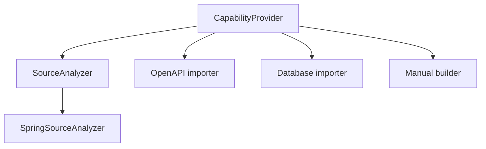

**Consequences.** Every input is a peer that produces the same IR. Adding a non-code input later requires no change to the abstraction.

**Alternatives.** Name the input Analyzer (rejected: excludes non-analysis inputs and would need renaming later).

**Tradeoffs.** A more general name is slightly more abstract up front. The generality is justified by the known future inputs.

---

### ADR-0004: Backends never know the source and never call frameworks

**Status:** Accepted

**Context.** A backend turns IR into an output such as an MCP server. If a backend called `ProductService` directly, it would know the system is Spring, and that framework knowledge would spread into every backend.

**Decision.** Backends read only the IR. They never depend on a provider, never depend on a runtime, and never call a framework directly. When a generated tool must execute logic, it goes through the Execution Adapter.

**Consequences.** A backend works for every system any provider can describe. The MCP backend is identical whether the underlying system is Spring, .NET, or a database.

**Alternatives.** Let backends call services directly (rejected: couples backends to frameworks and to the source).

**Tradeoffs.** Execution must be indirected through an adapter, which is one more interface. This indirection is the precise thing that keeps backends portable.

---

### ADR-0005: ExecutionAdapter separates generation from execution

**Status:** Accepted

**Context.** A generated MCP tool needs to actually run something. Binding the tool to a specific mechanism (a Spring bean) would mix two different concerns: producing the tool and executing it. It would also lock execution to one mechanism.

**Decision.** Introduce `ExecutionAdapter`, a small abstraction that answers one question: given a capability and arguments, run it and return a result. Concrete adapters include a Spring bean adapter, a REST adapter, a message queue adapter, and later gRPC.

```mermaid
flowchart LR
    Tool[Generated MCP tool] --> EA[ExecutionAdapter]
    EA --> SB[Spring bean]
    EA --> REST[REST call]
    EA --> MQ[Message queue]
    EA --> GRPC[gRPC]
```

**Consequences.** The MCP backend stays constant while the way a tool is executed varies behind the adapter. The same generated layer can bind to a real bean now and to REST for systems where the source is not available.

**Alternatives.** Generate code that calls the service directly (rejected: couples generation to one execution mechanism and to Spring).

**Tradeoffs.** One more abstraction to design and implement. It pays for itself the first time a second execution mechanism is needed.

---

### ADR-0006: Runtime is a first-class concept, distinct from the adapter

**Status:** Accepted

**Context.** The Execution Adapter is small and stateless: invoke a capability. But hosting the generated layer requires much more: discovering beans, registering tools, dependency injection, configuration, lifecycle, health, and observability. Calling all of that an adapter would mislabel a hosting environment as a simple function.

**Decision.** Separate the two. `ExecutionAdapter` is the small invocation interface. `Runtime` is the host environment that owns discovery, registration, dependency injection, lifecycle, configuration, health, and observability. A concrete runtime such as `tibyan-runtime-spring` contains an Execution Adapter as one of its parts.

**Consequences.** Future runtimes (Quarkus, Micronaut, .NET) are first-class peers. The naming protects the design: runtime-level concerns do not get stuffed into the adapter.

**Alternatives.** Keep one combined adapter concept (rejected: conflates a function with a hosting environment and would degrade over time).

**Tradeoffs.** Two concepts instead of one. The separation is justified by the very different lifecycles and responsibilities.

---

### ADR-0007: Spring Boot starter as the first runtime distribution

**Status:** Accepted

**Context.** To bind a generated tool to a real bean, the generated layer must reach the running application's beans. It can run inside the application's context or as a separate process. The product promise is to add AI with minimal change to the system.

**Decision.** For the MVP, distribute `tibyan-runtime-spring` as a Spring Boot starter. The company adds one dependency, auto-configuration activates, the runtime discovers the target bean, registers a tool, and starts the MCP server inside the application's own context.

**Consequences.** The promise becomes concrete: add one dependency and your system can talk to AI. The runtime has direct access to real beans, which is what makes a real binding possible.

**Alternatives.** A separate process talking over REST or the database (rejected for the MVP: no direct bean access, which defers the hardest assumption). It remains a valid option for systems where the source is unavailable, served later by a REST execution adapter.

**Tradeoffs.** Requires adding one dependency to the target build. This is judged acceptable and minimal, and far less invasive than editing the system.

---

### ADR-0008: A Technical Spike runs before the MVP

**Status:** Accepted

**Context.** The largest unknown is whether the runtime can host the generated layer in-context and reach a real bean. This cannot be answered on paper. Continuing to refine names and interfaces yields diminishing returns.

**Decision.** Freeze the architecture at the current level and build a Technical Spike (Volume 8) before P0. The spike contains no IR, no provider, no backend, no CLI. It exists only to prove the runtime binding, end to end, against a real Spring app and a real MCP client.

**Consequences.** If the spike fails, the architecture is corrected before significant work is built on a false assumption. If it succeeds, everything after it is ordinary engineering.

**Alternatives.** Go straight to the MVP (rejected: risks building the full stack on an unproven runtime assumption).

**Tradeoffs.** A short delay before MVP work begins. This is cheaper than discovering the problem after building providers, backends, and a CLI.

---

### ADR-0009: Java and Spring as the first target stack

**Status:** Accepted

**Context.** Tibyan must eventually support many stacks, but the MVP needs one. The maintainer's deepest expertise is Java and Spring, and Spring is one of the most common legacy business stacks.

**Decision.** The first provider, runtime, and target system are all Java and Spring. Other stacks (.NET, PHP) are explicitly deferred and added later as plugins that produce the same IR.

**Consequences.** Fastest path to a working end-to-end result. Adding a stack later is a new provider, not a redesign, because the IR and backends are framework-neutral.

**Alternatives.** Start multi-stack (rejected: multiplies effort before the core is proven).

**Tradeoffs.** Early validation is limited to one ecosystem. The neutral IR ensures this does not bias the core.

---

### ADR-0010: Source analysis via AST (JavaParser) for the MVP

**Status:** Accepted

**Context.** A Spring project can be read by reflection (needs the app compiled and running), by bytecode (reads compiled classes), or by AST (reads the source files). The MVP needs to read entities and capabilities from real source quickly.

**Decision.** Use AST analysis with JavaParser for the MVP provider. Read the source files, walk the tree, find annotations such as `@Entity` and their fields, and build the IR. Add a bytecode analyzer later for cases where source is unavailable.

**Consequences.** No need to compile or run the target to analyze it. Fast to implement and reason about.

**Alternatives.** Reflection (rejected: requires running the target, limited). Bytecode first (rejected for MVP: more complex than needed initially, kept for later when source is absent).

**Tradeoffs.** AST analysis can miss information only present at runtime or in bytecode. Acceptable for the MVP, covered later by an additional analyzer.

---

### ADR-0011: Modular extractors in the Spring provider

**Status:** Accepted

**Context.** A full Spring provider must eventually read entities, repositories, services, controllers, and annotations. Implementing all of these before the first result would delay any working output for a long time.

**Decision.** Structure the Spring provider as independent extractors (Entity, Repository, Service, Controller, Annotation) from the start, but enable only the Entity extractor for the MVP. The others exist as placeholders and are filled in during later phases.

**Consequences.** The architecture is right from day one, and scope is controlled. Adding an extractor later does not change the provider's shape.

**Alternatives.** A single monolithic analyzer (rejected: hard to extend and test). Build all extractors before shipping (rejected: delays the first result).

**Tradeoffs.** Slightly more structure up front. It is layout only, not extra logic, so the cost is minimal.

---

### ADR-0012: Plugin based, per-module providers, backends, and runtimes

**Status:** Accepted

**Context.** Providers, backends, and runtimes each carry their own dependencies. Grouping several into one module (for example one backends module containing Spring, MCP, OpenAPI, and TypeScript) would pull all of their dependencies together and destroy the isolation the plugin design promises.

**Decision.** Each provider, backend, and runtime is its own module, depending only on the plugin API and the core. The CLI or pipeline composes whichever are needed, later via service discovery.

**Consequences.** True isolation. A contributor can add a new backend or provider without touching any other module. Dependencies stay contained.

**Alternatives.** A single backends module with sub-packages (rejected: merges dependencies and breaks isolation).

**Tradeoffs.** More modules to manage. Build tooling handles this, and the isolation is worth it.

---

### ADR-0013: Keep the IR free of framework concepts (drop Endpoint and Service)

**Status:** Accepted

**Context.** Early IR sketches included Endpoint and Service. These are REST and Spring concepts. If they live in the neutral IR, backend and framework concerns leak into the contract that everything depends on.

**Decision.** Remove Endpoint and Service from the IR. The IR holds entities, capabilities, types, relations, and generic extension hooks (Annotation, Metadata). Each backend derives its own endpoints or services from capabilities.

```mermaid
flowchart LR
    Cap[Capability] --> SB[Spring backend: Controller]
    Cap --> MCP[MCP backend: Tool]
    Cap --> OAPI[OpenAPI backend: Operation]
```

**Consequences.** The IR stays neutral and durable. A future GraphQL backend, which has no controllers, is not contradicted by the model.

**Alternatives.** Keep Endpoint and Service in the IR (rejected: framework leakage into the core contract).

**Tradeoffs.** Each backend must compute its own surface from capabilities. This is the correct place for that logic.

---

### ADR-0014: Thin vertical slice for the MVP scope

**Status:** Accepted

**Context.** The temptation is to read an entire legacy system (entities, repositories, services, controllers) and bind all of it at once. This buries the hardest unknown (the runtime binding) under months of analysis work.

**Decision.** The MVP slice is intentionally tiny: one entity (Product), one read-only capability (getProduct), and one real binding to existing logic (`ProductService.findById`). Prove the whole path on the smallest surface, then widen it.

**Consequences.** The hardest step (in-context hosting and real bean access) is proven in weeks, not months. After it works, create and the rest are repetition, not unknowns.

**Alternatives.** Read and bind the whole system from the first slice (rejected: delays discovery of binding problems and risks weeks of wasted analysis).

**Tradeoffs.** The first result is deliberately small. That is the point: smallest surface, hardest risk, earliest proof.


---

### ADR-0015: Position as an AI-operable business platform, with the semantic model as the moat

**Status:** Accepted

**Context.** The vision was first framed as an AI-native platform, and the differentiator was implicitly MCP generation. Two risks follow. First, AI-native is vague and does not state what the product does. Second, MCP generation will be commoditized the moment frameworks such as Spring or .NET ship native MCP support, which would erase a product whose value is only protocol output. The positioning and the moat both need to be sharper and more durable, without changing the architecture.

**Decision.** Position Tibyan as an AI-operable business platform: existing systems that AI agents can operate, meaning read data, take actions, and run workflows, not merely expose over a protocol. Make the durable asset the semantic understanding of the business system. The Capability IR is the seed of a Semantic Business Capability Model that eventually carries capabilities, entities, relationships, workflows, events, policies, permissions, dependencies, and domain knowledge. MCP, OpenAPI, and SDKs are commoditizable outputs the platform targets; the model and the analysis that builds it are the moat.

**Consequences.** Vision, value proposition, and roadmap emphasize the model, governance, and cross-stack understanding rather than MCP output. Native MCP support from a framework becomes an opportunity, a cheaper output to target, rather than a threat. The architecture is unchanged: Provider, IR, Backend, and Runtime remain exactly as defined; only the IR's long-term target and the product positioning expand. The expanded model is explicitly a north star and is kept out of the MVP (see ADR-0014).

**Alternatives.** Position as an MCP generator (rejected: commoditizable, weak moat). Position as AI-native (rejected: vague, and does not convey operability). Expand the IR to the full semantic model now (rejected: scope trap; it is staged across later phases instead).

**Tradeoffs.** The moat is aspirational early and must be earned through deeper analysis over time. Until the semantic depth accrues, the product resembles an MCP generator. This is accepted because the alternative, competing on protocol output alone, is a genuinely undifferentiated product.

---

## Volume 15: Future RFCs

Status: Process plus seeded drafts. Significant changes to the IR, the contracts, or the platform's scope go through an RFC before they are built. This volume defines the RFC process and the template, and seeds the RFCs that the vision (Volume 1, section 9) already implies, all in Draft.

---

### 1. The RFC process

An RFC (Request for Comments) is how a non-trivial change is proposed, discussed, and decided before code is written. It protects the core's stability: anything that would touch the IR, the plugin API, or the platform's scope is an RFC, not an ad hoc commit.

| Status | Meaning |
|---|---|
| Draft | Written, not yet under formal discussion |
| Discussion | Open for feedback |
| Accepted | Agreed; ready to be scheduled into a phase |
| Implemented | Built and released |
| Rejected | Decided against, with the reason recorded |
| Superseded | Replaced by a later RFC |

When an RFC is accepted, the relevant decision is also captured as an ADR (Volume 14), and the work is scheduled into the roadmap (Volume 13).

### 2. RFC template

```
# RFC-XXXX: Title
Status: Draft
Author:
Created:

## Summary
One paragraph: what this proposes.

## Motivation
Why now. What problem it solves. What breaks if we do nothing.

## Proposal
The design. For IR changes, the exact objects, fields, types, and validation rules.

## Impact
Which volumes and modules change. Backward compatibility and migration.

## Alternatives
What else was considered and why this is preferred.

## Open questions
What is still undecided.
```

### 3. Seeded RFCs

These are the changes the long-term vision already points to. They are intentionally Draft and out of MVP scope (Volume 4, section 7).

#### RFC-0001: Workflows in the IR
Status: Draft. Summary: add a Workflow element that sequences capabilities into multi-step business processes. Motivation: operating a system means running processes, not only single calls. Open questions: how to represent branching and compensation without leaking an engine's concepts into the neutral IR.

#### RFC-0002: Permissions and governance
Status: Draft. Summary: add Permission and Policy elements so the model carries who may invoke a capability and under what rules, and a governance layer that enforces them at the runtime. Motivation: central, model-driven control of AI access is a core part of the moat (Volume 1, section 9.3). Open questions: how policies compose, and how they map onto the host system's existing authorization.

#### RFC-0003: Events in the IR
Status: Draft. Summary: add an Event element for occurrences the system emits or reacts to. Motivation: agents and workflows need to respond to change, not only poll. Open questions: delivery semantics, and how events relate to capabilities.

#### RFC-0004: Database provider
Status: Draft. Summary: a CapabilityProvider that builds IR from a database schema. Motivation: proves the IR accepts a non-code source and unlocks systems without readable application source (Volume 13, P6). Open questions: how much business meaning can be recovered from a schema alone.

#### RFC-0005: .NET provider and runtime
Status: Draft. Summary: a provider and a runtime for the .NET ecosystem. Motivation: proves the platform crosses ecosystems and strengthens the cross-stack moat (Volume 13, P7). Open questions: in-process hosting on .NET, and source analysis tooling.

#### RFC-0006: Plugin marketplace
Status: Draft. Summary: a distribution and discovery mechanism for third-party plugins. Motivation: grows an ecosystem around a stable plugin API (Volume 10, section 7). Open questions: versioning guarantees, trust, and compatibility signaling.

### 4. How to add an RFC

Copy the template in section 2, give it the next number, open it as Draft, and link it from this volume. Keep it Draft until there is a real intent to build it, so this list stays a map of direction rather than a backlog of speculation.

---

## Volume 16: Technology Stack

Status: Stable for the MVP. Exact library versions are pinned during the Technical Spike (Volume 8), because the MCP libraries on the JVM are moving quickly. This volume records what is chosen, what is deferred, and the reasoning, so the choices are not re-litigated later without cause.

---

### 1. Headline decision

Build the MVP in Java with Spring Boot. This is recorded as ADR-0009 and expanded here. The reasoning is not only that Java is the maintainer's strongest skill. It is that the two highest-value and highest-risk parts of the MVP are JVM-bound by their nature:

1. Reading Java and Spring source is native to the JVM. JavaParser already understands Java and can be grown toward Spring and JPA meaning.
2. The runtime must run inside the legacy Spring context and call real beans. Reaching a real `ProductService` bean is a JVM task. No other language can autowire a Spring bean.

So roughly two thirds of the MVP's value sits where Java is the natural fit and another language would add cost without benefit.

### 2. The stack, module by module

| Concern | Choice | Why |
|---|---|---|
| Language and platform | Java, on an LTS version (17 or 21) | Maintainer expertise; the target systems are Java; the runtime must be JVM |
| Application framework (runtime and generated code) | Spring Boot 3.x | The first target stack and the host for the in-context runtime |
| Build | Maven multi-module (Gradle equivalent) | Native to the Spring and Java world; matches generated projects |
| Source analysis | JavaParser (AST) | Reads `.java` files without compiling or running them; understands Java natively (ADR-0010) |
| IR representation | Plain Java records, serialized to JSON | Zero framework dependency in core; JSON for inspection and golden-file tests |
| Code generation | A template engine such as Freemarker or Handlebars | Templates per backend, easy to diff in golden-file tests |
| MCP server library | Official MCP Java SDK, or Spring AI MCP server support | One of these; the spike decides which (see section 4) |
| CLI | picocli | Small, idiomatic Java CLI framework |
| Runtime distribution | Spring Boot starter with auto-configuration | One dependency activates the in-context runtime (ADR-0007) |
| Testing | JUnit 5, AssertJ, golden-file tests, one end-to-end test | Determinism and real-binding verification |

### 3. Versions and how they are pinned

Java and Spring Boot versions should track current LTS and stable releases. The exact MCP library coordinates change often enough that this document does not hard-code them. Instead:

> Rule: the Technical Spike (Volume 8) pins the precise versions of the JVM, Spring Boot, and the chosen MCP library, and records them here as a versions table once proven. Until the spike runs, treat versions as "current LTS and current stable," not as fixed numbers.

### 4. The one open library question

There are two credible ways to run an MCP server on the JVM:

| Option | Nature | Trade-off |
|---|---|---|
| Official MCP Java SDK | The protocol library directly | More control, more wiring to do by hand |
| Spring AI MCP server support | MCP integrated into Spring auto-configuration | Less wiring, closer to the starter model, tied to the Spring AI release cadence |

Recommendation: prefer the Spring AI MCP server support for the MVP, because it does much of the starter and auto-configuration work that `tibyan-runtime-spring` needs anyway, which is the fastest path to the in-context goal. The spike exists partly to confirm this. If Spring AI's MCP support is not mature enough at spike time, fall back to the official SDK and do the wiring in the runtime module. Either way, the MCP library lives behind the runtime and the backend, so swapping it does not touch the IR or the core.

### 5. Why not Rust or Go for the MVP

To be fair to the alternatives, here is the comparison, which is also why they are deferred.

| Factor | Java | Rust or Go |
|---|---|---|
| Reading Java and Spring source | Native fit (JavaParser) | Would parse Java with tree-sitter and re-derive Spring meaning, against the grain |
| In-context runtime and real bean access | Natural, this is the JVM | Not possible in pure Rust or Go; needs a separate process or JVM interop |
| IR, validation, codegen, CLI | Comfortable | Comfortable, even pleasant, plus a learning and ecosystem tax |
| Raw performance, single binary, embedded | JVM is fine for a tool | Rust or Go win, but this is irrelevant to MVP value |

The honest summary: the parts where Rust or Go would shine (a single-binary CLI, a high-performance standalone core, out-of-process analyzers for non-JVM stacks, embedded targets) are all later, out-of-process, or not on the critical path. The parts that carry the MVP (reading Java source and binding to live Spring beans) are JVM problems Rust and Go cannot solve cleanly. Do not split the MVP across two languages; a foreign-function-interface seam on the riskiest piece would cost more than it saves.

Where the comparison flips, later: a `.NET` or PHP provider that runs out of process, a single-binary CLI for distribution, or a WebAssembly or embedded target. Those are P4 and beyond, and Rust or Go become reasonable, sometimes better, choices there. None of them change the core, because the core is framework and language neutral by design.

### 6. Dependencies that must never reach the core

A reminder that this volume must not contradict: `tibyan-core` depends on none of the above. Not Spring, not JavaParser, not the MCP library, not the template engine. Those belong to providers, backends, and runtimes. If any of them appears in core's dependency list, a concept has leaked and must move out (ADR-0001, ADR-0013, Volume 12 section 4).

---

## Volume 17: Implementation Guide

Status: Active. This is the builder-facing volume: how to implement Tibyan, in order, starting from nothing. It turns the architecture (Volumes 3 to 7), the structure (Volume 12), and the stack (Volume 16) into concrete steps. Code shown here is illustrative sketch, meant to fix shape and intent, not to be copied as final.

> Golden rule of sequencing: prove the hardest assumption before building the architecture around it. The spike (Volume 8) comes first. Do not build the IR, the provider, or the backend until the runtime binding is proven.

---

### 1. The contracts (write these interface shapes first, on paper or in plugin-api)

These four types are the skeleton of the whole system. Everything else implements or produces them.

```java
// tibyan-plugin-api
public interface CapabilityProvider {
    CapabilityModel provide(ProviderInput input);   // source -> IR
}

public interface SourceAnalyzer extends CapabilityProvider { }  // a provider that reads code

public interface Backend {
    void generate(CapabilityModel ir, GenerationContext ctx);   // IR -> output files
}

public interface ExecutionAdapter {
    Object invoke(CapabilityRef capability, Map<String,Object> args);  // run real logic
}
```

```java
// tibyan-core : the IR, plain records, no framework imports
public record CapabilityModel(List<Entity> entities, List<Capability> capabilities) {}
public record Entity(String name, List<Field> fields) {}
public record Field(String name, Type type) {}
public enum Type { STRING, LONG, UUID, BOOLEAN, DECIMAL, TIMESTAMP }   // closed primitive set
public record Capability(String name, Map<String,Type> input, Type output, boolean readOnly) {}
```

The point of starting here is that these shapes encode the rules: the provider returns IR and nothing else; the backend receives IR and a context and returns nothing to the caller; execution is a separate interface, not something the backend calls directly.

---

### 2. Phase -1: the Technical Spike (do this before anything else)

Goal: prove that a generated layer can run inside a real Spring app and call a real bean, by adding one dependency. Success criteria are in Volume 8.

#### Step 1: a tiny legacy app you do not own conceptually

```
examples/legacy-spring-app/
  Product.java            // @Entity { Long id; String name; }
  ProductService.java     // @Service, findById(Long) returns a real Product
  ProductController.java   // ordinary REST, proves it is a normal app
  application.yml          // H2 with one seeded product
```

Treat this app as if you cannot edit it, except to add one dependency.

#### Step 2: a hand-written runtime starter

Not generated. Hand-write `tibyan-runtime-spring` as a Spring Boot starter:

```java
@AutoConfiguration
public class TibyanAutoConfiguration {

    @Bean
    public McpServer tibyanMcpServer(ApplicationContext ctx) {
        ProductService svc = ctx.getBean(ProductService.class);          // discover real bean
        Tool getProduct = Tool.of("getProduct", args ->                  // one hard-coded tool
            svc.findById(Long.valueOf(args.get("id").toString())));
        return McpServer.builder().tool(getProduct).start();             // start inside this context
    }
}
```

Register it as auto-configuration so adding the dependency activates it. The exact MCP server API depends on the library chosen in Volume 16; the spike pins it.

#### Step 3: connect and prove

Add the starter as a dependency to the legacy app, start the app, connect an MCP client (Claude Desktop), and call `getProduct(5)`. Watch it return the real product from H2 through the real `ProductService`.

#### Step 4: write down what you learned

The spike's real deliverable is answers: which MCP library, whether the starter is enough, whether bean discovery and tool registration are clean, and the transport (stdio or HTTP). Record them in Volume 16's versions table. If the in-context model does not work cleanly, this is the moment to switch to a separate-process runtime, and the cost is one throwaway spike, not a built platform.

> If the spike fails or is ugly: stop and redesign the runtime (Volume 7) before proceeding. This is the whole reason the spike exists.

---

### 3. P0: Core and IR (only after the spike passes)

1. Create `tibyan-core` with the IR records and the closed `Type` set from section 1. No framework imports allowed.
2. Add `tibyan-plugin-api` with the four contracts. It depends on core only.
3. Implement semantic validation in core: duplicate names, unresolved references, unknown types.
4. Prove it: hand-build a `CapabilityModel` in a test, validate it, and serialize it to JSON and back.

Definition of done: a hand-built IR validates and round-trips, and `tibyan-core` has zero forbidden dependencies (Volume 12 section 4).

### 4. P1: the Spring provider

1. Create `tibyan-provider-spring` depending on plugin-api, core, and JavaParser.
2. Implement `SpringCapabilityProvider` that loads `.java` files into ASTs.
3. Implement `EntityExtractor`: walk the AST, find `@Entity` types, read their fields, map Java types to the closed `Type` set, and emit `Entity` plus a basic read `Capability` such as `getX`.
4. Leave the other extractors as empty placeholders.

```java
public final class EntityExtractor {
    public List<Entity> extract(List<CompilationUnit> units) {
        // for each class annotated @Entity, read fields, map to Type, build Entity
    }
}
```

Definition of done: scanning `examples/legacy-spring-app` produces a valid IR with `Product` and a `getProduct` capability.

### 5. P2: the MCP backend and the real runtime

1. Create `tibyan-backend-mcp` depending on plugin-api and core. It reads IR and emits an MCP tool per capability, where each tool calls `ExecutionAdapter.invoke(...)`, never a service directly.
2. Graduate `tibyan-runtime-spring` from the spike into a real module: auto-configuration, a `ToolRegistrar` that registers generated tools, and `SpringExecutionAdapter` that resolves the target bean and invokes it.
3. Wire the full path: scan, IR, generate MCP, host in the legacy context, agent calls `getProduct`, adapter calls the real `ProductService.findById`.

```java
// generated tool body (sketch): note it calls the adapter, not the service
public Object call(Map<String,Object> args) {
    return executionAdapter.invoke(new CapabilityRef("getProduct"), args);
}
```

```java
// SpringExecutionAdapter (sketch)
public Object invoke(CapabilityRef cap, Map<String,Object> args) {
    Object bean = ctx.getBean(resolveBeanFor(cap));   // the runtime knows the binding
    return reflectivelyCall(bean, resolveMethodFor(cap), args);
}
```

Definition of done: the MVP acceptance criteria in Volume 2, section 5, are met against a real, unmodified Spring system.

### 6. P3: the CLI

Wrap the pipeline with picocli so the flow is usable from a terminal:

```
tibyan scan ./legacy-spring-app          # provider -> IR (inspectable JSON)
tibyan generate --backend mcp            # IR -> generated MCP server
```

`tibyan-pipeline` orchestrates provide, validate, generate; `tibyan-cli` just parses arguments and calls it. Definition of done: a developer can modernize a system using only the CLI.

---

### 7. The build order, summarized

```mermaid
flowchart LR
    S[Spike: prove binding] --> P0[P0: core + IR]
    P0 --> P1[P1: Spring provider]
    P1 --> P2[P2: MCP backend + runtime]
    P2 --> P3[P3: CLI]
```

| Step | You are proving | Done when |
|---|---|---|
| Spike | The runtime can call a real bean in-context | Agent gets a real result from an unmodified app |
| P0 | The IR can stand alone | A hand-built IR validates and round-trips |
| P1 | A provider can build IR from real source | Scanning the example yields a valid IR |
| P2 | A backend plus adapter execute against the real system | MVP acceptance criteria pass |
| P3 | The flow is usable | A developer modernizes a system from the CLI |

### 8. Two failure modes to watch, stated plainly

1. Building the architecture before the spike. The most likely way to waste weeks is to build core, provider, and backend, and only then discover the runtime binding is ugly. Run the spike first.
2. Over-building the IR. The temptation to add workflows, permissions, and events early is strong and wrong (Volume 1, section 9.1). Keep the IR at entities and read capabilities until a phase truly needs more. The MVP is one entity and one read-only capability bound for real (ADR-0014).
