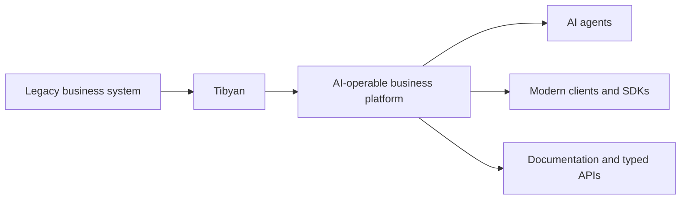
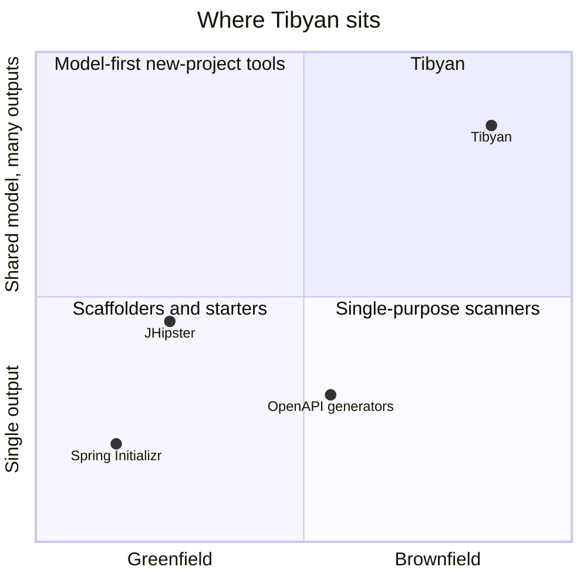
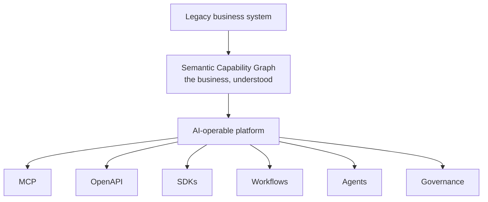

# Volume 1: Vision and Strategy

Status: Stable. This volume defines why Tibyan exists and what it is trying to become. It is the lens through which every later decision should be read.

---

## 1. Vision

Most valuable business software in the world is not new. It is years or decades old, it runs in production, and it cannot be rewritten safely or cheaply. At the same time, the most important shift in software right now is that systems are expected to talk to AI agents, expose typed interfaces, and integrate through open protocols.

There is a large gap between those two facts. Legacy systems were never designed for AI, and rewriting them to add it is rarely justified.

Tibyan's vision is to close that gap from the outside. It treats an existing system as the input, builds a neutral model of what that system can do, and generates a modern, AI-ready layer on top of it. The original system is never edited.

The end state Tibyan aims for:

The phrase that captures the goal is AI-operable. An AI-operable system is one that agents can operate, not merely read: they can pull data, take actions, and run multi-step workflows against it, through a generated and governed layer, while the original system stays untouched. Exposing an MCP endpoint is the beginning of operability, not the whole of it.

## 2. Mission

> Transform existing legacy business applications into AI-operable business platforms without rewriting the existing system.

The mission contains three non-negotiable commitments:

1. Existing systems are the primary input, not new projects.
2. The original system is never modified.
3. The output is genuinely AI-operable, meaning AI agents can understand and operate the system, reading data, taking actions, and running workflows, through generated and governed tools.

## 3. Problem statement

| Problem | Why it hurts |
|---|---|
| Legacy systems cannot talk to AI agents | They predate MCP, typed APIs, and the agent era, and adding this by hand is slow and error-prone |
| Rewriting is the usual answer, and it is the wrong one | Rewrites of large business systems are among the most expensive and risky projects a company can take on |
| Every integration is duplicated | An MCP server, an SDK, an OpenAPI spec, and documentation are all written and maintained separately for the same capability |
| Duplication grows with the system | Each new capability multiplies the surfaces that must be kept in sync by hand |
| The market is full of greenfield code generators | They help start new projects, but they do nothing for the systems that actually run the business |

The single sentence that frames the problem: the most expensive software a company owns is the software it already has, and that software is exactly the software that cannot talk to AI.

## 4. Goals

1. Read an existing business system and build a faithful, neutral model of its capabilities.
2. Generate an AI-ready layer, beginning with an MCP server, from that model.
3. Host that layer so it executes against the real system, not a copy.
4. Require no change to the original system, ideally nothing more than adding one dependency.
5. Keep the model independent of any framework, so the same model serves many outputs and many source technologies.
6. Make every part a plugin, so new sources, outputs, and runtimes are added without touching the core.

## 5. Non-goals

| Non-goal | Reason |
|---|---|
| Being a greenfield code generator | The market is saturated and the value is low. Greenfield is at most a stepping stone, not the product |
| Rewriting or refactoring the legacy system | The whole point is to avoid the rewrite |
| Being a Spring or Java tool | Spring is the first target only. The architecture treats every framework as a replaceable adapter |
| Being a documentation scanner | Producing docs or an OpenAPI file is a side output, not the goal. The goal is a shared model that many outputs depend on |
| Locking users into Tibyan at runtime | The generated layer wraps the system; it does not replace or capture it |

## 6. Value proposition

For an organization that owns a working but aging business system:

> Add one dependency, point Tibyan at your system, and your system can now talk to AI agents and modern clients, without a rewrite and without editing your code.

The value is highest exactly where the pain is highest: large, old, business-critical systems that cannot be replaced but must stay relevant.

### Why a CTO should adopt Tibyan today

The case is about business outcomes, not technical features.

| Outcome | What it means for the business |
|---|---|
| Modernize without rewriting | Avoid the cost, time, and risk of replacing a system that already works |
| Eliminate duplicated integration work | One model generates and keeps in sync the MCP server, the OpenAPI spec, the SDKs, and the docs, instead of hand-building and maintaining each surface separately |
| Make existing systems AI-operable | AI initiatives ship on the software the business already runs, instead of waiting for a rewrite |
| Lower integration cost over time | Each capability is described once, not re-implemented per surface, so cost falls as coverage grows |
| Govern AI access centrally | Permissions and policies live in the model, so AI access to the business is controlled rather than ad hoc |
| Reduce framework and vendor risk | The model is framework-neutral, so it outlives any single framework or protocol |

In one line for the CTO: get measurable AI capability on top of the systems you already depend on, in weeks, without a rewrite and without editing those systems.

## 7. Target customers

| Segment | Why Tibyan fits |
|---|---|
| Enterprises with large legacy business systems | They have the most to lose from a rewrite and the most to gain from modernization |
| Teams maintaining a long-lived Spring or Java backend | The first supported stack, and the fastest path to value |
| Companies adopting AI agents | They need their existing systems to be callable by agents safely |
| System integrators and consultancies | They modernize client systems for a living and need a repeatable tool |

The first concrete user, used to anchor the MVP: a team that owns a running Spring Boot system and wants an AI agent to operate it, without changing that system.

## 8. Market position

Tibyan is deliberately in the corner that almost no one occupies: brownfield input combined with a shared model that feeds many outputs. Greenfield generators sit in the opposite corner. Single-purpose scanners sit low on the model axis. The brownfield, shared-model corner is both the hardest to build and the most defensible.

## 9. Future vision and differentiation

The long-term shape of Tibyan, stated so that near-term decisions can be checked against it:

1. Many providers feed one IR: Spring source today, then OpenAPI, databases, bytecode, and other languages such as .NET and PHP.
2. Many backends consume one IR: MCP today, then OpenAPI, SDKs, documentation, and others such as GraphQL.
3. Many runtimes host the layer: Spring today, then Quarkus, Micronaut, and .NET.
4. A plugin ecosystem grows around the stable core, eventually with a marketplace of providers, backends, and runtimes.
5. The IR becomes a durable, framework-neutral description of business capabilities that outlives any single framework or protocol.

The strategic bet: protocols and frameworks will keep changing, but the description of what a business system can do is comparatively stable. Tibyan owns that description, the Capability IR, and treats everything else as a replaceable edge.

### 9.1 The Semantic Business Capability Model

Today the Capability IR is small: entities, fields, types, and capabilities. That is correct for the MVP. The long-term target is larger. The IR grows into a Semantic Business Capability Model, a framework-neutral, machine-readable description of what a business system is and does, not only the methods and entities that were extracted from it.

The model eventually represents:

| Element | What it captures |
|---|---|
| Business capabilities | The actions the business can perform, named in business terms |
| Business entities | The core objects the business operates on |
| Relationships | How entities relate to and depend on each other |
| Workflows | Multi-step business processes that span capabilities |
| Events | Significant occurrences the system emits or reacts to |
| Policies | The rules that constrain how capabilities may be used |
| Permissions | Who or what may invoke each capability |
| Dependencies | How capabilities and systems depend on one another |
| Domain knowledge | The meaning and context that make the model understandable, not only its structure |

> Discipline note: this is the north star, not the MVP. The MVP IR stays minimal, entities and read capabilities only. Each later element is added only when a phase needs it. Stating the target now lets every early decision be checked against it, so the small IR grows into the full model without a redesign. The architecture (Provider, IR, Backend, Runtime) does not change; only what the IR can hold grows.

### 9.2 The long-term flow

The near-term pipeline (Provider, IR, Backends) is the first step of a longer arc. As the IR grows into the Semantic Business Capability Model, the same neutral model becomes a Semantic Capability Graph, and Tibyan becomes the platform that sits between a legacy system and the AI era.

The Capability IR is the seed of the Semantic Capability Graph. MCP becomes one output among many. Governance and agents become first-class outputs rather than afterthoughts, because the model already carries policies, permissions, and relationships. This is the same architecture as today, with a richer model in the center and more backends around it.

### 9.3 The competitive moat

A fair challenge: what happens when Spring, or Microsoft, or the frameworks themselves add native MCP support? If the product were only MCP generation, that day would erase it. So the moat is deliberately not MCP generation.

The moat is the semantic understanding of business systems. It is hard to copy and it compounds over time.

| Layer | Why it is defensible |
|---|---|
| The semantic model | A framework-neutral, cross-system description of capabilities, relationships, policies, and domain meaning is far harder to build than a single MCP endpoint, and it is the same model behind every output |
| Cross-stack analysis | Understanding Spring, then .NET, then databases, and unifying them into one model is deep work that a single-framework vendor will not do for its competitors' stacks |
| Governance and policy | Because the model carries permissions and policies, Tibyan can govern AI access centrally, which a native MCP endpoint bolted onto one framework does not |
| Accumulated coverage | Every analyzer, extractor, and supported pattern adds to a body of understanding that a new entrant must rebuild from zero |

When frameworks add native MCP, that helps Tibyan rather than harming it: the protocol output becomes a commodity Tibyan can simply target, while the value moves to the layer Tibyan owns, the model. MCP support inside a framework is a feature. Understanding a company's whole system across frameworks is a platform.

> Honest caveat: this moat is real, but it must be earned. Early on, before the semantic depth accrues, Tibyan will look like an MCP generator. The strategy only works if the analysis and the model keep deepening, phase after phase. The moat is a destination, not a starting position.
