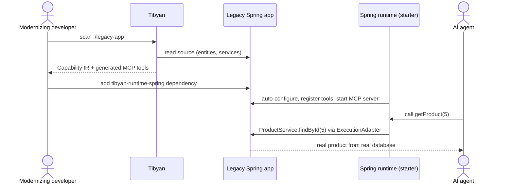

# Volume 2: Software Requirements Specification (SRS)

Status: Stable for the MVP scope; the MVP acceptance criteria in section 5 have been met and verified against the real example app (see docs/STATUS.md). Written in an IEEE 830 style. Requirements that belong to later phases are marked with their phase; phase tags P0 to P3 refer to the completed build (Volume 13, Tier 1), and the former P4 and P5 tags now live as direction in Volume 13, Tier 3.

---

## 1. Introduction

### 1.1 Purpose
This document specifies the requirements for Tibyan, an application modernization platform that adds an AI-ready layer to an existing business system without rewriting it. It defines the actors, assumptions, constraints, functional and non-functional requirements, acceptance criteria, use cases, and external interfaces.

### 1.2 Scope
Tibyan reads an existing system through a Capability Provider, builds a neutral Capability IR, validates it, and exposes it through Backends. A Runtime hosts the generated layer and connects it to the real system through an Execution Adapter. The MVP scope is a single source technology (Spring Boot and Java) and a single backend (MCP), with a real binding to existing logic.

### 1.3 Definitions, acronyms, abbreviations
| Term | Definition |
|---|---|
| IR | Capability Intermediate Representation, the neutral model of a system |
| Provider | A plugin that reads a source and produces IR |
| Backend | A plugin that turns IR into an output shape |
| ExecutionAdapter | The interface a generated tool uses to invoke real logic |
| Runtime | The host that runs the generated layer and binds it to the real system |
| MCP | Model Context Protocol |
| Capability | An action the system can perform |
| Brownfield | Modernizing a system that already exists |

### 1.4 References
Volume 1 (Vision), Volume 8 (Technical Spike), Volume 13 (Roadmap), Volume 14 (ADRs).

---

## 2. Overall description

### 2.1 Product perspective
Tibyan is a plugin-based platform built around a central Capability IR. It is not a monolith. Providers and backends and runtimes are independent modules that depend only on a small core and a plugin API.

### 2.2 Actors
| Actor | Description | Goals |
|---|---|---|
| Modernizing developer | A developer who runs Tibyan against a legacy system | Add an AI layer with minimal effort and zero edits to the system |
| Legacy system | The existing application being modernized | Be read and called, never modified |
| AI agent | An MCP client such as Claude Desktop | Discover and call the system's capabilities as tools |
| Plugin author | A contributor adding a provider, backend, or runtime | Extend Tibyan without touching the core |

### 2.3 Assumptions
1. The source code of the legacy system is available for the MVP provider.
2. The legacy system is a Spring Boot and Java application for the MVP.
3. The team can add one dependency to the legacy build for the MVP runtime.
4. An MCP-capable client is available to call the generated tools.

### 2.4 Constraints
1. The original system must not be edited, beyond adding one dependency for the runtime.
2. No framework concept may leak into the Capability IR.
3. Backends must not depend on any provider, on any runtime, or on any framework.
4. The MVP must prove a real binding to existing logic, not a stub.

---

## 3. Functional requirements

### 3.1 Core and IR
| ID | Requirement | Phase |
|---|---|---|
| FR1 | Represent a system as a Capability IR of entities, fields, types, capabilities, and relations | P0 |
| FR2 | Provide a closed, well-defined primitive type system (for example string, long, uuid, boolean, decimal, timestamp) | P0 |
| FR3 | Validate the IR for duplicate names, unresolved references, and invalid types | P0 |
| FR4 | Keep the IR free of any framework, protocol, or language specific concept | P0 |

### 3.2 Providers
| ID | Requirement | Phase |
|---|---|---|
| FR5 | Read a Spring Boot and Java project from source and produce IR | P1 |
| FR6 | Extract entities and their fields from the source (Entity extractor) | P1 |
| FR7 | Organize provider logic as independent extractors that can be enabled separately | P1 |
| FR8 | Extract repositories, services, and controllers to enrich capabilities | Partially delivered: the Service extractor was enabled after the MVP to discover the real binding (Volume 5, section 4.1); repository and controller extractors remain placeholders (Volume 13, Tier 2) |
| FR9 | Support additional providers (OpenAPI, database, bytecode, other languages) without changing the core | Direction (Volume 13, Tier 3) |

### 3.3 Backends
| ID | Requirement | Phase |
|---|---|---|
| FR10 | Generate an MCP server that exposes one tool per capability | P2 |
| FR11 | Generate tools that invoke logic only through an Execution Adapter, never a framework directly | P2 |
| FR12 | Generate an OpenAPI description from the IR | Direction (Volume 13, Tier 3) |
| FR13 | Generate typed client SDKs from the IR | Direction (Volume 13, Tier 3) |
| FR14 | Never read or depend on the provider or the source technology | P2 |

### 3.4 Runtime and execution
| ID | Requirement | Phase |
|---|---|---|
| FR15 | Host the generated MCP layer inside the legacy application's context | P1 to P2 |
| FR16 | Distribute the Spring runtime as a Spring Boot starter that activates by adding one dependency | P1 to P2 |
| FR17 | Bind a generated tool to a real bean and invoke real logic through the Execution Adapter | P2 |
| FR18 | Register generated tools with the running MCP server | P2 |
| FR19 | Support additional runtimes (Quarkus, Micronaut, .NET) without changing backends | Later |

### 3.5 CLI and pipeline
| ID | Requirement | Phase |
|---|---|---|
| FR20 | Provide a command to scan a system and produce IR | P3 |
| FR21 | Provide a command to generate a chosen backend from the IR | P3 |
| FR22 | Run the full pipeline: provide, validate, generate | P3 |

---

## 4. Non-functional requirements

### 4.1 Security
| ID | Requirement |
|---|---|
| NFR-S1 | The generated layer must respect the access rules of the underlying system; it must not bypass existing authentication or authorization |
| NFR-S2 | Side-effecting capabilities must be distinguishable from read-only ones in the IR, so policy can be applied later |
| NFR-S3 | The runtime must not expose any capability that was not derived from the system and validated |

### 4.2 Performance
| ID | Requirement |
|---|---|
| NFR-P1 | A scan of a typical module must complete in seconds to a few minutes on a developer machine |
| NFR-P2 | A generated tool call must add negligible overhead over a direct call to the underlying logic |

### 4.3 Reliability
| ID | Requirement |
|---|---|
| NFR-R1 | The same input must always produce the same IR and the same generated output (determinism) |
| NFR-R2 | A failure in one plugin must not corrupt the IR or crash unrelated plugins |

### 4.4 Compatibility
| ID | Requirement |
|---|---|
| NFR-C1 | Generated MCP servers must conform to a pinned MCP specification version |
| NFR-C2 | Adding a new source technology must not require changes to existing backends |

### 4.5 Maintainability
| ID | Requirement |
|---|---|
| NFR-M1 | The core must have zero dependencies on frameworks, providers, backends, or runtimes |
| NFR-M2 | Each generator must be covered by golden-file tests |

### 4.6 Extensibility
| ID | Requirement |
|---|---|
| NFR-E1 | New providers, backends, adapters, and runtimes must be addable as plugins without modifying the core |
| NFR-E2 | The plugin API must be small and stable, depending only on the core |

---

## 5. Acceptance criteria (MVP)

The MVP is accepted when all of the following hold against a real Spring Boot system that is not modified:

1. Tibyan reads the system and produces a Capability IR containing at least one entity and one capability.
2. The MCP backend generates a server exposing that capability as a tool.
3. The Spring runtime, added as a single dependency, hosts the server inside the application's context.
4. An AI agent calls the capability and the generated tool invokes the real existing logic through the Execution Adapter.
5. The result returned to the agent is the real result from the underlying system, read from its real data store.
6. No file of the original system was edited beyond adding one dependency.

---

## 6. Use cases

### 6.1 UC1: Modernize a Spring service for AI

### 6.2 UC2: Add a new source technology (future)
A plugin author writes a new provider, for example a database provider, that produces the same Capability IR. All existing backends and runtimes work against it unchanged.

### 6.3 UC3: Add a new output (future)
A plugin author writes a new backend, for example GraphQL, that reads the IR. It works for every system any provider can describe, with no provider changes.

---

## 7. External interfaces

| Interface | Description |
|---|---|
| Source code input | A path to a Spring Boot and Java project (MVP) |
| MCP interface | A standards-conformant MCP server exposing tools to agents |
| CLI | Commands to scan and generate (Volume 11) |
| Plugin API | The contracts CapabilityProvider, Backend, ExecutionAdapter, Runtime (Volumes 5, 6, 7, 10) |

---

## 8. Requirement to ADR traceability

| Requirement theme | Justifying ADR |
|---|---|
| Framework-free IR (FR4, NFR-M1) | ADR-0001, ADR-0013 |
| Brownfield input (FR5) | ADR-0002 |
| Provider abstraction (FR5 to FR9) | ADR-0003 |
| Backends never know the source (FR14) | ADR-0004 |
| Execution through an adapter (FR11, FR17) | ADR-0005 |
| Runtime as a first-class host (FR15 to FR19) | ADR-0006 |
| Spring Boot starter (FR16) | ADR-0007 |
| Real binding, not stub (acceptance criteria) | ADR-0014 |
