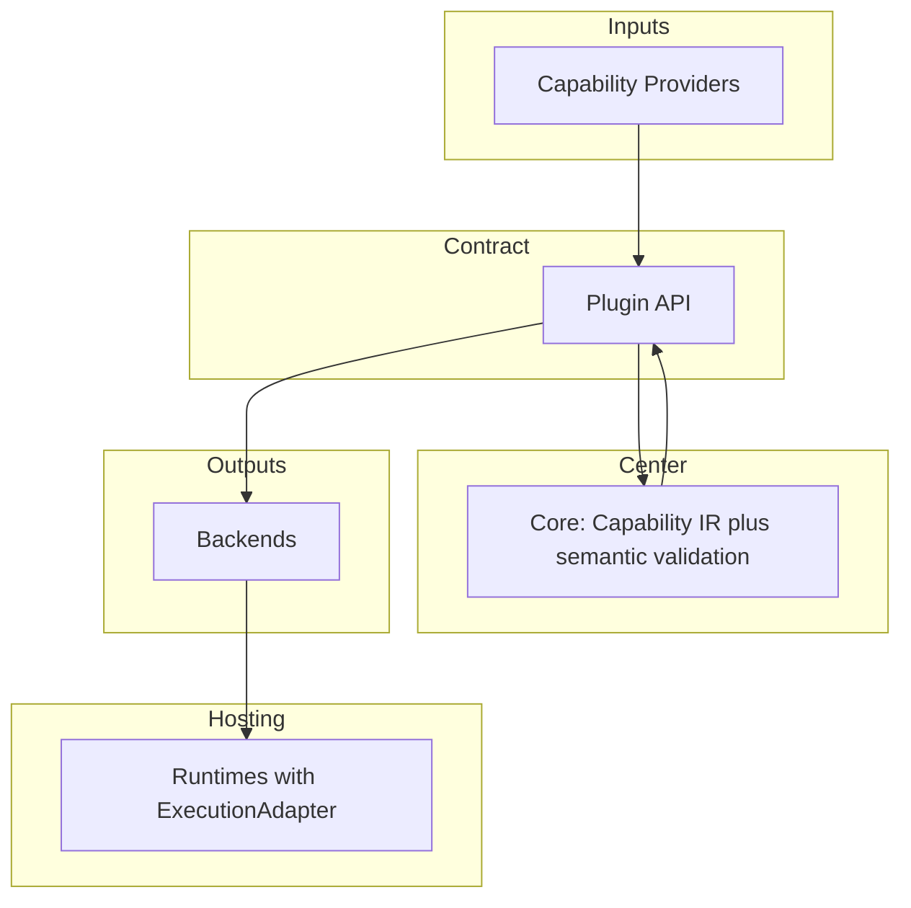

# Volume 3: Software Requirements Design (SRD)

Status: Stable. This volume describes how the requirements in Volume 2 are realized in design: the layered architecture, the modules and their responsibilities, the dependency rule, the design patterns, the extension points, and the tradeoffs. Where Volume 12 gives the physical module tree, this volume gives the reasoning that the tree encodes.

---

## 1. Architectural overview

Tibyan is organized around one center, the Capability IR, with everything else arranged as inputs into it or outputs from it. There are five abstractions (CapabilityProvider, Capability IR, Backend, ExecutionAdapter, Runtime). The design goal is that each can change independently, so the system grows by addition rather than by modification.

## 2. Layering and the dependency rule

The layers, from the inside out: the core holds the IR and validation and depends on nothing. The plugin API defines the contracts and depends on the core only. Providers, backends, and runtimes depend on the plugin API and the core, never on each other. The pipeline composes them. The single rule that protects the whole design: dependencies point inward, toward the core, and never sideways between plugins. Volume 12, section 5, lists the allowed and forbidden edges.

## 3. Design patterns

| Pattern | Where it is used | Why |
|---|---|---|
| Strategy | CapabilityProvider, Backend, ExecutionAdapter, Runtime | Each is an interchangeable family of implementations behind one interface |
| Pipeline | provide, validate, generate | A linear sequence of stages, each with one responsibility |
| Plugin and service discovery (SPI) | Providers and backends found at run time | New capabilities added without editing the composition root. Target, not yet current: as of the MVP the composition roots (CLI and Maven plugin) inject the concrete plugins directly (Volume 10, section 2) |
| Template method | Source extractors | A common extraction skeleton with per-concern steps |
| Adapter | ExecutionAdapter, and frameworks in general | Frameworks are adapters at the edge, never the architecture |
| Builder | IR construction inside providers | Assemble a valid IR step by step |

## 4. Extension points

| Extension point | Add this to | Without changing |
|---|---|---|
| A new source technology | A CapabilityProvider | The IR, backends, runtimes |
| A new output shape | A Backend | Providers, runtimes |
| A new execution mechanism | An ExecutionAdapter | Backends |
| A new host platform | A Runtime | Backends, the IR |
| A new IR element (future) | The core model plus a validator | Existing providers and backends until they opt in |

## 5. Key design decisions and tradeoffs

The decisions are recorded as ADRs in Volume 14. The dominant tradeoff across all of them is the same: Tibyan accepts an extra layer of indirection (a neutral IR, an execution adapter, a separate runtime) in exchange for independence between the parts. This costs more design up front and a little more ceremony, and it buys the ability to add a provider, a backend, or a runtime without a redesign. For a platform that must eventually span many stacks and outputs, that trade is correct.

## 6. Quality attributes

| Attribute | How the design serves it |
|---|---|
| Extensibility | Plugins behind a small, stable plugin API |
| Maintainability | A core with zero framework dependencies; golden-file tests per backend |
| Reliability | Deterministic IR and output; validation before generation |
| Portability | A framework-neutral IR; frameworks isolated at the edges |
| Testability | Each stage has a defined input and output, testable in isolation |
