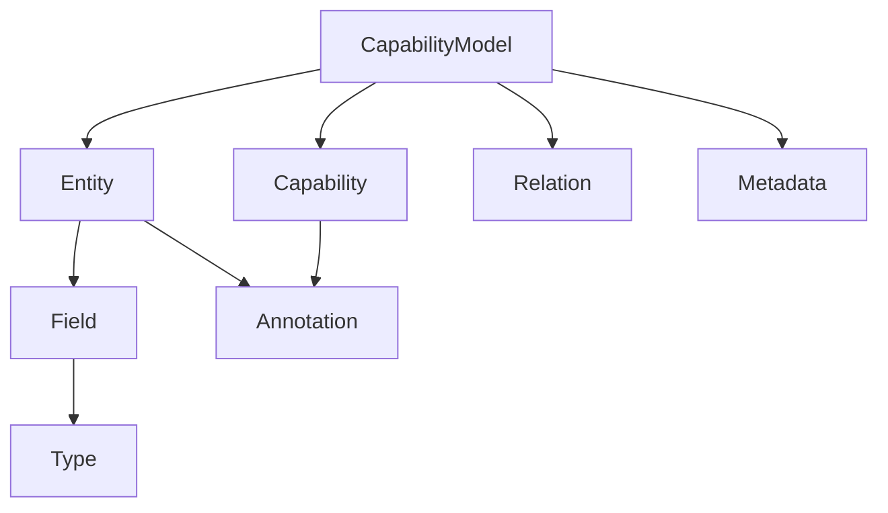

# Volume 4: Capability IR Specification

Status: Stable for the MVP shape. Future elements are marked clearly and are out of MVP scope. The Capability IR is the heart of Tibyan: the single, framework-neutral artifact that every provider produces and every backend consumes. If a concept does not belong in a neutral description of a business system, it does not belong in the IR.

---

## 1. Principles

1. The IR is neutral. It contains no framework, protocol, or language concept (ADR-0001, ADR-0013).
2. The IR is the only artifact backends read. Nothing downstream reads the original source.
3. The IR is deterministic. The same input yields the same IR, so it can be golden-file tested.
4. The IR starts small and grows. The MVP holds entities and read capabilities; later elements are added per phase, never all at once (Volume 1, section 9.1).

## 2. The object model



## 3. Objects, field by field (MVP)

### 3.1 CapabilityModel (root)
| Field | Type | Meaning |
|---|---|---|
| module | string | The name of the modeled module or system |
| version | string | The IR schema version |
| entities | Entity[] | The business objects |
| capabilities | Capability[] | The actions the system can perform |
| relations | Relation[] | How entities relate |
| metadata | Metadata | Free-form, non-semantic annotations |

### 3.2 Entity
| Field | Type | Meaning |
|---|---|---|
| key | string | The entity's stable identity: a provider-derived, dot-separated qualified name, unique within the module. For the Spring provider it is the entity class's fully-qualified name. It is what references resolve against and what makes two entities that share a simple name distinct. Added by phase Entity Identity (built 2026-07-13); see section 3.7 |
| name | string | The entity's display name, unique within the model. It is the simple name when that simple name is unique, and a deterministic context-disambiguated name (for example CrmNote) where needed to keep display names unique; a colliding entity may itself retain the bare simple name when its peers disambiguate around it (Volume 5, section 4.12.3, condition 3c). Every consumer surface (capability names, MCP tool names, OpenAPI schema names) derives from this. Semantics refined by phase Entity Identity; see section 3.7 |
| fields | Field[] | The entity's fields |
| annotations | Annotation[] | Generic extension hooks |
| metadata | Metadata | Free-form |

### 3.3 Field
| Field | Type | Meaning |
|---|---|---|
| name | string | Unique field name within the entity |
| type | Type | A primitive, or a reference to another entity |
| nullable | boolean | Whether the field may be absent |
| annotations | Annotation[] | Generic extension hooks |

> Nullable default (provider rule, recorded here so every provider agrees): a field is non-nullable by default, and nullable only when the source marks it so, for example with `@Column(nullable = true)` or `@Nullable`. The Spring provider already follows this rule (Volume 5), and future providers must adopt the same default so IR output stays consistent regardless of which provider produced it.

### 3.4 Capability
| Field | Type | Meaning |
|---|---|---|
| name | string | Unique capability name, in business terms (for example getProduct) |
| kind | enum | READ, WRITE, or ACTION. Verified and attested capabilities are READ; WRITE and ACTION exist only on reviewed capabilities (phase DL-1, section 3.10) |
| inputs | map of string to Type | Named, typed inputs |
| output | Type | The result type, often an entity reference. When outputMultiple is true, this is the element type of the collection, not the collection itself |
| outputMultiple | boolean | True if the capability returns a collection of the output type (a list read). Default false. Deliberate growth, RATIFIED and BUILT for phase E4 2026-07-02; see the collection-output growth note in section 4 and Volume 5, section 4.10 |
| readOnly | boolean | True if the capability has no side effects |
| binding | BindingRef | An opaque reference the runtime resolves to real logic. The IR never holds framework details |
| annotations | Annotation[] | Generic extension hooks |
| attestation | Attestation (optional) | The human-attested claim and its provenance, absent on every tool-verified capability. Deliberate growth, phase Attestation, designed 2026-07-20, PENDING ratification and build; see section 3.8 |
| review | Review (optional) | A named human's approval of a drafted capability beside the tool's own label, absent on verified and attested capabilities. Phase DL-1, built 2026-09-23; see section 3.10 |

> The binding is deliberately opaque in the IR. It names what to invoke, not how. The runtime and its ExecutionAdapter resolve it to a real bean or call. This keeps the IR neutral while still being executable. Phase Binding Identity (RATIFIED 2026-09-24, Volume 7 section 12) fixes the content the Spring provider puts in it to the canonical qualified class name plus the method, `inventory.ProductService#findById` exactly as this example, after a real host resolved a simple-name binding to the wrong class; the shape stays one opaque string.

### 3.5 Relation
| Field | Type | Meaning |
|---|---|---|
| from | string | Source entity name |
| to | string | Target entity name |
| kind | enum | ONE_TO_ONE, ONE_TO_MANY, MANY_TO_ONE, MANY_TO_MANY |

### 3.6 Annotation and Metadata
Annotation is a generic key with values, used as an extension hook so the IR can carry hints without growing new typed fields prematurely. Metadata is free-form key and value data that carries no semantic weight (for example, the source file a thing came from). Neither may smuggle framework concepts into semantics.

### 3.7 Entity identity: qualified key and display name (phase Entity Identity; built 2026-07-13)

Status: designed from the private enterprise benchmark, pending ratification. Per rule 12 this frozen design is committed first; the build is a separate later session that begins by committing the ratified design. No matching or keying code is written until this is ratified. The provider-side rule (keying, display-name derivation, reference resolution) is Volume 5, section 4.12; the backend-surface rule is Volume 6, section 3.4.

The problem, from real-app evidence. The IR keyed entities by their simple name, and that single `name` field did double duty: it was both the entity's identity (what `ENTITY_REF`, `Relation`, and capability naming resolve against, and what validation rule 1 requires unique) and its display name (what every consumer surface shows). On a real multi-module, bounded-context codebase (the private enterprise benchmark: 169 modules, 111 entities), the same simple name is legitimately reused across contexts: two distinct entities, in two distinct modules, mapped to two distinct tables, both named (for example) Note. Three such simple names collided across six entities. Simple-name keying collapses each pair: validation rule 1 sees a duplicate name and fails, and the tool emits nothing for the entire application, no IR, no MCP server, no OpenAPI document. This was the only total, output-blocking failure the benchmark surfaced, and it gates every other improvement (a discovery rule that finds more reads is worthless while the model cannot be emitted at all).

The honesty angle, stated plainly. Simple-name keying was a latent identity conflation that, absent the duplicate-name check, would have become a mis-bind: had the collision not been caught, keying by simple name would have silently merged two structurally distinct entities (different fields, different tables) into one, so a capability meant for one could bind to the other's shape, exactly the wrong-binding the tool exists to never produce. Fail-loud caught it, by refusing to emit rather than merging, which is why mis-bound stayed 0 and no actual wrong binding ever occurred. This phase removes the latent risk at its root. It relaxes no matching condition and adds no discovery rule; what it changes is that entity-reference and match resolution move from simple-name string equality to key-based resolution (Volume 5, section 4.12.4), making explicit the identity the model always needed, so it strengthens the mis-bound-0 guarantee rather than trading against it. One parallel hazard is qualified honestly, not hidden: two `@Service` classes can share a simple name just as two entities can, so this phase adds a binding-uniqueness validation rule (section 5, rule 7) that refuses two capabilities carrying the same binding string rather than shipping a possible runtime mis-bind. It makes that hazard loud; it does not resolve the bean qualification, which is a named follow-on (Volume 5, section 4.12.4). So the strengthening covers entity identity fully and converts the service-name hazard from silent to loud.

The change, smallest honest surface. Split the one overloaded field into two:

1. `key` (added): the entity's stable identity, a provider-derived, dot-separated qualified name, unique within the module. It is neutral in the IR (a qualified string), and each provider derives it from its own source: the Spring provider derives it from the entity class's fully-qualified name (package plus simple name); a future database provider would derive it from, say, schema plus table. Two entities are the same entity if and only if their keys are equal.
2. `name` (refined): the display name, unique within the module. It is the simple name when that simple name is unique across the model, and a deterministic context-disambiguated name only when it collides (the derivation rule is Volume 5, section 4.12). Every VERIFIED consumer surface derives from `name`: the capability name (`get<name>`), the MCP tool name, the OpenAPI schema component and path. The one exception, carved by phase Attestation (section 3.8; designed 2026-07-20): an ATTESTED capability's name is human-minted, not entity-derived, because a filtered or shaped business read has no `get<E>`/`list<E>` form; it carries the reserved `attested_` prefix, its uniqueness is enforced across all capabilities (rule 2), and its OpenAPI path derives from that minted name (Volume 6, section 4.4), never from an entity, so two attested reads of one subject entity never collide on a path. Entity references it emits (`ENTITY_REF`) still resolve by key to a display name as usual; only the capability's own name is minted.

References resolve by display name, unchanged in shape. `ENTITY_REF`, `Relation` endpoints, and a capability's entity output continue to carry the entity's `name` (section 3.5, section 4), which is unique, so their shape does not change and, in the common no-collision case where `name` is the simple name, the IR reference tokens and every generated surface are byte-identical to today. The provider does the qualified resolution while building the IR: it resolves a source reference, a field type or a service return type, to the right entity by `key` (Volume 5, section 4.12.4), then emits that entity's `name`; a reference that cannot be resolved to exactly one entity key is refused loud, never guessed. Display-name uniqueness is enforced by the core validator (section 5, rule 1), not merely produced by the provider, so a residual collision the provider could not resolve fails loud rather than shipping a duplicate tool or schema.

Why this is not IR growth in the sense the growth bar guards. The growth bar (section 4) governs the closed primitive type set; this adds no primitive and touches no type. It adds one identity field and refines one field's semantics. It introduces no new business concept (no workflow, event, policy), no new modeling capability, and no container. It is a correction: it makes explicit an identity the IR always implicitly relied on but had conflated with the display name. It is justified by counted real-app evidence (a total, output-blocking failure on a real application), it is the smallest change that fixes that failure, and it strengthens rather than weakens the never-wrong guarantee. That is precisely the discipline the growth bar encodes: deliberate, evidenced, minimal.

What this will never do: it does not change how any reference is shaped (a reference is still `ENTITY_REF(<name>)`); it does not rename any entity whose simple name is unique (no-collision apps, whatever their module count, and both public benchmarks stay byte-identical in generated output); it does not add a numeric or otherwise unreadable disambiguator (the display rule uses structural context, Volume 5, section 4.12); and it does not relax the never-guess bar (an unresolvable cross-context reference refuses, it does not pick a default).

### 3.8 The Attestation component: the human-attested third category in the model (phase Attestation; designed 2026-07-20, RATIFIED 2026-07-21, BUILT 2026-07-25 as AT-1; SHAPE built as AT-2 2026-09-01; component AMENDED and BOUNDARY added by AT-3, ratified 2026-09-01)

Status: RATIFIED and BUILT (AT-1, 2026-07-25); the component and rules 8 and 9 below are implemented in `tibyan-core` exactly as written, zero-dependency preserved. The full phase design, the attestable set, the lifecycle, and the honesty argument are Volume 5, section 4.15; the backend surfaces are Volume 6, sections 3.6 and 4.4. This section is the model half: what the IR must carry so an attested capability can exist without ever blurring into a verified one.

The decision: Capability gains ONE optional first-class component, `Attestation`, absent on every verified capability. Its fields, all required when present:

| Field | Type | Meaning |
|---|---|---|
| category | enum token | Which attestable holes the entry fills: `predicate` (what filters and guards select), `shape` (what the read returns), `both` (a filtered read whose element type is also unresolvable, one entry filling both holes), and, when AT-3 is ratified, `boundary`. Closed set; validation refuses an unknown token |
| resultSemantic | string | The human's one-sentence result claim, carried character-exactly |
| parameterMeanings | map of string to string | ONE entry per capability input, so its keyset equals the capability's input set (which is what makes per-input completeness checkable by the core, section 5 rule 8). Each value is a human meaning sentence, the reserved `paging` mark (a framework paging or ordering parameter, restricted per Volume 5, section 4.15.2), or the reserved `id` mark (the structurally-proven by-primary-key identifier of an existence-condition read). No input is uncovered and no key names a non-input |
| subjectEntity | string (optional) | For a `shape` or `both` category, the human-asserted subject entity (a display name present in the model); absent for a pure `predicate` |
| assertedBy | string | The named asserter; non-empty |
| origin | enum token | `human-authored` or `ai-drafted-human-confirmed`; a draft state never reaches the IR |
| date | string | The assertion date, from the attestations file, never from a clock the tool reads (determinism, CLAUDE.md rule 10) |
| fingerprint | string | The structural fingerprint of the code slice the assertion was validated against (Volume 5, section 4.15.4) |
| securityOwner | string (optional) | AT-3: for a `boundary` category, the named owner of the SECURITY DECISION the entry makes, separate from `assertedBy` and possibly a different person. Non-empty for `boundary`; absent for every data category, so a data attestation can never look like a security one |
| readOnlyAffirmed | boolean | AT-3: for a `boundary` entry covering a remote delegation, the explicit affirmation that invoking this performs no write ANYWHERE, which is the property the tool cannot check for that member. False on every data category; there is no default and silence is never an affirmation |
| assertedAuthorities | list of string | AT-3: for a `boundary` entry resolving a `securityUnverifiable` marker, the authorities the human asserts the declared contract requires. It NEVER populates `requiredAuthorities` and never clears the unverifiable marker: an asserted authority is not a compiled one. Empty on every data category |

Why FIRST-CLASS and not the Annotation hook, argued against the hook's own four precedents (view, enum, partial, paged): those are single facts a backend either surfaces or ignores, and the hook exists precisely so single facts do not grow typed fields prematurely (section 3.6). An attestation is a structured multi-field claim whose COMPLETENESS is itself the phase's core invariant (zero attestation drift, Volume 5 section 4.15): the category must come from a closed set, the asserter must be named, the origin must be a valid token, the fingerprint must be present, and every non-structural input must carry its meaning. Flattened into string-list annotations, none of that is checkable by `tibyan-core` without parsing string conventions, which is exactly where drift breeds; a validator that cannot see the structure cannot enforce the invariant. The component makes the invariant a type.

The growth bar (section 4), met on all three tests: (1) counted evidence: the fired trigger and the per-benchmark attestable ceilings (pms up to roughly 44 predicate and 7 shape refusals, erp up to roughly 44, the enterprise benchmark's guarded and aggregate sets; ledgers, the Attestation forecast sections), against a structural ceiling proven from three directions; (2) truthful naming: the component is named for exactly what it carries, a human attestation, and its epistemic class is explicit in the model rather than implied by convention; (3) no coercion: nothing that exists changes meaning; every verified capability is untouched, `Attestation` is absent on all of them, and an attestation-free model serializes byte-identically to today. This is the third deliberate growth (FLOAT, `outputMultiple`, `Attestation`) and the first that adds a component rather than a value, which is why it carries its own validation rules below.

Growth path within the component, stated so the closed set is honest: the `category` set grows to `boundary` when AT-3 is ratified (Volume 5, section 4.15.2 category C), and AT-3 additionally AMENDS the component shape rather than only adding a token, because a boundary attestation needs fields the data categories do not (a distinguished asserter affirmation and, for a delegation, a mandatory explicit `readOnly` affirmation). That amendment is AT-3's own ratified growth, argued against this same bar in AT-3's design session; it is named here so the current closed shape is not mistaken for the final one.

What this growth will never become: no policy or permission model (who MAY invoke stays future, section 7); no workflow, no event; no second epistemic class beyond the three (verified, attested, refused); no attestation on a WRITE or ACTION capability (validation refuses it); and never a substitute for structure: the binding, the types, and the read-safety of the target stay structurally checked, and `Attestation` carries only the semantics structure cannot reach.


### 3.9 Input value constraints (phase Enum Inputs; designed 2026-08-04, RATIFIED, BUILT 2026-09-01 as EI-1)

An optional component on Capability: a map from INPUT NAME to the closed set of values that input accepts on
the wire, absent on every capability that has none. It is the fourth deliberate growth (FLOAT,
`outputMultiple`, `Attestation`, this), and the smallest of them.

| Field | Type | Notes |
|---|---|---|
| inputValues | map of string to list of string | Keys are input names; each value is the closed, ordered, non-empty set of accepted wire values, read from a resolved in-tree enum declaration (Volume 5, section 4.16.4) |

Validation rule 10 (section 5): every key names an existing input of the capability; every keyed input is
STRING-typed; every value list is non-empty and its values distinct. The rule is what makes the phase's
invariant core-enforced rather than conventional.

Why a first-class component and NOT the Annotation hook, which is where E3 put the enum values for FIELDS.
The two are different in kind, and the difference is the whole argument. An output annotation is a HINT a
backend may surface or ignore (section 3.6's stated purpose). An input value set is a CONTRACT: a backend
renders it into a schema an agent reads as binding, and a runtime enforces it before invoking. A contract
whose completeness is an invariant needs a type the core can validate, which is section 3.8's argument for
`Attestation` applied to a smaller object. Keyed into annotations as `enumValues:status`, none of rule 10 is
checkable without parsing a string convention, and that is where drift breeds.

Why NOT a first-class ENUM primitive, the alternative E3 deferred to exactly this moment. Against the
growth bar of section 4, it fails test 2: the source declares a Java enum whose WIRE FORM IS A STRING, and
JSON Schema, OpenAPI, and the MCP tool schema all express a closed set as a string with an `enum`
constraint, so STRING names the wire truth and ENUM would name the Java construct instead. It also crosses
the line the collection-output note drew: `Type` is deliberately flat and closed, and an `ENUM(values...)`
member would be the first type to carry a payload, the wedge that opens type algebra. And it would split the
model positionally: the same enum is STRING-plus-annotation as an entity field and would become ENUM as a
parameter, an asymmetry with no truth behind it, forcing either an incoherent model or a reopening of the
output decision that this phase's trigger explicitly does not reopen.

The growth bar, met on all three tests: (1) COUNTED EVIDENCE, three authored pms entries refused
STRUCTURAL_FRAME on a domain enum parameter in the first real measurement, and a census of 10 erp read
methods with in-tree-resolvable enum parameters (Volume 5, section 4.16.9); (2) TRUTHFUL NAMING, the
component is named for exactly what it carries, the accepted wire values, and it constrains a STRING rather
than renaming it; (3) NO COERCION, nothing that exists changes meaning, no primitive is added, `Type` is
untouched, `inputs` keeps its shape, and a constraint-free model serializes byte-identically.

What this growth will never become: a general validation-constraint system (no ranges, lengths, patterns, or
required-ness), a container type, a per-input annotation bag, or a carrier for anything the tool did not
read from a resolved declaration. It carries one closed value set per input and nothing more.

### 3.10 The Review component: the reviewed third tier, and the kinds WRITE and ACTION (phase DL-1; designed and RATIFIED 2026-09-23, BUILT 2026-09-23)

Designed in Volume 5, section 4.17.4, and recorded here as the IR-facing half. One optional component on
Capability, `Review(label, reviewedBy, reviewedOn, descriptionOrigin, fingerprint)`, where `label` is the tool's
own read-safety label from the closed set READ, WRITE, UNKNOWN and the other four fields are the named human's
act and its pin. `CapabilityKind.WRITE` and `ACTION`, declared since the MVP and never produced, are produced from
this phase on, only with a `Review` attached. Validation gains rule 12 (a `Review` is complete, and a WRITE or
ACTION capability must carry one) and rule 13 (the `reviewed_` prefix, reserved both ways, as rule 9 reserves
`attested_`). Rule 5 is unchanged: `readOnly` is never true on WRITE or ACTION. The growth is argued against the
section 4 bar in Volume 5, section 4.17.4; an IR without approved drafts serializes byte-identically to today's.
Ratified and built 2026-09-23 (Volume 5, sections 4.17.12 and 4.17.13); rules 12 and 13 are in force in section 5
below. The build adds two guards rule 12 implies: one tier per capability, and the kind equals the label's kind.


### 3.11 Input multiplicity (phase DL-2a; designed 2026-09-24, PENDING RATIFICATION)

An optional component on Capability: the set of INPUT NAMES whose wire form is an array of the input's type,
absent (empty) on every capability that has none. It is the fifth deliberate growth (FLOAT, `outputMultiple`,
`Attestation`, `inputValues`, this), and it is E4's decision applied to the other side of the call.

| Field | Type | Notes |
|---|---|---|
| multipleInputs | set of string | Input names whose argument is a JSON array of the input's type, read from a `List`, `Set`, `Collection` or `Iterable` parameter whose element type is a modeled primitive or an in-tree enum (Volume 5 section 4.19.2) |

Validation rule 14 (section 5): every name in `multipleInputs` names an existing input of the capability, and
that input's type is a primitive (never an `ENTITY_REF`). Rule 10 is unchanged: a closed set on a multiple
input constrains each element.

Why a flag and not a `LIST(T)` type: section 3.9 recorded that `Type` is deliberately flat and closed and
that a payload-carrying member is the wedge that opens type algebra. The collection-output note took the
flag for outputs on the same ground; inputs take the same shape, so the model says "many of T" the same way
on both sides. The growth bar, met: (1) counted evidence, 76 collection-of-primitive parameters on the
adopter benchmark blocking 60 drafted methods (Volume 5 section 4.19.1); (2) truthful naming, the flag says
exactly what the wire carries; (3) no coercion, `Type` untouched, `inputs` untouched, a flag-free model
serializes byte-identically.

### 3.12 Shapes: structured inputs (phase DL-2b; designed 2026-09-24, PENDING RATIFICATION)

A Shape is the wire form of an in-tree class the runtime constructs from a JSON object: a DTO. It is the
sixth deliberate growth and the second that adds an element rather than a value, so it carries its own
rules. A Shape is NOT an Entity: it has no identity in the system, is never persisted, is never the target
of a relation and never the subject of a read.

| Field | Type | Notes |
|---|---|---|
| key | string | The class's canonical qualified name, unique within the model (the section 3.7 discipline) |
| name | string | The display name, the simple name unless it collides, disambiguated by the section 3.7 rule; the token `SHAPE_REF(name)` refers to it |
| fields | list of Field | The mapped fields in declaration order, typed by a primitive or a `SHAPE_REF`; never an `ENTITY_REF` |
| multipleFields | set of string | Field names whose wire form is an array of the field's type (section 3.11, at field level) |
| fieldValues | map of string to list of string | Per-field closed sets, the section 3.9 contract at field level |
| annotations | list of Annotation | Carries `partial` naming the skipped fields with their declared types (Volume 5 section 4.9 applied to an input) |

`Type` gains a third member, `SHAPE_REF(name)`, legal on a capability INPUT and on a shape FIELD, never on an
output and never on an entity field. `CapabilityModel` gains `shapes`, which carries only the shapes reachable
from an emitted capability's inputs (the closure rule the OpenAPI backend already applies to entities), so a
model with no shape input serializes byte-identically.

Validation rules 15 and 16 (section 5): shape keys and display names unique; every `SHAPE_REF` resolves to a
shape in the model; a shape's fields are typed by a primitive or a `SHAPE_REF`, never an `ENTITY_REF`; the
reference graph among shapes is acyclic; `multipleFields` and `fieldValues` name existing fields, the latter
STRING-typed with non-empty distinct values; every shape has at least one field; `partial` values name
fields that are NOT in `fields`.

The growth bar, met: (1) counted evidence, 388 DTO-shaped parameters blocking 320 drafted methods on the
adopter benchmark, 219 of them writes (Volume 5 section 4.19.1); (2) truthful naming, a Shape is named for
what it is, the shape of an input object, and is kept apart from Entity precisely because it is not one;
(3) no coercion, no entity, capability, primitive or existing field changes meaning, and every model built
before this phase serializes byte-identically. What this growth will never become: a persistence model, a
required-ness or validation-constraint system, a carrier for `Map` or `Object` payloads, or a way for a
verified read to take an object.

## 4. The primitive type system

The type system is closed. A type is either one of these primitives or a reference to an entity defined in the same model.

| Primitive | Notes |
|---|---|
| STRING | Text |
| LONG | 64-bit integer; common for identifiers |
| INTEGER | 32-bit integer |
| DECIMAL | Exact decimal, for money and quantities |
| FLOAT | 64-bit binary floating point; inexact by declaration, for measurements, rates, and quantities the source declares as floating point. Deliberate growth, designed and RATIFIED 2026-07-02; enters with the E3 build (see the growth note and the growth bar below, and Volume 5, section 4.6) |
| BOOLEAN | True or false |
| UUID | Universally unique identifier |
| TIMESTAMP | A point in time |
| ENTITY_REF(name) | A reference to another entity in the model |

A closed set is chosen on purpose: it forces providers to map source types into a small, well-understood vocabulary, which keeps backends simple and the IR portable.

Growth note on FLOAT, recorded per section 7 discipline: the set originally refused inexact numerics by design, and that refusal was correct until evidence priced it. The benchmark's full field census (Volume 5, section 4.4.1) found 8 `Double` fields across 7 of the 24 extraction-blocked entities, gating both entities forecast to produce the first discovered capabilities. FLOAT states what such a source declares, an inexact numeric; the exact-inexact line stays hard (no coercion in either direction, `BigDecimal` remains DECIMAL), and a FLOAT identifier forms no read intent. The rule, alternatives argued, and fixtures are in Volume 5, section 4.6.

The growth bar for the closed type set (the template FLOAT set, so a second addition cannot become casual). A new primitive enters the closed set only when all three hold: (1) counted evidence from a real benchmark shows the current set forcing a refusal on real fields, not a hypothetical one; (2) the new primitive tells the truth about the source, naming what the source actually declares rather than papering over it with a near-neighbor; and (3) it is never a coercion target from an exact type, so adding it cannot quietly change the meaning of data that already maps. FLOAT met all three: 8 real fields across 7 entities (counted), an inexact numeric named as inexact (truthful), and no path from DECIMAL or any exact type into it (no coercion). A candidate that fails any of the three is refused with a located message instead, exactly as the set did for inexact numerics until this evidence arrived. Growth is a deliberate, evidenced event, not a convenience.

Collection-output growth note (RATIFIED and BUILT for phase E4, 2026-07-02). A list read returns many of an entity, and the MVP IR had no way to say "many". This is the second deliberate growth after FLOAT, and it is a different kind: FLOAT added a member to the closed primitive set, while this adds a way for a capability to say its single output is a collection. The decision, argued against the growth bar and the smallest-honest-surface rule, is to add one boolean, `outputMultiple`, to Capability (section 3.4), and to leave the closed type set and the `Type` shape completely unchanged. The output type stays the element type (`ENTITY_REF(E)` for an entity list); `outputMultiple: true` says the capability returns a collection of that element type.

Why this shape and not a container type. The tempting alternative is to grow `Type` itself into `primitive | entity-ref | collection(elementType)`, a `LIST_OF(ENTITY_REF(E))` construct. It is rejected as larger and more dangerous:

1. It is smaller. A boolean on Capability touches one object and one validator. A container `Type` touches the sealed `Type` interface, every validator that switches on type, every backend's type rendering, and the JSON round-trip, for information the boolean already carries losslessly (a capability has exactly one output, so "the output is a collection" needs no place to nest).
2. It cannot grow into container algebra. Because the collection-ness lives on the capability and not in `Type`, there is structurally no way to write `List<List<X>>`, a `Map<K,V>`, or a collection field inside an entity. The type set stays closed and flat by construction, which is exactly the boundary this growth must never cross. A container `Type` would open all of those the moment it existed.
3. It composes with the existing hooks. A paged list discloses its page envelope through the existing `Annotation` hook (a `paged` annotation), exactly as `view`, `enum`, and `partial` already do (section 3.6), so paging needs no further growth.

What this growth will never become: no nested generics (a collection of collections is unrepresentable and refused), no `Map` modeling, no collection-typed entity fields (to-many fields stay skipped-with-a-note, Volume 5, section 4.8, until separately evidenced), and no arbitrary container algebra. `outputMultiple` marks one capability's one output as a flat collection of its element type, and nothing more.

What is deliberately not modeled, and disclosed instead of claimed: ordering and uniqueness (List versus Set) are not modeled, because the wire form is a JSON array in both cases and the tool cannot structurally prove a return is ordered or duplicate-free; the IR says "many E", never "an ordered list of E" or "a set of unique E". Paging metadata (total count, page number, page size) is not modeled either: a paged read's OUTPUT is still the element collection, and the page envelope is unmodeled wire shape, disclosed through a `paged` annotation the way a view is disclosed, never presented as the modeled shape. The evidence, the rule, the alternatives, and the fixtures are in Volume 5, section 4.10.

## 5. Validation rules

Structural rules, checked in `tibyan-core`:

1. Entity keys are unique within the model: the identity check, and two entities with the same qualified key are a genuine duplicate and fail loud (phase Entity Identity, section 3.7). Entity display names are ALSO unique within the model, and the core validator ENFORCES this independently, it does not trust the provider: if two entities carry the same display `name`, validation fails loud with a located message naming both display names and their keys. It is not left "to construction", because tibyan-core validates IR from every provider (the manual builder and future providers too), not only the Spring provider whose display-naming rule (Volume 5, section 4.12) normally makes the check pass; the provider's disambiguation is the mechanism that satisfies the check, never a substitute for it, so a residual display collision the provider could not resolve surfaces here as a located failure rather than a silent duplicate tool or schema. Field names are unique within an entity. (Here "within the model" is the one scanned `CapabilityModel`; a whole multi-Maven-module app scans into one model. Entity Identity target, designed 2026-07-13, pending ratification and build; the pre-phase rule this refines was the single clause "entity names are unique within the module.")
2. Capability names are unique within the module. (With Entity Identity, VERIFIED capability names derive from the display name, so two reads of same-simple-named entities in different contexts become `getCrmNote` and `getSupportNote`, distinct by construction. With phase Attestation, an ATTESTED capability's name is human-minted and reserved-prefixed, `attested_<name>` (section 3.8, rule 9); the uniqueness check covers all capabilities together, verified and attested, so a minted name colliding with any existing name fails loud. The rule is unchanged in wording; only the source of an attested name differs.)
3. Every type is a known primitive or an ENTITY_REF to an entity that exists. The ENTITY_REF token is the target entity's display `name`, unique within the model; with Entity Identity the provider resolves a source reference to the entity by `key` (Volume 5, section 4.12.4) and emits that display name, so this rule still resolves against the token the reference carries.
4. Every relation's from and to refer to entities that exist (by display `name`, as in rule 3).
5. A capability marked readOnly must not be of kind WRITE or ACTION.
6. A capability with outputMultiple true must be of kind READ (MVP), and its output must be a valid primitive or an ENTITY_REF to an entity that exists (the element type is validated by rule 3; the collection-ness is a marker, not a type, so there is nothing further to check). A singular capability leaves outputMultiple false; the field is never null.
7. Binding strings are unique across emitted capabilities: two capabilities carrying the same binding string fail loud with a located message, so an unprovable binding (for example two same-simple-name `@Service` classes both yielding `NoteService#findById`) is refused rather than shipped as a possible runtime mis-bind. This keeps the provable-or-refuse invariant covering the binding, not only entity identity. (Added by phase Entity Identity, Volume 5, section 4.12.4; designed 2026-07-13, pending ratification and build.) AMENDED by phase Binding Identity (designed, RATIFIED and BUILT 2026-09-24, Volume 7 section 12): the string compared is the QUALIFIED binding, `<canonical FQCN>#<method>`, on every tier, so two same-simple-name `@Service` classes no longer collide here and whether both ship is rule 2's question; the rule keeps its check for one declaration reached twice.
8. Attestation completeness (phase Attestation, section 3.8; designed 2026-07-20, pending ratification and build): a capability carrying an `Attestation` must carry it complete, and completeness is decidable by `tibyan-core` from the component's own fields (this is why it is first-class, section 3.8): a category token from the closed set, a non-empty `resultSemantic`, a non-empty `assertedBy`, a valid `origin` token (a draft origin fails), a `date`, a `fingerprint`, a `subjectEntity` present in the model when the category is `shape` or `both`, and a `parameterMeanings` map whose keyset EQUALS the capability's input set (every input covered by a sentence, the `paging` mark, or the `id` mark; no key names a non-input). The keyset-equality check is the per-input completeness the growth was purchased for, and it needs only the component and the capability's own inputs, not provider-side knowledge. An incomplete attestation fails loud; a partially carried claim is attestation drift, never shipped. An `Attestation` on a WRITE or ACTION capability fails loud (the policy gate stands).
9. The attested name prefix is reserved in both directions (phase Attestation, section 3.8; same status): a capability carrying an `Attestation` must be named `attested_<name>`, and a capability without one must not be. A verified capability wearing the attested prefix, or an attested capability hiding without it, fails loud: the epistemic class is readable from the name alone, on every surface, by construction.
10. INPUT VALUE CONSTRAINTS ARE COMPLETE AND WELL FORMED (phase Enum Inputs, section 3.9). Every key of `inputValues` names an existing input of the capability; every input so keyed is STRING-typed; every value list is non-empty and its values are distinct. A constraint naming an input that does not exist, attached to a non-STRING input, or carrying an empty or duplicated set is refused. This is what makes the phase's invariant (a rendered closed set is an enforced closed set) core-enforced rather than conventional.

11. BOUNDARY ATTESTATION COMPLETENESS (phase Attestation AT-3, Volume 5 section 4.15.2.3). A `boundary` attestation must carry a non-empty `securityOwner`, and must carry at least one of its two assertions: `readOnlyAffirmed` true (the delegation member) or a non-empty `assertedAuthorities` (the security-contract member). An entry that names a security owner and asserts nothing is refused. In the other direction, and this is the half that keeps the categories from blurring: a `predicate`, `shape`, or `both` attestation must carry NO `securityOwner`, must leave `readOnlyAffirmed` false, and must carry an empty `assertedAuthorities`. A data attestation wearing security fields fails loud, so a reader can never mistake one for the other, and neither can a consumer. Every value of `assertedAuthorities` is non-empty and the values are distinct. AND THE CONTRADICTION GUARD (added when C1 was built, 2026-09-01): a capability must never carry BOTH a compiled `requiredAuthorities` annotation and a non-empty `assertedAuthorities`. The declared-security composition runs after attestation intake, so this is the only place the two axes can be compared; if the tool proved a contract for that read, a human assertion over it is redundant at best and contradictory at worst, and the model fails loud rather than shipping two answers to one question.

12. REVIEW COMPLETENESS AND NECESSITY (phase DL-1, section 3.10; ratified and built 2026-09-23). A capability carrying a `Review` must carry every field non-empty (`label` from the closed set READ, WRITE, UNKNOWN; `reviewedBy`; `reviewedOn`; `descriptionOrigin` from `human` or `ai-draft`; `fingerprint`). A capability of kind WRITE or ACTION MUST carry a `Review`: no discovery rule proves a write, so a write without a named reviewer is refused. Rule 5 still holds: `readOnly` is never true on WRITE or ACTION.

13. THE REVIEWED PREFIX IS RESERVED IN BOTH DIRECTIONS (phase DL-1, section 3.10; same status). A capability carrying a `Review` is named `reviewed_<name>`, and a capability without one must not be. As with rule 9, the epistemic class is readable from the name alone on every surface, and a truncated description cannot hide it.


14. INPUT MULTIPLICITY IS WELL FORMED (phase DL-2a, section 3.11; PENDING RATIFICATION). Every name in `multipleInputs` names an existing input of the capability, and that input's type is a primitive.

15. SHAPE IDENTITY AND REFERENCE (phase DL-2b, section 3.12; PENDING RATIFICATION). Shape keys are unique within the model, shape display names are unique within the model, every `SHAPE_REF` on a capability input or a shape field resolves to a shape in the model, no `SHAPE_REF` appears on an output or an entity field, and the reference graph among shapes is acyclic.

16. SHAPE COMPLETENESS (phase DL-2b, section 3.12; same status). Every shape has at least one field; its fields are typed by a primitive or a `SHAPE_REF`, never an `ENTITY_REF`; `multipleFields` names existing fields typed by a primitive; `fieldValues` names existing STRING-typed fields with non-empty, distinct values; the `partial` annotation's values name fields that are not among the shape's fields.

A validation failure stops the pipeline before any generation, with a located, human-readable message.

## 6. Example IR (JSON)

```json
{
  "module": "inventory",
  "version": "0.1",
  "entities": [
    {
      "name": "Product",
      "fields": [
        { "name": "id",    "type": "LONG",    "nullable": false },
        { "name": "name",  "type": "STRING",  "nullable": false },
        { "name": "price", "type": "DECIMAL", "nullable": false }
      ]
    }
  ],
  "capabilities": [
    {
      "name": "getProduct",
      "kind": "READ",
      "inputs": { "id": "LONG" },
      "output": "ENTITY_REF(Product)",
      "readOnly": true,
      "binding": "inventory.ProductService#findById"
    }
  ],
  "relations": []
}
```

This is the MVP target: one entity, one read-only capability, a binding the runtime resolves to a real method.

Note (Entity Identity, section 3.7, built 2026-07-13): this illustrative example elides the `key` field for brevity. Each entity now carries a `key` (here it would be `"key": "inventory.Product"`), and `name` is the display name (unchanged, `Product`, since it does not collide); the generated backend output is byte-identical to the pre-phase output whenever the simple name does not collide, as here.

## 7. Future elements (out of MVP scope)

These are the north star from Volume 1, section 9.1. They are specified here only as direction, and each enters through its own RFC (Volume 15) and a phase, never all at once.

| Element | What it will add | Enters via |
|---|---|---|
| Workflows | Multi-step processes spanning capabilities | RFC, later phase |
| Events | Occurrences the system emits or reacts to | RFC, later phase |
| Policies | Rules constraining how capabilities are used | RFC, later phase |
| Permissions | Who or what may invoke a capability | RFC, later phase |
| Dependencies | How capabilities and systems depend on each other | RFC, later phase |
| Domain knowledge | Meaning and context beyond structure | RFC, later phase |

> Discipline note: adding any of these to the core model is a deliberate, validated step with its own validators and tests. Until a phase needs an element, it stays out, so the MVP IR remains small and provable.

### 7.1 Evidence-backed growth pressure (from the second-app trial), and how each item resolved

The pms-backend trial (docs/experiments/second-app-trial.md) produced the first concrete, counted pressure on this model, recorded here so growth stays deliberate. Updated 2026-07-02 with the E3 design outcomes:

- Collection outputs. List, filter, and paged reads dominate that app's real read API, and the type system had no collection shape for a capability's output. Resolved as deliberate growth (phase E4, RATIFIED and BUILT 2026-07-02): one boolean, `outputMultiple`, on Capability, with the closed type set unchanged (see the collection-output growth note in section 4). This models the unfiltered list-all read only; filtered, view-returning, and paged-envelope-shaped list reads are deferred by name to a successor phase, on the census evidence in Volume 5, section 4.10 and the experiment logs. The growth bar held in spirit: a boolean marker, not a container type, and no new primitive.
- Associations. Resolved with no IR growth (E3 decision a, Volume 5, section 4.4): the vocabulary already existed here, `ENTITY_REF` (section 4) and `Relation` (section 3.5), and the E3 design confirmed a pure provider mapping rule suffices. To-many collections stay deferred (zero exist in the benchmark).
- Enums. Resolved with no IR growth (E3 decision b, Volume 5, section 4.5): STRING plus an `enum` annotation carrying the closed value set, using the Annotation hook exactly as section 3.6 intends. A first-class ENUM primitive remains a deferred candidate, to be reopened only if enums are needed as capability inputs. THAT REOPENING CONDITION FIRED on 2026-08-01: attested PREDICATE filters take enum parameters, and three authored pms entries refused STRUCTURAL_FRAME on one (docs/experiments/second-app-trial.md section 15). It was resolved on 2026-08-04 (designed, pending ratification) NOT by adding the ENUM primitive but by section 3.9's input value constraint, so the closed type set is still unchanged and this output decision still stands. The argument is in section 3.9 and Volume 5, section 4.16.
- Inexact numerics. Resolved as deliberate growth (E3 decision c, Volume 5, section 4.6): FLOAT enters the closed set, pending ratification, on the census evidence (8 fields, 7 of 24 blocked entities, both joint-exit targets). See the growth note in section 4.
- Multi-argument reads. The `inputs` map (section 3.4) already holds multiple named inputs, so these likely need a discovery rule, not an IR change; that is decided in phase E4's design step. Still open.
- Partial-model integrity (the erp-backend trial). When an app extracts only in part, the model must stay closed (every `ENTITY_REF` and `Relation` targets a present entity, validation rules 3 and 4) and must disclose which entity shapes are incomplete. Resolved with no IR growth (Volume 5, sections 4.7 to 4.9): a closure pass drops references to absent entities, and a partial entity carries a `partial` annotation through the existing hook (section 3.6). The growth bar held: no new object, no new type, no new field. The dangling-reference case argued for an unresolved-reference concept and was refused, because the MCP tool does not expose an entity's field schema, so the consumer sees no benefit from representing an unresolved reference rather than dropping it.
- Entity identity (the private enterprise benchmark). On a real multi-module, bounded-context app (169 modules, 111 entities), the same simple name is reused across contexts, and simple-name keying collapsed 3 such names across 6 entities, failing validation rule 1 and blocking all output for the whole application. This is the only total, output-blocking failure found, and it gates every other improvement. Resolved by the smallest honest identity change (phase Entity Identity, section 3.7, built 2026-07-13): add one `key` field carrying the entity's qualified identity and refine `name` to a display name derived from `key`. It is not type-set growth (no primitive, no type), it relaxes no matching rule, and it removes a latent mis-bind (simple-name keying would have silently merged two distinct entities), so it strengthens the never-wrong guarantee. The full argument and the growth-bar analysis are in section 3.7.
- The human-attested third category (phase Attestation; designed 2026-07-20, pending ratification). The structural ceiling left the majority of both real apps' read surfaces refused, the maintainer-as-adopter hit that wall on pms, and the ratified E6b verdict had already named human attestation as the only honest carrier for unverifiable semantics. Resolved as the third deliberate growth: one optional first-class `Attestation` component on Capability (section 3.8), argued against the growth bar and against the Annotation hook (a structured claim whose completeness is an invariant needs a type, not string conventions), plus two validation rules (section 5, rules 8 and 9) that make completeness and the reserved `attested_` name prefix core-enforced. It is deliberately NOT the section 7 Permissions element (it models no authorization semantics) and not a policy: it carries a labeled human claim where structure ends. The full design, the attestable set, the lifecycle, and the per-benchmark ceilings are Volume 5, section 4.15 and the ledgers.

- Declared authority carriage (phase Controller-Authority, the first real-user-requested phase; designed 2026-07-19, pending ratification). A first adopter asked for the required privileges declared on an application's endpoints (its `@PreAuthorize`/`@Secured` contracts) to be extracted and carried in the manifest, so an external orchestration layer can enforce them before invoking a capability. Resolved with NO IR growth: two Annotation-hook entries on Capability, `requiredAuthorities` (the compiled literal any-of sequence) and `securityUnverifiable` (a closed reason token), the exact precedent of `view`, `enum`, `partial`, and `paged` (section 3.6). Argued against the growth bar and against section 7's future Permissions element: a first-class security field would model WHO MAY INVOKE, which is the Permissions concept, gated behind its own RFC and phase; what this phase carries is narrower and structural, a compiled DECLARATION read from the source (the annotation's literal authority strings, or the honest statement that a declaration exists but could not be compiled). It adds no primitive, no type, no object, and no policy semantics; the annotation hook exists precisely for hints that must not grow the model prematurely. The census evidence (296 method-level declarations across two benchmarks, zero of them `@PreAuthorize`) and the full rule are Volume 5, section 4.14; the backend surfaces are Volume 6, sections 3.5 and 4.3. If a future phase needs authorization SEMANTICS (all-of expression trees, per-object permissions, role models), that is the section 7 Permissions element entering through its own RFC, not a widening of these annotations.

- Discovery-gap rules and inherited identifiers (the private enterprise benchmark, RANK 2). The same app leaves a set of by-id reads un-discovered, in three recurring shapes, and a classification of them against all three benchmarks (Volume 5, section 4.13, designed 2026-07-13, pending ratification) found only two shapes general (an inherited `@Id` via a `@MappedSuperclass` or `@Inheritance(JOINED)` parent, and a private same-class helper hop) and the third already handled. Resolved with NO IR growth: both are provider matching and identifier-resolution rules, not model changes. The identifier-eligibility refinement is recorded here for the model's sake because it touches how the read intent's identifier is found: the identifier a read intent uses need not be declared directly on the entity; the Spring provider may resolve it structurally from an in-tree ancestor (a `@MappedSuperclass` or `@Inheritance` parent) one or more `extends` hops away, refusing when the ancestor is not in the scanned source, when the inherited key is composite, or when the id type is not bindable. This adds no field to the IR (the model never carried `@Id`; the identifier is a provider concept realized as the read intent's input, section 3.4). The classification's honest finding is that the general rules discover zero new capabilities on this benchmark (the affected entities are internal subtype rows, and the helper-hop instances all carry a soft-delete guard the tool correctly refuses), so the build is deferred on the P1b precedent. The full classification, rules, fixtures, and three-benchmark forecast are in Volume 5, section 4.13.
