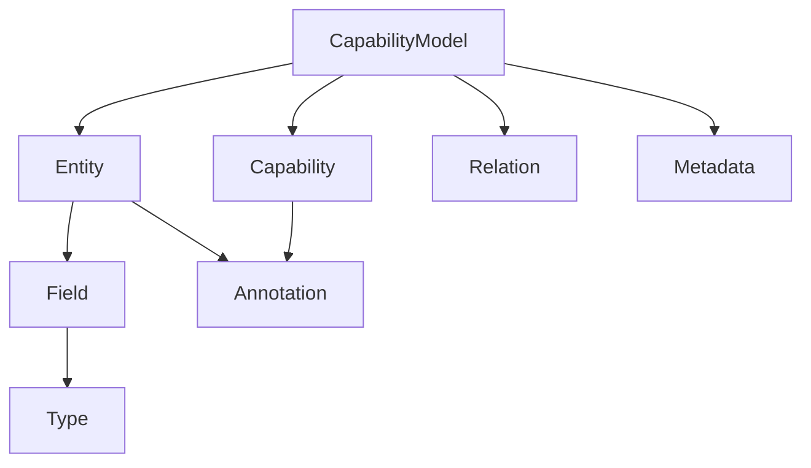

# Volume 4: Capability IR Specification

Status: Stable for the MVP shape. Future elements are marked clearly and are out of MVP scope. The Capability IR is the heart of Tibyan: the single, framework-neutral artifact that every provider produces and every backend consumes. If a concept does not belong in a neutral description of a business system, it does not belong in the IR.

---

## 1. Principles

1. The IR is neutral. It contains no framework, protocol, or language concept (ADR-0001, ADR-0013).
2. The IR is the only artifact backends read. Nothing downstream reads the original source.
3. The IR is deterministic. The same input yields the same IR, so it can be golden-file tested.
4. The IR starts small and grows. The MVP holds entities and read capabilities; later elements are added per phase, never all at once (Volume 1, section 9.1).

## 2. The object model



## 3. Objects, field by field (MVP)

### 3.1 CapabilityModel (root)
| Field | Type | Meaning |
|---|---|---|
| module | string | The name of the modeled module or system |
| version | string | The IR schema version |
| entities | Entity[] | The business objects |
| capabilities | Capability[] | The actions the system can perform |
| relations | Relation[] | How entities relate |
| metadata | Metadata | Free-form, non-semantic annotations |

### 3.2 Entity
| Field | Type | Meaning |
|---|---|---|
| name | string | Unique entity name within the module |
| fields | Field[] | The entity's fields |
| annotations | Annotation[] | Generic extension hooks |
| metadata | Metadata | Free-form |

### 3.3 Field
| Field | Type | Meaning |
|---|---|---|
| name | string | Unique field name within the entity |
| type | Type | A primitive, or a reference to another entity |
| nullable | boolean | Whether the field may be absent |
| annotations | Annotation[] | Generic extension hooks |

> Nullable default (provider rule, recorded here so every provider agrees): a field is non-nullable by default, and nullable only when the source marks it so, for example with `@Column(nullable = true)` or `@Nullable`. The Spring provider already follows this rule (Volume 5), and future providers must adopt the same default so IR output stays consistent regardless of which provider produced it.

### 3.4 Capability
| Field | Type | Meaning |
|---|---|---|
| name | string | Unique capability name, in business terms (for example getProduct) |
| kind | enum | READ, WRITE, or ACTION. MVP uses READ only |
| inputs | map of string to Type | Named, typed inputs |
| output | Type | The result type, often an entity reference. When outputMultiple is true, this is the element type of the collection, not the collection itself |
| outputMultiple | boolean | True if the capability returns a collection of the output type (a list read). Default false. Deliberate growth, RATIFIED and BUILT for phase E4 2026-07-02; see the collection-output growth note in section 4 and Volume 5, section 4.10 |
| readOnly | boolean | True if the capability has no side effects |
| binding | BindingRef | An opaque reference the runtime resolves to real logic. The IR never holds framework details |
| annotations | Annotation[] | Generic extension hooks |

> The binding is deliberately opaque in the IR. It names what to invoke, not how. The runtime and its ExecutionAdapter resolve it to a real bean or call. This keeps the IR neutral while still being executable.

### 3.5 Relation
| Field | Type | Meaning |
|---|---|---|
| from | string | Source entity name |
| to | string | Target entity name |
| kind | enum | ONE_TO_ONE, ONE_TO_MANY, MANY_TO_ONE, MANY_TO_MANY |

### 3.6 Annotation and Metadata
Annotation is a generic key with values, used as an extension hook so the IR can carry hints without growing new typed fields prematurely. Metadata is free-form key and value data that carries no semantic weight (for example, the source file a thing came from). Neither may smuggle framework concepts into semantics.

## 4. The primitive type system

The type system is closed. A type is either one of these primitives or a reference to an entity defined in the same model.

| Primitive | Notes |
|---|---|
| STRING | Text |
| LONG | 64-bit integer; common for identifiers |
| INTEGER | 32-bit integer |
| DECIMAL | Exact decimal, for money and quantities |
| FLOAT | 64-bit binary floating point; inexact by declaration, for measurements, rates, and quantities the source declares as floating point. Deliberate growth, designed and RATIFIED 2026-07-02; enters with the E3 build (see the growth note and the growth bar below, and Volume 5, section 4.6) |
| BOOLEAN | True or false |
| UUID | Universally unique identifier |
| TIMESTAMP | A point in time |
| ENTITY_REF(name) | A reference to another entity in the model |

A closed set is chosen on purpose: it forces providers to map source types into a small, well-understood vocabulary, which keeps backends simple and the IR portable.

Growth note on FLOAT, recorded per section 7 discipline: the set originally refused inexact numerics by design, and that refusal was correct until evidence priced it. The benchmark's full field census (Volume 5, section 4.4.1) found 8 `Double` fields across 7 of the 24 extraction-blocked entities, gating both entities forecast to produce the first discovered capabilities. FLOAT states what such a source declares, an inexact numeric; the exact-inexact line stays hard (no coercion in either direction, `BigDecimal` remains DECIMAL), and a FLOAT identifier forms no read intent. The rule, alternatives argued, and fixtures are in Volume 5, section 4.6.

The growth bar for the closed type set (the template FLOAT set, so a second addition cannot become casual). A new primitive enters the closed set only when all three hold: (1) counted evidence from a real benchmark shows the current set forcing a refusal on real fields, not a hypothetical one; (2) the new primitive tells the truth about the source, naming what the source actually declares rather than papering over it with a near-neighbor; and (3) it is never a coercion target from an exact type, so adding it cannot quietly change the meaning of data that already maps. FLOAT met all three: 8 real fields across 7 entities (counted), an inexact numeric named as inexact (truthful), and no path from DECIMAL or any exact type into it (no coercion). A candidate that fails any of the three is refused with a located message instead, exactly as the set did for inexact numerics until this evidence arrived. Growth is a deliberate, evidenced event, not a convenience.

Collection-output growth note (RATIFIED and BUILT for phase E4, 2026-07-02). A list read returns many of an entity, and the MVP IR had no way to say "many". This is the second deliberate growth after FLOAT, and it is a different kind: FLOAT added a member to the closed primitive set, while this adds a way for a capability to say its single output is a collection. The decision, argued against the growth bar and the smallest-honest-surface rule, is to add one boolean, `outputMultiple`, to Capability (section 3.4), and to leave the closed type set and the `Type` shape completely unchanged. The output type stays the element type (`ENTITY_REF(E)` for an entity list); `outputMultiple: true` says the capability returns a collection of that element type.

Why this shape and not a container type. The tempting alternative is to grow `Type` itself into `primitive | entity-ref | collection(elementType)`, a `LIST_OF(ENTITY_REF(E))` construct. It is rejected as larger and more dangerous:

1. It is smaller. A boolean on Capability touches one object and one validator. A container `Type` touches the sealed `Type` interface, every validator that switches on type, every backend's type rendering, and the JSON round-trip, for information the boolean already carries losslessly (a capability has exactly one output, so "the output is a collection" needs no place to nest).
2. It cannot grow into container algebra. Because the collection-ness lives on the capability and not in `Type`, there is structurally no way to write `List<List<X>>`, a `Map<K,V>`, or a collection field inside an entity. The type set stays closed and flat by construction, which is exactly the boundary this growth must never cross. A container `Type` would open all of those the moment it existed.
3. It composes with the existing hooks. A paged list discloses its page envelope through the existing `Annotation` hook (a `paged` annotation), exactly as `view`, `enum`, and `partial` already do (section 3.6), so paging needs no further growth.

What this growth will never become: no nested generics (a collection of collections is unrepresentable and refused), no `Map` modeling, no collection-typed entity fields (to-many fields stay skipped-with-a-note, Volume 5, section 4.8, until separately evidenced), and no arbitrary container algebra. `outputMultiple` marks one capability's one output as a flat collection of its element type, and nothing more.

What is deliberately not modeled, and disclosed instead of claimed: ordering and uniqueness (List versus Set) are not modeled, because the wire form is a JSON array in both cases and the tool cannot structurally prove a return is ordered or duplicate-free; the IR says "many E", never "an ordered list of E" or "a set of unique E". Paging metadata (total count, page number, page size) is not modeled either: a paged read's OUTPUT is still the element collection, and the page envelope is unmodeled wire shape, disclosed through a `paged` annotation the way a view is disclosed, never presented as the modeled shape. The evidence, the rule, the alternatives, and the fixtures are in Volume 5, section 4.10.

## 5. Validation rules

Structural rules, checked in `tibyan-core`:

1. Entity names are unique within the module; field names are unique within an entity.
2. Capability names are unique within the module.
3. Every type is a known primitive or an ENTITY_REF to an entity that exists.
4. Every relation's from and to refer to entities that exist.
5. A capability marked readOnly must not be of kind WRITE or ACTION.
6. A capability with outputMultiple true must be of kind READ (MVP), and its output must be a valid primitive or an ENTITY_REF to an entity that exists (the element type is validated by rule 3; the collection-ness is a marker, not a type, so there is nothing further to check). A singular capability leaves outputMultiple false; the field is never null.

A validation failure stops the pipeline before any generation, with a located, human-readable message.

## 6. Example IR (JSON)

```json
{
  "module": "inventory",
  "version": "0.1",
  "entities": [
    {
      "name": "Product",
      "fields": [
        { "name": "id",    "type": "LONG",    "nullable": false },
        { "name": "name",  "type": "STRING",  "nullable": false },
        { "name": "price", "type": "DECIMAL", "nullable": false }
      ]
    }
  ],
  "capabilities": [
    {
      "name": "getProduct",
      "kind": "READ",
      "inputs": { "id": "LONG" },
      "output": "ENTITY_REF(Product)",
      "readOnly": true,
      "binding": "inventory.ProductService#findById"
    }
  ],
  "relations": []
}
```

This is the MVP target: one entity, one read-only capability, a binding the runtime resolves to a real method.

## 7. Future elements (out of MVP scope)

These are the north star from Volume 1, section 9.1. They are specified here only as direction, and each enters through its own RFC (Volume 15) and a phase, never all at once.

| Element | What it will add | Enters via |
|---|---|---|
| Workflows | Multi-step processes spanning capabilities | RFC, later phase |
| Events | Occurrences the system emits or reacts to | RFC, later phase |
| Policies | Rules constraining how capabilities are used | RFC, later phase |
| Permissions | Who or what may invoke a capability | RFC, later phase |
| Dependencies | How capabilities and systems depend on each other | RFC, later phase |
| Domain knowledge | Meaning and context beyond structure | RFC, later phase |

> Discipline note: adding any of these to the core model is a deliberate, validated step with its own validators and tests. Until a phase needs an element, it stays out, so the MVP IR remains small and provable.

### 7.1 Evidence-backed growth pressure (from the second-app trial), and how each item resolved

The pms-backend trial (docs/experiments/second-app-trial.md) produced the first concrete, counted pressure on this model, recorded here so growth stays deliberate. Updated 2026-07-02 with the E3 design outcomes:

- Collection outputs. List, filter, and paged reads dominate that app's real read API, and the type system had no collection shape for a capability's output. Resolved as deliberate growth (phase E4, RATIFIED and BUILT 2026-07-02): one boolean, `outputMultiple`, on Capability, with the closed type set unchanged (see the collection-output growth note in section 4). This models the unfiltered list-all read only; filtered, view-returning, and paged-envelope-shaped list reads are deferred by name to a successor phase, on the census evidence in Volume 5, section 4.10 and the experiment logs. The growth bar held in spirit: a boolean marker, not a container type, and no new primitive.
- Associations. Resolved with no IR growth (E3 decision a, Volume 5, section 4.4): the vocabulary already existed here, `ENTITY_REF` (section 4) and `Relation` (section 3.5), and the E3 design confirmed a pure provider mapping rule suffices. To-many collections stay deferred (zero exist in the benchmark).
- Enums. Resolved with no IR growth (E3 decision b, Volume 5, section 4.5): STRING plus an `enum` annotation carrying the closed value set, using the Annotation hook exactly as section 3.6 intends. A first-class ENUM primitive remains a deferred candidate, to be reopened only if enums are needed as capability inputs.
- Inexact numerics. Resolved as deliberate growth (E3 decision c, Volume 5, section 4.6): FLOAT enters the closed set, pending ratification, on the census evidence (8 fields, 7 of 24 blocked entities, both joint-exit targets). See the growth note in section 4.
- Multi-argument reads. The `inputs` map (section 3.4) already holds multiple named inputs, so these likely need a discovery rule, not an IR change; that is decided in phase E4's design step. Still open.
- Partial-model integrity (the erp-backend trial). When an app extracts only in part, the model must stay closed (every `ENTITY_REF` and `Relation` targets a present entity, validation rules 3 and 4) and must disclose which entity shapes are incomplete. Resolved with no IR growth (Volume 5, sections 4.7 to 4.9): a closure pass drops references to absent entities, and a partial entity carries a `partial` annotation through the existing hook (section 3.6). The growth bar held: no new object, no new type, no new field. The dangling-reference case argued for an unresolved-reference concept and was refused, because the MCP tool does not expose an entity's field schema, so the consumer sees no benefit from representing an unresolved reference rather than dropping it.
