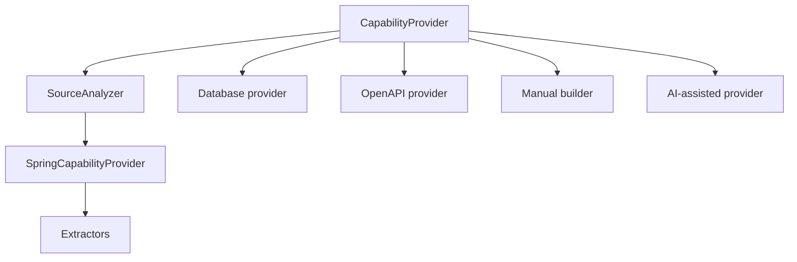

# Volume 5: Capability Providers

Status: Stable for the abstraction and the Spring provider. Future providers are described as direction. A Capability Provider is any source that produces Capability IR. It is the only part of the system that reads the original system, and it produces IR and nothing else.

---

## 1. The abstraction



```java
public interface CapabilityProvider {
    CapabilityModel provide(ProviderInput input);
}
public interface SourceAnalyzer extends CapabilityProvider { }   // a provider that reads code
```

## 2. Why provider is broader than analyzer

Not every input analyzes source code. An OpenAPI file, a database schema, or a human using a manual builder all describe a system without any code analysis. If the top abstraction were named Analyzer, those inputs would not fit it, and the name would have to change later. CapabilityProvider is the general contract; SourceAnalyzer is the specialization for inputs that read code (ADR-0003).

## 3. The provider contract

A provider takes an input that identifies a source and returns a Capability IR. It must:

1. Produce only IR. It never generates output and never knows what backends exist.
2. Map source types into the closed primitive type system (Volume 4, section 4).
3. Be deterministic. The same source yields the same IR.
4. Depend only on the plugin API and the core, never on a backend or a runtime (Volume 12, section 5).

## 4. The Spring provider (MVP)

`SpringCapabilityProvider` is a SourceAnalyzer that reads a Spring and Java project from source using JavaParser (ADR-0010). It is organized as independent extractors, of which only the Entity extractor is enabled for the MVP (ADR-0011).

| Extractor | Reads | Status |
|---|---|---|
| EntityExtractor | Classes annotated as entities and their fields | MVP, enabled |
| RepositoryExtractor | Repository interfaces and their queries | Placeholder |
| ServiceExtractor | Service methods, to enrich capabilities | Placeholder |
| ControllerExtractor | Controllers, to learn exposed operations | Placeholder |
| AnnotationExtractor | Annotations, as generic hints | Placeholder |

The extractor pattern keeps the provider correct from day one and lets coverage grow without reshaping the module. Each extractor contributes part of the IR; the provider assembles and returns the whole.

### 4.1 The binding convention (MVP decision)

For the MVP, a capability's binding (for example `ProductService#findById`) is a documented convention, not a fact read from the service. The Entity extractor synthesizes it from the entity name, as `<Entity>Service#findById`, because the provider does not read services yet. The binding stays opaque in the IR (Volume 4, section 3.4): it names what to invoke, never how. The runtime resolves the convention to a real bean and method (Volume 7, section 4 and rule 3).

Making the binding real, by reading the actual service method rather than assuming the convention, is the ServiceExtractor's job in a later phase, not P2. P2 must resolve the convention to a real call; it must not harden the convention into a permanent assumption anywhere downstream.

## 5. Future providers

| Provider | Source | Why it matters |
|---|---|---|
| Database provider | A database schema | Proves the IR accepts a non-code source (Volume 13, P6) |
| OpenAPI provider | An OpenAPI document | Imports systems that already publish a contract |
| Manual builder | A human-authored definition | A fallback when no readable source exists |
| AI-assisted provider | Mixed or unclear sources, with model assistance | Helps where structure is implicit, with human review |
| Bytecode analyzer | Compiled classes | Reads systems whose source is unavailable |

Each new provider produces the same IR, so every existing backend and runtime works against it with no change. That is the entire point of the abstraction.

## 6. Rules

1. A provider feeds the IR and stops. It produces no output.
2. A provider never depends on a backend or a runtime.
3. A provider maps all source types into the closed primitive set; unknown types are a validation concern, not a silent passthrough.
