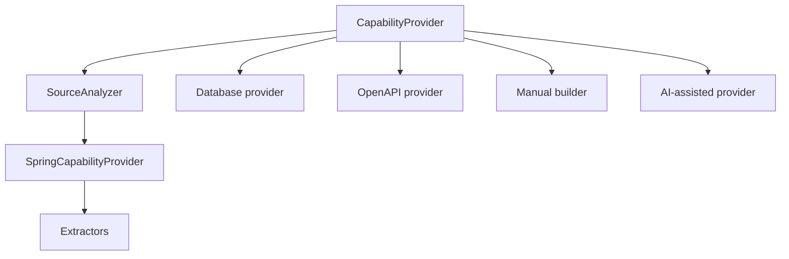

# Volume 5: Capability Providers

Status: Stable for the abstraction and the Spring provider. Future providers are described as direction. A Capability Provider is any source that produces Capability IR. It is the only part of the system that reads the original system, and it produces IR and nothing else.

---

## 1. The abstraction



```java
public interface CapabilityProvider {
    CapabilityModel provide(ProviderInput input);
}
public interface SourceAnalyzer extends CapabilityProvider { }   // a provider that reads code
```

## 2. Why provider is broader than analyzer

Not every input analyzes source code. An OpenAPI file, a database schema, or a human using a manual builder all describe a system without any code analysis. If the top abstraction were named Analyzer, those inputs would not fit it, and the name would have to change later. CapabilityProvider is the general contract; SourceAnalyzer is the specialization for inputs that read code (ADR-0003).

## 3. The provider contract

A provider takes an input that identifies a source and returns a Capability IR. It must:

1. Produce only IR. It never generates output and never knows what backends exist.
2. Map source types into the closed primitive type system (Volume 4, section 4).
3. Be deterministic. The same source yields the same IR.
4. Depend only on the plugin API and the core, never on a backend or a runtime (Volume 12, section 5).

## 4. The Spring provider (MVP)

`SpringCapabilityProvider` is a SourceAnalyzer that reads a Spring and Java project from source using JavaParser (ADR-0010). It is organized as extractors. The Entity and Service extractors are enabled: the Entity extractor reads entities and their read intents, the Service extractor discovers the real binding, and the provider joins the two (section 4.1). The repository, controller, and annotation extractors remain placeholders. This refines ADR-0011, which enabled only the Entity extractor at the start of the MVP.

| Extractor | Reads | Status |
|---|---|---|
| EntityExtractor | Classes annotated as entities, their fields, and the read intent for each | Enabled |
| ServiceExtractor | Service classes and their public methods, to discover a read capability's real binding | Enabled (read-by-id binding discovery) |
| RepositoryExtractor | Repository interfaces and their queries | Placeholder; the E2 build enables it to catalog Spring Data repositories (entity and id type arguments), hand-written repository interfaces, and their one-hop delegating implementations, the load evidence of section 4.2 |
| ControllerExtractor | Controllers, to learn exposed operations | Placeholder |
| AnnotationExtractor | Annotations, as generic hints | Placeholder |

The extractor pattern keeps the provider correct from day one and lets coverage grow without reshaping the module. Each placeholder extractor will contribute an independent slice of the IR. The Entity and Service extractors are different: they cooperate to produce one fact (the discovered binding), and that cooperation is a join the provider owns, so the extractors never depend on each other (section 4.1).

### 4.1 Binding discovery (the read capability's real method)

A capability's binding (for example `ProductService#findById`) names the real logic the runtime invokes. It is discovered from the source, read from the actual service method, not assumed from the entity name. The binding stays opaque in the IR (Volume 4, section 3.4): it names what to invoke, never how. The runtime resolves it to a real bean and method (Volume 7, section 4 and rule 3).

Two extractors collaborate, joined by the provider so that neither depends on the other:

- EntityExtractor reads each `@Entity` and produces the entity, its fields, and a read intent: the desired capability `get<Entity>`, its single id input (name and mapped type), and its entity-reference output. The read intent carries no binding.
- ServiceExtractor reads each `@Service` class and produces a neutral catalog of its public methods: the owning service's simple name, the method name, the return type's simple name, and the parameter types as written. It knows nothing about entities.
- SpringCapabilityProvider joins them: for each read intent it finds the one service method that backs it, and emits the capability with the discovered binding. The matching is the provider's coordination job, so the extractors stay independent.

The matching rule, the contract, is kept deliberately shape-based, not name-based. A service method M backs the read capability `get<Entity>` for entity E, whose id maps to primitive type `idType`, when all of these hold:

1. M is declared on a class annotated `@Service`.
2. M is `public` and not `static`.
3. M's return type, by simple name, equals E's name (M returns the entity).
4. M declares exactly one parameter, and that parameter's type maps, through the same Java-to-primitive mapping the entity fields use, to `idType` (M takes the entity's id).

The rule is expressed in types and shapes, never in the literal names `Product`, `ProductService`, or `findById`. A finder named `loadById` or `byId`, on a service named `CatalogStore` rather than `<Entity>Service`, still matches if its shape fits. A method with the same shape on a `@RestController` does not match, because rule 1 requires a `@Service`.

Outcomes:

- Exactly one method matches: the capability is emitted with binding `<ServiceClassSimpleName>#<methodName>`, taken from that method.
- No method matches: the provider fails with a located `ProviderException` that names the entity, the return type and single parameter type it sought, and the `@Service` methods it did see. It does not fall back to any convention.
- More than one method matches: the provider fails with a `ProviderException` listing the candidates. The backing method must be unambiguous; the provider will not guess.

Binding string format: unchanged. Discovery emits `<ServiceClassSimpleName>#<methodName>`, exactly the shape the runtime's `SpringExecutionAdapter` already parses (`<Bean>#<method>`, Volume 7, section 4). For the example app the discovered binding is `ProductService#findById`, identical to what the earlier convention produced; only its source changed, from assumed to read, so the adapter and the generated output are unchanged.

What is still assumed or unsupported, recorded so it is closed deliberately later. The second-app trial (docs/experiments/second-app-trial.md) measured these against a large real app and ranked them by capabilities blocked; the resulting phases are Volume 13, Tier 2:

- Parse behavior (closed by phase E1, see section 4.3). Once the top-ranked gap: the provider aborted the whole scan on the first unparseable file, the JavaParser language level was below the Java version of real apps (the trial app is Java 17), and the walk covered every file. It blocked 38 of 43 entities before extraction began. Phase E1 raised the language level to Java 17, made the survey collect-and-continue per file, and scoped the walk; the pms-backend scan now completes end to end and classifies all 43 entities (docs/experiments/second-app-trial.md, section 8.1).
- The matcher relates a service method to an entity only when the method returns the entity itself. Real layered systems return DTO and VTO types from services; the trial found this blocks essentially every single-key entity there (phase E2, section 4.2 below).
- Entity fields whose type is another entity (associations) have no mapping and fail loudly as unmapped types. Blocked four entities in the trial (phase E3).
- Only single-id-parameter reads are discovered. Lists, filtered queries, multi-argument finders, writes, and actions are not modeled; list and filter reads are the bulk of the trial app's real read API (phase E4), and write and action capabilities are future IR (Volume 4, section 7).
- The capability name is still the `get<Entity>` convention. Only the binding is discovered, not the business name of the capability.
- The entity's identifier is the first field annotated `@Id`. Composite or non-`@Id` identifiers are out of scope (three join entities in the trial; deliberately unscheduled).
- Type matching uses the closed primitive set; an id whose type is not in that set (Volume 4, section 4) cannot be matched and is surfaced as an unmapped type.

### 4.2 DTO-aware read discovery (designed 2026-07-02; RATIFIED 2026-07-02 as written)

The trial's second-ranked gap is that real service boundaries return view types, so a rule is needed for when a DTO- or VTO-returning service method backs a read of an entity. This section is that rule, designed from a read-only study of the benchmark app before any code, exactly as the binding rule in section 4.1 was: the rule enters this volume in one commit, the code follows in a later session, only after this rule is ratified. Until ratification, no matching code may be written.

#### 4.2.1 Evidence (read-only study of pms-backend, 2026-07-02)

Every by-id read visible in the benchmark's parseable source was traced from the service method down to the persistence call. Census of the six single-id, view-returning reads found in parsed `@Service` classes:

| Read | Body shape | Load chain terminal | Pattern |
|---|---|---|---|
| TenantServiceImpl#findById | load, unwrap, one mapper call | custom `@Query` (`findByIdWithRelations`, JPQL `WHERE t.id = :id`) | P1b |
| UnitServiceImpl#findById | load, unwrap, one mapper call | framework `findById` via one-hop delegation | P1a |
| LeaseServiceImpl#findById | load, unwrap, one mapper call | framework `findById` via one-hop delegation | P1a |
| BuildingServiceImpl#findById | load, map, second repository access, view mutation | framework `findById` | P2 |
| PropertyServiceImpl#findById | load, map, then loads buildings and units into the view | framework `findById` | P2 |
| ChatRoomServiceImpl#getChatRoomById | load, session-context read, authorization check, two more loads, multi-argument mapping | framework `findById` | P2 |

The recurring structural facts, and what they mean for the rule:

- The service layer never calls Spring Data directly. Every service depends on a hand-written repository interface (for example `TenantRepository`, a plain interface, not a Spring Data type). Its `@Repository` implementation delegates to a Spring Data interface (`TenantJpaRepository extends JpaRepository<Tenant, Long>`) one hop down. In four of five sampled implementations, the by-id method's body is exactly one statement, `return <jpaRepo>.findById(<param>);`, the framework's by-primary-key read. In one (Tenant), the terminal is a custom `@Query` whose by-primary-key fact lives inside a JPQL string.
- The mapping step is one call with the loaded entity as its sole argument: a MapStruct mapper declared in-tree (`public abstract TenantVTO toTenantVTO(Tenant tenant)` on `@Mapper PropertyMgtMapper`). The mapper declaration ties view to entity by declared parameter type, in code, with no name inspection.
- The by-primary-key fact is the safety-critical discriminator, and names cannot carry it. `TenantRepository` declares `Optional<Tenant> selectById(Long id)` and `Tenant findByUserId(Long userId)` side by side: identical Java shapes, one loads by primary key, one by a foreign key. Only the framework contract (`findById` inherited from a Spring Data repository of E) or the JPQL text distinguishes them. The rule therefore anchors on the framework contract and refuses the JPQL case.
- Live trap cases that a shape-only rule would mis-bind, all present in parsed source: `LeaseServiceImpl#getMyActiveLease(Long tenantId)` (filter query by tenant, first element, mapped; one Long parameter, returns LeaseVTO); `TenantServiceImpl#getMyUnit(Long userId)` (loads Tenant by user id, returns a Unit view off a navigation, `tenant.getUnit()`); `UserMgtProxyInternalServiceImpl#findById(Long)` (pure delegation, no load in the body, delegate unparseable); `resetPassword(Long)` returning String (a write with a read's signature); `FileIdGeneratorServiceImpl#generate(Integer domainId)` (one parameter of Domain's id type, no load of Domain); `DailyCounterServiceImpl#getNewCount()` (a mutating counter behind a read-sounding name); `UserDetailsSecurityService#loadUserByUsername(String)` (loads by email, second repository access, mutates the view). The rule's conditions refuse every one of these structurally.
- Composite-key hazard, exposed by tracing E1's outcomes: `EventAttendee` and `GroupMember` use `@IdClass` with two `@Id Long` fields. Section 4.1's "first `@Id` field" assumption formed a half-key read intent (`getEventAttendee(eventId)`). Nothing backed it, so no harm occurred, but if a matching one-Long method had existed, a composite-key entity's read could have bound to half its key. The eligibility rule below closes this.

Reachability of the 19 NO_BACKING_METHOD entities (why the benchmark number cannot move from this rule alone): 15 have their entire service layer among the 27 unparseable placeholder files (admin 3, billing 3, PPFile 1, inspection 1, maintenance 2, notification 2, user 3); 2 are the composite-key join entities (also unparseable services); 1 has an empty parsed service (AuditLog, fields only, no methods); 1 has only a mutating counter method (DailyCounter). None has any single-id-parameter read in a parsed `@Service`. The six reads in the census all belong to entities currently blocked at extraction (UNMAPPED_FIELD_TYPE, phase E3's causes: associations and enums). The consequences are stated in 4.2.9.

#### 4.2.2 The rule

A service method M backs the read capability `get<E>` for entity E, whose identifier maps to primitive type `idType`, when ALL of the following hold. Conditions 1 and 2 restate section 4.1's frame; the rest are new.

0. Eligibility (tightened): E has exactly one field annotated `@Id` and no `@EmbeddedId`. An entity with more than one `@Id` field or an `@EmbeddedId` forms no read intent at all; it is reported with a composite-key cause, never read by part of its key.
1. M is declared on a class annotated `@Service`, is `public`, and is not `static`.
2. M declares exactly one parameter, and that parameter's type maps to `idType`.
3. M's declared return type is not `void`. (If its simple name equals E's name, M is a section 4.1 candidate; this rule covers the case where it does not.)
4. M's body contains exactly one persistence access, the load, and it is one of:
   a. a call to one of the framework by-primary-key reads, `findById`, `getById`, or `getReferenceById`, on a field of the service whose declared type resolves in-tree to a Spring Data repository of E: an interface extending one of the recognized supertypes (`JpaRepository`, `CrudRepository`, `ListCrudRepository`, `PagingAndSortingRepository`, `ListPagingAndSortingRepository`) whose first type argument is E and whose second maps to `idType`; or
   b. a call to a method M2 on a field whose declared type resolves in-tree to a hand-written repository interface, where M2 is declared to return E or `Optional<E>` and take one parameter of `idType`, and the interface's single in-tree `@Repository` implementation implements M2 with a body that is exactly one return statement performing case (a) with the parameter forwarded verbatim (the one-hop delegation trace).
5. The argument to the load (and, in 4b, the argument forwarded by the delegation) is M's single parameter, verbatim: the parameter name itself, not an expression over it.
6. No other repository access appears anywhere in M's body: no call on any other repository-typed field, and no call anywhere whose target is a repository-typed field and whose name is a mutation (`save`, `saveAll`, `insert`, `update`, `delete`, `deleteById`, `deleteAll`, `persist`, `merge`, `flush`).
7. Apart from the load, M's body is exactly one of the two read shapes:
   a. fused: a single `return` whose expression is the load followed only by Optional unwrapping (`orElseThrow(...)`, `orElse(...)`, `get()`) and at most one `Optional.map(<mapping step>)`; or
   b. two-statement: one local variable declared and initialized from the load (with optional unwrap chain), followed immediately by `return <mapping step>(<that local>);`, with no other statements in the body.
8. The mapping step, when present, is a single call whose sole argument is the loaded entity value itself: an instance method on a field of the service, a static factory, a constructor, or a method reference inside `Optional.map`. A navigation (`x.getUnit()`), an element extraction (`list.get(0)`), or a multi-argument call disqualifies. When there is no mapping step (the fused form returns the unwrapped load), M is a section 4.1 candidate by construction.
9. The mapping step's callee resolves in-tree to a declaration whose single parameter's type is E by simple name and whose return type equals M's declared return type. An unresolvable callee refuses: the evidence is incomplete, and incomplete evidence is a refusal, not a guess. This resolution is the rule's type check; it is what makes the view's derivation from E a stated fact of the code rather than an inference.
10. Pooling and uniqueness: all methods matching section 4.1 (entity-returning) or this rule (view-returning) for entity E form one candidate set, with no precedence between the two kinds. Exactly one candidate: the capability is emitted with binding `<ServiceClassSimpleName>#<methodName>`. Zero: NO_BACKING_METHOD, with the near-miss diagnostics of 4.2.4. More than one: AMBIGUOUS_BINDING, listing all candidates. The provider never picks.

#### 4.2.3 The explanation

Every match must be explainable, and the explanation is part of the scan report's detail for the discovered entity. It contains, in code terms: the binding (service and method); the load evidence (the repository field and its declared type; whether the chain is direct or one-hop, and for one-hop, the interface method and the implementing class; the terminal framework method; and the Spring Data declaration cited as `<Interface> extends <Supertype><E, idType>`); the mapping evidence (the callee and its in-tree declaration, `<Mapper>#<method>(<E>) : <View>`); and the view type's simple name. Name resemblance between the view and the entity is never part of the evidence and never appears as a reason.

#### 4.2.4 Refusals and diagnostics

- Zero candidates stays NO_BACKING_METHOD with a located message, extended two ways. Near-misses: any method that passed conditions 1 to 3 but failed a later condition is named with the first condition it failed, in the rule's terms (for example: "load resolves through TenantRepository#selectById, whose implementation delegates to TenantJpaRepository#findByIdWithRelations, a custom query; by-primary-key evidence unavailable, deferred pattern P1b"). Skipped-file context: when any `@Service` or `@Repository` file under the scanned source was a parse skip, the message states how many, so an absence of candidates is never mistaken for an absence of code.
- More than one candidate stays AMBIGUOUS_BINDING, listing every candidate with its kind (entity-returning or view-returning).
- Composite-key entities are refused at eligibility (condition 0) with their own cause, distinct from "no identifier", naming the `@Id` fields or the `@EmbeddedId` seen.

#### 4.2.5 What the IR says about the output

Decision: the capability's output remains `ENTITY_REF(E)`, and the capability carries an annotation, name `view`, whose value is the returned view type's simple name.

Why: semantically the capability reads E; the rule's whole burden is proving, structurally, that the returned view is derived from a by-primary-key load of E in one step. The IR describes what a capability means, not its wire schema, and `ENTITY_REF(E)` with the view noted is the smallest representation that does not lie: an agent reading the manifest learns it is reading E and learns the concrete shape has a name of its own. The alternative, a first-class view or projection concept carrying the view's fields, is deliberate IR growth under Volume 4, section 7: it enters through its own designed step with validators and golden tests if and when evidence shows agents need field-level view schemas. It is explicitly not smuggled in here. The `Annotation` hook exists precisely for hints that must not grow the model prematurely (Volume 4, section 3.6).

#### 4.2.6 Covered and deferred patterns

Covered by this rule (from the census):

- P1a, minimal load-then-map with a framework by-primary-key terminal, direct or one-hop (Unit, Lease; 2 of the 6 census reads).

Deferred, each keeping a loud refusal with a named diagnostic:

- P1b, minimal shape but the load terminal is a custom `@Query` (Tenant; 1 of 6). Closing it means reading JPQL where-clauses or accepting a user-supplied assertion that a repository method is the by-primary-key read. Both are decisions for a later phase; neither is guessed now.
- P2, composite view assembly: the correct by-id load followed by further loads and view enrichment (Building, Property, ChatRoom; 3 of 6). These are real reads, but their result is assembled from more than the entity; expressing them honestly needs more than a one-step derivation and is deferred.
- Delegation-only facades (the proxy services): the evidence lives in the delegate, and tracing service-to-service chains is out of scope (in the benchmark the delegates are unparseable anyway).
- Non-primary-key single-argument reads (`getMyActiveLease`, `getMyUnit`, `findByUserId` shapes): permanently out of scope for `get<E>` by design. They are different capabilities (future named reads), not failed matches of this one.
- List, filter, and aggregate reads: phase E4 and later (Volume 4, section 7 discipline).

#### 4.2.7 What this rule will never do

- Never match on name similarity between a view and an entity (`TenantVTO` ~ `Tenant`), not even as a tiebreaker; names of views, services, and repository methods on hand-written interfaces carry no evidence weight. The only names with weight are framework contracts: the annotations already trusted (`@Entity`, `@Id`, `@Service`, `@Repository`), the recognized Spring Data supertypes, and the framework's own by-primary-key methods, whose semantics are defined by the framework, not by the application's style.
- Never score field overlap between a view and an entity.
- Never fall back: zero evidence is a refusal, partial evidence is a refusal, unresolvable evidence is a refusal.
- Never accept a non-verbatim argument flow: an expression, navigation, or element extraction is never "the id" or "the entity".
- Never bind a method whose body contains any mutation access or any second load.
- Never read by part of a composite key.

#### 4.2.8 Pre-registered fixtures (the build session must include these before the code exists)

Positives, one per covered form:

- F1: direct Spring Data load, fused form: `return mapper.toVto(repo.findById(id).orElseThrow(...));` with the repository declared `extends JpaRepository<E, Long>` in-tree.
- F2: one-hop delegation (the Unit and Lease shape): hand-written interface plus `@Repository` implementation whose body is `return jpaRepo.findById(id);`, service in the two-statement form.
- F3: `Optional.map` with a method reference: `return repo.findById(id).map(mapper::toVto).orElseThrow(...);`.

Refusals, each asserting the located diagnostic:

- F4: name-similar but structurally unrelated: a `TenantVTO`-returning method whose body loads via Building's repository (or performs no load). Must not match `getTenant`; this is the mandated proof that names carry nothing.
- F5: non-primary-key load: `findByUserId(Long)` declared on the Spring Data interface (a derived non-pk query), wrapped in an otherwise perfect body. Must refuse.
- F6: composite assembly (Building shape): second repository access and view mutation. Must refuse.
- F7: write in disguise: framework `findById` load, then mutation and `save`, then a mapped return. Must refuse on the mutation access.
- F8: custom-query terminal (Tenant shape): one-hop delegation ending in `@Query findByIdWithRelations`. Must refuse with the P1b near-miss naming the chain.
- F9: navigation argument (`getMyUnit` shape): `return mapper.toUnitVTO(tenant.getUnit());`. Must refuse.
- F10: delegation-only facade (proxy shape): no load in the body. Must refuse.
- F11: ambiguity across kinds: one entity-returning and one view-returning candidate for the same entity. Must refuse as AMBIGUOUS_BINDING listing both.
- F12: composite-key entity (`@IdClass`, two `@Id` fields): no read intent formed; the composite-key cause is reported. This is the eligibility tightening's test.

#### 4.2.9 Benchmark prediction and the sequencing finding

Stated before the build, so the build is measured against a forecast rather than a moving target:

- After the E2 build alone: discovered 0, mis-bound 0. Unchanged totals, because none of the 19 NO_BACKING_METHOD entities has any single-id read in a parseable service (4.2.1). What changes is honesty: NO_BACKING_METHOD messages gain near-miss and skipped-file context, and the two composite-key entities move from NO_BACKING_METHOD to the composite-key cause (predicted causes: unmapped field type 24, no backing method 17, composite key 2).
- After E2 and E3 together (E3 clearing the census entities' field types, associations and enums): Unit and Lease flip to DISCOVERED through P1a, each with exactly one candidate (the census found no competing methods). Predicted discovered: up to 2, contingent on E3 clearing every field of those entities, with mis-bound exactly 0. Tenant stays refused with the named P1b near-miss; Building, Property, and ChatRoom stay refused as P2.
- The hard bar is unchanged and absolute: mis-bound must be exactly 0 on every run. One mis-binding stops all phase work.

The sequencing finding, plainly: phase E2's exit criterion as written in Volume 13 ("discovered greater than zero on pms-backend") is not achievable by the E2 build alone on this benchmark. The first rise in discovered requires E2 and E3 together.

Ratification (2026-07-02): this rule is ratified as written, conditions 0 through 10, the ENTITY_REF-plus-view-annotation representation, fixtures F1 to F12, and the deferred patterns. Sequencing was decided: E3 is designed and built before the E2 build, and E2 plus E3 are measured jointly against the benchmark with the shared exit criterion, discovered greater than zero (forecast: Unit and Lease via P1a) and mis-bound exactly zero. The E2 build session follows the E3 build.

#### 4.2.10 P1b: the custom-query by-primary-key terminal (designed 2026-07-02; RATIFIED 2026-07-02 as the strict by-primary-key boundary; BUILD DEFERRED)

This is the deferred half of condition 4 (patterns 4.2.6). Today the load evidence must be a framework by-primary-key read (`findById`, `getById`, `getReferenceById`) on a Spring Data repository of E, reached directly (4a) or as the single delegate of the one-hop hand-written trace (4b). P1b answers the deferred question: when may a custom `@Query` method serve as that same load evidence? The bar is unchanged: structural proof of the by-primary-key claim, or refusal. Names carry no weight; the JPQL text is read, never the method name.

The design-closure of 2026-07-02 tightened this rule and re-examined its one apparent discovery, and it changed the outcome. The first design draft (also 2026-07-02) permitted any `JOIN FETCH` clause, including an inner one, on the assumption that a fetch join "never removes rows." That assumption is false for an inner `JOIN FETCH`: an inner join is an existence filter, and it drops the root entity when the fetched association is absent. Applying the corrected, strict rule to the only clean-looking discovery, pms Tenant, flips it from discovered to refused (section 4.2.10.1). The decisive finding follows: on both benchmarks there is NO custom query that is both provably nothing-but-a-by-primary-key load and feeding a discoverable read. P1b therefore discovers zero, and its ratified value is the strict refusal boundary it draws, inherited by E6 as a floor (section 4.2.10.6). Refusal is not the primary path of this rule; on this evidence it is the total path.

##### 4.2.10.1 Evidence and the decisive finding (read-only, both apps)

Every custom-query by-id read was traced to source. The full census is in the experiment ledgers (docs/experiments/second-app-trial.md, section 8.8; docs/experiments/third-app-trial.md, section 14). Six by-primary-key-shaped custom `@Query` methods exist across the two apps. Condition 4 (and therefore P1b) is consulted only when such a query is the load evidence of a view-returning service read, which is true for exactly two of the six; the other four feed a service `findById` that returns the entity, so they are section 4.1 discoveries whose bodies 4.1 never reads (P1b never touches them, verified on erp Product, Contact, ContactGroup, and Ticket: `TicketServiceImpl#findById` returns Ticket, so its custom-query body is irrelevant to its existing 4.1 discovery). The two that matter, each applied against the strict rule below:

- pms Tenant, `TenantServiceImpl#findById -> TenantVTO`, one-hop through `TenantRepository#selectById` to the `@Query` method. Its text, verbatim from source: `"SELECT t FROM Tenant t JOIN FETCH t.user LEFT JOIN FETCH t.unit un LEFT JOIN FETCH un.building b LEFT JOIN FETCH b.property WHERE t.id = :id"`. The WHERE is a single equality between the id property and the method's parameter, and PASSES P5. But the first fetch, `JOIN FETCH t.user`, is an INNER join fetch, and `Tenant.user` is a nullable `@ManyToOne` (declared `@ManyToOne @JoinColumn(name = "user_id")`, with no `optional = false` and no `nullable = false`, so nullable by JPA default). An inner join fetch on a nullable association drops the Tenant when its user is null: this query returns nothing for a Tenant that exists but has no user, so it is not equivalent to a by-primary-key load. It carries a hidden existence filter, and under the strict rule (P4 below) it FAILS. Verdict: FAIL. getTenant is not discovered.
- erp Delivery, `DeliveryServiceImpl#findById -> DeliveryReadDTO`, direct on the Spring Data repository. Its text: `"SELECT d FROM Delivery d LEFT JOIN FETCH d.truck LEFT JOIN FETCH d.driver LEFT JOIN FETCH d.transaction t LEFT JOIN FETCH t.customer LEFT JOIN FETCH t.supplier WHERE d.id = :id"`. Every fetch is a LEFT JOIN FETCH and the WHERE is the single id equality, so this query PASSES the strict rule: it is a genuine by-primary-key load. But Delivery does not discover, for a reason unrelated to P1b: `DeliveryServiceImpl#findById` maps via `mapToDTO(delivery)`, an implicit-this call with no receiver, which refuses at condition 9 (the mapper does not resolve to a field, a static factory, a constructor, or a method reference). Verdict on the query: PASS; on the read: refused at the mapper.

So the two clean-looking candidates fail for two different reasons: Tenant's query filters (inner fetch on a nullable association), and Delivery's query is a clean by-primary-key load whose consumer is blocked by an unrelated mapper rule. There is no case in either benchmark where a strict by-primary-key custom query feeds a discoverable view read. The blunt version of the finding, corrected from the first draft: the by-primary-key custom queries in the wild are not as clean as they look; the moment you read the join semantics rather than the WHERE alone, the one that seemed pure carries a filter. P1b discovers zero.

The contrast with the openly filtered custom queries is structurally clear and not a matter of naming: erp `DeliveryRepository#searchByFields`, `ProductRepository#findProducts`, `EmailTemplateRepository#searchByFields` are multi-parameter with `AND`/`OR`/`LIKE` predicates, refused already by condition 2 and by P5.

##### 4.2.10.2 The ratified rule: a custom `@Query` is a by-primary-key load only when provably nothing but one

Condition 4's terminal set is amended. The load in 4a (the direct call), and the single delegate call in the 4b one-hop implementation body, may serve as the by-primary-key load evidence when, in addition to a framework read, they call a repository method annotated `@Query` that is a VERIFIED by-primary-key select of E. Nothing else in rule 4.2 changes: conditions 5 to 9 (the verbatim argument, the single-access body, the two read shapes, the one resolvable mapping step) still apply to the service method exactly as written.

A `@Query` method is a verified by-primary-key select of E when ALL of the following hold. The rule is strict on purpose: it accepts only a query it can prove is nothing but a by-primary-key load.

- P1. It is declared on a Spring Data repository of E (an interface extending a recognized supertype whose first type argument is E), reached directly or as the 4b one-hop delegate terminal. P1b adds no new repository resolution; it reuses 4a and 4b's scoping exactly.
- P2. It carries a `@Query` annotation with a literal string value, and that value is JPQL. A `@Query(nativeQuery = true)` does not qualify: native SQL references tables and columns the tool has not mapped to E and its identifier, so the structural link to E is unprovable. A `@Query` referencing a named query by name only (its text defined elsewhere, for example a `@NamedQuery` or an XML mapping), or a repository method with no `@Query` at all, does not qualify: the query text must be present and readable in the annotation. Unlocatable text is a refusal, never an assumption.
- P3. The JPQL, read as a narrow token template (not interpreted), is a single-entity select of the root: `SELECT [DISTINCT] <alias> FROM <E> <alias> <fetch clauses> WHERE <predicate>`, where `<alias>` is the sole select item and is exactly the FROM alias, and `<E>` by simple name is E. A projection (`SELECT new <Dto>(...)`, `SELECT <alias>.<field>`, `SELECT COUNT(...)`, or more than one select item) does not qualify: its result is not E, so it is not a load of E.
- P4 (corrected in the design-closure, the pivotal condition). Every clause between FROM and WHERE is a `LEFT JOIN FETCH`. A LEFT (outer) join fetch is a pure eager-load directive: it adds related data to the returned E and never removes a root row, so it does not change the by-primary-key claim. An inner `JOIN FETCH` (a fetch join written without `LEFT`) does NOT qualify: it is an existence filter that drops the root E when the fetched association is absent, so it can return nothing for an E that exists by its id. The tool refuses it structurally, from the query text alone, without reasoning about whether the association happens to be mandatory; that a particular association is non-nullable is a fact the query text does not carry, and the rule does not go looking for it. A plain `JOIN` carrying an `ON` or `WITH` condition, or any join that is not a LEFT fetch, likewise does not qualify.
- P5. The WHERE clause is EXACTLY one equality between E's identifier and the method's single parameter: one operand is `<alias>.<idField>`, where `<idField>` is E's `@Id` field name (the actual identifier field the entity declares, not the literal token "id" assumed), and the other operand is the method's single parameter, referenced as a named parameter (`:name`, bound by `@Param("name")` or the parameter's own name) or the positional `?1`. There is no other predicate: no `AND`, no `OR`, no second comparison, no function applied to the identifier or the parameter.
- P6. The parameter binding is verbatim, extending condition 5's discipline to the query: the WHERE's parameter reference resolves to the method's single parameter (condition 2's id parameter). A WHERE that binds a literal, or references a parameter the method does not declare, does not qualify.

The tool reads a bounded JPQL subset: it locates the `SELECT`, `FROM`, `LEFT JOIN FETCH`, and `WHERE` tokens, the alias, the join kinds, and the single equality; it does not evaluate expressions, resolve JPQL functions, or model the query language. Any query that does not fit the template refuses. This keeps the tool a structural matcher, not a JPQL interpreter (section 4.2.10.4).

##### 4.2.10.3 The honesty argument, and the two hidden-filter refusals stated verbatim

The rule's whole job is to draw the line between a by-primary-key load and a filtered read, because binding a filtered read as `get<E>` would tell an agent, in the tool description it acts on, that the capability reads E by its id when it actually reads only the rows that also pass a hidden condition. That is a filtered read wearing a by-id read's clothes, and emitting it would be the project's first semantic lie. A filter can hide in two places, and both are refused:

> Filtered-WHERE refusal (P1b, verbatim): a `@Query` whose WHERE clause is anything other than the single equality of P5, in particular any WHERE containing a further predicate joined by `AND` or `OR` (for example `WHERE e.id = :id AND e.status = 'ACTIVE'`), is NOT a by-primary-key load. It is refused with a located message, "custom query on <Repo>#<method> filters beyond the primary key (WHERE has more than the id equality); it is a filtered read, not a by-id load, and is deferred, not bound as get<E> (Volume 5 section 4.2.10, P5)."

> Inner-fetch refusal (P1b, verbatim): a `@Query` containing an inner `JOIN FETCH` (a fetch join written without `LEFT`) is NOT a by-primary-key load, because the inner join drops the root entity when the fetched association is null, so the query can return nothing for an entity that exists by its id. It is refused with a located message, "custom query on <Repo>#<method> has an inner JOIN FETCH on <assoc>, an existence filter that excludes rows whose association is absent; it is not a by-id load and is deferred, not bound as get<E> (Volume 5 section 4.2.10, P4)."

The counterpoint, argued structurally: a LEFT JOIN FETCH is the one join the rule admits, because it is provably non-filtering from the query text alone. It keeps every root E row and only widens what is eagerly loaded onto it, so the row set is still "E with that id, or nothing." No predicate, and no inner join, is admitted; the id equality of P5 and the LEFT fetches of P4 are the entire permitted query.

##### 4.2.10.4 What P1b will never do

- Never read query semantics beyond the by-primary-key claim: it verifies the SELECT is of E, the joins are LEFT fetches, and the WHERE is exactly the id equality, and nothing more. It does not evaluate, optimize, or interpret the query.
- Never treat an inner join, or any predicate beyond the id equality, as non-filtering: a construct that can drop a matching-id row is a filter, and a filter is a refusal.
- Never accept native SQL (`nativeQuery = true`): the structural tie to E and its `@Id` is through JPQL entity and field names, which native SQL does not use.
- Never accept a query it cannot locate as literal text (a named or externally-defined query): unlocatable evidence is a refusal.
- Never infer from a method name: `findByIdWithRelations` is trusted for its read JPQL, not its name; and being named for the id does not save it when its join semantics filter, which is exactly why Tenant refuses.
- Never relax conditions 5 to 9: the verbatim argument, the single-access body, and the one resolvable mapping step are unchanged. P1b only widens what counts as the load terminal, and only to the strict by-primary-key select.

##### 4.2.10.5 Outcomes per affected entity, and the pool

P1b terminals join the 4.2 candidate pool with no precedence (condition 10). The strict rule discovers no entity on either benchmark:

- pms Tenant: REFUSED. Its `@Query` (`findByIdWithRelations`) fails P4 on the inner `JOIN FETCH t.user` (nullable association, an existence filter), so it is not verified by-primary-key evidence and getTenant is not emitted. Tenant stays NO_BACKING_METHOD, and its near-miss message becomes the inner-fetch refusal (section 4.2.10.3) instead of the generic "custom query, deferred" it carries today.
- erp Delivery: REFUSED, on the mapper, unchanged by P1b. Its `@Query` passes the strict rule (all LEFT fetches), but `mapToDTO(delivery)` is an implicit-this call that refuses at condition 9. The load is no longer the reason; the mapper is.
- erp Quote: UNCHANGED, stays AMBIGUOUS. `getInvoice` loads via the framework `findById` (a P1a match today, competing with the entity-returning `findById` as getQuote), so it never depended on P1b.
- erp Product, Contact, Ticket, ContactGroup: UNCHANGED. Each service `findById` returns the entity and is a section 4.1 discovery whose body 4.1 never reads. P1b does not evaluate their custom-query loads.

##### 4.2.10.6 Re-scope: P1b is E6's ratified lower boundary

P1b is the narrow, strict, by-primary-key-only boundary; it is not folded into E6, and E6 is not folded into it. E6 (the filter-semantics problem) inherits the majority case this census surfaced: custom queries that do MORE than a by-primary-key load, whether by a WHERE predicate, an inner-fetch existence filter, a projection, or a returned collection. Designing how to represent those honestly is precisely E6's job.

The ratified relationship, recorded so E6's design session inherits it: P1b's strict rule is E6's LOWER BOUNDARY. E6 designs upward from the floor P1b sets, and it may never present a query that does more than a by-primary-key load as an unfiltered by-id read. P1b's two refusals (the filtered WHERE and the inner-fetch filter) are the floor; whatever E6 builds to represent filtered and projected reads, it builds on top of that floor and never beneath it. A query that is exactly a by-primary-key load is a get<E> (P1b's domain); a query that is anything more is E6's, and it is labelled for what it is, never as a plain get.

##### 4.2.10.7 Build recommendation: DEFER the standalone P1b build

Recommended, and recorded: the standalone P1b build is DEFERRED. It discovers zero entities on both benchmarks, so a session that implements it would move no benchmark number; its whole value is the strict refusal boundary, and that value is captured by ratifying the rule here and carrying it into E6 as the floor (section 4.2.10.6). Building a JPQL token matcher to discover nothing is not worth a session.

The exact trigger for building it later, so the deferral is not open-ended: P1b is built when either (a) E6 is built, since E6 must implement the same by-primary-key floor to know what it is building above, so P1b's matcher lands as part of E6's load-classification; or (b) a future benchmark app presents a custom `@Query` that passes the strict rule (all LEFT fetches, single id-equality WHERE) AND feeds a resolvable view read, which would make P1b discover a real capability and earn its own build. Until one of those triggers, P1b stands as DESIGNED and RATIFIED, BUILD DEFERRED.

##### 4.2.10.8 Pre-registered fixtures (for the eventual build, whenever it lands)

Positives:

- P1b-1: direct Spring Data, clean by-pk `@Query`: a view-returning service method whose body is `V m = repo.findByIdX(id).orElseThrow(...); return mapper.toV(m);`, where `repo` is `extends JpaRepository<E, Id>` and `findByIdX` carries `@Query("SELECT e FROM E e WHERE e.id = :id")`. Discovers.
- P1b-2: one-hop hand-written to a `@Query` terminal (the Tenant chain shape, but with a clean query): a hand-written interface whose single `@Repository` implementation delegates in one return statement to a Spring Data `@Query` by-pk method whose fetches are all LEFT. Discovers.
- P1b-3: LEFT JOIN FETCH positive: the same as P1b-1 but the `@Query` is `"SELECT e FROM E e LEFT JOIN FETCH e.child WHERE e.id = :id"`. Discovers (a LEFT fetch does not change the claim).

Refusals, each asserting the located diagnostic:

- P1b-4 (the filtered-WHERE guard, the most important positive-refusal fixture): `"SELECT e FROM E e WHERE e.id = :id AND e.status = 'ACTIVE'"`, single id parameter. Must REFUSE with the verbatim P5 message; getE is not emitted.
- P1b-5 (the inner-fetch guard, the Tenant shape): `"SELECT e FROM E e JOIN FETCH e.other WHERE e.id = :id"`, an inner fetch. Must REFUSE with the verbatim P4 inner-fetch message. This is the fixture that encodes the design-closure correction, and it is the reason Tenant refuses.
- P1b-6: multi-parameter refusal: a `@Query` by-pk-looking method with a second parameter beyond the id. Refuses (condition 2, restated for the query).
- P1b-7: native query refusal: `@Query(value = "SELECT * FROM e_table WHERE id = :id", nativeQuery = true)`. Refuses on P2.
- P1b-8: unlocatable query refusal: a repository method whose `@Query` references a named query by name (no literal JPQL). Refuses on P2.
- P1b-9: projection refusal: `@Query("SELECT new com.x.EDto(e.id, e.name) FROM E e WHERE e.id = :id")`. Refuses on P3 (the result is not E).
- P1b-10 (pooling and mis-bound guard): an entity with both a framework-loaded view read and a clean P1b-loaded view read refuses as AMBIGUOUS_BINDING listing both; and the P1b-1 entity's discovered binding is exactly the verified method, output ENTITY_REF(E) with the view annotation, never a sibling entity's query.

##### 4.2.10.9 Forecast (build deferred; a target for the eventual build)

Even deferred, the build target is recorded number by number (ledgers: pms docs/experiments/second-app-trial.md section 8.8; erp docs/experiments/third-app-trial.md section 14). Under the ratified strict rule:

- pms: discovered 2, UNCHANGED. Tenant does not flip (its `@Query` fails P4 on the inner fetch), so getUnit and getLease remain the only discoveries. Its NO_BACKING_METHOD near-miss message changes from the generic custom-query note to the inner-fetch refusal; the counts do not move. Failed 41 (NO_BACKING_METHOD 38, COMPOSITE_KEY 3), skipped-by-parse 27, mis-bound 0. All byte-identical to the current row.
- erp: discovered 25, UNCHANGED. Delivery stays refused on its mapper, Quote stays AMBIGUOUS, the four entity-returning 4.1 reads are untouched; Delivery's near-miss message shifts from the load terminal to the mapper. Failed 9, mis-bound 0. Byte-identical to the current row.
- Both apps: discovered delta zero, every existing discovered row byte-identical, mis-bound 0. The mis-bound bar is not merely met but never at risk, since the rule emits nothing.

This is the honest close: P1b's strict rule refuses everything it surveyed, which is the correct behavior, and its ratified purpose is to be the by-primary-key floor E6 builds on, not a source of discovery.

### 4.3 Scan resilience: two entry points, the language level, collect-and-continue, and the walk rule (phase E1)

Reading a large, messy, real app is not the same job as producing an artifact from a clean one, so the provider has two entry points, and they behave differently on purpose:

- `scan` is the resilient survey. It walks the whole source, parses collect-and-continue, and returns the discovered IR together with a per-entity outcome for everything it could parse and a named, located skip for every file it could not. It aborts only when it cannot run at all: the source root is missing, is not a directory, or cannot be walked. This is what `tibyan scan` runs, and what the pms-backend benchmark measures.
- `provide` is the strict plugin-api contract used to produce an artifact. It runs the same survey and then refuses the whole scan if any file could not be parsed or any entity failed for a hard cause, returning a clean IR or throwing. This is what the build and `tibyan generate` run: you do not ship a manifest that silently missed a tool. An entity with no single `@Id` is tolerated (it yields no capability but is not an error), matching the read-by-id scope.

Both share one discovery rule (section 4.1). The split changes only whether a located failure is recorded and the survey continues, or aborts the whole run. Neither ever guesses a binding.

Three properties make the survey survive real source (phase E1):

1. Language level. The parser is configured at Java 17, the language level of the target apps (Volume 16, section 3.1). Parsing below the source's level rejects legitimate modern syntax (switch expressions, `instanceof` type patterns, records, text blocks) as if it were malformed. This alone removes the trial's f1 failures.
2. Collect-and-continue. A file that fails to parse, or cannot be read, is recorded as a located `ParseSkip` (the file and the parser's first-line, located message) and the walk continues. One bad file among hundreds is a logged skip, never a total failure. This does not weaken fail-loud: it relocates the loudness from "abort everything on the first bad file" to "name every bad file and keep going". The skips are part of the result, so a partial scan can never masquerade as a complete one, and a genuinely invalid file (an unrendered `$IMPORT` placeholder) stays a skip, it is not coerced into a parse.
3. The walk rule. The walk covers every `.java` file under the source root except those in build-output or tool-metadata directories (`target`, `build`, `out`, `bin`, `.git`, `.idea`, `.mvn`). It does not try to guess which files are "relevant" by their path: only `@Entity` and `@Service` classes contribute to the IR regardless of where they sit, and any file that will not parse becomes a located skip. Keeping the rule to a small, stated set of excluded directories, and letting collect-and-continue absorb the rest, is deliberately simpler and more robust than clever per-app exclusions. It is why the whole-app scan, which once died inside a private foundation library, now completes: that library's unparseable files are skips, not a wall.

Every entity the survey parses receives exactly one outcome: discovered, or failed with one located cause (`UNMAPPED_FIELD_TYPE`, `NO_IDENTIFIER`, `NO_BACKING_METHOD`, or `AMBIGUOUS_BINDING`). A mis-binding, a wrong capability, cannot appear, because the discovery rule emits only on an exact single-shape match; the survey states a mis-bound count and it is zero by construction. What phase E1 deliberately does not do: it adds no discovery power. Discovered stays where it was until DTO-aware matching (section 4.2, phase E2) and later phases open it.

### 4.4 Associations: entity-typed fields (E3 decision a; designed and RATIFIED 2026-07-02)

#### 4.4.1 Evidence: the full field census of the 24 blocked entities

E1's decomposition of the 24 UNMAPPED_FIELD_TYPE failures (13 associations, 8 enums, 3 Double) counted only each entity's first-blocking field, because extraction stops at the first unmapped type. This design step re-read every field of all 24 entities. The full census:

- Association fields: 20, across 15 entities. Every one is `@ManyToOne` to a class annotated `@Entity` elsewhere in the same source tree. There is not a single `@OneToMany`, `@ManyToMany`, `@OneToOne`, or `@Embedded` anywhere in the application's sources (verified by sweep), so to-one coverage is total coverage here.
- Enum fields: 21, across 13 entities. Every one is typed by a `public enum` declared in the same source tree, and every annotated one is `@Enumerated(EnumType.STRING)` (section 4.5).
- `Double` fields: 8, across 7 entities, most hidden behind an association or enum failure that E1 reported first (section 4.6). This is materially more than the first-cause count of 3, and it includes both joint-exit target entities: Lease (`monthlyRent`, `securityDeposit`) and Unit (`rentAmount`).

Per-entity clearing math (an entity clears only when every field maps): decision (a) alone clears 8 of 24 (ChatMessage, ChatRoom, FileVersion, Event, EventParameter, Building, OTP, UserRole); (b) alone clears 5 (CommunityEvent, Group, Inspection, Ticket, Property); (c) alone clears 2 (StaffInvoice, TimeEntry); (a) plus (b) clear 4 more (LeaseDocument, LeaseSignatureRequest, Staff, User); (b) plus (c) clear 2 more (LeaseTimeEntry, Vendor); (a) plus (c) clear Tenant; all three together clear Lease and Unit. All 24 clear only with all three decisions.

Two structural facts that shape the rules: `User.status` is typed `UserStatus`, which is an `@Entity` in this app, while `Lease.status` is typed `LeaseStatus`, which is an enum; the same naming pattern means two different things, so classification must come from finding the declaration, never from the name. And `UserRole` declares an `@Id @ManyToOne` field (`Role role`) under `@IdClass`: an association can be part of a composite key, so field mapping and read eligibility are separate concerns, handled by separate rules.

#### 4.4.2 The decision: provider mapping onto the existing IR, no growth

The IR already holds everything associations need: `Field.type` is "a primitive, or a reference to another entity" (`ENTITY_REF`, Volume 4, sections 3.3 and 4), `Relation` carries from, to, and kind (Volume 4, section 3.5), and the validators already check both (rules 3 and 4). Associations are therefore pure provider mapping, not IR growth. Nothing in Volume 4 changes for this decision.

#### 4.4.3 The rule

A field F declared on entity A maps to `ENTITY_REF(T)` and contributes a `Relation`, when ALL hold:

1. F is a persistent field: not `static`, not `@Transient` (the existing skips).
2. F's declared type, resolved by simple name (the last segment when the source writes a fully qualified name), is declared in the same scanned source tree as a class annotated `@Entity`. The declaration must be found; a type that merely looks like an entity name carries nothing.
3. F is annotated with exactly one of `@ManyToOne` or `@OneToOne`. The JPA annotation is the code's own declaration of the relationship and its kind; the provider reads it, it never infers it.
4. The field appears in A's IR shape as `name: ENTITY_REF(T)`, nullable per the existing nullable rule.
5. The model gains `Relation(from = A, to = T, kind)`, where `@ManyToOne` gives MANY_TO_ONE and `@OneToOne` gives ONE_TO_ONE. Identical (from, to, kind) triples are emitted once: two fields on ChatRoom referencing User produce two `ENTITY_REF(User)` fields but one Relation, because the fields carry the references and the Relation is the entity-level summary. Relations are emitted in a deterministic order (by from, then to, then kind).
6. An `@Id` association field maps under this rule like any other field. Whether the entity is readable is a separate, later question answered by eligibility (section 4.2, condition 0): a composite key containing an association refuses the read, but the entity and its shape still extract.

Refused, each keeping the existing UNMAPPED_FIELD_TYPE cause with the message enriched to name what was seen and why it does not map:

- An entity-typed field with no `@ManyToOne` or `@OneToOne` annotation (the relationship is not declared; the provider will not infer one).
- A field whose type resolves in-tree to a class that is neither an `@Entity` nor an enum (a value object, a library type): stays unmapped, message names the resolved declaration.
- A field whose type does not resolve in-tree at all: stays unmapped, message says resolution failed and where it looked.
- Collection associations (`@OneToMany`, `@ManyToMany`, any `List`, `Set`, or `Map` field): deferred to the list-modeling phase (E4 territory, Volume 4 section 7 discipline). Zero such fields exist in the benchmark (the census sweep), so this deferral costs nothing today and is not designed on zero evidence. The message names the field and the deferred shape.
- `@Embedded` types: deferred the same way; zero in the benchmark.

What the entity's IR shape claims, argued: the association field appears as a field of type `ENTITY_REF(T)` AND as a Relation, not one or the other. The field is part of the entity's real shape, and omitting it would under-describe the entity; the Relation is the model-level fact that backends and future consumers can use without walking fields. The MCP tool's output schema claims the field references entity T, which is honest at the semantic level this IR speaks at: the concrete wire shape is the view's business (section 4.2.5 already carries the view annotation), and a view that flattens `room` to `roomId` does not contradict "this field references ChatRoom".

What this rule will never do: infer a relationship kind that is not annotated; resolve a target by name resemblance instead of by finding its declaration; map a collection by taking its element type; or emit a Relation whose target entity is not in the model (the validator would rightly reject it, and the provider refuses first).

Pre-registered fixtures for the build session: A1, `@ManyToOne` to an in-tree entity maps to `ENTITY_REF` plus a MANY_TO_ONE Relation. A2, `@OneToOne` maps with kind ONE_TO_ONE. A3, two fields on one entity referencing the same target produce two fields and one deduplicated Relation. A4, an entity-typed field with no relationship annotation refuses, naming the field. A5, a `List` field refuses with the deferred-shape message. A6, a field typed by an in-tree non-entity class refuses, naming the resolved declaration. A7, a field declared with a fully qualified entity type resolves by last segment. A8, the name trap: a field whose type simple name looks entity-ish but resolves to nothing in-tree refuses (resolution is structural). A9, an `@Id @ManyToOne` field maps as a field while eligibility still refuses the composite-key read.

Benchmark effect of (a) alone: 8 of 24 entities clear extraction (7 move to NO_BACKING_METHOD; UserRole moves to the identifier cause once section 4.2 condition 0 is built, and to NO_BACKING_METHOD in the interim). Contributes to clearing 15 of 24 in combination. Expected new relations in the benchmark IR once all three decisions land: 19 unique MANY_TO_ONE relations. New cause codes: none; refusals stay UNMAPPED_FIELD_TYPE with enriched messages.

### 4.5 Enums (E3 decision b; designed and RATIFIED 2026-07-02)

#### 4.5.1 Evidence

21 enum-typed fields across 13 of the 24 blocked entities. Every enum type is declared `public enum` in the scanned tree (111 enum declarations exist in the app), every annotated field is `@Enumerated(EnumType.STRING)`, and one field (`Staff.payFrequency`) declares its enum with a fully qualified name. What actually crosses the MCP boundary is the JSON serialization of the service's return value, and Java enums serialize as their constant names; the database storage strategy (string or ordinal) never reaches the wire, so it carries no weight in the rule.

#### 4.5.2 The decision: STRING plus a values annotation, no IR growth

An enum field maps to the existing STRING primitive, and the field carries an annotation, name `enum`, whose values are the enum's constant names in declaration order. Argued: the wire form of the field is genuinely a string, so STRING does not lie; and the closed value set is genuinely useful to an agent, so it must not be dropped, which is exactly what the IR's `Annotation` hook exists for (Volume 4, section 3.6): a hint carried without growing the type system prematurely. The alternative, a first-class ENUM primitive in the closed set, would touch the core, every validator, every backend, and every future provider for information the annotation already carries losslessly; it stays a deferred growth candidate under Volume 4, section 7, to be reopened if enums are ever needed as capability inputs (where a schema-level value constraint would earn its cost). For MVP reads, enum fields appear only in outputs.

#### 4.5.3 The rule

A field F on entity A maps to STRING with an `enum` annotation when ALL hold:

1. F is a persistent field (not `static`, not `@Transient`).
2. F's declared type, resolved by simple name (last segment for fully qualified declarations), is declared in the same scanned source tree as an `enum`.
3. The annotation carries the constant names, read from that declaration, in declaration order (deterministic; constants with bodies or constructor arguments contribute their names only).
4. `@Enumerated` presence, absence, or mode changes nothing: the wire form is the constant name in all cases, and the rule maps the wire truth.

Refused, staying UNMAPPED_FIELD_TYPE with an enriched message: a field whose type cannot be resolved in-tree (the provider cannot confirm it is an enum, so it cannot enumerate its values; incomplete evidence is a refusal, not a bare STRING); a type that resolves to something other than an enum falls to the association rule (section 4.4) or its refusals.

What this rule will never do: decide enum-ness from a type's name or naming pattern (the `UserStatus` entity versus `LeaseStatus` enum pair in the evidence is the standing proof); map an unresolvable type to STRING without its values; invent, reorder, or filter constants; or read the storage mode into the model.

Pre-registered fixtures: B1, an in-tree enum field with `@Enumerated(EnumType.STRING)` maps to STRING with the constants in declaration order. B2, a bare enum field with no `@Enumerated` maps identically. B3, a fully-qualified enum declaration resolves by last segment. B4, a field typed by an unresolvable type refuses, naming the failed resolution. B5, the name trap: a field of type `XStatus` where `XStatus` is an in-tree `@Entity` maps under the association rule, not this one.

Benchmark effect of (b) alone: 5 of 24 entities clear extraction (all move to NO_BACKING_METHOD). Contributes to clearing 13 of 24 in combination. New cause codes: none.

### 4.6 Inexact numerics (E3 decision c; designed and RATIFIED 2026-07-02)

#### 4.6.1 Evidence, and why this decision grew

The closed set refused inexact numerics by design, and E1's first-cause count (3 `Double` fields) made refusal look cheap. The full census says otherwise: 8 `Double` fields across 7 of the 24 entities (`hoursWorked` twice, `totalAmount`, `monthlyRent`, `securityDeposit`, `leaseMonthlyRent`, `rentAmount`, `rating`), and among the blocked entities are both ratified joint-exit targets, Lease and Unit. Keeping the refusal makes the ratified E2 plus E3 exit criterion (discovered greater than zero, forecast Unit and Lease) unachievable on this benchmark: not a corner case but a gate.

#### 4.6.2 The decision: add FLOAT to the closed set, as flagged, deliberate IR growth

Recommendation: the closed primitive set gains one member, FLOAT, a 64-bit binary floating point, inexact by declaration. This is deliberate IR growth under Volume 4, section 7 discipline: it is recorded in Volume 4 with the census as its evidence, and the build carries its own validators, JSON round-trip, and golden-file updates.

The alternatives, argued and rejected:

- Keep refusing: honest but now demonstrably expensive (7 of 24 entities, both exit targets), and refusal states nothing true about the source; it merely declines to model it. Rejected on the new evidence; it was the right default until the count was real.
- Map to DECIMAL with a lossy-representation annotation: DECIMAL means exact in this IR ("for money and quantities", Volume 4, section 4). A source `Double` is not exact, and an agent told DECIMAL may assume exact arithmetic. An annotation apologizing for a wrong type is worse than the right type. Rejected as dishonest.
- Omit the field with an annotation: the wire JSON still contains the field (the views expose it), so the IR would under-describe every read's real output. Rejected.

FLOAT states exactly what the source declares: an inexact numeric. That some of these fields are money-as-Double (`totalAmount`, `monthlyRent`) is a defect of the modeled system, and the model's job is to describe the system as it is, not to repair it by coercion; the description is what makes the defect visible.

#### 4.6.3 The rule

1. Java `double`, `Double`, `float`, and `Float` map to FLOAT.
2. `BigDecimal` continues to map to DECIMAL. No coercion crosses the exact-inexact line in either direction, ever: never `Double` to DECIMAL, never `BigDecimal` to FLOAT.
3. FLOAT is an ordinary primitive thereafter: usable as a field type, subject to the same validators, serialized as a JSON number.
4. An identifier of type FLOAT does not form a read intent (an inexact primary key is not a lookup key the tool will bind); this is an eligibility refusal with a located message, alongside the composite-key rule.

What this rule will never do: coerce between exact and inexact representations; guess a precision or scale; or treat FLOAT as acceptable input for an id.

Pre-registered fixtures: C1, a `Double` field maps to FLOAT. C2, `double`, `float`, and `Float` map to FLOAT. C3, `BigDecimal` still maps to DECIMAL and no cross-coercion occurs. C4, IR JSON round-trips FLOAT and the golden files update deliberately with a visible diff. C5, an entity whose `@Id` is `Double` forms no read intent and refuses with a located message.

Benchmark effect of (c) alone: 2 of 24 entities clear extraction (StaffInvoice, TimeEntry, both to NO_BACKING_METHOD). Contributes to clearing 7 of 24 in combination, including both joint-exit targets. New cause codes: none.

### 4.7 Model closure: the dangling-reference rule (partial-model integrity, decision 1; designed and RATIFIED 2026-07-02)

The third-app trial (docs/experiments/third-app-trial.md, section 8) found the one case where valid discoveries exist but cannot be generated: an association field on an extracted entity targets an entity that is not in the model (it failed extraction, or its file was a parse skip), so the emitted `ENTITY_REF` field and `Relation` dangle, the model fails validation rules 3 and 4 (Volume 4, section 5), `tibyan scan --out` exits 2, and generation is blocked for the whole app, including its otherwise valid discoveries. On erp-backend that blocked all 7 real discoveries.

The invariant this rule must guarantee, stated first because it is the point: a model that passes validation is always producible from any real app, whatever fraction of it extracted. Producibility must not depend on the app extracting completely; a scan that discovers 7 of 25 must still generate those 7.

The options, argued honestly:

- (a) Close the model: when an association's target is not among the extracted entities, drop the `ENTITY_REF` field and its `Relation`, and disclose the omission (the entity is marked partial, section 4.9). The model stays closed and valid by construction.
- (b) Emit an unresolved marker and teach validation to accept a reference to a name not in the model. This is IR growth (a new unresolved-reference concept), and it is weighed against the growth bar (Volume 4, section 4) and fails it: the current MCP backend does not emit an entity's field schema into the tool at all (the tool's output is `ENTITY_REF(E)`, not E's fields), so a consumer sees no difference between a dropped field and an unresolved-marked one. Growth that buys the consumer nothing is not justified.
- (c) Cascade-refuse the referencing entity. This throws away valid discoveries (Ticket references three absent entities on erp; refusing Ticket would lose getTicket, and anything referencing Ticket would fall next). It is the opposite of the goal.

Decision: option (a). Because the tool schema does not expose entity fields today, dropping a dangling field costs the consumer nothing visible and guarantees producibility; it is the smallest honest surface, and it needs no IR growth.

The rule. After every entity has been through extraction (section 4.8), and before validation, the provider runs a closure pass over the model:

1. Let `present` be the set of entity names that extracted into the model.
2. For every entity field of type `ENTITY_REF(T)` where `T` is not in `present`: drop the field from the entity, and record it as a dropped reference in the entity's partial note (section 4.9). The field is never left in the model pointing at an absent entity.
3. For every `Relation(from, to, kind)` where `from` or `to` is not in `present`: drop the relation. (A relation whose `from` is absent cannot occur, since relations are emitted only by extracted entities; the `to` case is the live one.)
4. A capability's `output` of `ENTITY_REF(E)` is never dropped or altered: a capability is only emitted for an entity that extracted, so its output entity is always present. Closure touches entity fields and relations, never capabilities or bindings.

After the pass, every `ENTITY_REF` and every `Relation` in the model targets an entity that exists, so validation rules 3 and 4 hold by construction, and the model is producible.

What this rule will never do: emit a reference to an entity not in the model; drop a capability or change a binding to make a model validate (discovery is untouched, section 4.8); silently drop a reference without disclosing it (every drop is in the survey and the entity's partial note); or grow the IR to represent an unresolved reference.

Refusal and disclosure: closure does not refuse anything; it prunes and discloses. An entity that lost a reference is partial (section 4.9). Nothing about which capabilities are discovered changes.

Acceptance shape (for the build): on erp-backend, with closure in place, the 7 currently-discovered capabilities generate successfully; `tibyan generate --backend mcp` from the erp IR produces a valid manifest for them, where before it exited 2.

Pre-registered fixtures: G1, an entity A with a good `findById` and a `@ManyToOne B` where B is absent from the model (B's file does not parse, or B fails a non-tolerated case): A extracts, discovers via 4.1, and its `ENTITY_REF(B)` field plus the A-to-B relation are dropped and disclosed; the model validates. G2, generation: `generate` on the G1 model produces a valid manifest for getA. G3, a relation whose target is present is kept unchanged (closure prunes only the dangling).

Build finding (2026-07-02), recorded not worked around: with field tolerance (section 4.8) built, every scanned `@Entity` extracts, and an `ENTITY_REF` is emitted only for a type the registry resolves as an `@Entity`, so every reference target is present and the scan path never produces a dangling reference. Closure therefore never fires on real input (it dropped nothing on either benchmark), and the acceptance shape, erp's discoveries generating, is met because tolerance leaves no dangling reference to begin with. Closure is retained as the standing producibility invariant, so a validated model is always producible even if a later phase reintroduces a way for an entity to be absent (a parse-skipped entity file another entity resolves against, or a shape tolerance does not cover). Because the scan path cannot exercise it, the G1 and G2 fixtures are realized as a direct unit test of the drop-and-disclose logic on a synthetic model, not as scan fixtures; G3 (a present target kept) is exercised in the scan path. The invariant holds; its trigger is currently unreachable, which is a healthy state, not a gap (docs/experiments/third-app-trial.md, section 11.3).

### 4.8 Field tolerance: skip-with-a-note versus veto (partial-model integrity, decision 2; designed and RATIFIED 2026-07-02)

The trial's field-veto finding: a single field the provider cannot map today aborts the whole entity's extraction (`toField` throws, the entity is excluded). On erp-backend a to-many collection blocked 10 entities and an `@Embeddable Address` blocked 3, so entities with a perfectly good `findById` never extracted and never discovered. The trial's arithmetic is that tolerating these is worth more discoveries than any new matching rule: nine of the blocked entities have an entity-returning `findById` and would discover via the existing rule 4.1 the moment they extract.

The hard constraint, stated first: tolerance must never soften discovery. The rules 4.1 and 4.2, eligibility (condition 0), and the never-guess pooling (condition 10) are untouched. Tolerance changes only whether an entity reaches discovery, never how discovery decides. It cannot manufacture a capability: the only entity-derived inputs to matching are the entity name and the `@Id` type, and tolerance changes neither. Skipping a field can only make an entity's shape incomplete; it can never make a wrong capability.

The rule. During extraction, a field whose type the closed set and the association and enum rules cannot map is skipped with a located note, and the entity extracts without it, rather than the field vetoing the entity. Specifically, `toField` skips (records a note, emits no field) instead of throwing for:

1. To-many collections: `Set`, `List`, `Map`, `Collection`, `Iterable`, generic or raw, and `@OneToMany` / `@ManyToMany` fields. Note: "to-many field, deferred to the list-modeling phase (E4); skipped, not modeled." Output modeling of collections is explicitly E4, not this phase; here they are only prevented from vetoing.
2. Binary and primitive arrays: `byte[]` and other arrays of a scalar. Note: "binary or array field with no scalar mapping in the closed set; skipped, not modeled as a value." This corrects the trial's message nuance, where `byte[]` was reported as a to-many shape; it is a blob, not a collection of business items, and its note now says so.
3. In-tree value types: a field whose type resolves in the scanned tree to a class that is neither `@Entity` nor enum, including `@Embeddable` value objects. Note: "in-tree value type (for example @Embeddable), not an entity or enum; skipped." When the class carries `@Embeddable`, the note names it as such.
4. Unresolvable types: a field whose type is not found in the scanned tree at all (a library type). Note: "type not resolvable in the scanned source tree; skipped."
5. Entity-typed fields with no declared relationship: an entity-typed field with no `@ManyToOne` or `@OneToOne`. Note: "entity-typed field with no declared relationship; skipped rather than inferred." (Section 4.4's refusal to infer a relationship kind stands; the change is that it skips the field instead of vetoing the entity.)

What must still veto, and what still refuses: nothing about a field's type vetoes the whole entity any more; skipping a field never yields a wrong model, only an incomplete one, disclosed. What still refuses is discovery, unchanged: a composite key still refuses to form a read intent (COMPOSITE_KEY); an `@Id` that maps to no bindable primitive, or to FLOAT, still forms no read intent (NO_IDENTIFIER); an ambiguous pool still refuses (AMBIGUOUS_BINDING); an entity with no backing method still refuses (NO_BACKING_METHOD). Extraction is now tolerant; discovery is exactly as strict as before.

The latent-identifier nuance, resolved: once a blocking field no longer vetoes the entity, an entity whose `@Id` is itself unmappable surfaces its identifier case instead of hiding behind the field failure. On erp-backend, EmailTemplate has an enum-typed `@Id` and a blocking `Map` field; today it fails as UNMAPPED_FIELD_TYPE on the map, so its identifier is never evaluated. With tolerance, the map is skipped, EmailTemplate extracts, and its enum `@Id` (which the primitive mapper does not map) surfaces as NO_IDENTIFIER, the existing cause for an `@Id` that maps to no bindable primitive (the enum-to-STRING field mapping is not the same as an enum-typed lookup key, which is out of scope). The message may name the enum specifically; the cause is the existing NO_IDENTIFIER.

Interaction with closure (4.7): tolerance runs per field during extraction; closure (4.7) runs once over the whole model afterward. A field skipped by tolerance and a reference dropped by closure both make the entity partial (4.9). Tolerance reduces how many entities are absent, which reduces how much closure has to prune; closure remains the guarantee that holds regardless.

What this rule will never do: skip a field in a way that changes the `@Id` or the entity name and thus the matching inputs; let a skipped field cause a capability to be discovered that strict discovery would not emit; coerce a skipped type into a near-neighbor to avoid skipping it; or skip a field silently (every skip is a located note).

Pre-registered fixtures: T1 (the leverage), an entity with a `Set<Other>` field and a good `findById` returning the entity extracts partial (the collection skipped and noted) and discovers via 4.1. T2, an `@Embeddable` value-type field is skipped, the entity extracts. T3, a `byte[]` field is skipped with the binary note, not the to-many note. T4, an unresolvable library-type field is skipped, the entity extracts. T5 (latent id), an entity with a blocking collection and an enum-typed `@Id` extracts once the collection is skipped and surfaces NO_IDENTIFIER. T6 (negative, tolerance did not soften discovery), an entity that extracts partial but has no backing `findById` still fails NO_BACKING_METHOD, and a composite-key entity that extracts partial still fails COMPOSITE_KEY. T7 (mis-bound guard), the T1 entity's discovered binding is exactly the right method, proving tolerance did not perturb matching.

### 4.9 The partial-model survey contract (partial-model integrity, decision 3; designed and RATIFIED 2026-07-02)

With tolerance (4.8) and closure (4.7), an entity can be discovered and also carry skipped fields. The survey must report this without gaming the health metric (discovered rising while mis-bound stays zero).

What partial means, and why discovered stays honest: a partial entity is one that lost at least one field, to tolerance or to closure. A capability discovered for a partial entity is a fully valid capability: its binding invokes the real service method, which returns the real object with all its fields at run time; only the IR's description of the entity's field shape is incomplete. The current MCP tool does not expose an entity's field schema at all, so a discovered-partial capability and a discovered-complete one are identical to a consumer today. Counting a partial discovery as discovered is therefore honest: the capability is real. The one thing that must not be silent is the incompleteness of the entity shape, so it is disclosed.

The rule:

1. Disclosure in the IR (recommended, no growth). An entity that lost fields carries a `partial` annotation (the existing Annotation hook, Volume 4, section 3.6), whose values name the skipped and dropped field names. A validated IR is then self-describing about its own incompleteness; a consumer reading the IR can tell the shape is partial without re-deriving it. No new IR object or type is added; this is the same hook that carries `view` and `enum`.
2. Disclosure in the survey (required). A discovered entity that is partial reports as discovered with a qualifier, for example `getProduct -> ProductService#findById (partial: 3 fields skipped)`, and each skip or drop is a located note. A failed entity that is partial reports its cause as today, with the partial note added.
3. The benchmark row gains a partial dimension, not a redefinition. The `discovered`, `failed by cause`, `mis-bound`, and `skipped-by-parse` columns keep their historical meaning, so rows stay comparable across the phases. A new field, `partial N (M fields skipped)`, is added, and the experiment log carries a one-line methodology note the first time it appears, so the jump in `discovered` on erp-backend is read correctly: it is a genuine increase in real capabilities, enabled by tolerance, with the partial-shape caveat disclosed, not a moved goalpost.

The metric discipline is unchanged: discovered rising while mis-bound stays zero remains the health signal, and mis-bound is still the one alarm. Partiality is orthogonal: it measures how complete each discovered entity's shape is, and it can be watched falling over time as later phases (E4 for collections, an embeddable decision, and so on) model more field shapes, but it never inflates discovered and never masks a mis-binding.

What this rule will never do: count a refused or absent entity as discovered; hide a partial shape behind a clean discovered line; redefine an existing benchmark column so historical rows stop being comparable; or add an IR object to carry partiality when the annotation hook suffices.

A flagged, deferred concern (stated plainly, not thinned): when a later backend phase emits an entity's field schema into the generated tool, a partial entity's schema will under-describe the object the runtime actually returns, and that backend must surface the partiality there (for example, marking the schema open or noting omitted fields) so an agent is not misled. Today no backend emits entity field schemas, so this does not arise; it is recorded here as the one place partiality becomes consumer-visible, to be handled by that backend phase, not this one.

> Ratification rider (2026-07-02): when any future backend emits entity field schemas, the planned OpenAPI backend included, partiality must surface in that schema. This is not an optional note; it is a standing requirement inherited by that backend's own design session, which must state how it discloses a partial entity's omitted fields before it ships. The `partial` annotation (rule 1 above) is the source of truth that backend reads.

Pre-registered fixtures: S1, the survey line for a discovered partial entity carries the `(partial: ...)` qualifier and the entity's IR carries the `partial` annotation naming the skipped fields. S2, a fully-modeled discovered entity carries no `partial` annotation and no qualifier (absence means complete). S3, the survey totals line reports a partial count distinct from discovered and failed.

### 4.10 List reads: the unfiltered list-all capability (phase E4; designed, RATIFIED, and BUILT 2026-07-02)

Phase E4 is the trial's fourth-ranked gap: real service APIs are dominated by reads that return many of an entity, and the tool models none of them. This section is that rule, designed before any code exactly as 4.1, 4.2, and E3 to E5 were: it enters the volume in one commit, the code follows only after ratification. It is the largest design surface since 4.2, and its first duty is to draw its own boundary honestly.

#### 4.10.1 Evidence: the list-read census of both benchmarks (read-only, 2026-07-02)

Every `@Service` method returning a collection or page of an entity was traced from source in both benchmarks. The full census, with per-method classification and bodies, is in the experiment logs (docs/experiments/third-app-trial.md, section 12, and docs/experiments/second-app-trial.md, section 8.6). Counts by shape:

| Shape | erp-backend | pms-backend |
|---|---|---|
| (a) bare `findAll()` / (b) bare `findAll(Pageable)`, body a verbatim framework pass-through returning a collection of E | 11 methods across 10 entities | 0 |
| (c) filtered, one or more domain parameters (returns a collection of E or a view) | many (search, category id, supplier id, account type, status, and the multi-field `searchByFields`) | ~35, every one returning a custom `*ResultSet` envelope |
| (d) view-returning list or projection (`Page<NameIdDTO>`, `List<XxxReadDTO>`, `List<VendorVTO>`) | 8 (projection or stream-and-map) | ~7 `List<VTO>` plus the 35 `*ResultSet` envelopes (all view-shaped) |
| (e) other or scalar (`List<String>`, mapping helpers, writes returning a list) | several, named | 1 (`extractRoleIds`, a library JWT helper) |

The decisive facts the census establishes:

- erp exposes a clean, structurally verifiable list-all shape: 10 entities have a service method whose body is exactly `return <repo>.findAll();` or `return <repo>.findAll(<pageable>);`, where `<repo>` resolves to a Spring Data repository of the returned element type (for example `ContactRepository extends JpaRepository<Contact, UUID>`, `EmailTemplateRepository extends JpaRepository<EmailTemplate, EmailTemplateType>`). This is the framework by-collection contract, the list analogue of 4.1's by-primary-key contract, and it is provable from the same repository resolution the E2 `RepositoryCatalog` already performs.
- pms exposes no such shape at all. Every one of pms's ~35 list reads takes domain filter parameters and returns a custom `*ResultSet` view-envelope (`TenantResultSet`, `VendorResultSet`), and its ~7 `List<VTO>` reads each filter by a foreign key (`getVendorsByBuildingId(Long)`, `getDocumentsByLeaseId(Long)`). Not one is an unfiltered, entity-returning `findAll`. pms's entire list API lives in the deferred set below.
- The most dangerous shape is a method that looks unfiltered but is not: erp's `TransactionServiceImpl#findCompleted()` takes no parameters yet its body is `findAll().stream().filter(status == COMPLETED).toList()`. Binding a `listTransaction` to it would present a filtered subset as the whole collection, a mis-binding by the definition in 4.10.9. The rule must refuse it structurally.
- List reads are identifier-independent, and this is a genuine coverage gain: `EmailTemplate` fails the by-id read (its `@Id` is an enum, NO_IDENTIFIER, 4.8), yet `listEmailTemplate` is a clean, honest capability, because a list-all needs no bindable id. E4 discovers capabilities on entities where E1 to E5 discover none.
- Plurality: one entity (`ProductCategory`) declares two qualifying list-all methods, `findAll()` and `findAll(Pageable)`. Because paging is unmodeled (4.10.3), these produce the identical capability and the tool cannot choose between them. This is the structurally-indistinguishable pair, live in the benchmark.

#### 4.10.2 The scoping decision, stated first: model list-all, defer the rest by name

E4 models exactly one list shape: the unfiltered list-all read, where a `@Service` method returns a collection of an entity by delegating verbatim to the framework `findAll` on a Spring Data repository of that entity. It defers, by name and with a loud diagnostic, every other list shape:

- Filtered reads (any domain parameter beyond a lone `Pageable`/`Sort`): deferred to a successor phase (provisionally E6, filtered and multi-argument list reads). A parameter's meaning is a semantic claim the tool cannot verify structurally: a `UUID categoryId`, a `String search`, a `Long tenantId`, and a `Long buildingId` are the same Java shape, and only their names, which carry no evidence weight (4.2.7), suggest what they filter. "Filter by category" in a tool description is a claim an agent will act on, and the tool cannot substantiate it. Copying the parameter name into an input does not neutralize the claim; the name IS the claim. Filtered reads therefore get their own designed honesty rule later, not a thinned rider here.
- View-returning and projection lists (`Page<NameIdDTO>`, `List<XxxReadDTO>`, mapper-transformed lists): deferred. Unlike 4.2's by-id view rule, these offer no single in-tree mapping step to resolve the element type against the entity; they are Spring Data projections declared on the repository, or stream-and-map transforms in the body. Extending the 4.2 machinery to lists is a separate decision the census does not yet justify (the projection type `NameIdDTO` is even shared across entities, carrying less entity information than pms's per-entity VTOs).
- Paged-envelope wrapper types (pms's `*ResultSet`): deferred with the filtered reads, since every one is also filtered.

The split is not thinning; it is the honest boundary the census draws. A ratifiable E4 that models list-all and defers filters cleanly is worth more than one that models everything thinly. The consequence, stated as plainly as the E2 sequencing finding was: E4 discovers list capabilities on erp-backend and zero on pms-backend, because pms has no unfiltered entity-returning list read. The Volume 13 exit criterion for E4 ("at least one list or filter read on pms-backend in each module") is therefore not met by this rule and is re-scoped to the honest core (4.10.9 and Volume 13).

#### 4.10.3 The IR representation

The capability's `output` is the element type, `ENTITY_REF(E)`, and its `outputMultiple` flag is true (Volume 4, sections 3.4 and 4). The `inputs` map is empty: a list-all takes no domain input, and a forwarded `Pageable`/`Sort` is not modeled as an input (it is framework paging, not a capability parameter). A read whose terminal is the paged framework `findAll(Pageable)` additionally carries a `paged` annotation (the existing hook, Volume 4, section 3.6), disclosing that the concrete wire is a page envelope rather than a bare array; the modeled output is still the element collection. Ordering and uniqueness are never modeled (Volume 4, section 4). This is the smallest representation that does not lie: it says "this capability returns many E", discloses that a paged wire envelope exists, and claims nothing about order, count, or page shape.

#### 4.10.4 The rule

A `@Service` method M yields the list capability `list<E>` for entity E when ALL of the following hold. Conditions 1 and 2 restate the frame; the rest are the list-all contract.

1. M is declared on a class annotated `@Service`, is `public`, and is not `static`.
2. M's declared return type is a collection of E: one of `List`, `Set`, `Collection`, `Iterable`, `Page`, or `Slice`, whose single type argument, resolved by simple name in the scanned tree, is a class annotated `@Entity`. That entity is E, the element type. A raw collection, a collection of a primitive, or a collection of a non-entity type (a view, a projection, `String`) does not match this rule.
3. M declares either no parameters, or exactly one parameter whose type is the framework paging type `Pageable` or `Sort`. Any other parameter, of any type, disqualifies M from this rule (it is a filtered read, deferred; 4.10.6). `Pageable`/`Sort` are recognized structurally as framework types, never by name of the argument.
4. M's body contains exactly one persistence access, the load, and it is a call to the framework by-collection read `findAll` on a field of M's service whose declared type resolves in-tree to a Spring Data repository of E: an interface extending one of the recognized supertypes (`JpaRepository`, `CrudRepository`, `ListCrudRepository`, `PagingAndSortingRepository`, `ListPagingAndSortingRepository`) whose first type argument is E. The repository's second type argument (the id type) is not consulted: a list-all is independent of the entity's identifier.
5. If M declares a `Pageable`/`Sort` parameter, the argument to `findAll` is that parameter, verbatim (`findAll(pageable)`); if M declares no parameter, the call is the no-argument `findAll()`. No expression over the parameter, and no manufactured `Pageable`, is accepted.
6. M's body is exactly one read shape: a single `return` whose expression is the `findAll` call itself, with nothing wrapped around it. No `stream`, no `filter`, no `map`, no `subList`, no `PageImpl` reconstruction, no second call, no local transformation. The returned value is precisely what the framework `findAll` returned. This is the condition that refuses `findCompleted()` (a post-`findAll` `stream().filter(...)`), `ProductServiceImpl#findAll(Pageable)` (a custom-query load plus `convertToFullName` plus a manual `PageImpl`), and `DeliveryServiceImpl#findAll()` (a custom query plus `map`).
7. No other repository access appears anywhere in M's body: no call on any other repository-typed field, and no mutation call (`save`, `saveAll`, `insert`, `update`, `delete`, `deleteById`, `deleteAll`, `persist`, `merge`, `flush`) anywhere. A list method that writes is not a read.

Diagnostics amendment (ratified 2026-07-02, during the build). Condition 3's refusal separates domain parameters from framework paging parameters, so a filtered read like `findByCategory(UUID categoryId, Pageable pageable)` is refused with a diagnostic that names the domain parameter specifically (`takes domain parameter(s) [categoryId]`), rather than a generic "takes 2 parameters". This is diagnostics-only: it changes no matching outcome (the method is refused either way, and no domain parameter name is ever copied into an input, section 4.10.2), and it makes the refusal more honest by naming what the reader must look at. It was made mid-build and flagged as an amendment in that session's summary (CLAUDE.md rule 13), and is ratified retroactively here.

#### 4.10.5 Naming and pooling

The capability is named `list<E>`, where `<E>` is the entity's simple name (`listContact`, `listTransaction`, `listEmailTemplate`). The name is minted from the entity, never from the method: a method named `findAll`, `getAll`, or anything else yields `list<E>` all the same, because the method name carries no evidence weight. Entity names are unique within the module, so `list<E>` is unique.

E4 models exactly one list-all capability per entity, so its pool is exactly the set of methods on all `@Service` classes that satisfy 4.10.4 for E:

- Exactly one method in the pool: `list<E>` is emitted, bound to `<ServiceClassSimpleName>#<methodName>`.
- Zero methods: no list capability for E (the entity may still have a by-id capability, or none). This is not a failure; it is the absence of a list-all read.
- More than one method: LIST_AMBIGUOUS, a new cause, listing every candidate. Because paging is unmodeled, `findAll()` and `findAll(Pageable)` are indistinguishable at the capability level and both fall in this pool; the tool refuses rather than prefer one (preferring the paged overload would be a nominal or heuristic guess, forbidden). `ProductCategory` is the live case.

The list pool and the by-id pools (4.1, 4.2) never intersect: a by-id candidate returns E singular and takes an id, a list candidate returns a collection of E and takes no domain argument. `get<E>` and `list<E>` are different capabilities with different names and coexist freely. E4 is therefore strictly additive to by-id discovery: it cannot move, mask, or perturb any `get<E>` result, and any such movement on re-run is a regression finding (4.10.9). The plurality the roadmap anticipated (findAll, findActive, findByCategory as several list reads of one entity) is real, but findActive and findByCategory are filtered reads, deferred; within E4's scope an entity has at most one list-all, so their naming-apart is a problem for the filtered-reads phase, not this one.

#### 4.10.6 Covered and deferred patterns

Covered: P-List-a, the unfiltered list-all with a framework `findAll` terminal, no-argument or `Pageable`/`Sort`-forwarded, direct on a Spring Data repository of E (erp's `listContact`, `listTruck`, `listAccount`, and so on).

Deferred, each keeping a loud, named diagnostic so an absence of a list capability is never silent:

- P-List-filter: a domain parameter present (erp's `findByCategory(UUID, Pageable)`, `searchByFields(...)`, `findBySupplier`, and all of pms's `*ResultSet` reads). Diagnostic names it a deferred filtered list read. The bulk of both apps' real list API; its own phase.
- P-List-view: the element type is a view or projection, or the body maps the loaded collection (erp's `getListableContacts` returning `Page<NameIdDTO>`, `QuoteServiceImpl#findAll` returning `List<QuoteReadDTO>`, pms's `List<VendorVTO>` reads). Diagnostic names it a deferred view-returning list read.
- P-List-derived: the load terminal is not the framework `findAll` but a derived or `@Query` collection method (`findByActiveTrue`, `findAllWithAssociations`). Diagnostic names the non-framework terminal, the list analogue of the 4.2 P1b refusal. This is also the boundary that forbids query-derivation from Spring Data method names: the tool never reads `findActive` or `findByStatus` as "list active" or "filter by status"; that would be nominal inference, refused by principle.
- P-List-hop: the load delegates one hop through a hand-written repository interface to a Spring Data `findAll`. The 4.2 one-hop trace could extend here, but no benchmark evidence requires it yet (erp calls Spring Data directly; pms's list reads are all filtered), so it is deferred rather than designed on zero evidence.

#### 4.10.7 What this rule will never do

- Never treat a parameter's name as its meaning: it will not read `categoryId`, `status`, or `search` as a filter, and it refuses any read with a domain parameter rather than copying the name into an input.
- Never derive a query from a Spring Data method name: `findByActiveTrue` is never "list active"; only the framework `findAll` contract counts.
- Never present a filtered collection as the whole: a body that post-filters, maps, slices, or reconstructs the framework result refuses, so a subset is never bound to `list<E>`.
- Never model order, uniqueness, or paging as fact: `List` and `Set` are the same "many E", and a page envelope is disclosed, never claimed.
- Never prefer one indistinguishable method over another: two qualifying list-all methods refuse as LIST_AMBIGUOUS.
- Never bind a method that writes, or that touches a second repository.
- Never let a list discovery change a by-id discovery: the pools are disjoint by construction.

#### 4.10.8 Pre-registered fixtures (the build session must include these before the code exists)

Positives:

- L1, bare `findAll()`: a `@Service` method `List<E> findAll()` whose body is `return repo.findAll();`, `repo` declared `extends JpaRepository<E, ID>` in-tree, yields `listE` with `output ENTITY_REF(E)`, `outputMultiple true`, empty inputs, no `paged` annotation. (erp's `listTruck`, `listAccount`, `listTransaction` shape.)
- L2, paged `findAll(Pageable)`: `Page<E> findAll(Pageable pageable)` whose body is `return repo.findAll(pageable);` yields `listE` with `outputMultiple true`, empty inputs, and a `paged` annotation. (erp's `listContact`, `listContactGroup` shape.)
- L3, `Set`/`Slice`/`Iterable`/`Collection` element containers each map to the same `outputMultiple` output (container variety does not change the IR).
- L4, identifier independence: an entity whose `@Id` maps to no bindable primitive (an enum id) still yields `listE` from a clean `findAll(Pageable)`, proving the list rule ignores the id type. (erp's `listEmailTemplate`; the entity's `getE` remains NO_IDENTIFIER, and both outcomes coexist.)

Refusals, each asserting the located diagnostic:

- L5, filtered read: `Page<E> findByCategory(UUID categoryId, Pageable)` refuses with the deferred filtered-list diagnostic and mints no `listE`; the fixture asserts no input named `categoryId` is ever produced (the proof the tool never claims filter semantics).
- L6, unfiltered-looking but body-filtered: `List<E> findCompleted()` whose body is `return repo.findAll().stream().filter(...).toList();` refuses on condition 6, proving a filtered subset never binds to `listE`.
- L7, view-returning list: `Page<NameIdDTO> getListable(Pageable)` or a `stream().map(mapper::to).toList()` body refuses with the deferred view-list diagnostic.
- L8, non-framework terminal: `List<E> findAllActive()` whose body calls `repo.findByActiveTrue()` refuses with the deferred derived-terminal diagnostic (the anti-nominal-inference proof).
- L9, mutation in body: a collection-returning method that also calls `repo.save(...)` refuses on condition 7.
- L10, the structurally-indistinguishable pair (coexistence and ambiguity): an entity with both `findAll()` and `findAll(Pageable)`, both clean, refuses as LIST_AMBIGUOUS listing both, minting no `listE`. (erp's `ProductCategory`.)
- L11, mis-bound guard: an entity with exactly one clean `findAll` on the right repository yields a `listE` bound to exactly that method on that service, and its output element type is exactly E (not a sibling entity). This is the list analogue of the by-id mis-bound guard.
- L12, coexistence of get and list: an entity with both a by-id `findById` (4.1) and a clean `findAll` yields both `getE` and `listE`, independently, proving the pools are disjoint and E4 is additive.

#### 4.10.9 Benchmark forecast and the split finding

Stated before the build, so the build is measured against a forecast. The number-by-number forecasts are in the experiment logs (erp: docs/experiments/third-app-trial.md, section 12; pms: docs/experiments/second-app-trial.md, section 8.6). In summary:

- erp-backend: 9 new list capabilities (`listContact`, `listContactCategory`, `listContactGroup`, `listAccount`, `listTransaction`, `listTruck`, `listProductGroup`, `listVariationGroup`, `listEmailTemplate`), one of them (`listEmailTemplate`) on an entity with no by-id capability. `ProductCategory` refuses as LIST_AMBIGUOUS (two qualifying methods). `Product` gets no list (its `findAll` is a custom-query transform). The 16 by-id discoveries are unchanged. Mis-bound 0.
- pms-backend: 0 new list capabilities, because pms has no unfiltered entity-returning list read; all ~42 list reads are deferred as filtered or view-returning, each named in the survey. The existing row (discovered 2, mis-bound 0) is unchanged. This is the split finding made concrete, and it is why E4's exit criterion is re-scoped.
- The hard bar is unchanged and absolute: mis-bound exactly 0 on both apps, and every existing `get<E>` outcome byte-identical (E4 is additive). A single mis-binding, or any movement in an existing discovery, stops the phase.

Mis-bound for a list capability means either of two things, and both are counted: a `list<E>` bound to a method that returns a collection of the wrong entity (an element-type error), or a filtered method presented as unfiltered (a subset bound to `list<E>`, the `findCompleted()` hazard). The rule refuses both structurally (conditions 2 and 6), and fixtures L6 and L11 guard them.

### 4.11 E6: the filter-semantics-plus-envelope problem, DEFERRED with a documented ceiling (designed 2026-07-02)

E6 owns everything that does more than an unfiltered by-primary-key or list-all read: filtered reads (a WHERE with predicates beyond the id equality), projected and view-returning custom queries, and envelope-wrapped reads (the pms `*ResultSet` wrappers that hide whether a read even exists). P1b froze the lower boundary, a query that is nothing but a by-primary-key load (section 4.2.10); E6 is the majority above it. This section is the design half, and its honest conclusion is a deferral with a stated ceiling, not a discovery rule. The governing constraint is inherited and absolute: the tool may never present a filtered read as if its filter semantics were verified, because a parameter's name is a claim an agent acts on. Any option that cannot meet that constraint is rejected regardless of how much coverage it would add.

Ratified split and verdict (2026-07-02, Volume 13): E6 is split into E6a (envelope transparency, making wrapped reads visible and classified, designed in section 4.11.7 below) and E6b (the filter-semantics decision, deferred with the ceiling of sections 4.11.4 to 4.11.6, human-attested its leading candidate). E6a is first, because an honesty decision about a filter cannot be made on a read that cannot be seen; E6a grants visibility, never discovery. The modeled-opaque rejection (section 4.11.3) is a standing rejection, never revisited casually: an MCP tool's name and signature are the claim, and a disclaimer is invisible at the moment of action.

#### 4.11.1 The census: the filtered read is the majority, and pms hides it in envelopes

From the read-only census of both benchmarks (full counts in the ledgers: docs/experiments/second-app-trial.md section 8.9, docs/experiments/third-app-trial.md section 15). By shape:

- (a) single-predicate filter beyond id, (b) multi-predicate filter, (c) filter plus paging: pms has roughly 35 such reads, every one returning a `*ResultSet` envelope; erp has roughly 30, returning `Page<E>` or `List<E>` directly.
- (d) projection or view-returning custom query: pms roughly 7 (`List<VTO>` by a foreign key); erp roughly 9 (`Page<NameIdDTO>`, `List<XxxReadDTO>`).
- (e) envelope-wrapped reads where the existence of a read is hidden by an opaque wrapper: pms roughly 35 (the `*ResultSet` types); erp 0 (its filtered reads are directly typed).
- (f) collection filters (`findByX` returning a collection): both apps, folded into (a) to (c) above.

Two facts decide the design. First, the filtered read is the majority of real data access on both apps: after E1 to E5 and E4, pms discovers 2 reads and erp 25, and essentially everything else, dozens of reads per app, is filtered, projected, or wrapped. Second, and decisively, the two apps differ in where the filter lives, and pms is the harder and the designated benchmark:

- erp's filters are in the query, and split in two: some are Spring Data derived queries (`findByNameContainingIgnoreCase`, `findByParentId`, `findByProductCategoryId`, `findByAccountType`), whose meaning the framework defines from the method name against the entity's properties; the rest are custom `@Query` with arbitrary JPQL (`searchByFields` with `:search IS NULL OR ...`), whose meaning is in the query text.
- pms's filters are in imperative code. `TenantServiceImpl#getAllByFilter(fullName, email, orderBy, orderDir, pageNum, pageSize, pageOffset)` builds a `TenantSearchFilter` and calls `tenantRepository.selectAllByFilters(filter)`, which a hand-written `TenantQueryBuilder` executes. What `fullName` and `email` filter, and how (exact match, prefix, contains), is nowhere in any query text: it is in the query builder's Java. It is structurally invisible, full stop. pms has zero derived-query filters and zero readable filter predicates.

So on pms, the designated E6 benchmark whose entire list API is filtered and envelope-shaped, there is no structural way to know any filter's meaning. That is the ground truth this design must answer to.

#### 4.11.2 Part 1: the envelope sub-problem (seeing the read), and why it is a separate prerequisite

The pms `*ResultSet` wrappers make a read invisible: E4 named only 3 deferred list reads on pms, not the roughly 42 the census counts, because the recognized-container rule cannot see into an opaque wrapper return type (section 4.10.6; docs/experiments/second-app-trial.md section 8.7). Part 1 asks whether the tool can structurally see through a wrapper to determine that a read of E exists.

It can, and the mechanism is bounded: `TenantResultSet` is not generic over the entity (it is a per-entity named class, not `ResultSet<Tenant>`), so there is no type argument to read; but it declares exactly one collection field, `List<TenantVTO> data`, plus a `Long total`. The tool can resolve the wrapper class in-tree, find its single collection field, read the element type (`TenantVTO`), and resolve that view back to Tenant through the existing 4.2 view machinery (the mapper `toTenantVTO(Tenant)` ties it). That is a real, structural recognition of an envelope-wrapped collection read of Tenant, without interpreting the wrapper's semantics.

But seeing the read buys nothing on its own, and this is the honest point: every pms envelope read that the tool would unwrap is a filtered read (`getAllByFilter`, `getMy*`, `getBuilding*`), so unwrapping the envelope lands exactly at the filter wall of part 2. Unwrapping envelopes only to refuse the filtered reads inside them adds no capability. There is not even a clean unfiltered-list-all hiding in the envelopes: the nominally unfiltered ones (`getAllTickets(pageNum, pageSize)`) return a view collection and page manually with `Integer` parameters, so they are view-returning and manually paged, not the clean `findAll` shape E4 models. Envelope-unwrapping is therefore its own prerequisite sub-phase, larger than it looks and worth building only after, and if, a representation for what it reveals exists. It is deferred with the rest of E6.

#### 4.11.3 Part 2: the filter-representation question, the three honest shapes weighed against the never-claim constraint

A filtered read can take only three shapes, and each is judged by the one test: does it ever present the filter's meaning as verified when it is not?

- REFUSE. Filtered reads are refused, loud and classified, and the ceiling is documented (section 4.11.5). This meets the constraint trivially, because it claims nothing. Its cost is coverage: the majority of both apps stays unreachable. It is the safe answer, and on the structural-only principle it is the correct one, because a filter's meaning is genuinely not structurally provable in the general case, and pms proves it (the meaning is in query-builder Java).
- MODELED-OPAQUE: expose the filter as a typed input whose name is copied but whose semantics are declared unclaimed in every surface. This is the path E4 rejected for single filters, reconsidered at scale, and it fails the constraint harder at scale, not softer. The copied parameter name lives in the structured tool schema, the part an agent acts on directly; a prose disclaimer lives in a description the agent may never read and an orchestrating agent certainly will not read across dozens of tools. The name is the claim, and a disclaimer beside a claim does not unmake it. The dilemma is unescapable: copy the domain name and you make an unverified claim; genericize it to `filter1` and the tool is useless. There is no honest and useful middle. pms makes it worse still: the tool cannot even write a truthful disclaimer, because it does not know what `fullName` filters. Rejected, permanently, on the constraint.
- HUMAN-ATTESTED: a person asserts a filter's meaning, and the tool records it as HUMAN-ATTESTED, a category explicitly distinct from tool-verified, and carries that distinction through to every consumer surface. This is the only option that can both add coverage and meet the constraint, because it never presents the filter as verified; it presents it as attested. But its architectural weight is real and must be paid honestly. It would be the project's first human-in-the-loop mechanism and the first time the tool carries a claim it did not prove. The zero-mis-bound record is a guarantee about tool-verified bindings; attestation introduces a human-error failure mode outside that guarantee, so the messaging must be exact: "never guesses" survives (a human asserted, the tool did not guess), but "structural proof or refusal" gains a third state, attested, that must be labelled as such wherever it appears, never blurred into verified. And it is not a discovery rule at all; it is a capability-authoring mechanism (an attestation format, a way for a human to author it, IR carriage, backend disclosure, and a verified-versus-attested marker on every surface), which is a different kind of design that deserves its own phase, not a rider on E6.

A structural exception, recorded precisely because it is easy to get wrong: Spring Data derived queries are the one place a filter's meaning is structurally verifiable, and reading them is not the nominal inference the earlier phases refused. The prior rule (never derive a query from a method name, section 4.10.7) is about arbitrary names: a method may be called anything, so `getActiveWidgets` proves nothing. But a Spring Data derived-query method name is a framework DSL, not an arbitrary name: the framework parses `findByNameContainingIgnoreCase` against the entity's `name` property and generates the predicate deterministically, and it rejects the method at startup if the property does not resolve. Reading it is reading a framework contract, the same class as reading `findById`. So a verified-derived-query filter is honest and structural. But it covers only derived queries: it does nothing for custom `@Query` filters (arbitrary JPQL) and nothing at all for pms (zero derived queries, all query-builder). It is a narrow structural sub-phase, not a solution to the majority, and it still needs the representation and the paging design that the rest of E6 needs.

#### 4.11.4 Recommendation: REFUSE for v1, defer E6 with the ceiling documented

Recommended, and ratifiable: for v1, the entire filter-semantics-plus-envelope pattern is REFUSED, and E6 is deferred, not built. The recommendation is not a failure to find a rule; it is the finding that a filter's meaning is not structurally provable in the general case, so the structural-only tool must refuse it, exactly as it refuses any evidence it cannot prove. The three options resolve as: MODELED-OPAQUE rejected permanently on the never-claim constraint; HUMAN-ATTESTED recorded as the one honest way to represent an unverified filter, deferred to its own future phase because it is a human-in-the-loop authoring mechanism and a real departure from structural-only, not an E6 matching rule; verified-derived-query filters recorded as the one narrow structural avenue, an erp-only minority, deferred as its own sub-phase; and envelope-unwrapping recorded as a prerequisite that pays off only once a representation exists, deferred with the rest.

Filtered, projected, and envelope reads continue to be handled exactly as they are today: named deferrals in the survey (section 4.10.6; Volume 11 section 3.3), never emitted as capabilities, never mis-bound. No IR growth, no new discovery rule, no backend change. The deferral is the behavior, and it is already correct.

#### 4.11.5 The coverage ceiling, stated plainly per app

This is the honest boundary of what the structural-only tool addresses, and it is large. It is a finding about addressable scope, not a defect.

- pms-backend: discovered 2 (getUnit, getLease). The ceiling holds essentially the entire rest of the read API: roughly 42 list reads (35 `*ResultSet` filtered and envelope-hidden, 7 `List<VTO>` foreign-key filtered), the filtered and non-primary-key by-id reads (`getAllByFilter`, `getMyUnit`, `getMyActiveLease`, `findByUserId` shapes), and Tenant's inner-fetch read (P1b-refused). pms is the app that proves the ceiling: its idiom is filtered and envelope-wrapped end to end, and structural-only discovery reaches almost none of it.
- erp-backend: discovered 25 (16 by-id, 9 list-all). The ceiling holds roughly 44 deferred reads: roughly 30 filtered (derived-query and custom-`@Query`), roughly 9 projection or view lists, 5 transformed-body reads, and the view-returning custom-query reads (Delivery). Of erp's ceiling, only the derived-query subset is even a candidate for the narrow structural exception; the `@Query` and transformed reads are not.

The one-line honest statement of the tool's reach: the structural-only tool tops out at unfiltered reads, get by primary key and list all. Filtered, projected, and envelope reads, the majority of both real apps, are beyond it without either human attestation (any filter) or a framework-contract derived-query rule (the derived-query minority only), and both are future.

#### 4.11.6 Reopening triggers

The question is reopened, as its own designed phase with ratification records first (rule 12), under any of:

- Human-attested capabilities are adopted as a product direction. This is the only path that unlocks the majority, and it is a deliberate architectural decision (the first carried-but-unproven claim), not a matching-rule extension. Its design session must define the attestation format and the verified-versus-attested carriage before any code.
- A narrow structural win is wanted sooner: verified Spring Data derived-query filters, on the evidence that enough clean derived queries exist to justify the derived-query grammar parser and a filtered-read representation. This is honest and structural but erp-shaped and partial, and it must still answer the paging and representation questions.
- Envelope-unwrapping is wanted independently, once either of the above provides something to represent. On its own it reveals only reads the tool would then refuse, so it is never built first.

Until one of these triggers, E6 stands as DESIGNED, DEFERRED WITH A DOCUMENTED CEILING. No fixtures and no forecast are pre-registered, because no buildable discovery rule is recommended; the deliverable is this ceiling and these triggers.

#### 4.11.7 E6a: the envelope transparency rule (visibility, not discovery; designed 2026-07-02, pending ratification then build)

E6a is the first half of the ratified E6 split: it makes a read that hides behind a wrapper or envelope return type VISIBLE AND CLASSIFIED, so it can pass through the existing rules and be counted, rather than being skipped unseen at the return-type gate. The framing is the whole point and is stated first: E6a changes a read from invisible to visible and classified; it does NOT grant discovery. Once a read is visible, it still passes through 4.1, 4.2, 4.10, and P1b, and the E6b-pending filter refusal, exactly as any other read. A filtered read seen through a wrapper is still refused as filtered, now visibly and countably instead of hidden. The expected outcome is therefore many newly visible reads, mostly refused as filtered, few or zero new discoveries, and a failure ledger that becomes complete. E6a is not designed toward discoveries.

##### 4.11.7.1 The transparency census (read-only, both apps)

Full counts in the ledgers (pms docs/experiments/second-app-trial.md section 8.10; erp docs/experiments/third-app-trial.md section 16). What it establishes:

- pms wraps almost every list read in a per-entity `*ResultSet` type (`TenantResultSet`, `RentalPaymentResultSet`, and roughly thirty more), OpenAPI-generated, each declaring one collection field (`List<VTO> data`) and a `Long total`. None is generic (there is a single generic `ListResultSet<T>` in the common library, but no read returns it). Every such read builds the wrapper in its body from a persistence access on a repository of the entity that returns a collection of it: `List<Tenant> tenants = tenantRepository.selectAllByFilters(filter); ... return mapper.toTenantResultSet(tenants, count);`. So the read of E is provable from the body's repository access, not from the wrapper. Every one of these reads is filtered (`selectAllByFilters(filter)` with domain parameters).
- erp uses no wrapper types: its reads return `Page<E>`, `List<E>`, or `Page<NameIdDTO>` directly, all already recognized (or deferred by name) by 4.10. E6a is inert on erp.

##### 4.11.7.2 The rule

A method whose declared return type W is not already recognized (not E, not a view under 4.2, not a recognized collection container under 4.10) is made visible as a read of E, and handed to the existing rules, when transparency holds. Transparency is one of two structural ties to E, and nothing else:

- T1, generic tie: W is a generic type and one of its type arguments is E (an in-tree `@Entity`) or a view of E (a type that resolves to E through the 4.2 view machinery). The wrapper's payload is E, provable from the type argument alone, without reading W's fields. This covers `Wrapper<E>` and `ListResultSet<TenantVTO>`.
- T2, body tie: the method body contains exactly one persistence access on a repository-typed field (the 4.2 repository resolution), and that access's declared return type is E, `Optional<E>`, or a collection of E (`List<E>`, `Set<E>`, and so on). The read of E is proven by the repository access's return type, without reading W's fields. This covers the pms `getAllByFilter`/`selectAllByFilters` pattern.

When T1 or T2 holds, the method is visible as a read of E and is routed to the existing rules unchanged (condition V below). When neither holds, the wrapper is opaque and the read is refused (condition O below).

- V, visibility is not discovery (the crucial non-grant). Once transparent, the read is classified by the existing rules with no modification and no precedence: if the tie is to a collection of E, the method is a list-read candidate and 4.10's conditions apply in full, so a filtered or transformed body (which every pms wrapper read has) is deferred as filtered exactly as any other list read; if the tie is to a single E, the method is a by-id candidate and 4.1, 4.2, and P1b apply unchanged. E6a adds no discovery rule and bypasses no honesty rule. The only thing E6a changes is that the read is now seen and counted; whether it discovers is decided entirely by the rules it is handed to, and for a filtered read the answer is refusal.
- O, opaque refusal. A wrapper return type for which neither T1 nor T2 holds, its tie to E not structurally provable, is refused with a located cause, `OPAQUE_WRAPPER`, naming the wrapper type and stating that the read's existence cannot be proven without reading the wrapper's internals or trusting its name. This covers a wrapper built from a service-to-service proxy call whose delegate is unparseable or returns a proxy type with no repository-of-E tie. The read stays invisible-by-refusal: counted, never guessed.

##### 4.11.7.3 What E6a will never do

- Never read the wrapper's fields or interpret its contents or semantics. The tie to E is the type argument (T1) or the repository access's return type (T2), never the wrapper's internal shape.
- Never assume a wrapper wraps E from its name: `TenantResultSet` is not trusted to wrap Tenant by its name; the tie must be T1 or T2. A `TenantResultSet` whose body reads a repository of Building is a read of Building, not Tenant.
- Never unwrap a wrapper whose tie to E is not structurally provable: that is `OPAQUE_WRAPPER`, a refusal.
- Never grant discovery or bypass a filter refusal. Visibility is not discovery; a filtered read seen through a wrapper is still refused (filtered).
- Never make a read of the wrong entity visible: T1 and T2 tie to exactly the E proven by the type argument or the repository access, so a wrong-entity mis-classification cannot occur.

Collections through wrappers (a wrapper of a list of E) are in E6a scope via T1 or T2 (the dominant pms shape). A wrapper of a wrapper, or one whose payload resolves to E only through several hops, is a named deferral, out of E6a scope, decided by the census if it ever appears.

##### 4.11.7.4 Pre-registered fixtures (for the eventual build)

- E6a-1 (transparent generic that then discovers): a method returning `Box<E>` (generic, E the type argument) whose body is a clean framework `findAll` of E. Unwraps via T1 to a list read and discovers `list<E>`. This proves visibility can lead to discovery when the underlying read is clean; the benchmarks contain no such case, which the forecast states.
- E6a-2 (transparent body, filtered, still refused, the common case): a method returning `EResultSet` (non-generic) whose body is `List<E> xs = eRepo.selectAllByFilters(filter); return map(xs);` with domain parameters. Visible via T2, then refused as a filtered list read (4.10 condition 3). This is the fixture that proves visibility without discovery.
- E6a-3 (opaque, refused): a method returning `EResultSet` whose body has no provable repository-of-E access (built from a proxy call to an unresolvable delegate). Must refuse with `OPAQUE_WRAPPER`.
- E6a-4 (name trap): a method returning `TenantResultSet` whose single persistence access is on a repository of Building. The tie is to Building, never to Tenant; the wrapper name carries nothing. Must classify as a read of Building (and then refuse it if filtered), never Tenant.
- E6a-5 (mis-classification guard): a transparent wrapper read is classified as a read of exactly the entity its type argument or repository access proves, never a sibling; and a transparent-but-filtered read never appears as a discovery.

##### 4.11.7.5 Forecast (visibility gained, not discoveries gained)

Stated before the build, framed as visibility, not discovery (full number-by-number in the ledgers):

- pms: roughly 12 `*ResultSet` reads move from invisible to visible, the ones in the three parseable modules (property, lease, billing). Every one is filtered, so all roughly 12 become VISIBLE-BUT-REFUSED-FILTERED, named deferrals in the survey. New discoveries: 0. The other roughly 23 `*ResultSet` reads sit in the ten unparseable placeholder-file modules (vendor, user, staff, notification, maintenance, inspection, file, community, chat, admin); they stay invisible by parse skip, which is not E6a's scope but the residue of the genuinely invalid source E1 already accounts for. The existing discoveries (getUnit, getLease) are byte-identical; mis-bound 0. Named uncertainty: the roughly 12 depends on how many `*ResultSet` reads sit in parseable service files; it is bounded by the property, lease, and billing modules.
- erp: byte-identical. No wrapper return types exist, so E6a recognizes nothing new; discovered 25, mis-bound 0, unchanged.
- The headline is visibility gained (roughly 12 on pms), discoveries gained 0. The failure and deferral ledger becomes more complete: pms's hidden wrapper reads are now counted as filtered deferrals rather than silently unseen, which is the correct and honest result. E6a confirms structurally what the E6 census asserted, that pms's wrapper reads are all filtered, which is exactly why E6b's filter decision is the one that matters, and E6a on its own moves no discovery number.

This is the honest close of E6a's design: it is a visibility phase whose expected and correct benchmark result is many newly visible reads, all refused as filtered, and zero new discoveries. It feeds the E6b, human-attested case directly: where a wrapper is opaque and the tool cannot even prove a read exists, a human could assert what it returns, which the tool cannot.

## 5. Future providers

| Provider | Source | Why it matters |
|---|---|---|
| Database provider | A database schema | Proves the IR accepts a non-code source (Volume 13, Tier 3) |
| OpenAPI provider | An OpenAPI document | Imports systems that already publish a contract |
| Manual builder | A human-authored definition | A fallback when no readable source exists |
| AI-assisted provider | Mixed or unclear sources, with model assistance | Helps where structure is implicit, with human review |
| Bytecode analyzer | Compiled classes | Reads systems whose source is unavailable |

Each new provider produces the same IR, so every existing backend and runtime works against it with no change. That is the entire point of the abstraction.

## 6. Rules

1. A provider feeds the IR and stops. It produces no output.
2. A provider never depends on a backend or a runtime.
3. A provider maps all source types into the closed primitive set; unknown types are a validation concern, not a silent passthrough.
