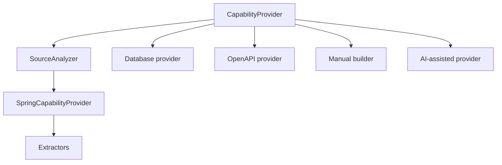

# Volume 5: Capability Providers

Status: Stable for the abstraction and the Spring provider. Future providers are described as direction. A Capability Provider is any source that produces Capability IR. It is the only part of the system that reads the original system, and it produces IR and nothing else.

---

## 1. The abstraction



```java
public interface CapabilityProvider {
    CapabilityModel provide(ProviderInput input);
}
public interface SourceAnalyzer extends CapabilityProvider { }   // a provider that reads code
```

## 2. Why provider is broader than analyzer

Not every input analyzes source code. An OpenAPI file, a database schema, or a human using a manual builder all describe a system without any code analysis. If the top abstraction were named Analyzer, those inputs would not fit it, and the name would have to change later. CapabilityProvider is the general contract; SourceAnalyzer is the specialization for inputs that read code (ADR-0003).

## 3. The provider contract

A provider takes an input that identifies a source and returns a Capability IR. It must:

1. Produce only IR. It never generates output and never knows what backends exist.
2. Map source types into the closed primitive type system (Volume 4, section 4).
3. Be deterministic. The same source yields the same IR.
4. Depend only on the plugin API and the core, never on a backend or a runtime (Volume 12, section 5).

## 4. The Spring provider (MVP)

`SpringCapabilityProvider` is a SourceAnalyzer that reads a Spring and Java project from source using JavaParser (ADR-0010). It is organized as extractors. The Entity and Service extractors are enabled: the Entity extractor reads entities and their read intents, the Service extractor discovers the real binding, and the provider joins the two (section 4.1). The repository, controller, and annotation extractors remain placeholders. This refines ADR-0011, which enabled only the Entity extractor at the start of the MVP.

| Extractor | Reads | Status |
|---|---|---|
| EntityExtractor | Classes annotated as entities, their fields, and the read intent for each | Enabled |
| ServiceExtractor | Service classes and their public methods, to discover a read capability's real binding | Enabled (read-by-id binding discovery) |
| RepositoryExtractor | Repository interfaces and their queries | Placeholder |
| ControllerExtractor | Controllers, to learn exposed operations | Placeholder |
| AnnotationExtractor | Annotations, as generic hints | Placeholder |

The extractor pattern keeps the provider correct from day one and lets coverage grow without reshaping the module. Each placeholder extractor will contribute an independent slice of the IR. The Entity and Service extractors are different: they cooperate to produce one fact (the discovered binding), and that cooperation is a join the provider owns, so the extractors never depend on each other (section 4.1).

### 4.1 Binding discovery (the read capability's real method)

A capability's binding (for example `ProductService#findById`) names the real logic the runtime invokes. It is discovered from the source, read from the actual service method, not assumed from the entity name. The binding stays opaque in the IR (Volume 4, section 3.4): it names what to invoke, never how. The runtime resolves it to a real bean and method (Volume 7, section 4 and rule 3).

Two extractors collaborate, joined by the provider so that neither depends on the other:

- EntityExtractor reads each `@Entity` and produces the entity, its fields, and a read intent: the desired capability `get<Entity>`, its single id input (name and mapped type), and its entity-reference output. The read intent carries no binding.
- ServiceExtractor reads each `@Service` class and produces a neutral catalog of its public methods: the owning service's simple name, the method name, the return type's simple name, and the parameter types as written. It knows nothing about entities.
- SpringCapabilityProvider joins them: for each read intent it finds the one service method that backs it, and emits the capability with the discovered binding. The matching is the provider's coordination job, so the extractors stay independent.

The matching rule, the contract, is kept deliberately shape-based, not name-based. A service method M backs the read capability `get<Entity>` for entity E, whose id maps to primitive type `idType`, when all of these hold:

1. M is declared on a class annotated `@Service`.
2. M is `public` and not `static`.
3. M's return type, by simple name, equals E's name (M returns the entity).
4. M declares exactly one parameter, and that parameter's type maps, through the same Java-to-primitive mapping the entity fields use, to `idType` (M takes the entity's id).

The rule is expressed in types and shapes, never in the literal names `Product`, `ProductService`, or `findById`. A finder named `loadById` or `byId`, on a service named `CatalogStore` rather than `<Entity>Service`, still matches if its shape fits. A method with the same shape on a `@RestController` does not match, because rule 1 requires a `@Service`.

Outcomes:

- Exactly one method matches: the capability is emitted with binding `<ServiceClassSimpleName>#<methodName>`, taken from that method.
- No method matches: the provider fails with a located `ProviderException` that names the entity, the return type and single parameter type it sought, and the `@Service` methods it did see. It does not fall back to any convention.
- More than one method matches: the provider fails with a `ProviderException` listing the candidates. The backing method must be unambiguous; the provider will not guess.

Binding string format: unchanged. Discovery emits `<ServiceClassSimpleName>#<methodName>`, exactly the shape the runtime's `SpringExecutionAdapter` already parses (`<Bean>#<method>`, Volume 7, section 4). For the example app the discovered binding is `ProductService#findById`, identical to what the earlier convention produced; only its source changed, from assumed to read, so the adapter and the generated output are unchanged.

What is still assumed or unsupported, recorded so it is closed deliberately later. The second-app trial (docs/experiments/second-app-trial.md) measured these against a large real app and ranked them by capabilities blocked; the resulting phases are Volume 13, Tier 2:

- Parse behavior (closed by phase E1, see section 4.3). Once the top-ranked gap: the provider aborted the whole scan on the first unparseable file, the JavaParser language level was below the Java version of real apps (the trial app is Java 17), and the walk covered every file. It blocked 38 of 43 entities before extraction began. Phase E1 raised the language level to Java 17, made the survey collect-and-continue per file, and scoped the walk; the pms-backend scan now completes end to end and classifies all 43 entities (docs/experiments/second-app-trial.md, section 8.1).
- The matcher relates a service method to an entity only when the method returns the entity itself. Real layered systems return DTO and VTO types from services; the trial found this blocks essentially every single-key entity there (phase E2, section 4.2 below).
- Entity fields whose type is another entity (associations) have no mapping and fail loudly as unmapped types. Blocked four entities in the trial (phase E3).
- Only single-id-parameter reads are discovered. Lists, filtered queries, multi-argument finders, writes, and actions are not modeled; list and filter reads are the bulk of the trial app's real read API (phase E4), and write and action capabilities are future IR (Volume 4, section 7).
- The capability name is still the `get<Entity>` convention. Only the binding is discovered, not the business name of the capability.
- The entity's identifier is the first field annotated `@Id`. Composite or non-`@Id` identifiers are out of scope (three join entities in the trial; deliberately unscheduled).
- Type matching uses the closed primitive set; an id whose type is not in that set (Volume 4, section 4) cannot be matched and is surfaced as an unmapped type.

### 4.2 DTO-aware read discovery (to be designed here before it is coded)

This section is a reserved slot, on purpose. The trial's second-ranked gap is that real service boundaries return view types, so a rule is needed for when a DTO- or VTO-returning service method backs a read of an entity. That rule will be designed and written into this section first, and coded only after it is written, exactly as the binding rule in section 4.1 was: the rule went into this volume in one commit, the code followed in the next. Until the written rule exists here, no matching code may be written. The exit measure for the rule, once built, is discovered capabilities on the benchmark app with zero mis-bindings (Volume 13, Tier 2, phase E2).

### 4.3 Scan resilience: two entry points, the language level, collect-and-continue, and the walk rule (phase E1)

Reading a large, messy, real app is not the same job as producing an artifact from a clean one, so the provider has two entry points, and they behave differently on purpose:

- `scan` is the resilient survey. It walks the whole source, parses collect-and-continue, and returns the discovered IR together with a per-entity outcome for everything it could parse and a named, located skip for every file it could not. It aborts only when it cannot run at all: the source root is missing, is not a directory, or cannot be walked. This is what `tibyan scan` runs, and what the pms-backend benchmark measures.
- `provide` is the strict plugin-api contract used to produce an artifact. It runs the same survey and then refuses the whole scan if any file could not be parsed or any entity failed for a hard cause, returning a clean IR or throwing. This is what the build and `tibyan generate` run: you do not ship a manifest that silently missed a tool. An entity with no single `@Id` is tolerated (it yields no capability but is not an error), matching the read-by-id scope.

Both share one discovery rule (section 4.1). The split changes only whether a located failure is recorded and the survey continues, or aborts the whole run. Neither ever guesses a binding.

Three properties make the survey survive real source (phase E1):

1. Language level. The parser is configured at Java 17, the language level of the target apps (Volume 16, section 3.1). Parsing below the source's level rejects legitimate modern syntax (switch expressions, `instanceof` type patterns, records, text blocks) as if it were malformed. This alone removes the trial's f1 failures.
2. Collect-and-continue. A file that fails to parse, or cannot be read, is recorded as a located `ParseSkip` (the file and the parser's first-line, located message) and the walk continues. One bad file among hundreds is a logged skip, never a total failure. This does not weaken fail-loud: it relocates the loudness from "abort everything on the first bad file" to "name every bad file and keep going". The skips are part of the result, so a partial scan can never masquerade as a complete one, and a genuinely invalid file (an unrendered `$IMPORT` placeholder) stays a skip, it is not coerced into a parse.
3. The walk rule. The walk covers every `.java` file under the source root except those in build-output or tool-metadata directories (`target`, `build`, `out`, `bin`, `.git`, `.idea`, `.mvn`). It does not try to guess which files are "relevant" by their path: only `@Entity` and `@Service` classes contribute to the IR regardless of where they sit, and any file that will not parse becomes a located skip. Keeping the rule to a small, stated set of excluded directories, and letting collect-and-continue absorb the rest, is deliberately simpler and more robust than clever per-app exclusions. It is why the whole-app scan, which once died inside a private foundation library, now completes: that library's unparseable files are skips, not a wall.

Every entity the survey parses receives exactly one outcome: discovered, or failed with one located cause (`UNMAPPED_FIELD_TYPE`, `NO_IDENTIFIER`, `NO_BACKING_METHOD`, or `AMBIGUOUS_BINDING`). A mis-binding, a wrong capability, cannot appear, because the discovery rule emits only on an exact single-shape match; the survey states a mis-bound count and it is zero by construction. What phase E1 deliberately does not do: it adds no discovery power. Discovered stays where it was until DTO-aware matching (section 4.2, phase E2) and later phases open it.

## 5. Future providers

| Provider | Source | Why it matters |
|---|---|---|
| Database provider | A database schema | Proves the IR accepts a non-code source (Volume 13, Tier 3) |
| OpenAPI provider | An OpenAPI document | Imports systems that already publish a contract |
| Manual builder | A human-authored definition | A fallback when no readable source exists |
| AI-assisted provider | Mixed or unclear sources, with model assistance | Helps where structure is implicit, with human review |
| Bytecode analyzer | Compiled classes | Reads systems whose source is unavailable |

Each new provider produces the same IR, so every existing backend and runtime works against it with no change. That is the entire point of the abstraction.

## 6. Rules

1. A provider feeds the IR and stops. It produces no output.
2. A provider never depends on a backend or a runtime.
3. A provider maps all source types into the closed primitive set; unknown types are a validation concern, not a silent passthrough.
