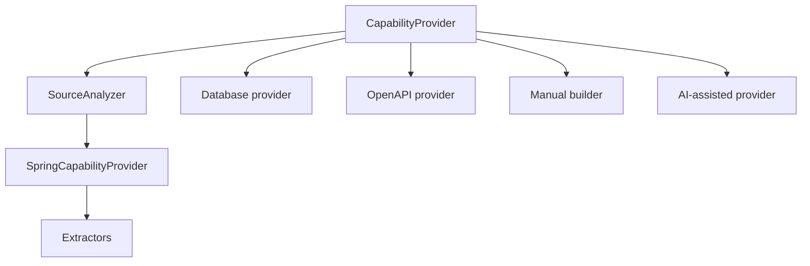

# Volume 5: Capability Providers

Status: Stable for the abstraction and the Spring provider. Future providers are described as direction. A Capability Provider is any source that produces Capability IR. It is the only part of the system that reads the original system, and it produces IR and nothing else.

---

## 1. The abstraction



```java
public interface CapabilityProvider {
    CapabilityModel provide(ProviderInput input);
}
public interface SourceAnalyzer extends CapabilityProvider { }   // a provider that reads code
```

## 2. Why provider is broader than analyzer

Not every input analyzes source code. An OpenAPI file, a database schema, or a human using a manual builder all describe a system without any code analysis. If the top abstraction were named Analyzer, those inputs would not fit it, and the name would have to change later. CapabilityProvider is the general contract; SourceAnalyzer is the specialization for inputs that read code (ADR-0003).

## 3. The provider contract

A provider takes an input that identifies a source and returns a Capability IR. It must:

1. Produce only IR. It never generates output and never knows what backends exist.
2. Map source types into the closed primitive type system (Volume 4, section 4).
3. Be deterministic. The same source yields the same IR.
4. Depend only on the plugin API and the core, never on a backend or a runtime (Volume 12, section 5).

## 4. The Spring provider (MVP)

`SpringCapabilityProvider` is a SourceAnalyzer that reads a Spring and Java project from source using JavaParser (ADR-0010). It is organized as extractors. The Entity and Service extractors are enabled: the Entity extractor reads entities and their read intents, the Service extractor discovers the real binding, and the provider joins the two (section 4.1). The repository, controller, and annotation extractors remain placeholders. This refines ADR-0011, which enabled only the Entity extractor at the start of the MVP.

| Extractor | Reads | Status |
|---|---|---|
| EntityExtractor | Classes annotated as entities, their fields, and the read intent for each | Enabled |
| ServiceExtractor | Service classes and their public methods, to discover a read capability's real binding | Enabled (read-by-id binding discovery) |
| RepositoryExtractor | Repository interfaces and their queries | Placeholder |
| ControllerExtractor | Controllers, to learn exposed operations | Placeholder |
| AnnotationExtractor | Annotations, as generic hints | Placeholder |

The extractor pattern keeps the provider correct from day one and lets coverage grow without reshaping the module. Each placeholder extractor will contribute an independent slice of the IR. The Entity and Service extractors are different: they cooperate to produce one fact (the discovered binding), and that cooperation is a join the provider owns, so the extractors never depend on each other (section 4.1).

### 4.1 Binding discovery (the read capability's real method)

A capability's binding (for example `ProductService#findById`) names the real logic the runtime invokes. It is discovered from the source, read from the actual service method, not assumed from the entity name. The binding stays opaque in the IR (Volume 4, section 3.4): it names what to invoke, never how. The runtime resolves it to a real bean and method (Volume 7, section 4 and rule 3).

Two extractors collaborate, joined by the provider so that neither depends on the other:

- EntityExtractor reads each `@Entity` and produces the entity, its fields, and a read intent: the desired capability `get<Entity>`, its single id input (name and mapped type), and its entity-reference output. The read intent carries no binding.
- ServiceExtractor reads each `@Service` class and produces a neutral catalog of its public methods: the owning service's simple name, the method name, the return type's simple name, and the parameter types as written. It knows nothing about entities.
- SpringCapabilityProvider joins them: for each read intent it finds the one service method that backs it, and emits the capability with the discovered binding. The matching is the provider's coordination job, so the extractors stay independent.

The matching rule, the contract, is kept deliberately shape-based, not name-based. A service method M backs the read capability `get<Entity>` for entity E, whose id maps to primitive type `idType`, when all of these hold:

1. M is declared on a class annotated `@Service`.
2. M is `public` and not `static`.
3. M's return type, by simple name, equals E's name (M returns the entity).
4. M declares exactly one parameter, and that parameter's type maps, through the same Java-to-primitive mapping the entity fields use, to `idType` (M takes the entity's id).

The rule is expressed in types and shapes, never in the literal names `Product`, `ProductService`, or `findById`. A finder named `loadById` or `byId`, on a service named `CatalogStore` rather than `<Entity>Service`, still matches if its shape fits. A method with the same shape on a `@RestController` does not match, because rule 1 requires a `@Service`.

Outcomes:

- Exactly one method matches: the capability is emitted with binding `<ServiceClassSimpleName>#<methodName>`, taken from that method.
- No method matches: the provider fails with a located `ProviderException` that names the entity, the return type and single parameter type it sought, and the `@Service` methods it did see. It does not fall back to any convention.
- More than one method matches: the provider fails with a `ProviderException` listing the candidates. The backing method must be unambiguous; the provider will not guess.

Binding string format: unchanged. Discovery emits `<ServiceClassSimpleName>#<methodName>`, exactly the shape the runtime's `SpringExecutionAdapter` already parses (`<Bean>#<method>`, Volume 7, section 4). For the example app the discovered binding is `ProductService#findById`, identical to what the earlier convention produced; only its source changed, from assumed to read, so the adapter and the generated output are unchanged.

What is still assumed or unsupported, recorded so it is closed deliberately later:

- Only single-id-parameter reads are discovered. Lists, filtered queries, multi-argument finders, writes, and actions are not modeled; write and action capabilities are future IR (Volume 4, section 7).
- The capability name is still the `get<Entity>` convention. Only the binding is discovered, not the business name of the capability.
- The entity's identifier is the first field annotated `@Id`. Composite or non-`@Id` identifiers are out of scope.
- Type matching uses the closed primitive set; an id whose type is not in that set (Volume 4, section 4) cannot be matched and is surfaced as an unmapped type.

## 5. Future providers

| Provider | Source | Why it matters |
|---|---|---|
| Database provider | A database schema | Proves the IR accepts a non-code source (Volume 13, P6) |
| OpenAPI provider | An OpenAPI document | Imports systems that already publish a contract |
| Manual builder | A human-authored definition | A fallback when no readable source exists |
| AI-assisted provider | Mixed or unclear sources, with model assistance | Helps where structure is implicit, with human review |
| Bytecode analyzer | Compiled classes | Reads systems whose source is unavailable |

Each new provider produces the same IR, so every existing backend and runtime works against it with no change. That is the entire point of the abstraction.

## 6. Rules

1. A provider feeds the IR and stops. It produces no output.
2. A provider never depends on a backend or a runtime.
3. A provider maps all source types into the closed primitive set; unknown types are a validation concern, not a silent passthrough.
