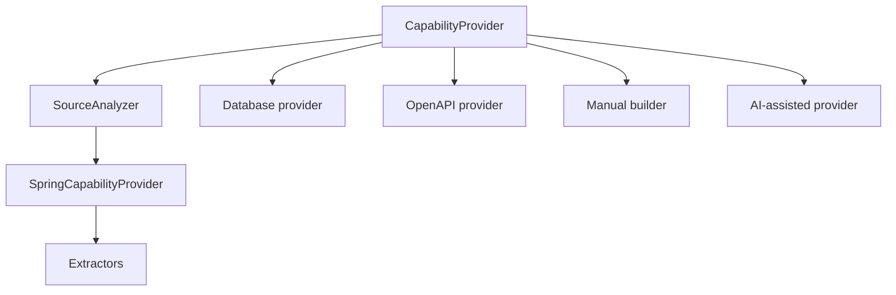

# Volume 5: Capability Providers

Status: Stable for the abstraction and the Spring provider. Future providers are described as direction. A Capability Provider is any source that produces Capability IR. It is the only part of the system that reads the original system, and it produces IR and nothing else.

---

## 1. The abstraction



```java
public interface CapabilityProvider {
    CapabilityModel provide(ProviderInput input);
}
public interface SourceAnalyzer extends CapabilityProvider { }   // a provider that reads code
```

## 2. Why provider is broader than analyzer

Not every input analyzes source code. An OpenAPI file, a database schema, or a human using a manual builder all describe a system without any code analysis. If the top abstraction were named Analyzer, those inputs would not fit it, and the name would have to change later. CapabilityProvider is the general contract; SourceAnalyzer is the specialization for inputs that read code (ADR-0003).

## 3. The provider contract

A provider takes an input that identifies a source and returns a Capability IR. It must:

1. Produce only IR. It never generates output and never knows what backends exist.
2. Map source types into the closed primitive type system (Volume 4, section 4).
3. Be deterministic. The same source yields the same IR.
4. Depend only on the plugin API and the core, never on a backend or a runtime (Volume 12, section 5).

## 4. The Spring provider (MVP)

`SpringCapabilityProvider` is a SourceAnalyzer that reads a Spring and Java project from source using JavaParser (ADR-0010). It is organized as extractors. The Entity and Service extractors are enabled: the Entity extractor reads entities and their read intents, the Service extractor discovers the real binding, and the provider joins the two (section 4.1). The repository, controller, and annotation extractors remain placeholders. This refines ADR-0011, which enabled only the Entity extractor at the start of the MVP.

| Extractor | Reads | Status |
|---|---|---|
| EntityExtractor | Classes annotated as entities, their fields, and the read intent for each | Enabled |
| ServiceExtractor | Service classes and their public methods, to discover a read capability's real binding | Enabled (read-by-id binding discovery) |
| RepositoryExtractor | Repository interfaces and their queries | Placeholder; the E2 build enables it to catalog Spring Data repositories (entity and id type arguments), hand-written repository interfaces, and their one-hop delegating implementations, the load evidence of section 4.2 |
| ControllerExtractor | Controllers, to learn exposed operations | Placeholder |
| AnnotationExtractor | Annotations, as generic hints | Placeholder |

The extractor pattern keeps the provider correct from day one and lets coverage grow without reshaping the module. Each placeholder extractor will contribute an independent slice of the IR. The Entity and Service extractors are different: they cooperate to produce one fact (the discovered binding), and that cooperation is a join the provider owns, so the extractors never depend on each other (section 4.1).

### 4.1 Binding discovery (the read capability's real method)

A capability's binding (for example `ProductService#findById`) names the real logic the runtime invokes. It is discovered from the source, read from the actual service method, not assumed from the entity name. The binding stays opaque in the IR (Volume 4, section 3.4): it names what to invoke, never how. The runtime resolves it to a real bean and method (Volume 7, section 4 and rule 3).

Two extractors collaborate, joined by the provider so that neither depends on the other:

- EntityExtractor reads each `@Entity` and produces the entity, its fields, and a read intent: the desired capability `get<Entity>`, its single id input (name and mapped type), and its entity-reference output. The read intent carries no binding.
- ServiceExtractor reads each `@Service` class and produces a neutral catalog of its public methods: the owning service's simple name, the method name, the return type's simple name, and the parameter types as written. It knows nothing about entities.
- SpringCapabilityProvider joins them: for each read intent it finds the one service method that backs it, and emits the capability with the discovered binding. The matching is the provider's coordination job, so the extractors stay independent.

The matching rule, the contract, is kept deliberately shape-based, not name-based. A service method M backs the read capability `get<Entity>` for entity E, whose id maps to primitive type `idType`, when all of these hold:

1. M is declared on a class annotated `@Service`.
2. M is `public` and not `static`.
3. M's return type, by simple name, equals E's name (M returns the entity).
4. M declares exactly one parameter, and that parameter's type maps, through the same Java-to-primitive mapping the entity fields use, to `idType` (M takes the entity's id).

The rule is expressed in types and shapes, never in the literal names `Product`, `ProductService`, or `findById`. A finder named `loadById` or `byId`, on a service named `CatalogStore` rather than `<Entity>Service`, still matches if its shape fits. A method with the same shape on a `@RestController` does not match, because rule 1 requires a `@Service`.

Outcomes:

- Exactly one method matches: the capability is emitted with binding `<ServiceClassSimpleName>#<methodName>`, taken from that method.
- No method matches: the provider fails with a located `ProviderException` that names the entity, the return type and single parameter type it sought, and the `@Service` methods it did see. It does not fall back to any convention.
- More than one method matches: the provider fails with a `ProviderException` listing the candidates. The backing method must be unambiguous; the provider will not guess.

Binding string format: unchanged. Discovery emits `<ServiceClassSimpleName>#<methodName>`, exactly the shape the runtime's `SpringExecutionAdapter` already parses (`<Bean>#<method>`, Volume 7, section 4). For the example app the discovered binding is `ProductService#findById`, identical to what the earlier convention produced; only its source changed, from assumed to read, so the adapter and the generated output are unchanged.

What is still assumed or unsupported, recorded so it is closed deliberately later. The second-app trial (docs/experiments/second-app-trial.md) measured these against a large real app and ranked them by capabilities blocked; the resulting phases are Volume 13, Tier 2:

- Parse behavior (closed by phase E1, see section 4.3). Once the top-ranked gap: the provider aborted the whole scan on the first unparseable file, the JavaParser language level was below the Java version of real apps (the trial app is Java 17), and the walk covered every file. It blocked 38 of 43 entities before extraction began. Phase E1 raised the language level to Java 17, made the survey collect-and-continue per file, and scoped the walk; the pms-backend scan now completes end to end and classifies all 43 entities (docs/experiments/second-app-trial.md, section 8.1).
- The matcher relates a service method to an entity only when the method returns the entity itself. Real layered systems return DTO and VTO types from services; the trial found this blocks essentially every single-key entity there (phase E2, section 4.2 below).
- Entity fields whose type is another entity (associations) have no mapping and fail loudly as unmapped types. Blocked four entities in the trial (phase E3).
- Only single-id-parameter reads are discovered. Lists, filtered queries, multi-argument finders, writes, and actions are not modeled; list and filter reads are the bulk of the trial app's real read API (phase E4), and write and action capabilities are future IR (Volume 4, section 7).
- The capability name is still the `get<Entity>` convention. Only the binding is discovered, not the business name of the capability.
- The entity's identifier is the first field annotated `@Id`. Composite or non-`@Id` identifiers are out of scope (three join entities in the trial; deliberately unscheduled).
- Type matching uses the closed primitive set; an id whose type is not in that set (Volume 4, section 4) cannot be matched and is surfaced as an unmapped type.

### 4.2 DTO-aware read discovery (designed 2026-07-02; RATIFIED 2026-07-02 as written)

The trial's second-ranked gap is that real service boundaries return view types, so a rule is needed for when a DTO- or VTO-returning service method backs a read of an entity. This section is that rule, designed from a read-only study of the benchmark app before any code, exactly as the binding rule in section 4.1 was: the rule enters this volume in one commit, the code follows in a later session, only after this rule is ratified. Until ratification, no matching code may be written.

#### 4.2.1 Evidence (read-only study of pms-backend, 2026-07-02)

Every by-id read visible in the benchmark's parseable source was traced from the service method down to the persistence call. Census of the six single-id, view-returning reads found in parsed `@Service` classes:

| Read | Body shape | Load chain terminal | Pattern |
|---|---|---|---|
| TenantServiceImpl#findById | load, unwrap, one mapper call | custom `@Query` (`findByIdWithRelations`, JPQL `WHERE t.id = :id`) | P1b |
| UnitServiceImpl#findById | load, unwrap, one mapper call | framework `findById` via one-hop delegation | P1a |
| LeaseServiceImpl#findById | load, unwrap, one mapper call | framework `findById` via one-hop delegation | P1a |
| BuildingServiceImpl#findById | load, map, second repository access, view mutation | framework `findById` | P2 |
| PropertyServiceImpl#findById | load, map, then loads buildings and units into the view | framework `findById` | P2 |
| ChatRoomServiceImpl#getChatRoomById | load, session-context read, authorization check, two more loads, multi-argument mapping | framework `findById` | P2 |

The recurring structural facts, and what they mean for the rule:

- The service layer never calls Spring Data directly. Every service depends on a hand-written repository interface (for example `TenantRepository`, a plain interface, not a Spring Data type). Its `@Repository` implementation delegates to a Spring Data interface (`TenantJpaRepository extends JpaRepository<Tenant, Long>`) one hop down. In four of five sampled implementations, the by-id method's body is exactly one statement, `return <jpaRepo>.findById(<param>);`, the framework's by-primary-key read. In one (Tenant), the terminal is a custom `@Query` whose by-primary-key fact lives inside a JPQL string.
- The mapping step is one call with the loaded entity as its sole argument: a MapStruct mapper declared in-tree (`public abstract TenantVTO toTenantVTO(Tenant tenant)` on `@Mapper PropertyMgtMapper`). The mapper declaration ties view to entity by declared parameter type, in code, with no name inspection.
- The by-primary-key fact is the safety-critical discriminator, and names cannot carry it. `TenantRepository` declares `Optional<Tenant> selectById(Long id)` and `Tenant findByUserId(Long userId)` side by side: identical Java shapes, one loads by primary key, one by a foreign key. Only the framework contract (`findById` inherited from a Spring Data repository of E) or the JPQL text distinguishes them. The rule therefore anchors on the framework contract and refuses the JPQL case.
- Live trap cases that a shape-only rule would mis-bind, all present in parsed source: `LeaseServiceImpl#getMyActiveLease(Long tenantId)` (filter query by tenant, first element, mapped; one Long parameter, returns LeaseVTO); `TenantServiceImpl#getMyUnit(Long userId)` (loads Tenant by user id, returns a Unit view off a navigation, `tenant.getUnit()`); `UserMgtProxyInternalServiceImpl#findById(Long)` (pure delegation, no load in the body, delegate unparseable); `resetPassword(Long)` returning String (a write with a read's signature); `FileIdGeneratorServiceImpl#generate(Integer domainId)` (one parameter of Domain's id type, no load of Domain); `DailyCounterServiceImpl#getNewCount()` (a mutating counter behind a read-sounding name); `UserDetailsSecurityService#loadUserByUsername(String)` (loads by email, second repository access, mutates the view). The rule's conditions refuse every one of these structurally.
- Composite-key hazard, exposed by tracing E1's outcomes: `EventAttendee` and `GroupMember` use `@IdClass` with two `@Id Long` fields. Section 4.1's "first `@Id` field" assumption formed a half-key read intent (`getEventAttendee(eventId)`). Nothing backed it, so no harm occurred, but if a matching one-Long method had existed, a composite-key entity's read could have bound to half its key. The eligibility rule below closes this.

Reachability of the 19 NO_BACKING_METHOD entities (why the benchmark number cannot move from this rule alone): 15 have their entire service layer among the 27 unparseable placeholder files (admin 3, billing 3, PPFile 1, inspection 1, maintenance 2, notification 2, user 3); 2 are the composite-key join entities (also unparseable services); 1 has an empty parsed service (AuditLog, fields only, no methods); 1 has only a mutating counter method (DailyCounter). None has any single-id-parameter read in a parsed `@Service`. The six reads in the census all belong to entities currently blocked at extraction (UNMAPPED_FIELD_TYPE, phase E3's causes: associations and enums). The consequences are stated in 4.2.9.

#### 4.2.2 The rule

A service method M backs the read capability `get<E>` for entity E, whose identifier maps to primitive type `idType`, when ALL of the following hold. Conditions 1 and 2 restate section 4.1's frame; the rest are new.

0. Eligibility (tightened): E has exactly one field annotated `@Id` and no `@EmbeddedId`. An entity with more than one `@Id` field or an `@EmbeddedId` forms no read intent at all; it is reported with a composite-key cause, never read by part of its key.
1. M is declared on a class annotated `@Service`, is `public`, and is not `static`.
2. M declares exactly one parameter, and that parameter's type maps to `idType`.
3. M's declared return type is not `void`. (If its simple name equals E's name, M is a section 4.1 candidate; this rule covers the case where it does not.)
4. M's body contains exactly one persistence access, the load, and it is one of:
   a. a call to one of the framework by-primary-key reads, `findById`, `getById`, or `getReferenceById`, on a field of the service whose declared type resolves in-tree to a Spring Data repository of E: an interface extending one of the recognized supertypes (`JpaRepository`, `CrudRepository`, `ListCrudRepository`, `PagingAndSortingRepository`, `ListPagingAndSortingRepository`) whose first type argument is E and whose second maps to `idType`; or
   b. a call to a method M2 on a field whose declared type resolves in-tree to a hand-written repository interface, where M2 is declared to return E or `Optional<E>` and take one parameter of `idType`, and the interface's single in-tree `@Repository` implementation implements M2 with a body that is exactly one return statement performing case (a) with the parameter forwarded verbatim (the one-hop delegation trace).
5. The argument to the load (and, in 4b, the argument forwarded by the delegation) is M's single parameter, verbatim: the parameter name itself, not an expression over it.
6. No other repository access appears anywhere in M's body: no call on any other repository-typed field, and no call anywhere whose target is a repository-typed field and whose name is a mutation (`save`, `saveAll`, `insert`, `update`, `delete`, `deleteById`, `deleteAll`, `persist`, `merge`, `flush`).
7. Apart from the load, M's body is exactly one of the two read shapes:
   a. fused: a single `return` whose expression is the load followed only by Optional unwrapping (`orElseThrow(...)`, `orElse(...)`, `get()`) and at most one `Optional.map(<mapping step>)`; or
   b. two-statement: one local variable declared and initialized from the load (with optional unwrap chain), followed immediately by `return <mapping step>(<that local>);`, with no other statements in the body.
8. The mapping step, when present, is a single call whose sole argument is the loaded entity value itself: an instance method on a field of the service, a static factory, a constructor, or a method reference inside `Optional.map`. A navigation (`x.getUnit()`), an element extraction (`list.get(0)`), or a multi-argument call disqualifies. When there is no mapping step (the fused form returns the unwrapped load), M is a section 4.1 candidate by construction.
9. The mapping step's callee resolves in-tree to a declaration whose single parameter's type is E by simple name and whose return type equals M's declared return type. An unresolvable callee refuses: the evidence is incomplete, and incomplete evidence is a refusal, not a guess. This resolution is the rule's type check; it is what makes the view's derivation from E a stated fact of the code rather than an inference.
10. Pooling and uniqueness: all methods matching section 4.1 (entity-returning) or this rule (view-returning) for entity E form one candidate set, with no precedence between the two kinds. Exactly one candidate: the capability is emitted with binding `<ServiceClassSimpleName>#<methodName>`. Zero: NO_BACKING_METHOD, with the near-miss diagnostics of 4.2.4. More than one: AMBIGUOUS_BINDING, listing all candidates. The provider never picks.

#### 4.2.3 The explanation

Every match must be explainable, and the explanation is part of the scan report's detail for the discovered entity. It contains, in code terms: the binding (service and method); the load evidence (the repository field and its declared type; whether the chain is direct or one-hop, and for one-hop, the interface method and the implementing class; the terminal framework method; and the Spring Data declaration cited as `<Interface> extends <Supertype><E, idType>`); the mapping evidence (the callee and its in-tree declaration, `<Mapper>#<method>(<E>) : <View>`); and the view type's simple name. Name resemblance between the view and the entity is never part of the evidence and never appears as a reason.

#### 4.2.4 Refusals and diagnostics

- Zero candidates stays NO_BACKING_METHOD with a located message, extended two ways. Near-misses: any method that passed conditions 1 to 3 but failed a later condition is named with the first condition it failed, in the rule's terms (for example: "load resolves through TenantRepository#selectById, whose implementation delegates to TenantJpaRepository#findByIdWithRelations, a custom query; by-primary-key evidence unavailable, deferred pattern P1b"). Skipped-file context: when any `@Service` or `@Repository` file under the scanned source was a parse skip, the message states how many, so an absence of candidates is never mistaken for an absence of code.
- More than one candidate stays AMBIGUOUS_BINDING, listing every candidate with its kind (entity-returning or view-returning).
- Composite-key entities are refused at eligibility (condition 0) with their own cause, distinct from "no identifier", naming the `@Id` fields or the `@EmbeddedId` seen.

#### 4.2.5 What the IR says about the output

Decision: the capability's output remains `ENTITY_REF(E)`, and the capability carries an annotation, name `view`, whose value is the returned view type's simple name.

Why: semantically the capability reads E; the rule's whole burden is proving, structurally, that the returned view is derived from a by-primary-key load of E in one step. The IR describes what a capability means, not its wire schema, and `ENTITY_REF(E)` with the view noted is the smallest representation that does not lie: an agent reading the manifest learns it is reading E and learns the concrete shape has a name of its own. The alternative, a first-class view or projection concept carrying the view's fields, is deliberate IR growth under Volume 4, section 7: it enters through its own designed step with validators and golden tests if and when evidence shows agents need field-level view schemas. It is explicitly not smuggled in here. The `Annotation` hook exists precisely for hints that must not grow the model prematurely (Volume 4, section 3.6).

#### 4.2.6 Covered and deferred patterns

Covered by this rule (from the census):

- P1a, minimal load-then-map with a framework by-primary-key terminal, direct or one-hop (Unit, Lease; 2 of the 6 census reads).

Deferred, each keeping a loud refusal with a named diagnostic:

- P1b, minimal shape but the load terminal is a custom `@Query` (Tenant; 1 of 6). Closing it means reading JPQL where-clauses or accepting a user-supplied assertion that a repository method is the by-primary-key read. Both are decisions for a later phase; neither is guessed now.
- P2, composite view assembly: the correct by-id load followed by further loads and view enrichment (Building, Property, ChatRoom; 3 of 6). These are real reads, but their result is assembled from more than the entity; expressing them honestly needs more than a one-step derivation and is deferred.
- Delegation-only facades (the proxy services): the evidence lives in the delegate, and tracing service-to-service chains is out of scope (in the benchmark the delegates are unparseable anyway).
- Non-primary-key single-argument reads (`getMyActiveLease`, `getMyUnit`, `findByUserId` shapes): permanently out of scope for `get<E>` by design. They are different capabilities (future named reads), not failed matches of this one.
- List, filter, and aggregate reads: phase E4 and later (Volume 4, section 7 discipline).

#### 4.2.7 What this rule will never do

- Never match on name similarity between a view and an entity (`TenantVTO` ~ `Tenant`), not even as a tiebreaker; names of views, services, and repository methods on hand-written interfaces carry no evidence weight. The only names with weight are framework contracts: the annotations already trusted (`@Entity`, `@Id`, `@Service`, `@Repository`), the recognized Spring Data supertypes, and the framework's own by-primary-key methods, whose semantics are defined by the framework, not by the application's style.
- Never score field overlap between a view and an entity.
- Never fall back: zero evidence is a refusal, partial evidence is a refusal, unresolvable evidence is a refusal.
- Never accept a non-verbatim argument flow: an expression, navigation, or element extraction is never "the id" or "the entity".
- Never bind a method whose body contains any mutation access or any second load.
- Never read by part of a composite key.

#### 4.2.8 Pre-registered fixtures (the build session must include these before the code exists)

Positives, one per covered form:

- F1: direct Spring Data load, fused form: `return mapper.toVto(repo.findById(id).orElseThrow(...));` with the repository declared `extends JpaRepository<E, Long>` in-tree.
- F2: one-hop delegation (the Unit and Lease shape): hand-written interface plus `@Repository` implementation whose body is `return jpaRepo.findById(id);`, service in the two-statement form.
- F3: `Optional.map` with a method reference: `return repo.findById(id).map(mapper::toVto).orElseThrow(...);`.

Refusals, each asserting the located diagnostic:

- F4: name-similar but structurally unrelated: a `TenantVTO`-returning method whose body loads via Building's repository (or performs no load). Must not match `getTenant`; this is the mandated proof that names carry nothing.
- F5: non-primary-key load: `findByUserId(Long)` declared on the Spring Data interface (a derived non-pk query), wrapped in an otherwise perfect body. Must refuse.
- F6: composite assembly (Building shape): second repository access and view mutation. Must refuse.
- F7: write in disguise: framework `findById` load, then mutation and `save`, then a mapped return. Must refuse on the mutation access.
- F8: custom-query terminal (Tenant shape): one-hop delegation ending in `@Query findByIdWithRelations`. Must refuse with the P1b near-miss naming the chain.
- F9: navigation argument (`getMyUnit` shape): `return mapper.toUnitVTO(tenant.getUnit());`. Must refuse.
- F10: delegation-only facade (proxy shape): no load in the body. Must refuse.
- F11: ambiguity across kinds: one entity-returning and one view-returning candidate for the same entity. Must refuse as AMBIGUOUS_BINDING listing both.
- F12: composite-key entity (`@IdClass`, two `@Id` fields): no read intent formed; the composite-key cause is reported. This is the eligibility tightening's test.

#### 4.2.9 Benchmark prediction and the sequencing finding

Stated before the build, so the build is measured against a forecast rather than a moving target:

- After the E2 build alone: discovered 0, mis-bound 0. Unchanged totals, because none of the 19 NO_BACKING_METHOD entities has any single-id read in a parseable service (4.2.1). What changes is honesty: NO_BACKING_METHOD messages gain near-miss and skipped-file context, and the two composite-key entities move from NO_BACKING_METHOD to the composite-key cause (predicted causes: unmapped field type 24, no backing method 17, composite key 2).
- After E2 and E3 together (E3 clearing the census entities' field types, associations and enums): Unit and Lease flip to DISCOVERED through P1a, each with exactly one candidate (the census found no competing methods). Predicted discovered: up to 2, contingent on E3 clearing every field of those entities, with mis-bound exactly 0. Tenant stays refused with the named P1b near-miss; Building, Property, and ChatRoom stay refused as P2.
- The hard bar is unchanged and absolute: mis-bound must be exactly 0 on every run. One mis-binding stops all phase work.

The sequencing finding, plainly: phase E2's exit criterion as written in Volume 13 ("discovered greater than zero on pms-backend") is not achievable by the E2 build alone on this benchmark. The first rise in discovered requires E2 and E3 together.

Ratification (2026-07-02): this rule is ratified as written, conditions 0 through 10, the ENTITY_REF-plus-view-annotation representation, fixtures F1 to F12, and the deferred patterns. Sequencing was decided: E3 is designed and built before the E2 build, and E2 plus E3 are measured jointly against the benchmark with the shared exit criterion, discovered greater than zero (forecast: Unit and Lease via P1a) and mis-bound exactly zero. The E2 build session follows the E3 build.

### 4.3 Scan resilience: two entry points, the language level, collect-and-continue, and the walk rule (phase E1)

Reading a large, messy, real app is not the same job as producing an artifact from a clean one, so the provider has two entry points, and they behave differently on purpose:

- `scan` is the resilient survey. It walks the whole source, parses collect-and-continue, and returns the discovered IR together with a per-entity outcome for everything it could parse and a named, located skip for every file it could not. It aborts only when it cannot run at all: the source root is missing, is not a directory, or cannot be walked. This is what `tibyan scan` runs, and what the pms-backend benchmark measures.
- `provide` is the strict plugin-api contract used to produce an artifact. It runs the same survey and then refuses the whole scan if any file could not be parsed or any entity failed for a hard cause, returning a clean IR or throwing. This is what the build and `tibyan generate` run: you do not ship a manifest that silently missed a tool. An entity with no single `@Id` is tolerated (it yields no capability but is not an error), matching the read-by-id scope.

Both share one discovery rule (section 4.1). The split changes only whether a located failure is recorded and the survey continues, or aborts the whole run. Neither ever guesses a binding.

Three properties make the survey survive real source (phase E1):

1. Language level. The parser is configured at Java 17, the language level of the target apps (Volume 16, section 3.1). Parsing below the source's level rejects legitimate modern syntax (switch expressions, `instanceof` type patterns, records, text blocks) as if it were malformed. This alone removes the trial's f1 failures.
2. Collect-and-continue. A file that fails to parse, or cannot be read, is recorded as a located `ParseSkip` (the file and the parser's first-line, located message) and the walk continues. One bad file among hundreds is a logged skip, never a total failure. This does not weaken fail-loud: it relocates the loudness from "abort everything on the first bad file" to "name every bad file and keep going". The skips are part of the result, so a partial scan can never masquerade as a complete one, and a genuinely invalid file (an unrendered `$IMPORT` placeholder) stays a skip, it is not coerced into a parse.
3. The walk rule. The walk covers every `.java` file under the source root except those in build-output or tool-metadata directories (`target`, `build`, `out`, `bin`, `.git`, `.idea`, `.mvn`). It does not try to guess which files are "relevant" by their path: only `@Entity` and `@Service` classes contribute to the IR regardless of where they sit, and any file that will not parse becomes a located skip. Keeping the rule to a small, stated set of excluded directories, and letting collect-and-continue absorb the rest, is deliberately simpler and more robust than clever per-app exclusions. It is why the whole-app scan, which once died inside a private foundation library, now completes: that library's unparseable files are skips, not a wall.

Every entity the survey parses receives exactly one outcome: discovered, or failed with one located cause (`UNMAPPED_FIELD_TYPE`, `NO_IDENTIFIER`, `NO_BACKING_METHOD`, or `AMBIGUOUS_BINDING`). A mis-binding, a wrong capability, cannot appear, because the discovery rule emits only on an exact single-shape match; the survey states a mis-bound count and it is zero by construction. What phase E1 deliberately does not do: it adds no discovery power. Discovered stays where it was until DTO-aware matching (section 4.2, phase E2) and later phases open it.

### 4.4 Associations: entity-typed fields (E3 decision a; designed and RATIFIED 2026-07-02)

#### 4.4.1 Evidence: the full field census of the 24 blocked entities

E1's decomposition of the 24 UNMAPPED_FIELD_TYPE failures (13 associations, 8 enums, 3 Double) counted only each entity's first-blocking field, because extraction stops at the first unmapped type. This design step re-read every field of all 24 entities. The full census:

- Association fields: 20, across 15 entities. Every one is `@ManyToOne` to a class annotated `@Entity` elsewhere in the same source tree. There is not a single `@OneToMany`, `@ManyToMany`, `@OneToOne`, or `@Embedded` anywhere in the application's sources (verified by sweep), so to-one coverage is total coverage here.
- Enum fields: 21, across 13 entities. Every one is typed by a `public enum` declared in the same source tree, and every annotated one is `@Enumerated(EnumType.STRING)` (section 4.5).
- `Double` fields: 8, across 7 entities, most hidden behind an association or enum failure that E1 reported first (section 4.6). This is materially more than the first-cause count of 3, and it includes both joint-exit target entities: Lease (`monthlyRent`, `securityDeposit`) and Unit (`rentAmount`).

Per-entity clearing math (an entity clears only when every field maps): decision (a) alone clears 8 of 24 (ChatMessage, ChatRoom, FileVersion, Event, EventParameter, Building, OTP, UserRole); (b) alone clears 5 (CommunityEvent, Group, Inspection, Ticket, Property); (c) alone clears 2 (StaffInvoice, TimeEntry); (a) plus (b) clear 4 more (LeaseDocument, LeaseSignatureRequest, Staff, User); (b) plus (c) clear 2 more (LeaseTimeEntry, Vendor); (a) plus (c) clear Tenant; all three together clear Lease and Unit. All 24 clear only with all three decisions.

Two structural facts that shape the rules: `User.status` is typed `UserStatus`, which is an `@Entity` in this app, while `Lease.status` is typed `LeaseStatus`, which is an enum; the same naming pattern means two different things, so classification must come from finding the declaration, never from the name. And `UserRole` declares an `@Id @ManyToOne` field (`Role role`) under `@IdClass`: an association can be part of a composite key, so field mapping and read eligibility are separate concerns, handled by separate rules.

#### 4.4.2 The decision: provider mapping onto the existing IR, no growth

The IR already holds everything associations need: `Field.type` is "a primitive, or a reference to another entity" (`ENTITY_REF`, Volume 4, sections 3.3 and 4), `Relation` carries from, to, and kind (Volume 4, section 3.5), and the validators already check both (rules 3 and 4). Associations are therefore pure provider mapping, not IR growth. Nothing in Volume 4 changes for this decision.

#### 4.4.3 The rule

A field F declared on entity A maps to `ENTITY_REF(T)` and contributes a `Relation`, when ALL hold:

1. F is a persistent field: not `static`, not `@Transient` (the existing skips).
2. F's declared type, resolved by simple name (the last segment when the source writes a fully qualified name), is declared in the same scanned source tree as a class annotated `@Entity`. The declaration must be found; a type that merely looks like an entity name carries nothing.
3. F is annotated with exactly one of `@ManyToOne` or `@OneToOne`. The JPA annotation is the code's own declaration of the relationship and its kind; the provider reads it, it never infers it.
4. The field appears in A's IR shape as `name: ENTITY_REF(T)`, nullable per the existing nullable rule.
5. The model gains `Relation(from = A, to = T, kind)`, where `@ManyToOne` gives MANY_TO_ONE and `@OneToOne` gives ONE_TO_ONE. Identical (from, to, kind) triples are emitted once: two fields on ChatRoom referencing User produce two `ENTITY_REF(User)` fields but one Relation, because the fields carry the references and the Relation is the entity-level summary. Relations are emitted in a deterministic order (by from, then to, then kind).
6. An `@Id` association field maps under this rule like any other field. Whether the entity is readable is a separate, later question answered by eligibility (section 4.2, condition 0): a composite key containing an association refuses the read, but the entity and its shape still extract.

Refused, each keeping the existing UNMAPPED_FIELD_TYPE cause with the message enriched to name what was seen and why it does not map:

- An entity-typed field with no `@ManyToOne` or `@OneToOne` annotation (the relationship is not declared; the provider will not infer one).
- A field whose type resolves in-tree to a class that is neither an `@Entity` nor an enum (a value object, a library type): stays unmapped, message names the resolved declaration.
- A field whose type does not resolve in-tree at all: stays unmapped, message says resolution failed and where it looked.
- Collection associations (`@OneToMany`, `@ManyToMany`, any `List`, `Set`, or `Map` field): deferred to the list-modeling phase (E4 territory, Volume 4 section 7 discipline). Zero such fields exist in the benchmark (the census sweep), so this deferral costs nothing today and is not designed on zero evidence. The message names the field and the deferred shape.
- `@Embedded` types: deferred the same way; zero in the benchmark.

What the entity's IR shape claims, argued: the association field appears as a field of type `ENTITY_REF(T)` AND as a Relation, not one or the other. The field is part of the entity's real shape, and omitting it would under-describe the entity; the Relation is the model-level fact that backends and future consumers can use without walking fields. The MCP tool's output schema claims the field references entity T, which is honest at the semantic level this IR speaks at: the concrete wire shape is the view's business (section 4.2.5 already carries the view annotation), and a view that flattens `room` to `roomId` does not contradict "this field references ChatRoom".

What this rule will never do: infer a relationship kind that is not annotated; resolve a target by name resemblance instead of by finding its declaration; map a collection by taking its element type; or emit a Relation whose target entity is not in the model (the validator would rightly reject it, and the provider refuses first).

Pre-registered fixtures for the build session: A1, `@ManyToOne` to an in-tree entity maps to `ENTITY_REF` plus a MANY_TO_ONE Relation. A2, `@OneToOne` maps with kind ONE_TO_ONE. A3, two fields on one entity referencing the same target produce two fields and one deduplicated Relation. A4, an entity-typed field with no relationship annotation refuses, naming the field. A5, a `List` field refuses with the deferred-shape message. A6, a field typed by an in-tree non-entity class refuses, naming the resolved declaration. A7, a field declared with a fully qualified entity type resolves by last segment. A8, the name trap: a field whose type simple name looks entity-ish but resolves to nothing in-tree refuses (resolution is structural). A9, an `@Id @ManyToOne` field maps as a field while eligibility still refuses the composite-key read.

Benchmark effect of (a) alone: 8 of 24 entities clear extraction (7 move to NO_BACKING_METHOD; UserRole moves to the identifier cause once section 4.2 condition 0 is built, and to NO_BACKING_METHOD in the interim). Contributes to clearing 15 of 24 in combination. Expected new relations in the benchmark IR once all three decisions land: 19 unique MANY_TO_ONE relations. New cause codes: none; refusals stay UNMAPPED_FIELD_TYPE with enriched messages.

### 4.5 Enums (E3 decision b; designed and RATIFIED 2026-07-02)

#### 4.5.1 Evidence

21 enum-typed fields across 13 of the 24 blocked entities. Every enum type is declared `public enum` in the scanned tree (111 enum declarations exist in the app), every annotated field is `@Enumerated(EnumType.STRING)`, and one field (`Staff.payFrequency`) declares its enum with a fully qualified name. What actually crosses the MCP boundary is the JSON serialization of the service's return value, and Java enums serialize as their constant names; the database storage strategy (string or ordinal) never reaches the wire, so it carries no weight in the rule.

#### 4.5.2 The decision: STRING plus a values annotation, no IR growth

An enum field maps to the existing STRING primitive, and the field carries an annotation, name `enum`, whose values are the enum's constant names in declaration order. Argued: the wire form of the field is genuinely a string, so STRING does not lie; and the closed value set is genuinely useful to an agent, so it must not be dropped, which is exactly what the IR's `Annotation` hook exists for (Volume 4, section 3.6): a hint carried without growing the type system prematurely. The alternative, a first-class ENUM primitive in the closed set, would touch the core, every validator, every backend, and every future provider for information the annotation already carries losslessly; it stays a deferred growth candidate under Volume 4, section 7, to be reopened if enums are ever needed as capability inputs (where a schema-level value constraint would earn its cost). For MVP reads, enum fields appear only in outputs.

#### 4.5.3 The rule

A field F on entity A maps to STRING with an `enum` annotation when ALL hold:

1. F is a persistent field (not `static`, not `@Transient`).
2. F's declared type, resolved by simple name (last segment for fully qualified declarations), is declared in the same scanned source tree as an `enum`.
3. The annotation carries the constant names, read from that declaration, in declaration order (deterministic; constants with bodies or constructor arguments contribute their names only).
4. `@Enumerated` presence, absence, or mode changes nothing: the wire form is the constant name in all cases, and the rule maps the wire truth.

Refused, staying UNMAPPED_FIELD_TYPE with an enriched message: a field whose type cannot be resolved in-tree (the provider cannot confirm it is an enum, so it cannot enumerate its values; incomplete evidence is a refusal, not a bare STRING); a type that resolves to something other than an enum falls to the association rule (section 4.4) or its refusals.

What this rule will never do: decide enum-ness from a type's name or naming pattern (the `UserStatus` entity versus `LeaseStatus` enum pair in the evidence is the standing proof); map an unresolvable type to STRING without its values; invent, reorder, or filter constants; or read the storage mode into the model.

Pre-registered fixtures: B1, an in-tree enum field with `@Enumerated(EnumType.STRING)` maps to STRING with the constants in declaration order. B2, a bare enum field with no `@Enumerated` maps identically. B3, a fully-qualified enum declaration resolves by last segment. B4, a field typed by an unresolvable type refuses, naming the failed resolution. B5, the name trap: a field of type `XStatus` where `XStatus` is an in-tree `@Entity` maps under the association rule, not this one.

Benchmark effect of (b) alone: 5 of 24 entities clear extraction (all move to NO_BACKING_METHOD). Contributes to clearing 13 of 24 in combination. New cause codes: none.

### 4.6 Inexact numerics (E3 decision c; designed and RATIFIED 2026-07-02)

#### 4.6.1 Evidence, and why this decision grew

The closed set refused inexact numerics by design, and E1's first-cause count (3 `Double` fields) made refusal look cheap. The full census says otherwise: 8 `Double` fields across 7 of the 24 entities (`hoursWorked` twice, `totalAmount`, `monthlyRent`, `securityDeposit`, `leaseMonthlyRent`, `rentAmount`, `rating`), and among the blocked entities are both ratified joint-exit targets, Lease and Unit. Keeping the refusal makes the ratified E2 plus E3 exit criterion (discovered greater than zero, forecast Unit and Lease) unachievable on this benchmark: not a corner case but a gate.

#### 4.6.2 The decision: add FLOAT to the closed set, as flagged, deliberate IR growth

Recommendation: the closed primitive set gains one member, FLOAT, a 64-bit binary floating point, inexact by declaration. This is deliberate IR growth under Volume 4, section 7 discipline: it is recorded in Volume 4 with the census as its evidence, and the build carries its own validators, JSON round-trip, and golden-file updates.

The alternatives, argued and rejected:

- Keep refusing: honest but now demonstrably expensive (7 of 24 entities, both exit targets), and refusal states nothing true about the source; it merely declines to model it. Rejected on the new evidence; it was the right default until the count was real.
- Map to DECIMAL with a lossy-representation annotation: DECIMAL means exact in this IR ("for money and quantities", Volume 4, section 4). A source `Double` is not exact, and an agent told DECIMAL may assume exact arithmetic. An annotation apologizing for a wrong type is worse than the right type. Rejected as dishonest.
- Omit the field with an annotation: the wire JSON still contains the field (the views expose it), so the IR would under-describe every read's real output. Rejected.

FLOAT states exactly what the source declares: an inexact numeric. That some of these fields are money-as-Double (`totalAmount`, `monthlyRent`) is a defect of the modeled system, and the model's job is to describe the system as it is, not to repair it by coercion; the description is what makes the defect visible.

#### 4.6.3 The rule

1. Java `double`, `Double`, `float`, and `Float` map to FLOAT.
2. `BigDecimal` continues to map to DECIMAL. No coercion crosses the exact-inexact line in either direction, ever: never `Double` to DECIMAL, never `BigDecimal` to FLOAT.
3. FLOAT is an ordinary primitive thereafter: usable as a field type, subject to the same validators, serialized as a JSON number.
4. An identifier of type FLOAT does not form a read intent (an inexact primary key is not a lookup key the tool will bind); this is an eligibility refusal with a located message, alongside the composite-key rule.

What this rule will never do: coerce between exact and inexact representations; guess a precision or scale; or treat FLOAT as acceptable input for an id.

Pre-registered fixtures: C1, a `Double` field maps to FLOAT. C2, `double`, `float`, and `Float` map to FLOAT. C3, `BigDecimal` still maps to DECIMAL and no cross-coercion occurs. C4, IR JSON round-trips FLOAT and the golden files update deliberately with a visible diff. C5, an entity whose `@Id` is `Double` forms no read intent and refuses with a located message.

Benchmark effect of (c) alone: 2 of 24 entities clear extraction (StaffInvoice, TimeEntry, both to NO_BACKING_METHOD). Contributes to clearing 7 of 24 in combination, including both joint-exit targets. New cause codes: none.

### 4.7 Model closure: the dangling-reference rule (partial-model integrity, decision 1; designed and RATIFIED 2026-07-02)

The third-app trial (docs/experiments/third-app-trial.md, section 8) found the one case where valid discoveries exist but cannot be generated: an association field on an extracted entity targets an entity that is not in the model (it failed extraction, or its file was a parse skip), so the emitted `ENTITY_REF` field and `Relation` dangle, the model fails validation rules 3 and 4 (Volume 4, section 5), `tibyan scan --out` exits 2, and generation is blocked for the whole app, including its otherwise valid discoveries. On erp-backend that blocked all 7 real discoveries.

The invariant this rule must guarantee, stated first because it is the point: a model that passes validation is always producible from any real app, whatever fraction of it extracted. Producibility must not depend on the app extracting completely; a scan that discovers 7 of 25 must still generate those 7.

The options, argued honestly:

- (a) Close the model: when an association's target is not among the extracted entities, drop the `ENTITY_REF` field and its `Relation`, and disclose the omission (the entity is marked partial, section 4.9). The model stays closed and valid by construction.
- (b) Emit an unresolved marker and teach validation to accept a reference to a name not in the model. This is IR growth (a new unresolved-reference concept), and it is weighed against the growth bar (Volume 4, section 4) and fails it: the current MCP backend does not emit an entity's field schema into the tool at all (the tool's output is `ENTITY_REF(E)`, not E's fields), so a consumer sees no difference between a dropped field and an unresolved-marked one. Growth that buys the consumer nothing is not justified.
- (c) Cascade-refuse the referencing entity. This throws away valid discoveries (Ticket references three absent entities on erp; refusing Ticket would lose getTicket, and anything referencing Ticket would fall next). It is the opposite of the goal.

Decision: option (a). Because the tool schema does not expose entity fields today, dropping a dangling field costs the consumer nothing visible and guarantees producibility; it is the smallest honest surface, and it needs no IR growth.

The rule. After every entity has been through extraction (section 4.8), and before validation, the provider runs a closure pass over the model:

1. Let `present` be the set of entity names that extracted into the model.
2. For every entity field of type `ENTITY_REF(T)` where `T` is not in `present`: drop the field from the entity, and record it as a dropped reference in the entity's partial note (section 4.9). The field is never left in the model pointing at an absent entity.
3. For every `Relation(from, to, kind)` where `from` or `to` is not in `present`: drop the relation. (A relation whose `from` is absent cannot occur, since relations are emitted only by extracted entities; the `to` case is the live one.)
4. A capability's `output` of `ENTITY_REF(E)` is never dropped or altered: a capability is only emitted for an entity that extracted, so its output entity is always present. Closure touches entity fields and relations, never capabilities or bindings.

After the pass, every `ENTITY_REF` and every `Relation` in the model targets an entity that exists, so validation rules 3 and 4 hold by construction, and the model is producible.

What this rule will never do: emit a reference to an entity not in the model; drop a capability or change a binding to make a model validate (discovery is untouched, section 4.8); silently drop a reference without disclosing it (every drop is in the survey and the entity's partial note); or grow the IR to represent an unresolved reference.

Refusal and disclosure: closure does not refuse anything; it prunes and discloses. An entity that lost a reference is partial (section 4.9). Nothing about which capabilities are discovered changes.

Acceptance shape (for the build): on erp-backend, with closure in place, the 7 currently-discovered capabilities generate successfully; `tibyan generate --backend mcp` from the erp IR produces a valid manifest for them, where before it exited 2.

Pre-registered fixtures: G1, an entity A with a good `findById` and a `@ManyToOne B` where B is absent from the model (B's file does not parse, or B fails a non-tolerated case): A extracts, discovers via 4.1, and its `ENTITY_REF(B)` field plus the A-to-B relation are dropped and disclosed; the model validates. G2, generation: `generate` on the G1 model produces a valid manifest for getA. G3, a relation whose target is present is kept unchanged (closure prunes only the dangling).

### 4.8 Field tolerance: skip-with-a-note versus veto (partial-model integrity, decision 2; designed and RATIFIED 2026-07-02)

The trial's field-veto finding: a single field the provider cannot map today aborts the whole entity's extraction (`toField` throws, the entity is excluded). On erp-backend a to-many collection blocked 10 entities and an `@Embeddable Address` blocked 3, so entities with a perfectly good `findById` never extracted and never discovered. The trial's arithmetic is that tolerating these is worth more discoveries than any new matching rule: nine of the blocked entities have an entity-returning `findById` and would discover via the existing rule 4.1 the moment they extract.

The hard constraint, stated first: tolerance must never soften discovery. The rules 4.1 and 4.2, eligibility (condition 0), and the never-guess pooling (condition 10) are untouched. Tolerance changes only whether an entity reaches discovery, never how discovery decides. It cannot manufacture a capability: the only entity-derived inputs to matching are the entity name and the `@Id` type, and tolerance changes neither. Skipping a field can only make an entity's shape incomplete; it can never make a wrong capability.

The rule. During extraction, a field whose type the closed set and the association and enum rules cannot map is skipped with a located note, and the entity extracts without it, rather than the field vetoing the entity. Specifically, `toField` skips (records a note, emits no field) instead of throwing for:

1. To-many collections: `Set`, `List`, `Map`, `Collection`, `Iterable`, generic or raw, and `@OneToMany` / `@ManyToMany` fields. Note: "to-many field, deferred to the list-modeling phase (E4); skipped, not modeled." Output modeling of collections is explicitly E4, not this phase; here they are only prevented from vetoing.
2. Binary and primitive arrays: `byte[]` and other arrays of a scalar. Note: "binary or array field with no scalar mapping in the closed set; skipped, not modeled as a value." This corrects the trial's message nuance, where `byte[]` was reported as a to-many shape; it is a blob, not a collection of business items, and its note now says so.
3. In-tree value types: a field whose type resolves in the scanned tree to a class that is neither `@Entity` nor enum, including `@Embeddable` value objects. Note: "in-tree value type (for example @Embeddable), not an entity or enum; skipped." When the class carries `@Embeddable`, the note names it as such.
4. Unresolvable types: a field whose type is not found in the scanned tree at all (a library type). Note: "type not resolvable in the scanned source tree; skipped."
5. Entity-typed fields with no declared relationship: an entity-typed field with no `@ManyToOne` or `@OneToOne`. Note: "entity-typed field with no declared relationship; skipped rather than inferred." (Section 4.4's refusal to infer a relationship kind stands; the change is that it skips the field instead of vetoing the entity.)

What must still veto, and what still refuses: nothing about a field's type vetoes the whole entity any more; skipping a field never yields a wrong model, only an incomplete one, disclosed. What still refuses is discovery, unchanged: a composite key still refuses to form a read intent (COMPOSITE_KEY); an `@Id` that maps to no bindable primitive, or to FLOAT, still forms no read intent (NO_IDENTIFIER); an ambiguous pool still refuses (AMBIGUOUS_BINDING); an entity with no backing method still refuses (NO_BACKING_METHOD). Extraction is now tolerant; discovery is exactly as strict as before.

The latent-identifier nuance, resolved: once a blocking field no longer vetoes the entity, an entity whose `@Id` is itself unmappable surfaces its identifier case instead of hiding behind the field failure. On erp-backend, EmailTemplate has an enum-typed `@Id` and a blocking `Map` field; today it fails as UNMAPPED_FIELD_TYPE on the map, so its identifier is never evaluated. With tolerance, the map is skipped, EmailTemplate extracts, and its enum `@Id` (which the primitive mapper does not map) surfaces as NO_IDENTIFIER, the existing cause for an `@Id` that maps to no bindable primitive (the enum-to-STRING field mapping is not the same as an enum-typed lookup key, which is out of scope). The message may name the enum specifically; the cause is the existing NO_IDENTIFIER.

Interaction with closure (4.7): tolerance runs per field during extraction; closure (4.7) runs once over the whole model afterward. A field skipped by tolerance and a reference dropped by closure both make the entity partial (4.9). Tolerance reduces how many entities are absent, which reduces how much closure has to prune; closure remains the guarantee that holds regardless.

What this rule will never do: skip a field in a way that changes the `@Id` or the entity name and thus the matching inputs; let a skipped field cause a capability to be discovered that strict discovery would not emit; coerce a skipped type into a near-neighbor to avoid skipping it; or skip a field silently (every skip is a located note).

Pre-registered fixtures: T1 (the leverage), an entity with a `Set<Other>` field and a good `findById` returning the entity extracts partial (the collection skipped and noted) and discovers via 4.1. T2, an `@Embeddable` value-type field is skipped, the entity extracts. T3, a `byte[]` field is skipped with the binary note, not the to-many note. T4, an unresolvable library-type field is skipped, the entity extracts. T5 (latent id), an entity with a blocking collection and an enum-typed `@Id` extracts once the collection is skipped and surfaces NO_IDENTIFIER. T6 (negative, tolerance did not soften discovery), an entity that extracts partial but has no backing `findById` still fails NO_BACKING_METHOD, and a composite-key entity that extracts partial still fails COMPOSITE_KEY. T7 (mis-bound guard), the T1 entity's discovered binding is exactly the right method, proving tolerance did not perturb matching.

### 4.9 The partial-model survey contract (partial-model integrity, decision 3; designed and RATIFIED 2026-07-02)

With tolerance (4.8) and closure (4.7), an entity can be discovered and also carry skipped fields. The survey must report this without gaming the health metric (discovered rising while mis-bound stays zero).

What partial means, and why discovered stays honest: a partial entity is one that lost at least one field, to tolerance or to closure. A capability discovered for a partial entity is a fully valid capability: its binding invokes the real service method, which returns the real object with all its fields at run time; only the IR's description of the entity's field shape is incomplete. The current MCP tool does not expose an entity's field schema at all, so a discovered-partial capability and a discovered-complete one are identical to a consumer today. Counting a partial discovery as discovered is therefore honest: the capability is real. The one thing that must not be silent is the incompleteness of the entity shape, so it is disclosed.

The rule:

1. Disclosure in the IR (recommended, no growth). An entity that lost fields carries a `partial` annotation (the existing Annotation hook, Volume 4, section 3.6), whose values name the skipped and dropped field names. A validated IR is then self-describing about its own incompleteness; a consumer reading the IR can tell the shape is partial without re-deriving it. No new IR object or type is added; this is the same hook that carries `view` and `enum`.
2. Disclosure in the survey (required). A discovered entity that is partial reports as discovered with a qualifier, for example `getProduct -> ProductService#findById (partial: 3 fields skipped)`, and each skip or drop is a located note. A failed entity that is partial reports its cause as today, with the partial note added.
3. The benchmark row gains a partial dimension, not a redefinition. The `discovered`, `failed by cause`, `mis-bound`, and `skipped-by-parse` columns keep their historical meaning, so rows stay comparable across the phases. A new field, `partial N (M fields skipped)`, is added, and the experiment log carries a one-line methodology note the first time it appears, so the jump in `discovered` on erp-backend is read correctly: it is a genuine increase in real capabilities, enabled by tolerance, with the partial-shape caveat disclosed, not a moved goalpost.

The metric discipline is unchanged: discovered rising while mis-bound stays zero remains the health signal, and mis-bound is still the one alarm. Partiality is orthogonal: it measures how complete each discovered entity's shape is, and it can be watched falling over time as later phases (E4 for collections, an embeddable decision, and so on) model more field shapes, but it never inflates discovered and never masks a mis-binding.

What this rule will never do: count a refused or absent entity as discovered; hide a partial shape behind a clean discovered line; redefine an existing benchmark column so historical rows stop being comparable; or add an IR object to carry partiality when the annotation hook suffices.

A flagged, deferred concern (stated plainly, not thinned): when a later backend phase emits an entity's field schema into the generated tool, a partial entity's schema will under-describe the object the runtime actually returns, and that backend must surface the partiality there (for example, marking the schema open or noting omitted fields) so an agent is not misled. Today no backend emits entity field schemas, so this does not arise; it is recorded here as the one place partiality becomes consumer-visible, to be handled by that backend phase, not this one.

> Ratification rider (2026-07-02): when any future backend emits entity field schemas, the planned OpenAPI backend included, partiality must surface in that schema. This is not an optional note; it is a standing requirement inherited by that backend's own design session, which must state how it discloses a partial entity's omitted fields before it ships. The `partial` annotation (rule 1 above) is the source of truth that backend reads.

Pre-registered fixtures: S1, the survey line for a discovered partial entity carries the `(partial: ...)` qualifier and the entity's IR carries the `partial` annotation naming the skipped fields. S2, a fully-modeled discovered entity carries no `partial` annotation and no qualifier (absence means complete). S3, the survey totals line reports a partial count distinct from discovered and failed.

## 5. Future providers

| Provider | Source | Why it matters |
|---|---|---|
| Database provider | A database schema | Proves the IR accepts a non-code source (Volume 13, Tier 3) |
| OpenAPI provider | An OpenAPI document | Imports systems that already publish a contract |
| Manual builder | A human-authored definition | A fallback when no readable source exists |
| AI-assisted provider | Mixed or unclear sources, with model assistance | Helps where structure is implicit, with human review |
| Bytecode analyzer | Compiled classes | Reads systems whose source is unavailable |

Each new provider produces the same IR, so every existing backend and runtime works against it with no change. That is the entire point of the abstraction.

## 6. Rules

1. A provider feeds the IR and stops. It produces no output.
2. A provider never depends on a backend or a runtime.
3. A provider maps all source types into the closed primitive set; unknown types are a validation concern, not a silent passthrough.
