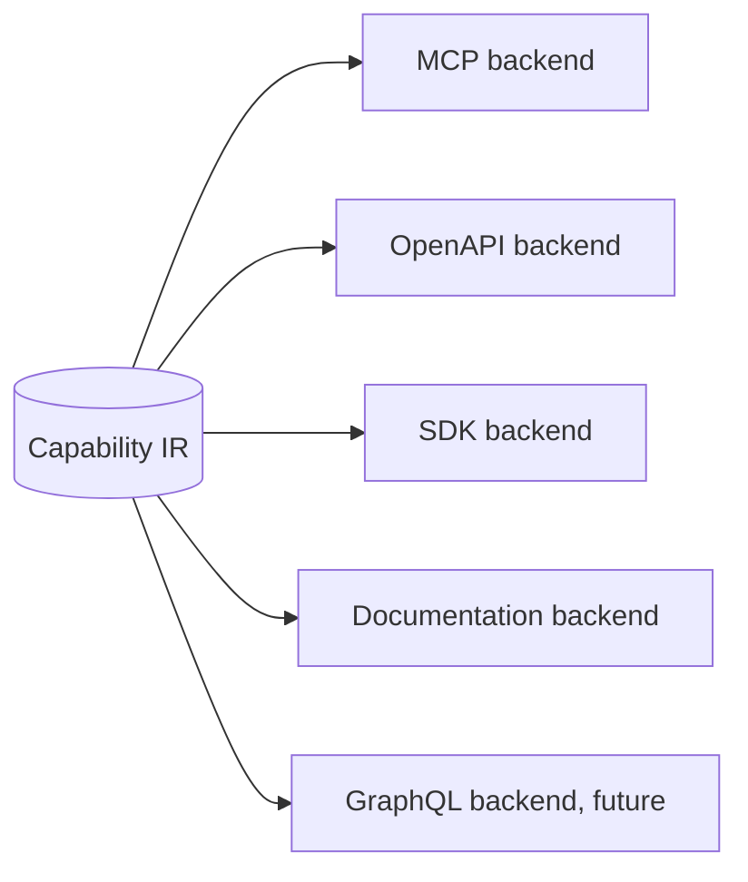

# Volume 6: Backends

Status: Stable for the abstraction and the MCP backend. Future backends are described as direction. A Backend turns the Capability IR into an output shape. It reads only the IR, it never learns where the IR came from, and it never calls a framework directly.

---

## 1. The abstraction



```java
public interface Backend {
    void generate(CapabilityModel ir, GenerationContext ctx);
}
```

The `GenerationContext` carries everything the backend needs that is not the IR: the output directory, the template settings, and the naming of the ExecutionAdapter the generated code will call. It does not carry any source or framework information.

## 2. Why backends never know the source

If a backend knew the system was Spring, that knowledge would leak into the backend, and every backend would need a branch per source technology. By reading only the IR, the MCP backend is identical whether the underlying system is Spring, .NET, or a database (ADR-0004). The cost of this rule is that execution must be indirected through the ExecutionAdapter rather than calling a service directly. That indirection is exactly what keeps backends portable.

## 3. The MCP backend (MVP)

The MCP backend emits a standards-conformant MCP server that exposes one tool per capability. Each generated tool:

1. Declares its inputs and output from the capability's typed signature.
2. On invocation, calls `ExecutionAdapter.invoke(capability, args)`. It never imports or calls a service class.
3. Returns the adapter's result to the agent.

```java
// generated tool body (sketch)
public Object call(Map<String,Object> args) {
    return executionAdapter.invoke(new CapabilityRef("getProduct"), args);
}
```

### 3.1 Surfacing the view of a read (decided 2026-07-02)

A read discovered from a view-returning service method carries a `view` annotation in the IR (Volume 5, section 4.2.5): the output stays `ENTITY_REF(E)`, and the annotation records the concrete return type's simple name, for example `getUnit` with `view: UnitVTO`. Without surfacing it, the generated tool tells its consumer only `ENTITY_REF(Unit)`, which is less honest than the IR: the wire shape is a `UnitVTO`, a projection of Unit. This subsection decides how the MCP backend surfaces that.

The decision, smallest honest surface first:

- Manifest field (required). A tool entry for a capability whose IR carries a `view` annotation gains one field, `"view"`, whose value is the view type's simple name, placed immediately after `"output"`. It refines the output: `"output": "ENTITY_REF(Unit)"` says the read is of Unit; `"view": "UnitVTO"` says the concrete shape returned has its own name. A capability with no `view` annotation gets no `view` field at all, no null and no empty string; its absence means the output is the entity shape itself. This keeps unchanged capabilities byte-identical.
- Description (added, and justified). The synthesized `"description"` gains one clause for a view-carrying capability: `Read Unit by id. Returns the UnitVTO view of Unit.` The description is the surface most MCP clients show an agent directly, and a generic client may never render a custom `view` field; leaving the description saying only `Read Unit by id.` while the wire returns a `UnitVTO` reproduces the very dishonesty this change closes. The clause is one sentence, deterministic, and appears only when a view is present.
- One-off for `view`, not a generic annotation passthrough. The backend surfaces the `view` annotation specifically, not arbitrary IR annotations. A generic passthrough would dump every annotation key the provider ever attaches into the manifest, inviting schema sprawl and leaking hints the backend does not know how to render. The backend surfaces only annotations it understands how to present; `view` is the one it understands today. A second such annotation is a second deliberate, one-off decision here.

The IR, the provider, and the runtime do not change. The `view` field is additive; the runtime's manifest loader reads only the fields it knows (`name`, `description`, `binding`, `output`, `inputs`) and tolerates the unknown `view` field. That tolerance is made explicit on the runtime's manifest types so it does not depend on the host's Jackson configuration; the runtime's behavior is otherwise unchanged (it does not act on the view).

### 3.3 Surfacing a list read (phase E4, RATIFIED and BUILT 2026-07-02)

A list capability carries `output: ENTITY_REF(E)` with `outputMultiple: true` (Volume 4, section 3.4; Volume 5, section 4.10). Without surfacing the multiplicity, the generated tool would tell its consumer `ENTITY_REF(E)`, hiding that the tool returns many E, not one. This subsection decides how the MCP backend surfaces it, in the same smallest-honest-surface spirit as the `view` field (section 3.1).

- Manifest field (required). A tool entry for a capability with `outputMultiple: true` gains one field, `"outputMultiple": true`, placed immediately after `"output"`. It refines the output: `"output": "ENTITY_REF(Contact)"` names the element, `"outputMultiple": true` says the tool returns a collection of that element. A singular capability gets no such field at all, no `false` and no null, so every existing capability stays byte-identical.
- Paged field (required when present). A capability carrying the `paged` annotation (Volume 5, section 4.10.3) gains a `"paged": true` field after `"outputMultiple"`. It is the machine half of the page-envelope disclosure; a list read whose terminal was the no-argument `findAll()` gets no `paged` field.
- Description (added, and justified). The synthesized `"description"` for a list capability reads `List all Contact.`; for a paged one it reads `List all Contact. Returns a page of results; the total count and page envelope are not modeled.` The description is the surface most MCP clients show an agent directly, so leaving it silent about multiplicity or paging while the wire returns many, or a page envelope, reproduces the dishonesty this change closes. The clause is deterministic and appears only for the shape it describes.
- One-off for `outputMultiple` and `paged`, not a generic passthrough. As with `view`, the backend surfaces the two annotations it understands how to present, not arbitrary IR annotations. A third understood annotation is a third deliberate decision here.

The IR, the provider, and the runtime's contract do not change shape. The two new fields are additive; the runtime's manifest loader reads only the fields it acts on and tolerates the unknown `outputMultiple` and `paged` fields explicitly on its manifest types (the same `@JsonIgnoreProperties` tolerance the `view` field uses), so tolerance does not depend on the host's Jackson configuration.

Runtime note, and the one deferred piece named honestly. To invoke a list read, `SpringExecutionAdapter` resolves the binding to the real bean and method as today, invokes it with no arguments for a no-parameter `findAll()`, and serializes the returned collection as a JSON array. When the method takes a `Pageable` (the paged shape), the adapter must supply one, and what `Pageable` to supply (an unpaged default, or a first page) is runtime paging behavior, which is explicitly out of phase E4's scope (Volume 13). Until that is designed, a no-argument list read is fully executable end to end, and a paged list read is discovered, modeled, and rendered by both backends but carries a deferred runtime invocation note (Volume 7, section 8). For a `Page` result the adapter serializes the page content (the elements), never the envelope, consistent with the IR modeling the element collection and disclosing the envelope rather than claiming it.

### 3.4 Display names and collision disambiguation (phase Entity Identity; designed 2026-07-13, pending ratification)

Every name a backend puts on a surface derives from the entity's display `name` (Volume 4, section 3.7; the disambiguation rule that produces it is Volume 5, section 4.12). This subsection records what that means for the two built backends and the survey, and why no backend needs a new field.

- MCP. The tool name is the capability name, `get<display name>`; the manifest `output` renders `ENTITY_REF(<display name>)`. Both already read the display `name`, so no manifest field is added. When a simple name is unique (every single-context app, and both public benchmarks), the display name is the simple name and the manifest is byte-identical: `getProduct`, `output: ENTITY_REF(Product)`. When simple names collide, the disambiguated names flow straight through: two reads of same-named entities become `getOrderOffer` and `getDiscountOffer`, with `output` fields `ENTITY_REF(OrderOffer)` and `ENTITY_REF(DiscountOffer)`. Capability-name uniqueness (Volume 4, rule 2) holds by construction, so the two tools never collide.
- OpenAPI. The schema rule (section 4) names a component by the entity, the path `/<resource>` by the entity, and an entity `$ref` by the entity; all three now read the display `name`. Two colliding `Offer` entities therefore produce two distinct components `OrderOffer` and `DiscountOffer`, two distinct paths, and `$ref`s that each point at the right one, so the `$ref` collision that simple-name schemas would have produced cannot arise. For a unique simple name the component, path, and `$ref` are byte-identical to today (`Product`, `/product/{id}`, `#/components/schemas/Product`). No schema rule changes; only the string each rule reads is the display name instead of the raw simple name, and the two coincide except on collision.
- Survey. The scan survey (rendered by the CLI, Volume 11) gains one line, emitted only when nonzero: `collisions resolved: N`, where N simple names were disambiguated across M entities. It discloses that a disambiguation happened and its extent. At zero it is omitted, exactly as the deferred and partial lines are, so a no-collision survey is byte-identical. The decision is recorded here; the CLI renders it when the phase is built.
- Golden churn, stated honestly. The example-app and both public-benchmark backend goldens (the MCP manifest, the OpenAPI document) must stay byte-identical, because none of those apps has a colliding simple name; the build verifies this, and a collision found in either public benchmark would be a regression finding, not an expected change. The IR-serialization output changes additively (each entity gains a `key` field; reference tokens and display names are unchanged for a no-collision app), so any `scan --out` IR golden updates with a visible additive diff, exactly as E3 (relations, enums) and E4 (`outputMultiple`) changed the IR shape. New backend golden cases are added for the collision scenario, from the collision fixtures (Volume 5, section 4.12.6: EI-1 and EI-7 to EI-13).

- Emission order (required for the byte-identical guarantee). Backend output byte-identity depends not only on each surface string but on the ORDER surfaces are emitted in. Component, path, and tool emission order must stay keyed on the display `name` (the current order), and the new `key` must never be used as a sort key on any surface: the `key` is a fully-qualified name, so sorting components or tools by it would reorder a no-collision app's OpenAPI components and manifest tools even though every string is unchanged, breaking the goldens for no reason. The existing example-app and benchmark goldens backstop this, but stating it makes the byte-identical guarantee rest on the design, not only on the golden diff. Core validation independently enforces display-name uniqueness (Volume 4, section 5, rule 1), so a duplicate surface name fails loud before any backend runs, rather than one component silently overwriting another.

What this will never do: a backend never invents a disambiguator of its own (the display name is decided once, in the provider, so every backend agrees); and no backend surfaces the raw `key` on a tool or schema name, which would leak a package path into an agent-facing surface. The key is identity, carried in the IR for resolution and validation; the display name is what a surface shows.

### 3.2 Future backends (direction)

| Backend | Output | Note |
|---|---|---|
| OpenAPI | An OpenAPI document | Built 2026-07-02: the second backend, proving one IR feeds more than one output with no provider change (section 4) |
| SDK | Typed client libraries | Generated clients for the same capabilities (Volume 13, Tier 3) |
| Documentation | Human-readable API docs | A side output from the same model |
| GraphQL | A GraphQL schema and resolvers | Has no controllers, which is why the IR must stay neutral (ADR-0013) |
| REST | A conventional REST surface | For systems that want a fresh, generated API |

Because each backend derives its own surface (a tool, an operation, a resolver) from capabilities, the IR never needs an Endpoint or Service concept. Those were deliberately removed from the IR (ADR-0013).

## 4. The OpenAPI backend (the second backend, an IR-reuse proof; built 2026-07-02)

`tibyan-backend-openapi` turns the same Capability IR into an OpenAPI 3.0 document, proving the one-IR-many-outputs claim on real capabilities: the erp-backend IR (16 read capabilities) and the pms-backend IR (2) both render to valid OpenAPI with zero change to `tibyan-core`, `tibyan-plugin-api`, or any provider. It is a proof, not a product backend: read-by-id GET operations only, exactly what the IR carries today. It reads only the IR (rule 1) and emits a deterministic JSON document by the same hand-rolled approach `ManifestWriter` uses, so no serialization library reaches the backend and golden-file output is exact. JSON is a valid OpenAPI 3.x serialization; hand-rolling it is deterministic and dependency-free, where hand-rolling YAML would risk whitespace and escaping bugs.

Shape: one GET operation per capability. The path is `/<resource>/{<id>}` where `<resource>` is the output entity's name with its first letter lowercased and `<id>` is the capability's single input name; the `operationId` is the capability name; the single typed input becomes a required path parameter. The 200 response schema follows the partiality-in-schema rule (section 4.1).

The closed type set maps to OpenAPI as follows:

| IR type | OpenAPI | Note |
|---|---|---|
| STRING | `{type: string}` | |
| LONG | `{type: integer, format: int64}` | |
| INTEGER | `{type: integer, format: int32}` | |
| DECIMAL | `{type: number, format: decimal}` | Wire-accurate: the default JSON serialization of an exact decimal is a JSON number, so `number` matches the wire, and `format: decimal` hints the exactness the bare `number` cannot. A `string` representation would over-claim a serialization the app does not use by default; a source that serializes decimals as strings would need this revisited (a finding, not now) |
| FLOAT | `{type: number, format: double}` | Inexact 64-bit float, per the IR |
| BOOLEAN | `{type: boolean}` | |
| UUID | `{type: string, format: uuid}` | |
| TIMESTAMP | `{type: string, format: date-time}` | |
| ENTITY_REF(T) in a field | `{$ref: '#/components/schemas/T'}` | T is present by model closure (Volume 5, section 4.7); a component is emitted for every entity in the reference closure of the entity-returning capabilities |

The `enum` annotation (Volume 5, section 4.5) surfaces as an OpenAPI `enum` on the field's string schema, which is exactly what the annotation was recorded for. The `view` annotation surfaces per the schema rule (section 4.1, condition 3). A nullable field carries `nullable: true`; an `ENTITY_REF` field is emitted as a bare `$ref`, so its nullability is not expressed (an OpenAPI 3.0 limitation not worth `allOf`-wrapping in a proof, noted).

### 4.1 The partiality-in-schema rule (the honesty baseline for generated schemas)

This is the first backend that emits entity field schemas, so it inherits the ratified requirement (Volume 5, section 4.9, the ratification rider): a partial entity's schema must not present itself as the complete shape. More broadly, a generated schema must never let a reader be more confident about the wire shape than the IR's knowledge justifies. The rule:

1. No response schema claims closedness. `additionalProperties` is never set to `false` on any generated object. The IR is a semantic model of an entity's persistent fields, not a wire contract; the real response may carry fields the IR does not model (transient or computed fields), so asserting a closed object would claim a completeness the IR cannot back.
2. Entity-returning capability (output `ENTITY_REF(E)`, no `view` annotation): the 200 response is a `$ref` to E's component schema. E's component lists its modeled fields as `properties`, each typed per the mapping table, is permissive per condition 1, and its `description` states it is entity E as modeled.
3. View-returning capability (output `ENTITY_REF(E)` with a `view` annotation naming V): the 200 response is a standalone permissive object with no `properties`, because the IR does not model V's fields at all. Its `description` reads "Returns V, a view of E; the concrete field shape of V is not modeled, so this schema does not enumerate its fields," and it carries `x-tibyan-view: V`. It never references E's component and never presents E's fields as V's fields. This is the refusal-of-claims case: the schema declines to describe fields it does not know, because inventing the entity's fields for a view wire shape is exactly the dishonesty the project refuses.
4. Partial entity component (E carries a `partial` annotation naming skipped fields): the component lists only the modeled (present) fields; its `description` carries the disclosure "Partial model: N field(s) of the source entity are not represented: <names>," and it carries `x-tibyan-partial: [<names>]`. A skipped field appears in neither `properties` nor `required`. The object is permissive per condition 1, so the omitted fields are allowed at runtime but never claimed.
5. `required` lists a field only when it is both modeled and non-nullable. A partial entity's omitted fields never appear in `required`.
6. Disclosure is in two places for two audiences: a vendor extension (`x-tibyan-partial`, `x-tibyan-view`) for machine consumers and the `description` prose for human and agent readers. Both are emitted; neither alone.

What this rule will never claim: a closed object (`additionalProperties: false`) for any response; a view's fields (it does not know them), nor the source entity's fields presented as the view's fields; a skipped or unmodeled field in `properties` or `required`; a partial entity's schema as the complete shape; or any field, type, format, or constraint the IR does not carry.

The guiding test, restated: a view response says "I do not model these fields"; a partial entity says "these N fields are not represented"; a complete entity says "here are the modeled fields, and there may be more." A reader is never more confident than the IR.

### 4.2 List operations (phase E4, RATIFIED and BUILT 2026-07-02)

This realizes the E4 seam recorded when the backend shipped (section 4): a list capability's output is an array whose items are the element schema. When the IR grows `outputMultiple` (Volume 4, section 3.4), the OpenAPI backend renders a list capability as follows, and the rendering is mechanical because the honesty machinery of section 4.1 already handles the element:

1. Path and operation. A list capability has no id input, so its path is the collection path `/<resource>` (the output entity's name, first letter lowercased), with a GET whose `operationId` is the capability name (`listContact`). It has no path parameter and, in E4, no query parameters (paging is unmodeled, section 4.1's honesty rule forbids inventing them).
2. The 200 response schema is `{type: array, items: <element schema>}`. The element schema is exactly what a singular capability of the same output would produce: for `output ENTITY_REF(E)` it is `{$ref: '#/components/schemas/E'}`, so E's component (with its partiality disclosure per section 4.1, condition 4) is the array's item type. A list of a partial entity is therefore an array whose items disclose their own omitted fields, with no new rule: the E5 rider rides along through the element.
3. Paged disclosure. When the capability carries the `paged` annotation, the array response additionally carries `x-tibyan-paged: true` and a `description` clause: "The wire response is a page envelope; this schema models the element collection, not the page envelope." The array is not wrapped in a fabricated page object, because the IR does not model the envelope and section 4.1 forbids claiming a shape the IR does not carry. The array itself is never marked closed (`additionalProperties` does not apply to arrays, and the item object stays permissive per section 4.1).
4. Filtered inputs do not arise. E4 discovers no filtered list read (Volume 5, section 4.10.2), so the backend renders no opaque filter parameters and makes no unverified "filter by X" claim. When filtered reads are modeled in a later phase, how their inputs render (a query parameter with a copied name, and whether the description states the semantics are not verified) is that phase's decision, inheriting this same honesty rule; it is named here, not designed here.

What this will never claim: a page envelope shape the IR does not model (only an array of the element, plus a paged disclosure); a filter parameter the IR does not carry; or, through the array's items, any more than the element schema already honestly claims under section 4.1.

## 5. Templates and testing

Backends generate code from templates (Volume 16). Every backend is covered by golden-file tests: a fixed IR produces a fixed set of files, and any change to the output is a visible diff. This makes generation deterministic and reviewable.

## 6. Rules

1. A backend reads only the IR plus its GenerationContext.
2. A backend never depends on a provider, never depends on a runtime, and never calls a framework directly.
3. Generated code invokes logic only through the ExecutionAdapter.
