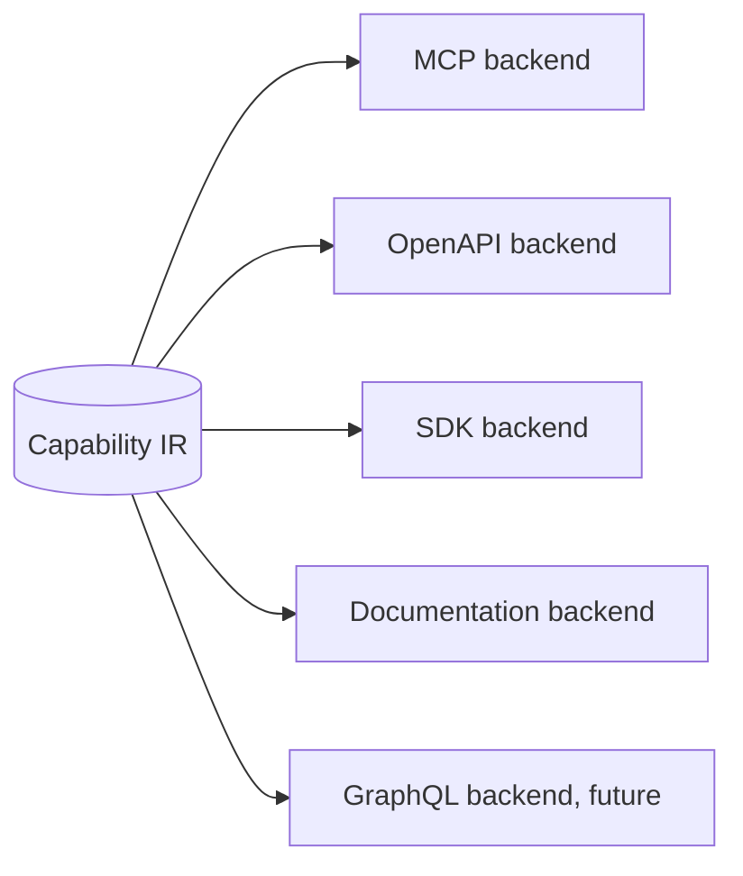

# Volume 6: Backends

Status: Stable for the abstraction and the MCP backend. Future backends are described as direction. A Backend turns the Capability IR into an output shape. It reads only the IR, it never learns where the IR came from, and it never calls a framework directly.

---

## 1. The abstraction



```java
public interface Backend {
    void generate(CapabilityModel ir, GenerationContext ctx);
}
```

The `GenerationContext` carries everything the backend needs that is not the IR: the output directory, the template settings, and the naming of the ExecutionAdapter the generated code will call. It does not carry any source or framework information.

## 2. Why backends never know the source

If a backend knew the system was Spring, that knowledge would leak into the backend, and every backend would need a branch per source technology. By reading only the IR, the MCP backend is identical whether the underlying system is Spring, .NET, or a database (ADR-0004). The cost of this rule is that execution must be indirected through the ExecutionAdapter rather than calling a service directly. That indirection is exactly what keeps backends portable.

## 3. The MCP backend (MVP)

The MCP backend emits a standards-conformant MCP server that exposes one tool per capability. Each generated tool:

1. Declares its inputs and output from the capability's typed signature.
2. On invocation, calls `ExecutionAdapter.invoke(capability, args)`. It never imports or calls a service class.
3. Returns the adapter's result to the agent.

```java
// generated tool body (sketch)
public Object call(Map<String,Object> args) {
    return executionAdapter.invoke(new CapabilityRef("getProduct"), args);
}
```

## 4. Future backends

| Backend | Output | Note |
|---|---|---|
| OpenAPI | An OpenAPI document | Proves the IR feeds more than one backend (Volume 13, Tier 3) |
| SDK | Typed client libraries | Generated clients for the same capabilities (Volume 13, Tier 3) |
| Documentation | Human-readable API docs | A side output from the same model |
| GraphQL | A GraphQL schema and resolvers | Has no controllers, which is why the IR must stay neutral (ADR-0013) |
| REST | A conventional REST surface | For systems that want a fresh, generated API |

Because each backend derives its own surface (a tool, an operation, a resolver) from capabilities, the IR never needs an Endpoint or Service concept. Those were deliberately removed from the IR (ADR-0013).

## 5. Templates and testing

Backends generate code from templates (Volume 16). Every backend is covered by golden-file tests: a fixed IR produces a fixed set of files, and any change to the output is a visible diff. This makes generation deterministic and reviewable.

## 6. Rules

1. A backend reads only the IR plus its GenerationContext.
2. A backend never depends on a provider, never depends on a runtime, and never calls a framework directly.
3. Generated code invokes logic only through the ExecutionAdapter.
