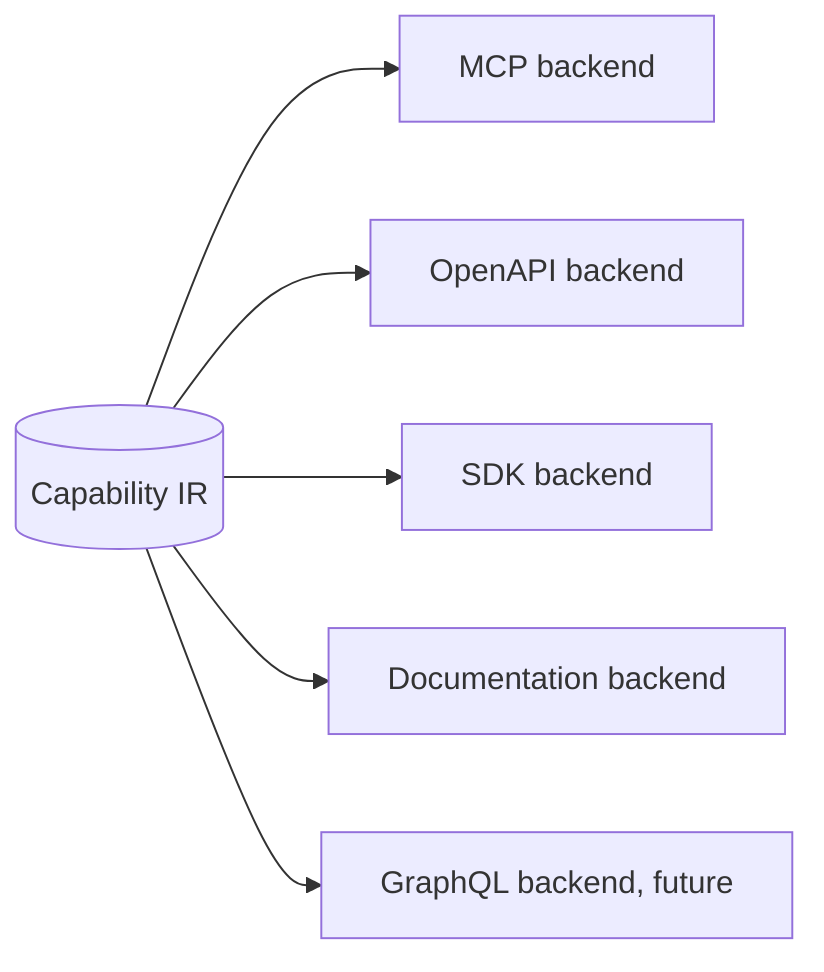

# Volume 6: Backends

Status: Stable for the abstraction and the MCP backend. Future backends are described as direction. A Backend turns the Capability IR into an output shape. It reads only the IR, it never learns where the IR came from, and it never calls a framework directly.

---

## 1. The abstraction



```java
public interface Backend {
    void generate(CapabilityModel ir, GenerationContext ctx);
}
```

The `GenerationContext` carries everything the backend needs that is not the IR: the output directory, the template settings, and the naming of the ExecutionAdapter the generated code will call. It does not carry any source or framework information.

## 2. Why backends never know the source

If a backend knew the system was Spring, that knowledge would leak into the backend, and every backend would need a branch per source technology. By reading only the IR, the MCP backend is identical whether the underlying system is Spring, .NET, or a database (ADR-0004). The cost of this rule is that execution must be indirected through the ExecutionAdapter rather than calling a service directly. That indirection is exactly what keeps backends portable.

## 3. The MCP backend (MVP)

The MCP backend emits a standards-conformant MCP server that exposes one tool per capability. Each generated tool:

1. Declares its inputs and output from the capability's typed signature.
2. On invocation, calls `ExecutionAdapter.invoke(capability, args)`. It never imports or calls a service class.
3. Returns the adapter's result to the agent.

```java
// generated tool body (sketch)
public Object call(Map<String,Object> args) {
    return executionAdapter.invoke(new CapabilityRef("getProduct"), args);
}
```

### 3.1 Surfacing the view of a read (decided 2026-07-02)

A read discovered from a view-returning service method carries a `view` annotation in the IR (Volume 5, section 4.2.5): the output stays `ENTITY_REF(E)`, and the annotation records the concrete return type's simple name, for example `getUnit` with `view: UnitVTO`. Without surfacing it, the generated tool tells its consumer only `ENTITY_REF(Unit)`, which is less honest than the IR: the wire shape is a `UnitVTO`, a projection of Unit. This subsection decides how the MCP backend surfaces that.

The decision, smallest honest surface first:

- Manifest field (required). A tool entry for a capability whose IR carries a `view` annotation gains one field, `"view"`, whose value is the view type's simple name, placed immediately after `"output"`. It refines the output: `"output": "ENTITY_REF(Unit)"` says the read is of Unit; `"view": "UnitVTO"` says the concrete shape returned has its own name. A capability with no `view` annotation gets no `view` field at all, no null and no empty string; its absence means the output is the entity shape itself. This keeps unchanged capabilities byte-identical.
- Description (added, and justified). The synthesized `"description"` gains one clause for a view-carrying capability: `Read Unit by id. Returns the UnitVTO view of Unit.` The description is the surface most MCP clients show an agent directly, and a generic client may never render a custom `view` field; leaving the description saying only `Read Unit by id.` while the wire returns a `UnitVTO` reproduces the very dishonesty this change closes. The clause is one sentence, deterministic, and appears only when a view is present.
- One-off for `view`, not a generic annotation passthrough. The backend surfaces the `view` annotation specifically, not arbitrary IR annotations. A generic passthrough would dump every annotation key the provider ever attaches into the manifest, inviting schema sprawl and leaking hints the backend does not know how to render. The backend surfaces only annotations it understands how to present; `view` is the one it understands today. A second such annotation is a second deliberate, one-off decision here.

The IR, the provider, and the runtime do not change. The `view` field is additive; the runtime's manifest loader reads only the fields it knows (`name`, `description`, `binding`, `output`, `inputs`) and tolerates the unknown `view` field. That tolerance is made explicit on the runtime's manifest types so it does not depend on the host's Jackson configuration; the runtime's behavior is otherwise unchanged (it does not act on the view).

### 3.2 Future backends (direction)

| Backend | Output | Note |
|---|---|---|
| OpenAPI | An OpenAPI document | Built 2026-07-02: the second backend, proving one IR feeds more than one output with no provider change (section 4) |
| SDK | Typed client libraries | Generated clients for the same capabilities (Volume 13, Tier 3) |
| Documentation | Human-readable API docs | A side output from the same model |
| GraphQL | A GraphQL schema and resolvers | Has no controllers, which is why the IR must stay neutral (ADR-0013) |
| REST | A conventional REST surface | For systems that want a fresh, generated API |

Because each backend derives its own surface (a tool, an operation, a resolver) from capabilities, the IR never needs an Endpoint or Service concept. Those were deliberately removed from the IR (ADR-0013).

## 4. The OpenAPI backend (the second backend, an IR-reuse proof; built 2026-07-02)

`tibyan-backend-openapi` turns the same Capability IR into an OpenAPI 3.0 document, proving the one-IR-many-outputs claim on real capabilities: the erp-backend IR (16 read capabilities) and the pms-backend IR (2) both render to valid OpenAPI with zero change to `tibyan-core`, `tibyan-plugin-api`, or any provider. It is a proof, not a product backend: read-by-id GET operations only, exactly what the IR carries today. It reads only the IR (rule 1) and emits a deterministic JSON document by the same hand-rolled approach `ManifestWriter` uses, so no serialization library reaches the backend and golden-file output is exact. JSON is a valid OpenAPI 3.x serialization; hand-rolling it is deterministic and dependency-free, where hand-rolling YAML would risk whitespace and escaping bugs.

Shape: one GET operation per capability. The path is `/<resource>/{<id>}` where `<resource>` is the output entity's name with its first letter lowercased and `<id>` is the capability's single input name; the `operationId` is the capability name; the single typed input becomes a required path parameter. The 200 response schema follows the partiality-in-schema rule (section 4.1).

The closed type set maps to OpenAPI as follows:

| IR type | OpenAPI | Note |
|---|---|---|
| STRING | `{type: string}` | |
| LONG | `{type: integer, format: int64}` | |
| INTEGER | `{type: integer, format: int32}` | |
| DECIMAL | `{type: number, format: decimal}` | Wire-accurate: the default JSON serialization of an exact decimal is a JSON number, so `number` matches the wire, and `format: decimal` hints the exactness the bare `number` cannot. A `string` representation would over-claim a serialization the app does not use by default; a source that serializes decimals as strings would need this revisited (a finding, not now) |
| FLOAT | `{type: number, format: double}` | Inexact 64-bit float, per the IR |
| BOOLEAN | `{type: boolean}` | |
| UUID | `{type: string, format: uuid}` | |
| TIMESTAMP | `{type: string, format: date-time}` | |
| ENTITY_REF(T) in a field | `{$ref: '#/components/schemas/T'}` | T is present by model closure (Volume 5, section 4.7); a component is emitted for every entity in the reference closure of the entity-returning capabilities |

The `enum` annotation (Volume 5, section 4.5) surfaces as an OpenAPI `enum` on the field's string schema, which is exactly what the annotation was recorded for. The `view` annotation surfaces per the schema rule (section 4.1, condition 3). A nullable field carries `nullable: true`; an `ENTITY_REF` field is emitted as a bare `$ref`, so its nullability is not expressed (an OpenAPI 3.0 limitation not worth `allOf`-wrapping in a proof, noted).

### 4.1 The partiality-in-schema rule (the honesty baseline for generated schemas)

This is the first backend that emits entity field schemas, so it inherits the ratified requirement (Volume 5, section 4.9, the ratification rider): a partial entity's schema must not present itself as the complete shape. More broadly, a generated schema must never let a reader be more confident about the wire shape than the IR's knowledge justifies. The rule:

1. No response schema claims closedness. `additionalProperties` is never set to `false` on any generated object. The IR is a semantic model of an entity's persistent fields, not a wire contract; the real response may carry fields the IR does not model (transient or computed fields), so asserting a closed object would claim a completeness the IR cannot back.
2. Entity-returning capability (output `ENTITY_REF(E)`, no `view` annotation): the 200 response is a `$ref` to E's component schema. E's component lists its modeled fields as `properties`, each typed per the mapping table, is permissive per condition 1, and its `description` states it is entity E as modeled.
3. View-returning capability (output `ENTITY_REF(E)` with a `view` annotation naming V): the 200 response is a standalone permissive object with no `properties`, because the IR does not model V's fields at all. Its `description` reads "Returns V, a view of E; the concrete field shape of V is not modeled, so this schema does not enumerate its fields," and it carries `x-tibyan-view: V`. It never references E's component and never presents E's fields as V's fields. This is the refusal-of-claims case: the schema declines to describe fields it does not know, because inventing the entity's fields for a view wire shape is exactly the dishonesty the project refuses.
4. Partial entity component (E carries a `partial` annotation naming skipped fields): the component lists only the modeled (present) fields; its `description` carries the disclosure "Partial model: N field(s) of the source entity are not represented: <names>," and it carries `x-tibyan-partial: [<names>]`. A skipped field appears in neither `properties` nor `required`. The object is permissive per condition 1, so the omitted fields are allowed at runtime but never claimed.
5. `required` lists a field only when it is both modeled and non-nullable. A partial entity's omitted fields never appear in `required`.
6. Disclosure is in two places for two audiences: a vendor extension (`x-tibyan-partial`, `x-tibyan-view`) for machine consumers and the `description` prose for human and agent readers. Both are emitted; neither alone.

What this rule will never claim: a closed object (`additionalProperties: false`) for any response; a view's fields (it does not know them), nor the source entity's fields presented as the view's fields; a skipped or unmodeled field in `properties` or `required`; a partial entity's schema as the complete shape; or any field, type, format, or constraint the IR does not carry.

The guiding test, restated: a view response says "I do not model these fields"; a partial entity says "these N fields are not represented"; a complete entity says "here are the modeled fields, and there may be more." A reader is never more confident than the IR.

## 5. Templates and testing

Backends generate code from templates (Volume 16). Every backend is covered by golden-file tests: a fixed IR produces a fixed set of files, and any change to the output is a visible diff. This makes generation deterministic and reviewable.

## 6. Rules

1. A backend reads only the IR plus its GenerationContext.
2. A backend never depends on a provider, never depends on a runtime, and never calls a framework directly.
3. Generated code invokes logic only through the ExecutionAdapter.
