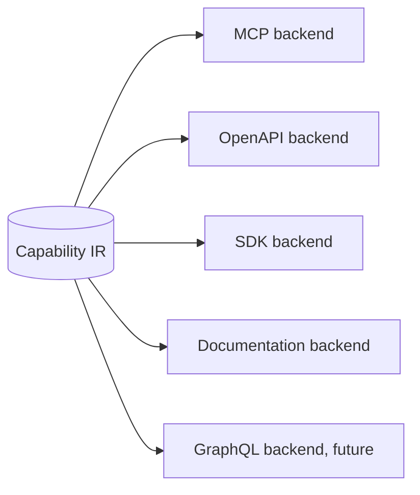

# Volume 6: Backends

Status: Stable for the abstraction and the MCP backend. Future backends are described as direction. A Backend turns the Capability IR into an output shape. It reads only the IR, it never learns where the IR came from, and it never calls a framework directly.

---

## 1. The abstraction



```java
public interface Backend {
    void generate(CapabilityModel ir, GenerationContext ctx);
}
```

The `GenerationContext` carries everything the backend needs that is not the IR: the output directory, the template settings, and the naming of the ExecutionAdapter the generated code will call. It does not carry any source or framework information.

## 2. Why backends never know the source

If a backend knew the system was Spring, that knowledge would leak into the backend, and every backend would need a branch per source technology. By reading only the IR, the MCP backend is identical whether the underlying system is Spring, .NET, or a database (ADR-0004). The cost of this rule is that execution must be indirected through the ExecutionAdapter rather than calling a service directly. That indirection is exactly what keeps backends portable.

## 3. The MCP backend (MVP)

The MCP backend emits a standards-conformant MCP server that exposes one tool per capability. Each generated tool:

1. Declares its inputs and output from the capability's typed signature.
2. On invocation, calls `ExecutionAdapter.invoke(capability, args)`. It never imports or calls a service class.
3. Returns the adapter's result to the agent.

```java
// generated tool body (sketch)
public Object call(Map<String,Object> args) {
    return executionAdapter.invoke(new CapabilityRef("getProduct"), args);
}
```

### 3.1 Surfacing the view of a read (decided 2026-07-02)

A read discovered from a view-returning service method carries a `view` annotation in the IR (Volume 5, section 4.2.5): the output stays `ENTITY_REF(E)`, and the annotation records the concrete return type's simple name, for example `getUnit` with `view: UnitVTO`. Without surfacing it, the generated tool tells its consumer only `ENTITY_REF(Unit)`, which is less honest than the IR: the wire shape is a `UnitVTO`, a projection of Unit. This subsection decides how the MCP backend surfaces that.

The decision, smallest honest surface first:

- Manifest field (required). A tool entry for a capability whose IR carries a `view` annotation gains one field, `"view"`, whose value is the view type's simple name, placed immediately after `"output"`. It refines the output: `"output": "ENTITY_REF(Unit)"` says the read is of Unit; `"view": "UnitVTO"` says the concrete shape returned has its own name. A capability with no `view` annotation gets no `view` field at all, no null and no empty string; its absence means the output is the entity shape itself. This keeps unchanged capabilities byte-identical.
- Description (added, and justified). The synthesized `"description"` gains one clause for a view-carrying capability: `Read Unit by id. Returns the UnitVTO view of Unit.` The description is the surface most MCP clients show an agent directly, and a generic client may never render a custom `view` field; leaving the description saying only `Read Unit by id.` while the wire returns a `UnitVTO` reproduces the very dishonesty this change closes. The clause is one sentence, deterministic, and appears only when a view is present.
- One-off for `view`, not a generic annotation passthrough. The backend surfaces the `view` annotation specifically, not arbitrary IR annotations. A generic passthrough would dump every annotation key the provider ever attaches into the manifest, inviting schema sprawl and leaking hints the backend does not know how to render. The backend surfaces only annotations it understands how to present; `view` is the one it understands today. A second such annotation is a second deliberate, one-off decision here.

The IR, the provider, and the runtime do not change. The `view` field is additive; the runtime's manifest loader reads only the fields it knows (`name`, `description`, `binding`, `output`, `inputs`) and tolerates the unknown `view` field. That tolerance is made explicit on the runtime's manifest types so it does not depend on the host's Jackson configuration; the runtime's behavior is otherwise unchanged (it does not act on the view).

| Backend | Output | Note |
|---|---|---|
| OpenAPI | An OpenAPI document | Proves the IR feeds more than one backend (Volume 13, Tier 3) |
| SDK | Typed client libraries | Generated clients for the same capabilities (Volume 13, Tier 3) |
| Documentation | Human-readable API docs | A side output from the same model |
| GraphQL | A GraphQL schema and resolvers | Has no controllers, which is why the IR must stay neutral (ADR-0013) |
| REST | A conventional REST surface | For systems that want a fresh, generated API |

Because each backend derives its own surface (a tool, an operation, a resolver) from capabilities, the IR never needs an Endpoint or Service concept. Those were deliberately removed from the IR (ADR-0013).

## 5. Templates and testing

Backends generate code from templates (Volume 16). Every backend is covered by golden-file tests: a fixed IR produces a fixed set of files, and any change to the output is a visible diff. This makes generation deterministic and reviewable.

## 6. Rules

1. A backend reads only the IR plus its GenerationContext.
2. A backend never depends on a provider, never depends on a runtime, and never calls a framework directly.
3. Generated code invokes logic only through the ExecutionAdapter.
