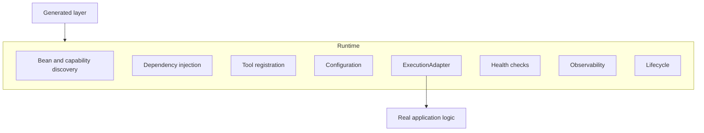
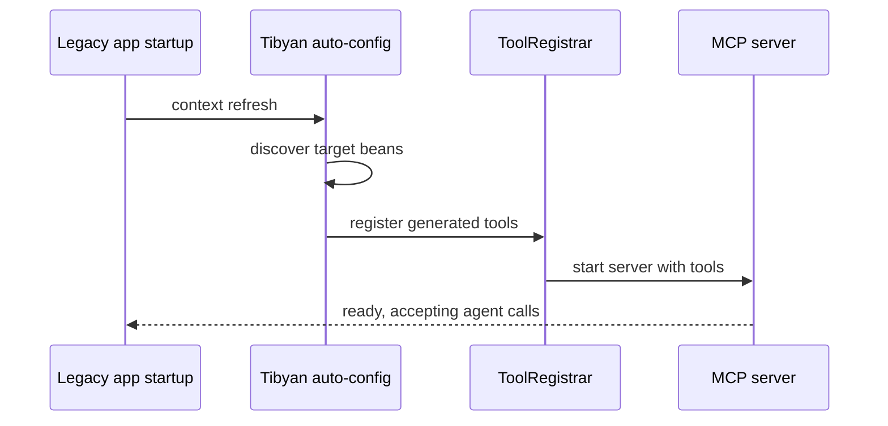

# Volume 7: Runtime

Status: Stable for the Spring runtime's MVP responsibilities; later responsibilities are described as direction. This volume is intentionally detailed, because the runtime is where the generated layer meets the real system, and it is the part the Technical Spike (Volume 8) exists to prove.

---

## 1. Why the runtime exists

A backend produces generated code, but generated code does not run itself. Something must host it, connect it to the real system, and keep it alive. That something is the Runtime. In Tibyan's model, the runtime is what makes a legacy system AI-operable in practice: it places the generated MCP layer inside or beside the real application and binds each tool to real logic.

## 2. Why the runtime is not an ExecutionAdapter

These are often confused, so the distinction is stated plainly. The ExecutionAdapter is a small, stateless interface that answers one question: given a capability and arguments, run it and return a result. The Runtime is a whole hosting environment with many responsibilities, of which invoking a capability is only one. Folding the runtime into the adapter would mislabel an environment as a function and would, over time, stuff lifecycle and observability concerns into a place never meant to hold them (ADR-0006). A runtime contains an ExecutionAdapter; it is not one.



## 3. Runtime responsibilities

| Responsibility | What it does |
|---|---|
| Discovery | Finds the real beans and the capabilities the tools must reach |
| Dependency injection | Resolves the dependencies the generated and host code need |
| Tool registration | Registers the generated tools with the running MCP server |
| Configuration | Reads settings (transport, exposure, limits) from the host application |
| Execution | Invokes real logic through the ExecutionAdapter |
| Health checks | Reports whether the layer and its targets are ready and live |
| Observability | Emits logs, metrics, and traces for tool calls |
| Lifecycle | Starts the MCP server at startup and shuts it down cleanly |
| Runtime plugins | Allows runtime-level extensions (for example, an auth interceptor) later |

## 4. The Spring runtime (MVP)

`tibyan-runtime-spring` is distributed as a Spring Boot starter (ADR-0007). Adding one dependency activates auto-configuration, which discovers the target bean, registers the generated tools, provides the `SpringExecutionAdapter`, and starts the MCP server inside the application's own context. For the MVP, the responsibilities exercised are discovery, tool registration, bean access, and running the MCP server. Health, observability, and lifecycle hardening come later, but the structure is in place from the start.

```java
@AutoConfiguration
public class TibyanAutoConfiguration {
    @Bean ToolRegistrar toolRegistrar(ApplicationContext ctx) { /* register generated tools */ }
    @Bean SpringExecutionAdapter executionAdapter(ApplicationContext ctx) { /* resolve and invoke beans */ }
    @Bean McpServer tibyanMcpServer(ToolRegistrar reg) { /* start MCP inside this context */ }
}
```

## 5. Lifecycle



## 6. Future runtimes

| Runtime | Host | Note |
|---|---|---|
| Quarkus | A Quarkus application | Same role, different host (build-time DI) |
| Micronaut | A Micronaut application | Same role, compile-time injection |
| .NET | A .NET application | Crosses ecosystems; proves the runtime concept is not Java-only |

A new runtime is a peer that hosts the same generated layer. Backends do not change when a runtime is added (ADR-0006), because backends target the ExecutionAdapter contract, not a specific host.

## 7. Rules

1. The runtime hosts and binds; it contains no IR and no generation logic.
2. The runtime owns the ExecutionAdapter implementation for its host.
3. The runtime is the only place that knows how a capability's opaque binding maps to a real call.
