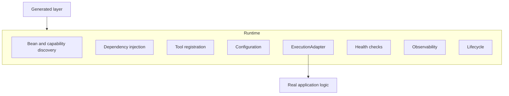
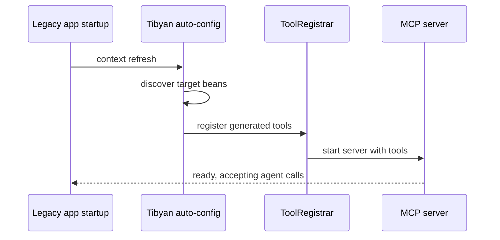

# Volume 7: Runtime

Status: Stable for the Spring runtime's MVP responsibilities; later responsibilities are described as direction. This volume is intentionally detailed, because the runtime is where the generated layer meets the real system, and it is the part the Technical Spike (Volume 8) exists to prove.

---

## 1. Why the runtime exists

A backend produces generated code, but generated code does not run itself. Something must host it, connect it to the real system, and keep it alive. That something is the Runtime. In Tibyan's model, the runtime is what makes a legacy system AI-operable in practice: it places the generated MCP layer inside or beside the real application and binds each tool to real logic.

## 2. Why the runtime is not an ExecutionAdapter

These are often confused, so the distinction is stated plainly. The ExecutionAdapter is a small, stateless interface that answers one question: given a capability and arguments, run it and return a result. The Runtime is a whole hosting environment with many responsibilities, of which invoking a capability is only one. Folding the runtime into the adapter would mislabel an environment as a function and would, over time, stuff lifecycle and observability concerns into a place never meant to hold them (ADR-0006). A runtime contains an ExecutionAdapter; it is not one.



## 3. Runtime responsibilities

| Responsibility | What it does |
|---|---|
| Discovery | Finds the real beans and the capabilities the tools must reach |
| Dependency injection | Resolves the dependencies the generated and host code need |
| Tool registration | Registers the generated tools with the running MCP server |
| Configuration | Reads settings (transport, exposure, limits) from the host application |
| Execution | Invokes real logic through the ExecutionAdapter |
| Health checks | Reports whether the layer and its targets are ready and live |
| Observability | Emits logs, metrics, and traces for tool calls |
| Lifecycle | Starts the MCP server at startup and shuts it down cleanly |
| Runtime plugins | Allows runtime-level extensions (for example, an auth interceptor) later |

## 4. The Spring runtime (MVP)

`tibyan-runtime-spring` is distributed as a Spring Boot starter (ADR-0007). Adding one dependency activates auto-configuration, which discovers the target bean, registers the generated tools, provides the `SpringExecutionAdapter`, and starts the MCP server inside the application's own context. For the MVP, the responsibilities exercised are discovery, tool registration, bean access, and running the MCP server. Health, observability, and lifecycle hardening come later, but the structure is in place from the start.

For the MVP, the binding the `SpringExecutionAdapter` resolves follows the convention recorded in Volume 5, section 4.1 (`<Entity>Service#findById`). The adapter resolves that convention to a real bean and method at run time; it does not treat the convention as permanent, because the ServiceExtractor will later supply the real method in the IR. This keeps rule 3 below honest: the runtime is the only place that maps the opaque binding to a real call, and it maps a convention today, a read fact tomorrow, with no change to backends or the IR.

```java
@AutoConfiguration
public class TibyanAutoConfiguration {
    @Bean ToolRegistrar toolRegistrar(ApplicationContext ctx) { /* register generated tools */ }
    @Bean SpringExecutionAdapter executionAdapter(ApplicationContext ctx) { /* resolve and invoke beans */ }
    @Bean McpServer tibyanMcpServer(ToolRegistrar reg) { /* start MCP inside this context */ }
}
```

## 5. Lifecycle



## 6. Future runtimes

| Runtime | Host | Note |
|---|---|---|
| Quarkus | A Quarkus application | Same role, different host (build-time DI) |
| Micronaut | A Micronaut application | Same role, compile-time injection |
| .NET | A .NET application | Crosses ecosystems; proves the runtime concept is not Java-only |

A new runtime is a peer that hosts the same generated layer. Backends do not change when a runtime is added (ADR-0006), because backends target the ExecutionAdapter contract, not a specific host.

## 7. Rules

1. The runtime hosts and binds; it contains no IR and no generation logic.
2. The runtime owns the ExecutionAdapter implementation for its host.
3. The runtime is the only place that knows how a capability's opaque binding maps to a real call.

## 8. Known gaps and deferred work (as of the MVP)

These are conscious gaps left at the end of the MVP (phases -1 through P3), recorded so they are not mistaken for oversights and so a later phase can close them deliberately. None of them block the MVP, which is verified end to end (Volume 2, section 5).

1. Binding convention is still an assumption (highest-value next item). A capability's binding is synthesized by convention: `get<Entity>` binds to `<Entity>Service#findById` (Volume 5, section 4.1). The provider does not read services yet, so it assumes this shape; the runtime then resolves the convention to a real bean and method. If a system's service is not named `<Entity>Service`, or its finder is not `findById`, the binding will not resolve at run time. This is the first thing that breaks on a second, different Spring app. Making the binding real, by reading the actual service method instead of assuming it, is the ServiceExtractor's job: a P1 placeholder that is not yet enabled. This is the highest-value next item.

2. App configuration beyond the one dependency. The acceptance goal is that modernizing an app costs exactly one added dependency. Today the example app also needs two things the starter does not yet supply: a launch property, `-Dtibyan.capabilities=...`, that points the runtime at the generated manifest, and a small `spring.ai.mcp.server` block in its `application.yml` (pre-existing from the spike) that names the MCP server. Target: the starter's auto-configuration should eventually supply the MCP server configuration itself and discover the manifest without a launch property, so a truly untouched app needs only the one dependency. Deferred to runtime hardening, not MVP scope.

3. Coverage is read-only get-by-id only. Only the EntityExtractor is enabled, so the IR holds entities and one read-only `get<Entity>` capability each. Lists, filtered queries, writes, and richer operations are not modeled; write and action capabilities are future IR (Volume 4, section 7). The CLI offers only the spring provider and the mcp backend, so a different source stack or output shape needs a new plugin.

4. Argument coercion across the MCP boundary. Arguments arrive from an MCP client as JSON, so a numeric id arrives as an Integer while the bound method expects a Long. The `SpringExecutionAdapter` coerces a small, fixed set of primitive cases (for example Integer to Long, text to BigDecimal) and no more. This is intentionally minimal for the MVP and will need a real, complete coercion strategy later, covering all primitive types, nullability, and clear failures on mismatch.

5. Plugin discovery is not real SPI yet. The pipeline composes plugins through their interfaces, and the CLI, as the composition root, injects the concrete Spring provider and MCP backend directly. The service-provider discovery described in Volume 10, section 2 is the target, not the current state: it would need a `name()` on the plugin interfaces plus a `META-INF/services` declaration in each plugin module. Deferred to the plugin-system phase. Recorded in Volume 10, section 2 so no one assumes discovery already exists.

6. Two materializations of one tool contract (a recorded decision, not a defect). The runtime registers tools at run time from the generated capabilities manifest, as dynamic tool callbacks. The backend also generates a tool class per capability, which is the materialization for a standalone generated project that is compiled and hosted on its own. Both forms honor exactly one contract: `tool(args) -> ExecutionAdapter.invoke(new CapabilityRef(name), args)`. This is the intended design: the manifest is the in-context hosting path, the generated class is the standalone path, and neither calls a service or framework directly.

7. Health, observability, and lifecycle hardening. Sections 3 and 4 list discovery, tool registration, bean access, and running the MCP server as the responsibilities exercised in the MVP. Health checks, observability (logs, metrics, and traces for tool calls), and lifecycle hardening (clean startup and shutdown ordering) are named in section 3 but not yet implemented. They remain later work, cross-referenced here so this gap list is complete.
