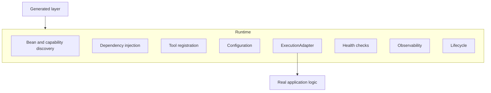
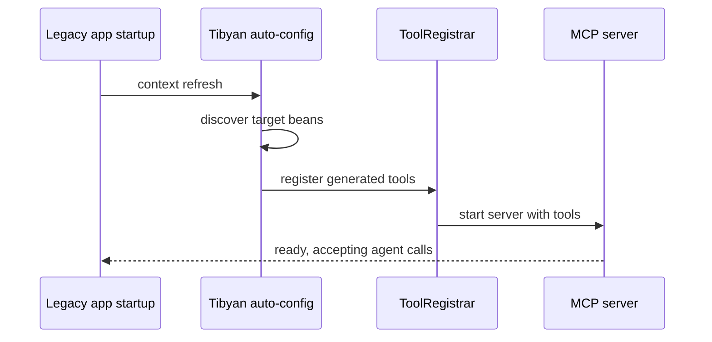

# Volume 7: Runtime

Status: Stable for the Spring runtime's MVP responsibilities; later responsibilities are described as direction. This volume is intentionally detailed, because the runtime is where the generated layer meets the real system, and it is the part the Technical Spike (Volume 8) exists to prove.

---

## 1. Why the runtime exists

A backend produces generated code, but generated code does not run itself. Something must host it, connect it to the real system, and keep it alive. That something is the Runtime. In Tibyan's model, the runtime is what makes a legacy system AI-operable in practice: it places the generated MCP layer inside or beside the real application and binds each tool to real logic.

## 2. Why the runtime is not an ExecutionAdapter

These are often confused, so the distinction is stated plainly. The ExecutionAdapter is a small, stateless interface that answers one question: given a capability and arguments, run it and return a result. The Runtime is a whole hosting environment with many responsibilities, of which invoking a capability is only one. Folding the runtime into the adapter would mislabel an environment as a function and would, over time, stuff lifecycle and observability concerns into a place never meant to hold them (ADR-0006). A runtime contains an ExecutionAdapter; it is not one.



## 3. Runtime responsibilities

| Responsibility | What it does |
|---|---|
| Discovery | Finds the real beans and the capabilities the tools must reach |
| Dependency injection | Resolves the dependencies the generated and host code need |
| Tool registration | Registers the generated tools with the running MCP server |
| Configuration | Reads settings (transport, exposure, limits) from the host application |
| Execution | Invokes real logic through the ExecutionAdapter |
| Health checks | Reports whether the layer and its targets are ready and live |
| Observability | Emits logs, metrics, and traces for tool calls |
| Lifecycle | Starts the MCP server at startup and shuts it down cleanly |
| Runtime plugins | Allows runtime-level extensions (for example, an auth interceptor) later |

## 4. The Spring runtime (MVP)

`tibyan-runtime-spring` is distributed as a Spring Boot starter (ADR-0007). Adding one dependency activates auto-configuration, which discovers the target bean, registers the generated tools, provides the `SpringExecutionAdapter`, and starts the MCP server inside the application's own context. For the MVP, the responsibilities exercised are discovery, tool registration, bean access, and running the MCP server. Health, observability, and lifecycle hardening come later, but the structure is in place from the start.

One dependency, nothing else. A truly untouched app needs only this starter on its classpath; it needs no `spring.ai.mcp.server` block and no launch property. Two pieces make that true:

1. MCP server defaults. The starter contributes default values for `spring.ai.mcp.server.name` and `spring.ai.mcp.server.version` through an `EnvironmentPostProcessor`, added as the lowest-precedence property source. The app needs no MCP config of its own, yet anything it does set (in `application.yml`, a profile, an environment variable, or a `-D` property) still wins. The starter names the MCP server; it overrides nothing.

2. Manifest discovery without a property. The runtime finds the generated capabilities manifest by a small, fixed resolution order: an explicit `tibyan.capabilities` location if the host set one (still supported), then the conventional classpath location `classpath:/tibyan/capabilities.json`, then the conventional file location `file:tibyan/capabilities.json` relative to the working directory. The common path is to ship the manifest as a normal resource at `tibyan/capabilities.json`, where it is found with no property. An explicit `tibyan.capabilities` that resolves to nothing fails loudly rather than silently falling through, and finding no manifest at any location fails with a message listing everywhere it looked. The runtime exists to host generated tools, so finding none is a real misconfiguration, not a reason to start serving nothing.

So adopting Tibyan is: add the one dependency, and place the generated `tibyan/capabilities.json` on the classpath. Nothing in the app's own configuration changes.

The binding the `SpringExecutionAdapter` resolves is the real service method, discovered by the provider and carried in the IR as the opaque form `<Bean>#<method>` (Volume 5, section 4.1). The adapter splits that form, resolves the bean and method through the `ApplicationContext`, and invokes it reflectively at run time. It never depended on the binding being a convention: when the provider produced a convention and now that it produces a discovered fact, the adapter is identical, because both are the same opaque string. This keeps rule 3 below honest: the runtime is the only place that maps the opaque binding to a real call, and it maps whatever the IR carries, with no change to backends or the IR.

```java
@AutoConfiguration
public class TibyanAutoConfiguration {
    @Bean ToolRegistrar toolRegistrar(ApplicationContext ctx) { /* register generated tools */ }
    @Bean SpringExecutionAdapter executionAdapter(ApplicationContext ctx) { /* resolve and invoke beans */ }
    @Bean McpServer tibyanMcpServer(ToolRegistrar reg) { /* start MCP inside this context */ }
}
```

## 5. Lifecycle



## 6. Future runtimes

| Runtime | Host | Note |
|---|---|---|
| Quarkus | A Quarkus application | Same role, different host (build-time DI) |
| Micronaut | A Micronaut application | Same role, compile-time injection |
| .NET | A .NET application | Crosses ecosystems; proves the runtime concept is not Java-only |

A new runtime is a peer that hosts the same generated layer. Backends do not change when a runtime is added (ADR-0006), because backends target the ExecutionAdapter contract, not a specific host.

## 7. Rules

1. The runtime hosts and binds; it contains no IR and no generation logic.
2. The runtime owns the ExecutionAdapter implementation for its host.
3. The runtime is the only place that knows how a capability's opaque binding maps to a real call.

## 8. Known gaps and deferred work (as of the MVP)

These are conscious gaps left at the end of the MVP (phases -1 through P3), recorded so they are not mistaken for oversights and so a later phase can close them deliberately. None of them block the MVP, which is verified end to end (Volume 2, section 5). The provider-side shape gaps have since been measured against a second real app and ranked by evidence (docs/experiments/second-app-trial.md); the phases that close them are Volume 13, Tier 2.

1. Binding is now discovered, not assumed (this gap is closed). A capability's binding was once synthesized by convention: `get<Entity>` bound to `<Entity>Service#findById`. It is now read from the real service method by the enabled ServiceExtractor, matched by shape, not by name (Volume 5, section 4.1): the provider finds the one `@Service` method that returns the entity and takes its id, and emits `<ServiceClassSimpleName>#<methodName>`. A service not named `<Entity>Service`, or a finder not named `findById`, is discovered correctly; a read with no backing method, or more than one, fails loudly with a located error rather than mis-binding. The runtime still resolves the same opaque `<Bean>#<method>` form, so the adapter is unchanged. What remains assumed and bounded: only single-id-parameter reads are discovered (lists, multi-argument finders, writes, and actions are not), the capability name is still the `get<Entity>` convention, and the identifier is the first `@Id` field. Those are recorded in Volume 5, section 4.1 as the next shape gaps to close. Pointing the tool at a second real app has since been done: the pms-backend trial confirmed and ranked these gaps by counted evidence, with zero mis-bindings observed (docs/experiments/second-app-trial.md; Volume 13, Tier 2).

2. App configuration is now just the one dependency (this gap is closed). The acceptance goal is that modernizing an app costs exactly one added dependency. The example app once also needed two things the starter did not supply: a launch property, `-Dtibyan.capabilities=...`, pointing at the generated manifest, and a small `spring.ai.mcp.server` block in its `application.yml` naming the MCP server. Both are gone. The starter now supplies the MCP server name and version as defaults through an `EnvironmentPostProcessor` (lowest precedence, so the app can still override), and the runtime discovers the manifest by a fixed order (explicit `tibyan.capabilities`, then `classpath:/tibyan/capabilities.json`, then `file:tibyan/capabilities.json`), failing loudly if none is found (Volume 7, section 4). The example app proves it: its `application.yml` has no MCP block, and it starts and serves getProduct over genuine MCP with no launch property.

The manifest is also no longer copied by hand. The `tibyan-maven-plugin` runs the existing pipeline during the app's build (bound to `generate-resources`) and writes `tibyan/capabilities.json` onto the classpath output. It invokes the same `TibyanCompiler` and `McpBackend` the CLI uses, so its output is byte-identical to `tibyan generate` by construction, not a second generator; the plugin module holds only Maven wiring. The example app no longer commits a manifest: its build generates one from its own source, and the end-to-end test asserts that build-generated manifest is byte-identical to the CLI output. Adopting Tibyan is now: add the dependency, add the build plugin once, build. What is still manual: configuring the build plugin once in the app's pom, and choosing when to regenerate (the plugin runs on every build, so the manifest tracks the source). Auto-discovery of the plugin without a pom entry is not attempted and is not planned for the MVP.

3. Coverage is read-only get-by-id only. The Entity and Service extractors are enabled (the Service extractor discovers the binding, Volume 5, section 4.1), so the IR holds entities and one read-only `get<Entity>` capability each. Lists, filtered queries, writes, and richer operations are not modeled; write and action capabilities are future IR (Volume 4, section 7). The second-app trial quantified this gap on a real app: services there return DTO and result-set types, and list and filter reads are the bulk of the real read API (Volume 13, Tier 2, phases E2 and E4). The CLI offers only the spring provider and the mcp backend, so a different source stack or output shape needs a new plugin.

4. Argument coercion across the MCP boundary. Arguments arrive from an MCP client as JSON, so a numeric id arrives as an Integer while the bound method expects a Long. The `SpringExecutionAdapter` coerces a small, fixed set of primitive cases (for example Integer to Long, text to BigDecimal) and no more. This is intentionally minimal for the MVP and will need a real, complete coercion strategy later, covering all primitive types, nullability, and clear failures on mismatch.

5. Plugin discovery is not real SPI yet. The pipeline composes plugins through their interfaces, and the CLI, as the composition root, injects the concrete Spring provider and MCP backend directly. The service-provider discovery described in Volume 10, section 2 is the target, not the current state: it would need a `name()` on the plugin interfaces plus a `META-INF/services` declaration in each plugin module. Deferred to the plugin-system phase. Recorded in Volume 10, section 2 so no one assumes discovery already exists.

6. Two materializations of one tool contract (a recorded decision, not a defect). The runtime registers tools at run time from the generated capabilities manifest, as dynamic tool callbacks. The backend also generates a tool class per capability, which is the materialization for a standalone generated project that is compiled and hosted on its own. Both forms honor exactly one contract: `tool(args) -> ExecutionAdapter.invoke(new CapabilityRef(name), args)`. This is the intended design: the manifest is the in-context hosting path, the generated class is the standalone path, and neither calls a service or framework directly.

7. Health, observability, and lifecycle hardening. Sections 3 and 4 list discovery, tool registration, bean access, and running the MCP server as the responsibilities exercised in the MVP. Health checks, observability (logs, metrics, and traces for tool calls), and lifecycle hardening (clean startup and shutdown ordering) are named in section 3 but not yet implemented. They remain later work, cross-referenced here so this gap list is complete.

8. Runtime invocation of a paged list read (opened by the phase E4 design, Volume 5, section 4.10; Volume 6, section 3.3). A list-all read whose bound method is the no-argument `findAll()` is fully executable today: the adapter invokes it and serializes the returned collection. A list-all read whose bound method takes a `Pageable` (the paged shape) needs the adapter to supply one, and what `Pageable` to supply (an unpaged default, or a first page) is a runtime paging decision the E4 design deliberately leaves out of scope. Until it is designed, the paged list capability is discovered, modeled with `outputMultiple` plus a `paged` disclosure, and rendered by both backends, but its live invocation is deferred. The honest interim, when the build lands, is that the adapter passes an unpaged or default `Pageable` and serializes the page content (never the envelope), recorded here so the boundary is explicit and not mistaken for a completed behavior.

9. Security enforcement of the declared authority contract (opened by phase Controller-Authority, Volume 5, section 4.14; Volume 6, sections 3.5 and 4.3; built 2026-07-19). The manifest may carry `requiredAuthorities` (a compiled any-of authority sequence the application declares for a read) or `securityUnverifiable` (a declared contract exists that could not be compiled). The runtime this phase DOES NOTHING with either field: it loads them tolerantly (the additive-field discipline, proven by a loader test) and does not authenticate callers, validate tokens, or check authorities. Enforcement is deliberately the consumer's layer, which is the requesting adopter's own architecture (an orchestration layer that enforces the declared contract before invoking the capability). Two facts are recorded so this boundary is not misread. First, the bypass fact that motivates the whole phase: in the surveyed real apps the declared security sits on the CONTROLLER methods, and the execution adapter invokes the SERVICE bean directly, so the application's own enforcement point is not on the invocation path the tool generates; carrying the declared contract in the manifest is what lets an external layer re-impose it. Second, the inverse case: a host application that declares method security ON ITS SERVICE beans (none of the three benchmarks does) would have Spring's method-security interceptor fire on the adapter's invocation too, and with no `Authentication` in the security context the call would be denied at runtime; if a real adopter hits this, the behavior is the app's own security working as declared, and the resolution (supplying an authenticated context to the adapter) is part of this same named deferral. The optional future enforcement hook, when evidence asks for it, is a runtime plugin that validates a supplied principal's granted authorities against `requiredAuthorities` before invoking, refusing unverifiable capabilities by default; it enters through its own designed phase, never silently.

10. Attested capabilities at the runtime (opened by phase Attestation, Volume 5, section 4.15; designed 2026-07-20, pending ratification). Invocation of an attested capability is IDENTICAL to a verified one, argued rather than assumed: the binding is a structurally resolved `<Bean>#<method>` like any other (attestation fills semantic holes, never structural ones, so there is nothing different to invoke), and a runtime that behaved differently would imply the tool doubts what its labels state exactly. What the runtime adds is one consumer control and one tolerance: the loader tolerates the additive `attested`/`attestation` manifest fields (the standing additive-field discipline, with a loader test at build), and a property, `tibyan.attested.expose` (default `true`), lets a consumer exclude attested capabilities from registration wholesale, for surfaces that must be verified-only. Default true because committing `tibyan/attestations.json` through review IS the adopter's deliberate opt-in; the property serves the consumer who did not make that choice. Two named non-goals this phase: no per-call runtime warning (the labeling is the honesty mechanism, and it is complete), and no principal-passing for the context-dependent reads (the me-scoped `RequestContext` reads stay excluded from attestation entirely until a principal design exists; that future design is invocation architecture and would be its own ratified phase).

## 9. EI-R: runtime argument binding and closed-set enforcement (phase Enum Inputs; designed 2026-08-04, RATIFIED and BUILT 2026-08-05)

A LATENT DEFECT, found while designing the enum-input phase and recorded here because it is that phase's
blocking precondition rather than a detail of it. `SpringExecutionAdapter` resolves the target method with
`bean.getClass().getMethod(methodName, parameterTypes)`, where each entry of `parameterTypes` comes from
`IrTypes.toJavaClass(input.type())`. A STRING input yields `String.class`, but the real signature of a
filtered read takes a domain enum (`CostCategory`), so the lookup throws `NoSuchMethodException` and the
capability is UNINVOKABLE. TIMESTAMP has the same problem: it yields `Instant.class` against a real
`LocalDate` parameter.

Why it has never been observed: every capability shipped to date has exactly one identifier-typed input.
Verified against the current IR of both public benchmarks, every discovered pms input is LONG and every
discovered erp input is UUID. The defect is real, latent, and NOT enum-specific.

EI-R, the fix, ratified as a build step that PRECEDES the enum-input build:

1. Resolve the target method by NAME AND ARITY rather than by reconstructed parameter types. When more than
   one same-arity overload matches, REFUSE LOUDLY with a located error naming the candidates. The tool never
   guesses which overload a capability binds to.
2. Convert each incoming argument to that method's DECLARED parameter type, read by reflection: the existing
   primitive coercions, the `java.time` types, and enums.
3. For an enum-typed parameter, match the incoming value by the SAME rule the provider used to advertise the
   set (Volume 5, section 4.16.4): the constant name for a bare enum, the `@JsonValue` literal for a
   value-mapped enum. The two must agree by construction, because a set advertised by one rule and matched by
   another is the MIS-CONSTRAINED failure.
4. VALIDATE an incoming value against the carried set BEFORE invoking, refusing with a located error that
   names the legal values. This is the enforcement the schema `enum` promises, and it is the reason the
   backends may render it at all.

Invariant for the EI-R build: every existing capability invokes identically, proven by the unchanged
end-to-end test and the unchanged example-app goldens. If EI-R proves larger than one session, the honest
outcome is that enum inputs do not ship, not that they ship unenforced.

### 9.1 EI-R actual: built and measured (2026-08-05)

The ratified EI-R (section 9) implemented exactly. RUNTIME ONLY: `tibyan-core`, the provider, and both
backends are untouched, so generated output cannot move and did not. `mvn clean verify` green across 12
modules.

WHAT WAS BUILT, item by item against the ratified list:

1. Method resolution by NAME AND ARITY, replacing the reconstructed-parameter-type lookup. Bridge and
   synthetic methods are skipped, which the design did not anticipate and which is load bearing: javac gives
   a generic interface implementation an erased bridge of the same name and arity, and without the skip an
   ordinary `Finder<String>` would have refused as ambiguous. Two GENUINE same-arity overloads refuse loudly
   and name the candidates.
2. Arguments converted into the resolved method's DECLARED parameter types, including the `java.time` types
   and enums, with primitive parameters boxed and a missing value for a primitive refused with a located
   message rather than a reflective failure.
3. Enum matching by the SAME wire-value rule the provider will use to advertise, implemented in a new
   `EnumWireValues`: constant names for a bare enum (shape a), the `@JsonValue` literals for a value-mapped
   enum (shape b), and a fallback to constant names when more than one `@JsonValue` accessor makes the shape
   ambiguous (shape c), which is safe precisely because the provider advertises nothing in that case. The
   `@JsonValue` annotation is matched BY TYPE NAME, so Jackson does not become a dependency of the runtime
   module and an application without Jackson simply takes shape (a). The annotation's optional boolean is
   honoured rather than assumed.
4. An illegal value refused BEFORE invoking, with the legal values named in the message. This is the
   enforcement a schema closed set promises, and it now exists.

A SMALL CLEANUP recorded rather than left silent: `IrTypes.toJavaClass` had exactly one caller, the defect
site, and is removed. `IrTypes.jsonSchemaType` is untouched and still drives the tool input schema.

MEASURED. All 27 runtime tests green, including the three pre-existing `SpringExecutionAdapterTest` cases
that are the regression guard for the ratified invariant "every existing capability invokes identically";
the end-to-end MCP test and the example-app goldens are unchanged. Both public benchmarks are BYTE-IDENTICAL
on the serialized IR, the generated MCP output and the generated OpenAPI document, verified by `diff` with
zero differences, and their refusal-cause ledgers are UNCHANGED, which is the correct outcome for a
runtime-only step: a provider refusal cannot move when the provider did not change.

WHAT THIS STEP DELIBERATELY DOES NOT DO. It renders no closed set on any surface, because that is EI-1 and
because the ratified sequencing rule forbids rendering before this step exists, not after. Nothing in the
IR carries a value set yet, so the runtime's enforcement currently derives the legal values from the
DECLARED ENUM ITSELF at invocation time. That is the same set EI-1 will advertise, by construction, which
is the whole point of implementing one rule in one place.

Fixtures EI-R1 to EI-R11 (`EnumInputRuntimeBindingTest`): a bare enum bound by constant name; a value-mapped
enum bound by its wire literal; a value-mapped enum REFUSING the constant name, which is the MIS-CONSTRAINED
guard, since accepting it would mean accepting a value outside the advertised set; an illegal value refused
with the legal values named; a `LocalDate` bound from ISO text; a mixed-arity read binding every parameter
to its declared type; two genuine overloads refusing; a bridge method NOT creating a false ambiguity; an
unknown method naming the arity; the legal-value set read from the enum and never synthesized, with a
non-enum carrying none; and a CHARACTER-EXACT replica of the real pms `CostCategory` declaration proving all
eight literals in declaration order, that `renovation` matches, and that `RENOVATION` does not.
