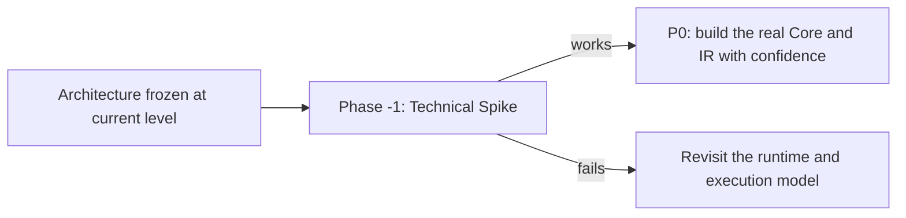
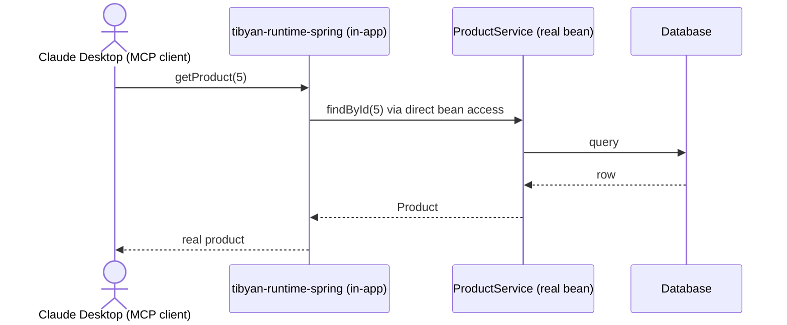

# Volume 8: Technical Spike

Status: Active decision. This is the first thing that will be built. It comes before P0 and before the MVP.

> Note: A spike is a throwaway experiment. Its only purpose is to remove a technical unknown. Its code is not expected to ship. Lessons from it feed the real architecture.

---

## 1. Why a spike, and why before the MVP

The architecture is now well understood. The five abstractions (Provider, IR, Backend, ExecutionAdapter, Runtime) are agreed, and their responsibilities and dependency rules are clear. Continuing to refine names and interfaces on paper has reached diminishing returns.

One large unknown remains, and it cannot be answered by a diagram. It can only be answered by running code:

> Can a generated MCP layer be hosted inside a real legacy Spring application and call that application's real beans, so that an AI agent receives a real result, without modifying the application?

If the answer is no, the architecture changes. If the answer is yes, everything after it is ordinary engineering. A principle from large engineering organizations applies directly here: prove the hardest assumption first.



## 2. Goal

Demonstrate, with the smallest possible amount of code, that a Spring Boot application can expose one real capability to an AI agent through an MCP server that runs inside its own context.

## 3. Scope

### 3.1 In scope
A tiny, hand-written setup:

```
legacy-app/
    Product.java
    ProductService.java        // findById returns a real product
    ProductController.java
tibyan-runtime-spring/          // hand written for the spike, not generated
    auto-configuration
    discovers ProductService
    registers ONE tool
    starts an MCP server inside the app context
```

The end-to-end path the spike must light up:



### 3.2 Explicitly out of scope
The spike deliberately contains none of the real architecture:

| Excluded | Reason |
|---|---|
| Capability IR | Not needed to test runtime feasibility |
| Provider or Analyzer | The tool is hand-written, not derived |
| JavaParser | No source analysis in the spike |
| Backend or Generator | The tool is hand-written, not generated |
| CLI | Not needed |
| Plugin system | Not needed |

Everything above is hand-written and hard-coded. The spike answers one question only.

## 4. Success criteria

The spike succeeds when all of the following are true:

1. The Spring application starts normally with the runtime added.
2. The runtime discovers the real `ProductService` bean.
3. The runtime registers one tool and starts an MCP server inside the application context.
4. An MCP client (Claude Desktop) calls `getProduct(5)`.
5. The call reaches the real `ProductService.findById(5)`.
6. The real product is returned to the client from the real data store.
7. No file of the legacy app was edited other than adding the runtime dependency and minimal configuration.

## 5. Unknowns the spike will resolve

These are concrete questions that the spike, and only the spike, will answer:

| Unknown | What we will learn |
|---|---|
| Is the official MCP Java SDK suitable, or is the Spring AI MCP server starter a better base? | Which library to standardize on |
| Is a Spring Boot starter enough to host the MCP server in-context? | Whether the one-dependency promise holds |
| Is bean discovery straightforward? | How the runtime should find existing services |
| Is tool registration dynamic enough? | Whether tools can be registered at startup from data |
| Are there context or classloader problems running the server in-app? | Whether the in-context model is viable |
| Is reflection enough, or is bytecode tooling such as ByteBuddy needed? | The technique for binding tools to beans |
| Is auto-configuration enough to activate everything? | The activation model for the runtime |
| Transport: stdio for Claude Desktop, or HTTP? | The default transport for the runtime |

## 6. Risks

| Risk | Mitigation |
|---|---|
| Running an MCP server inside the app context causes conflicts | Keep the spike minimal; if it fails, switch the runtime model to a separate process and document the change |
| The chosen MCP library is immature | The spike tests exactly this; switching libraries is cheap at spike stage |
| Bean access requires intrusive configuration | If a single dependency is not enough, document the true minimal footprint honestly |

## 7. Expected result and exit

The expected result is that adding one dependency and minimal configuration is enough to host the MCP server and reach a real bean. If so, the runtime model in Volume 7 is validated and the project proceeds to P0 with confidence.

> Important environment note: this spike requires a live Spring context and a real MCP client connection. It must be run on a developer machine. It cannot be executed inside a documentation or sandbox environment. The deliverable for the spike is therefore a complete, copy-paste runnable package plus a runbook.

## 8. After the spike

Once the hardest assumption is proven, the build order follows Volume 13: P0 builds the real Core and IR, P1 builds the Spring provider, P2 builds the MCP backend, and the lessons from the spike are folded into `tibyan-runtime-spring`.
