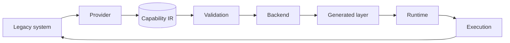
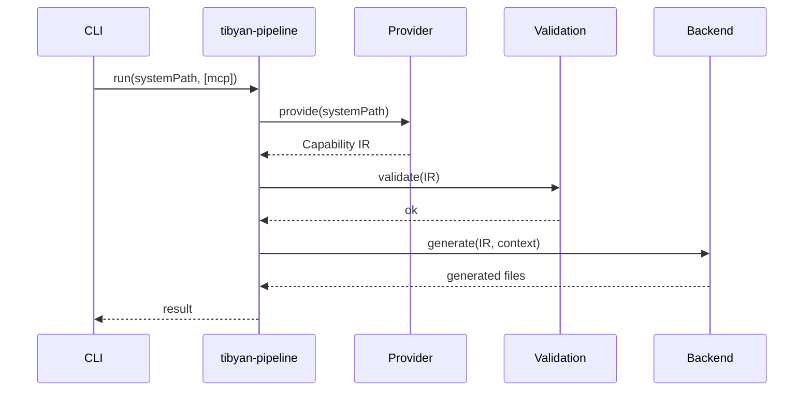

# Volume 9: Compiler Pipeline

Status: Stable. This volume explains the stages a run passes through, from a legacy system to a hosted, callable layer. It connects the abstractions in Volumes 5, 6, and 7 into one flow.

---

## 1. The pipeline at a glance

The pipeline is a straight line with one feedback edge: execution runs back against the original system. Each stage has a single responsibility and hands a well-defined artifact to the next.

## 2. The stages

### 2.1 Provide
A `CapabilityProvider` reads a source and produces IR. For the MVP this is `SpringCapabilityProvider`, which uses JavaParser to read `.java` files, the `EntityExtractor` to find entities and their read intents, and the `ServiceExtractor` to discover each read's real binding from the actual service method (Volume 5, section 4.1). The provider's only output is IR. It does not generate anything and does not know what backends exist.

Input: a path to a system. Output: an in-memory Capability IR.

### 2.2 Represent
The IR is the neutral model: entities, fields, types, capabilities, relations. It is the single artifact every later stage reads. Nothing downstream ever reads the original source again. This is the property that makes the pipeline composable.

### 2.3 Validate
Semantic validation runs over the IR only: duplicate names, unresolved references, unknown types against the closed primitive type system, and capability shape. Validation belongs to `tibyan-core` and has no framework knowledge. A failure here stops the pipeline with a located, human-readable error before any code is generated.

Input: IR. Output: the same IR, proven well-formed, or a validation error.

### 2.4 Generate
A `Backend` reads the validated IR and produces an output shape. For the MVP this is `tibyan-backend-mcp`, which emits an MCP server exposing one tool per capability. The generated tool does not call a framework. It calls the `ExecutionAdapter`. The backend never learns that the source was Spring.

Input: validated IR plus a `GenerationContext`. Output: generated source files.

### 2.5 Host and execute
A `Runtime` hosts the generated layer and binds it to the real system. For the MVP this is `tibyan-runtime-spring`, a Spring Boot starter that auto-configures inside the legacy application's context, registers the generated tools, and provides the `SpringExecutionAdapter`. When an agent calls a tool, the adapter invokes the real bean, for example `ProductService.findById`, and returns the real result.

Input: the generated layer plus the live application context. Output: a running, callable MCP layer over the real system.

## 3. Orchestration

`tibyan-pipeline` owns the sequence: provide, validate, generate. It does not contain provider, backend, or runtime logic; it composes them. Hosting is the runtime's job and happens in the target application, not in the pipeline. The pipeline has two thin callers: the CLI (Volume 11) for terminal use, and `tibyan-maven-plugin` (Volume 11, section 3.1), which runs the same sequence during a host app's build and writes the manifest onto the classpath. Both invoke the same `TibyanCompiler`, so their outputs are identical by construction.

## 4. Where future stages attach

The pipeline does not change when the project grows. A second provider attaches at Provide. A second backend attaches at Generate. A second runtime attaches at Host. Workflows, permissions, and events enter as richer IR at Represent, and the validators that check them are added at Validate. No stage is rewritten; each simply gains more of the same kind of plugin.
