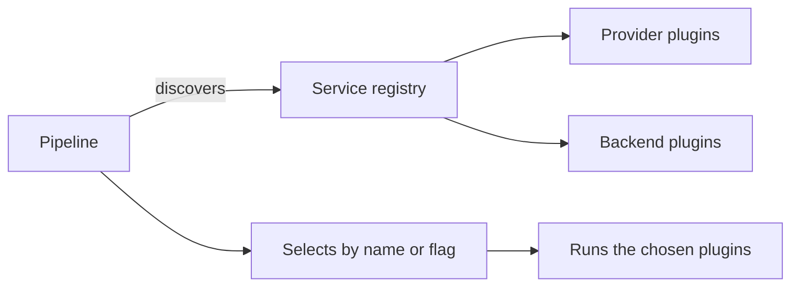

# Volume 10: Plugin System

Status: Stable for the model; service discovery and versioning details are pinned as the first plugins are built. Tibyan is plugin based by design: providers, backends, and runtimes are plugins around a small, stable core. This volume defines how plugins are discovered, loaded, isolated, versioned, and, eventually, shared.

---

## 1. Why plugins

A platform that must span many sources, outputs, and hosts cannot be a monolith. If every new source or output required editing a central file, the core would never be stable. Plugins invert this: the core and the plugin API stay fixed, and capability is added from the outside. This is what lets a contributor add a backend or a provider without touching anything else (ADR-0012).

## 2. Discovery

Plugins are discovered at run time through a service registry. On the JVM this is the standard service-provider mechanism (the Java ServiceLoader, or Spring's equivalent). Each plugin module declares which contract it implements. The pipeline asks the registry for available providers and backends and selects the ones the run needs, by name or by a command-line flag. The composition root never hard-codes a list of plugins.

> Current status (MVP): this discovery is the target, not the current state. As of the MVP it is not implemented. The pipeline composes plugins through their interfaces, and the CLI, as the composition root, injects the concrete plugins (the Spring provider and the MCP backend) directly. Real discovery needs a `name()` on the plugin interfaces and a `META-INF/services` declaration in each plugin module, both deferred to the plugin-system phase. Do not assume discovery already exists because Volume 12 lists the pipeline as discovering plugins at run time; today the CLI wires them, and the pipeline stays free of any concrete plugin (Volume 7, section 8).

## 3. Loading and isolation

Each plugin is its own module with its own dependencies (Volume 12, section 4). A plugin carries the libraries it needs (JavaParser for the Spring provider, an MCP library for the runtime) without forcing those libraries on any other plugin. The rule that one module contains exactly one plugin is what keeps dependencies isolated; bundling two plugins would merge their dependency trees and defeat the purpose.

## 4. Lifecycle

| Phase | What happens |
|---|---|
| Register | The plugin declares its contract in the service registry |
| Discover | The pipeline finds it at run time |
| Select | The run chooses it by name or flag |
| Execute | The plugin runs its single responsibility (provide, generate, or host) |

Plugins are stateless with respect to each other. A provider does not know which backend will consume its IR, and a backend does not know which provider produced it.

## 5. Dependency rules

1. A plugin depends only on the plugin API and the core.
2. A plugin never depends on another plugin.
3. One plugin per module, so dependency trees stay separate.

## 6. Versioning

The plugin API is the compatibility boundary. It is kept small on purpose, so it can stay stable while implementations evolve. A plugin declares the plugin API version it targets. A breaking change to the plugin API is a deliberate, versioned event with its own migration notes, because every plugin depends on it. The core's stability is the whole reason plugins are safe to write.

## 7. Future: a plugin marketplace

Once the plugin API has proven stable across several providers, backends, and runtimes, third-party plugins become viable, and a marketplace of community providers, backends, and runtimes can grow around the core. This is a long-term outcome, not an MVP feature, and it depends entirely on the plugin API having earned its stability first.
