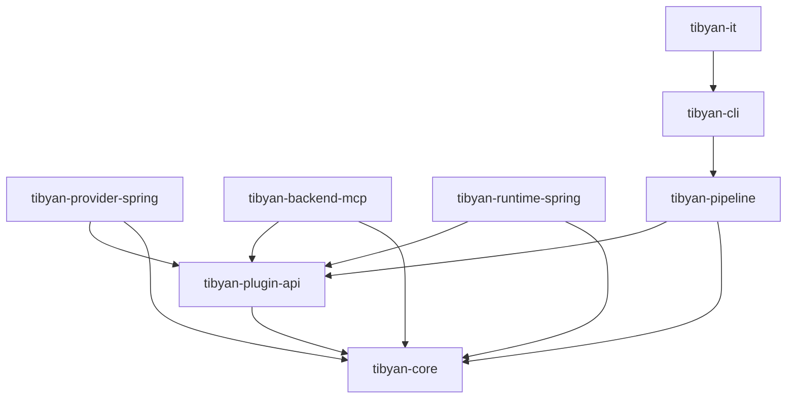

# Volume 12: Project Structure

Status: Stable for the MVP and its near neighbors. This volume defines the final module layout, what each module is for, and the dependency rules that protect the architecture. The structure is the architecture made physical: if the modules and their allowed dependencies are correct, the design in Volumes 3 to 7 cannot quietly rot.

---

## 1. Build system

Maven multi-module, with a parent aggregator POM. Gradle would work identically; Maven is chosen because it is the most common in the Spring and Java world that the first provider and runtime target, so generated and host projects feel native.

Package root for all modules: `com.tibyaan`.

## 2. The module map at a glance

The top-level module layout, which is the structure most contributors need day to day:

```
tibyan/
├── tibyan-core/                  # IR + semantic validation, zero dependencies
├── tibyan-plugin-api/            # CapabilityProvider · Backend · ExecutionAdapter
├── tibyan-provider-spring/       # JavaParser + EntityExtractor (the rest are placeholders)
├── tibyan-backend-mcp/           # IR -> MCP tools (talks to ExecutionAdapter)
├── tibyan-runtime-spring/        # Spring Boot starter:
│                                 #   MVP:   auto-config + tool registration + bean access + run MCP
│                                 #   later: discovery · health · observability · lifecycle
├── tibyan-pipeline/              # provide -> IR -> generate
├── tibyan-cli/                   # tibyan scan / tibyan generate
├── tibyan-maven-plugin/          # Maven wiring only: runs the pipeline at build time onto the classpath
├── tibyan-it/                    # end-to-end: a real product comes back from ProductService
└── generated/                    # gitignored
```

The expanded version below shows the same modules with their internal package layout.

## 3. The expanded tree

```
tibyan/
|-- pom.xml                         # parent / aggregator, dependency management
|-- README.md
|-- docs/                           # this documentation set
|-- examples/
|   `-- legacy-spring-app/          # a small real Spring app used by tests and the spike
|
|-- tibyan-core/                    # IR + semantic validation. ZERO external deps
|   `-- src/main/java/com/tibyaan/core/
|       |-- ir/                     # the model: Module, Entity, Field, Type,
|       |                           #            Capability, Relation, Annotation, Metadata
|       `-- semantic/               # validators over the IR only
|
|-- tibyan-plugin-api/              # the three contracts. Depends on core only
|   `-- src/main/java/com/tibyaan/plugin/
|       |-- CapabilityProvider.java # input abstraction (broadest)
|       |-- SourceAnalyzer.java     #   a CapabilityProvider that reads code
|       |-- Backend.java            # output abstraction
|       |-- ExecutionAdapter.java   # how a capability is executed
|       `-- GenerationContext.java  # what a Backend receives
|
|-- tibyan-provider-spring/         # Spring source -> IR (JavaParser)
|   `-- src/main/java/com/tibyaan/provider/spring/
|       |-- SpringCapabilityProvider.java
|       `-- extractors/
|           |-- EntityExtractor.java        # MVP: enabled
|           |-- RepositoryExtractor.java     # placeholder
|           |-- ServiceExtractor.java        # placeholder
|           |-- ControllerExtractor.java     # placeholder
|           `-- AnnotationExtractor.java      # placeholder
|
|-- tibyan-backend-mcp/             # IR -> MCP server code. Talks to ExecutionAdapter
|   `-- src/main/
|       |-- java/com/tibyaan/backend/mcp/
|       `-- resources/templates/mcp/
|
|-- tibyan-runtime-spring/          # Spring Boot starter that hosts the layer in-context
|   `-- src/main/
|       |-- java/com/tibyaan/runtime/spring/
|       |   |-- TibyanAutoConfiguration.java
|       |   |-- ToolRegistrar.java
|       |   `-- SpringExecutionAdapter.java   # the MVP ExecutionAdapter implementation
|       `-- resources/META-INF/spring/        # auto-configuration registration
|
|-- tibyan-pipeline/                # orchestration: provide -> validate -> generate
|   `-- src/main/java/com/tibyaan/pipeline/
|       `-- TibyanCompiler.java
|
|-- tibyan-cli/                     # picocli entry point
|   `-- src/main/java/com/tibyaan/cli/
|       `-- TibyanCli.java          # tibyan scan / tibyan generate
|
|-- tibyan-it/                      # integration + golden-file + end-to-end tests
|   `-- src/test/...
|
`-- generated/                     # output of a run. gitignored
```

Later modules slot in without changing anything above: `tibyan-backend-openapi`, `tibyan-backend-sdk`, `tibyan-provider-database`, `tibyan-provider-dotnet`, `tibyan-runtime-quarkus`, each as its own module depending only on the plugin API and core.

## 4. Module responsibilities

| Module | Responsibility | Must not |
|---|---|---|
| tibyan-core | Hold the IR and validate it | Depend on any framework, provider, backend, or runtime |
| tibyan-plugin-api | Define CapabilityProvider, Backend, ExecutionAdapter | Depend on any concrete provider, backend, or runtime |
| tibyan-provider-spring | Read Spring source and produce IR | Depend on any backend or runtime; produce any output |
| tibyan-backend-mcp | Turn IR into MCP server code | Know the source; call a framework directly; depend on a runtime |
| tibyan-runtime-spring | Host the generated layer and bind to real beans | Contain IR or generation logic |
| tibyan-pipeline | Orchestrate provide, validate, generate | Contain provider, backend, or runtime logic itself |
| tibyan-cli | Parse commands and call the pipeline | Contain compiler logic |
| tibyan-it | Test across modules end to end | Be depended on by any production module |

## 5. Dependency rules

The dependency graph is intentionally a shallow tree with the core at the root. Arrows mean "is allowed to depend on."



Allowed:

| From | May depend on |
|---|---|
| plugin-api | core |
| any provider | plugin-api, core |
| any backend | plugin-api, core |
| any runtime | plugin-api, core |
| pipeline | plugin-api, core (and discovers providers and backends at run time) |
| cli | pipeline |
| it | cli and everything, for tests only |

Forbidden, and these are the rules that keep the architecture honest:

1. core depends on nothing. Not Spring, not JavaParser, not an MCP library. If core needs an import from any of those, a concept has leaked and must move out.
2. A backend never depends on a provider. Backends read IR, never source.
3. A backend never depends on a runtime, and never calls a framework directly. It goes through ExecutionAdapter.
4. A provider never depends on a backend. Providers feed the IR and stop.
5. No module bundles two plugins. One provider, one backend, or one runtime per module, so dependencies stay isolated.

A simple test for any proposed dependency: if it would let a framework name appear inside `tibyan-core`, or let a backend learn what the source technology was, it is forbidden.

## 6. What the runtime produces, and where

A run writes a normal, runnable Spring project into `generated/`, for example:

```
generated/inventory-mcp/
|-- pom.xml
`-- src/main/
    |-- java/com/example/inventory/mcp/
    |   |-- GetProductTool.java        # generated MCP tool, calls ExecutionAdapter
    |   `-- McpServerConfig.java        # registers tools
    `-- resources/
        `-- application.yml
```

In the starter model (MVP), this generated code is hosted by `tibyan-runtime-spring` inside the legacy application's own context, so the tool reaches the real `ProductService` bean. The generated code never imports Spring service classes directly; it asks the ExecutionAdapter to invoke the capability.

## 7. Why this structure and not a simpler one

A single module would be faster to start and would destroy the architecture within weeks, because nothing would stop the IR from importing Spring or a backend from calling a service. The module boundaries are not bureaucracy; they are the compiler that enforces the design. The cost is more POM files. The benefit is that the rules in section 4 are checked by the build, not by discipline alone.
