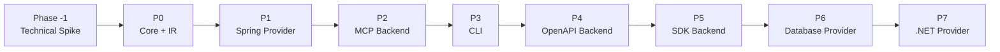

# Volume 13: Development Roadmap

Status: Stable. This roadmap is brownfield-first and spike-first. Each phase has milestones, deliverables, and exit criteria. A phase is not started until the previous phase meets its exit criteria.

---

## 1. Sequencing principle

Two rules order everything:

1. Prove the hardest assumption first. The runtime binding is the largest unknown, so a Technical Spike comes before any other work (Volume 8).
2. Build in thin vertical slices. Each phase keeps something that runs end to end and grows it, rather than building a layer in isolation.

## 2. Phases

### Phase -1: Technical Spike
| Field | Detail |
|---|---|
| Goal | Prove a generated MCP layer can run inside a real Spring app and call a real bean |
| Deliverables | A runnable spike package and a runbook (Volume 8) |
| Milestone | An AI agent calls getProduct(5) and gets a real result |
| Exit criteria | All Volume 8 success criteria met, or a documented decision to change the runtime model |

### P0: Core and IR
| Field | Detail |
|---|---|
| Goal | Build the real Capability IR and its semantic validation, with zero framework dependencies |
| Deliverables | `tibyan-core` with IR types and validators; `tibyan-plugin-api` with the three contracts |
| Milestone | A hand-built IR validates and round-trips to and from JSON |
| Exit criteria | IR documented (Volume 4); a sample IR validates; core has zero forbidden dependencies |

### P1: Spring Provider
| Field | Detail |
|---|---|
| Goal | Read a real Spring project from source and produce IR |
| Deliverables | `tibyan-provider-spring` using JavaParser; the Entity extractor enabled, others as placeholders |
| Milestone | Scanning a real project yields a correct IR for at least one entity and one capability |
| Exit criteria | A real Spring module produces a valid IR; provider has no backend or runtime dependency |

### P2: MCP Backend
| Field | Detail |
|---|---|
| Goal | Generate an MCP server from the IR, executing through the Execution Adapter |
| Deliverables | `tibyan-backend-mcp`; `tibyan-runtime-spring` graduated from the spike; `SpringExecutionAdapter` |
| Milestone | One definition flows scan to IR to MCP to a real bean call, end to end |
| Exit criteria | The MVP acceptance criteria in Volume 2 are met against a real, unmodified Spring system |

### P3: CLI
| Field | Detail |
|---|---|
| Goal | Make the pipeline usable from the command line |
| Deliverables | `tibyan-cli` with scan and generate commands; `tibyan-pipeline` orchestration |
| Milestone | `tibyan scan` and `tibyan generate` run the full flow |
| Exit criteria | A developer can modernize a system using only the CLI |

### P4: OpenAPI Backend
| Field | Detail |
|---|---|
| Goal | Prove the IR feeds more than one backend |
| Deliverables | `tibyan-backend-openapi` |
| Milestone | The same IR produces both MCP and OpenAPI |
| Exit criteria | OpenAPI output is generated with no provider changes |

### P5: SDK Backend
| Field | Detail |
|---|---|
| Goal | Generate typed client SDKs from the IR |
| Deliverables | `tibyan-backend-sdk` |
| Milestone | A typed client is generated and calls a generated server |
| Exit criteria | SDK output is generated with no provider or runtime changes |

### P6: Database Provider
| Field | Detail |
|---|---|
| Goal | Prove the IR accepts more than one source |
| Deliverables | A database schema provider that produces IR |
| Milestone | The same backends work on an IR built from a database |
| Exit criteria | A second provider feeds the same IR with no backend changes |

### P7: .NET Provider
| Field | Detail |
|---|---|
| Goal | Prove the platform crosses ecosystems |
| Deliverables | A .NET source provider that produces IR |
| Milestone | A .NET system is modernized through the same backends |
| Exit criteria | A non-Java system produces a valid IR; the modernization layer works unchanged |

## 3. What each phase proves about the architecture

| Phase | Architectural claim it validates |
|---|---|
| Spike | The runtime can bind to a real legacy system |
| P0 | The IR can stand alone, framework-free |
| P1 | A provider can feed the IR from real source |
| P2 | A backend plus an adapter can execute against the real system |
| P4, P5 | One IR feeds many backends |
| P6, P7 | One IR accepts many providers and crosses ecosystems |

## 4. Guardrail

Workflows, permissions, and events are intentionally absent from the early phases. They are real parts of the long-term IR (Volume 4), but they are not on the critical path to proving modernization. They are scheduled only after the brownfield loop is proven end to end.
