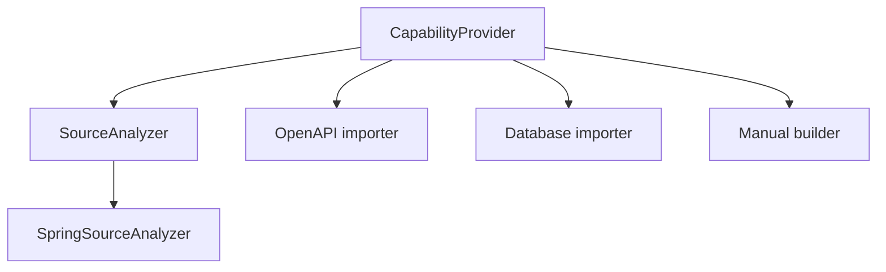
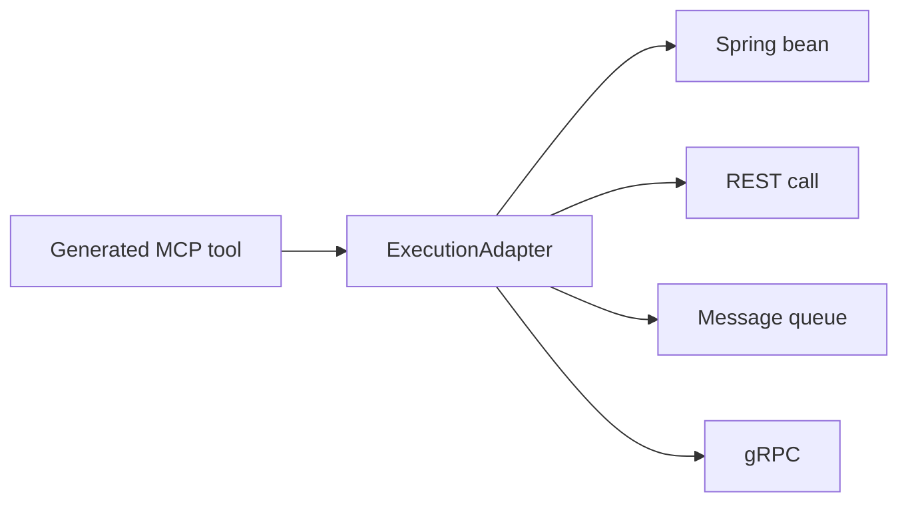
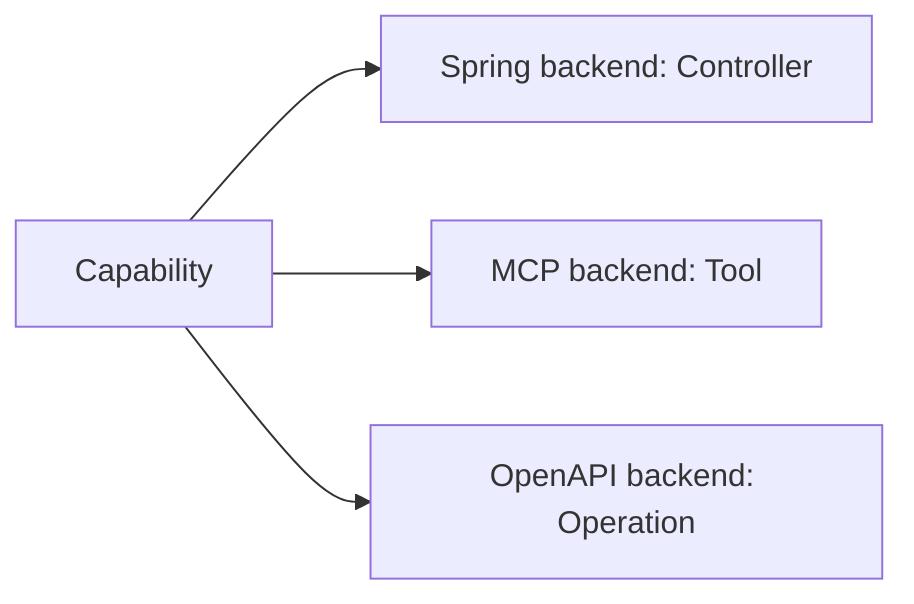

# Volume 14: Architecture Decision Records (ADR)

Status: Living document. Each ADR records one decision, the context that forced it, the decision itself, and its consequences, alternatives, and tradeoffs. ADRs are the backbone of the project: every other volume defers to these.

Format: each record uses Status, Context, Decision, Consequences, Alternatives, Tradeoffs.

## Index

| ADR | Title | Status |
|---|---|---|
| 0001 | Capability IR as the single source of truth | Accepted |
| 0002 | Brownfield modernization over greenfield generation | Accepted |
| 0003 | CapabilityProvider as the input abstraction | Accepted |
| 0004 | Backends never know the source and never call frameworks | Accepted |
| 0005 | ExecutionAdapter separates generation from execution | Accepted |
| 0006 | Runtime is a first-class concept, distinct from the adapter | Accepted |
| 0007 | Spring Boot starter as the first runtime distribution | Accepted |
| 0008 | A Technical Spike runs before the MVP | Accepted |
| 0009 | Java and Spring as the first target stack | Accepted |
| 0010 | Source analysis via AST (JavaParser) for the MVP | Accepted |
| 0011 | Modular extractors in the Spring provider | Accepted, refined post-MVP (Service extractor enabled) |
| 0012 | Plugin based, per-module providers, backends, and runtimes | Accepted |
| 0013 | Keep the IR free of framework concepts (drop Endpoint and Service) | Accepted |
| 0014 | Thin vertical slice for the MVP scope | Accepted |
| 0015 | Position as an AI-operable business platform; the semantic model is the moat | Accepted |

---

## ADR-0001: Capability IR as the single source of truth

**Status:** Accepted

**Context.** Tibyan must accept many kinds of input (Spring source today, databases and other languages later) and produce many kinds of output (MCP today, OpenAPI, SDKs, docs later). If inputs talked to outputs directly, the system would become an N by M tangle, where every new input or output multiplies the integrations to maintain.

**Decision.** Place a neutral, framework-free Capability IR at the center. Every input produces IR. Every output consumes IR. Nothing reads the original input except the provider that produced the IR.

**Consequences.** Adding an input is writing one provider. Adding an output is writing one backend. Neither touches the other. The IR becomes the durable asset of the project, more stable than any framework or protocol.

**Alternatives.** Direct input-to-output translation (rejected: N by M explosion). A framework-specific model such as a Spring model (rejected: leaks framework concepts and blocks other stacks).

**Tradeoffs.** A neutral IR is an extra layer with its own design cost, and some source detail is intentionally dropped at the boundary. This cost is paid once and repaid by every provider and backend after it.

---

## ADR-0002: Brownfield modernization over greenfield generation

**Status:** Accepted

**Context.** The project could target new projects (write a definition, generate an app) or existing systems (read a running system, add a modern layer). The greenfield market is saturated with scaffolders and code generators. The expensive, unsolved problem in industry is that large legacy systems cannot adopt AI without a risky rewrite.

**Decision.** Tibyan is brownfield-first. Its primary input is a system that already exists, and its output is a modern layer added on top, with the original system never edited.

**Consequences.** The first real module is a provider that reads an existing system, not a parser for a new language. The commercial message becomes modernize without rewrite, which is stronger and less crowded.

**Alternatives.** Greenfield generation (rejected as the primary direction: low differentiation, low value). A hybrid that leads with greenfield (rejected as the headline, but greenfield remains a possible stepping stone for testing the core).

**Tradeoffs.** Reading messy real-world systems is much harder than reading a clean definition file. This difficulty is accepted because it is exactly where the defensible value is.

---

## ADR-0003: CapabilityProvider as the input abstraction

**Status:** Accepted

**Context.** Source code analysis is only one way to learn what a system can do. Future inputs include OpenAPI import, database schema import, a manual builder, and AI-assisted import. Not all of these analyze source code, so an interface named Analyzer would be too narrow.

**Decision.** The input contract is `CapabilityProvider`, defined as any source that produces IR. `SourceAnalyzer` is a specialization of it for inputs that analyze code, and the Spring provider is a specialization of that.

**Consequences.** Every input is a peer that produces the same IR. Adding a non-code input later requires no change to the abstraction.

**Alternatives.** Name the input Analyzer (rejected: excludes non-analysis inputs and would need renaming later).

**Tradeoffs.** A more general name is slightly more abstract up front. The generality is justified by the known future inputs.

---

## ADR-0004: Backends never know the source and never call frameworks

**Status:** Accepted

**Context.** A backend turns IR into an output such as an MCP server. If a backend called `ProductService` directly, it would know the system is Spring, and that framework knowledge would spread into every backend.

**Decision.** Backends read only the IR. They never depend on a provider, never depend on a runtime, and never call a framework directly. When a generated tool must execute logic, it goes through the Execution Adapter.

**Consequences.** A backend works for every system any provider can describe. The MCP backend is identical whether the underlying system is Spring, .NET, or a database.

**Alternatives.** Let backends call services directly (rejected: couples backends to frameworks and to the source).

**Tradeoffs.** Execution must be indirected through an adapter, which is one more interface. This indirection is the precise thing that keeps backends portable.

---

## ADR-0005: ExecutionAdapter separates generation from execution

**Status:** Accepted

**Context.** A generated MCP tool needs to actually run something. Binding the tool to a specific mechanism (a Spring bean) would mix two different concerns: producing the tool and executing it. It would also lock execution to one mechanism.

**Decision.** Introduce `ExecutionAdapter`, a small abstraction that answers one question: given a capability and arguments, run it and return a result. Concrete adapters include a Spring bean adapter, a REST adapter, a message queue adapter, and later gRPC.

**Consequences.** The MCP backend stays constant while the way a tool is executed varies behind the adapter. The same generated layer can bind to a real bean now and to REST for systems where the source is not available.

**Alternatives.** Generate code that calls the service directly (rejected: couples generation to one execution mechanism and to Spring).

**Tradeoffs.** One more abstraction to design and implement. It pays for itself the first time a second execution mechanism is needed.

---

## ADR-0006: Runtime is a first-class concept, distinct from the adapter

**Status:** Accepted

**Context.** The Execution Adapter is small and stateless: invoke a capability. But hosting the generated layer requires much more: discovering beans, registering tools, dependency injection, configuration, lifecycle, health, and observability. Calling all of that an adapter would mislabel a hosting environment as a simple function.

**Decision.** Separate the two. `ExecutionAdapter` is the small invocation interface. `Runtime` is the host environment that owns discovery, registration, dependency injection, lifecycle, configuration, health, and observability. A concrete runtime such as `tibyan-runtime-spring` contains an Execution Adapter as one of its parts.

**Consequences.** Future runtimes (Quarkus, Micronaut, .NET) are first-class peers. The naming protects the design: runtime-level concerns do not get stuffed into the adapter.

**Alternatives.** Keep one combined adapter concept (rejected: conflates a function with a hosting environment and would degrade over time).

**Tradeoffs.** Two concepts instead of one. The separation is justified by the very different lifecycles and responsibilities.

---

## ADR-0007: Spring Boot starter as the first runtime distribution

**Status:** Accepted

**Context.** To bind a generated tool to a real bean, the generated layer must reach the running application's beans. It can run inside the application's context or as a separate process. The product promise is to add AI with minimal change to the system.

**Decision.** For the MVP, distribute `tibyan-runtime-spring` as a Spring Boot starter. The company adds one dependency, auto-configuration activates, the runtime discovers the target bean, registers a tool, and starts the MCP server inside the application's own context.

**Consequences.** The promise becomes concrete: add one dependency and your system can talk to AI. The runtime has direct access to real beans, which is what makes a real binding possible.

**Alternatives.** A separate process talking over REST or the database (rejected for the MVP: no direct bean access, which defers the hardest assumption). It remains a valid option for systems where the source is unavailable, served later by a REST execution adapter.

**Tradeoffs.** Requires adding one dependency to the target build. This is judged acceptable and minimal, and far less invasive than editing the system.

---

## ADR-0008: A Technical Spike runs before the MVP

**Status:** Accepted

**Context.** The largest unknown is whether the runtime can host the generated layer in-context and reach a real bean. This cannot be answered on paper. Continuing to refine names and interfaces yields diminishing returns.

**Decision.** Freeze the architecture at the current level and build a Technical Spike (Volume 8) before P0. The spike contains no IR, no provider, no backend, no CLI. It exists only to prove the runtime binding, end to end, against a real Spring app and a real MCP client.

**Consequences.** If the spike fails, the architecture is corrected before significant work is built on a false assumption. If it succeeds, everything after it is ordinary engineering.

**Alternatives.** Go straight to the MVP (rejected: risks building the full stack on an unproven runtime assumption).

**Tradeoffs.** A short delay before MVP work begins. This is cheaper than discovering the problem after building providers, backends, and a CLI.

---

## ADR-0009: Java and Spring as the first target stack

**Status:** Accepted

**Context.** Tibyan must eventually support many stacks, but the MVP needs one. The maintainer's deepest expertise is Java and Spring, and Spring is one of the most common legacy business stacks.

**Decision.** The first provider, runtime, and target system are all Java and Spring. Other stacks (.NET, PHP) are explicitly deferred and added later as plugins that produce the same IR.

**Consequences.** Fastest path to a working end-to-end result. Adding a stack later is a new provider, not a redesign, because the IR and backends are framework-neutral.

**Alternatives.** Start multi-stack (rejected: multiplies effort before the core is proven).

**Tradeoffs.** Early validation is limited to one ecosystem. The neutral IR ensures this does not bias the core.

---

## ADR-0010: Source analysis via AST (JavaParser) for the MVP

**Status:** Accepted

**Context.** A Spring project can be read by reflection (needs the app compiled and running), by bytecode (reads compiled classes), or by AST (reads the source files). The MVP needs to read entities and capabilities from real source quickly.

**Decision.** Use AST analysis with JavaParser for the MVP provider. Read the source files, walk the tree, find annotations such as `@Entity` and their fields, and build the IR. Add a bytecode analyzer later for cases where source is unavailable.

**Consequences.** No need to compile or run the target to analyze it. Fast to implement and reason about.

**Alternatives.** Reflection (rejected: requires running the target, limited). Bytecode first (rejected for MVP: more complex than needed initially, kept for later when source is absent).

**Tradeoffs.** AST analysis can miss information only present at runtime or in bytecode. Acceptable for the MVP, covered later by an additional analyzer.

---

## ADR-0011: Modular extractors in the Spring provider

**Status:** Accepted; refined after the MVP. The decision to structure the provider as independent extractors stands unchanged. The detail "enable only the Entity extractor" was deliberately refined in the first post-MVP hardening step: the Service extractor is now also enabled, so the capability binding is discovered from the real service method instead of assumed by convention. The rule and the join between the two extractors are specified in Volume 5, section 4.1. Repository, controller, and annotation extractors remain placeholders.

**Context.** A full Spring provider must eventually read entities, repositories, services, controllers, and annotations. Implementing all of these before the first result would delay any working output for a long time.

**Decision.** Structure the Spring provider as independent extractors (Entity, Repository, Service, Controller, Annotation) from the start, but enable only the Entity extractor for the MVP. The others exist as placeholders and are filled in during later phases.

**Consequences.** The architecture is right from day one, and scope is controlled. Adding an extractor later does not change the provider's shape.

**Alternatives.** A single monolithic analyzer (rejected: hard to extend and test). Build all extractors before shipping (rejected: delays the first result).

**Tradeoffs.** Slightly more structure up front. It is layout only, not extra logic, so the cost is minimal.

---

## ADR-0012: Plugin based, per-module providers, backends, and runtimes

**Status:** Accepted

**Context.** Providers, backends, and runtimes each carry their own dependencies. Grouping several into one module (for example one backends module containing Spring, MCP, OpenAPI, and TypeScript) would pull all of their dependencies together and destroy the isolation the plugin design promises.

**Decision.** Each provider, backend, and runtime is its own module, depending only on the plugin API and the core. The CLI or pipeline composes whichever are needed, later via service discovery.

**Consequences.** True isolation. A contributor can add a new backend or provider without touching any other module. Dependencies stay contained.

**Alternatives.** A single backends module with sub-packages (rejected: merges dependencies and breaks isolation).

**Tradeoffs.** More modules to manage. Build tooling handles this, and the isolation is worth it.

---

## ADR-0013: Keep the IR free of framework concepts (drop Endpoint and Service)

**Status:** Accepted

**Context.** Early IR sketches included Endpoint and Service. These are REST and Spring concepts. If they live in the neutral IR, backend and framework concerns leak into the contract that everything depends on.

**Decision.** Remove Endpoint and Service from the IR. The IR holds entities, capabilities, types, relations, and generic extension hooks (Annotation, Metadata). Each backend derives its own endpoints or services from capabilities.

**Consequences.** The IR stays neutral and durable. A future GraphQL backend, which has no controllers, is not contradicted by the model.

**Alternatives.** Keep Endpoint and Service in the IR (rejected: framework leakage into the core contract).

**Tradeoffs.** Each backend must compute its own surface from capabilities. This is the correct place for that logic.

---

## ADR-0014: Thin vertical slice for the MVP scope

**Status:** Accepted

**Context.** The temptation is to read an entire legacy system (entities, repositories, services, controllers) and bind all of it at once. This buries the hardest unknown (the runtime binding) under months of analysis work.

**Decision.** The MVP slice is intentionally tiny: one entity (Product), one read-only capability (getProduct), and one real binding to existing logic (`ProductService.findById`). Prove the whole path on the smallest surface, then widen it.

**Consequences.** The hardest step (in-context hosting and real bean access) is proven in weeks, not months. After it works, create and the rest are repetition, not unknowns.

**Alternatives.** Read and bind the whole system from the first slice (rejected: delays discovery of binding problems and risks weeks of wasted analysis).

**Tradeoffs.** The first result is deliberately small. That is the point: smallest surface, hardest risk, earliest proof.

---

## ADR-0015: Position as an AI-operable business platform, with the semantic model as the moat

**Status:** Accepted

**Context.** The vision was first framed as an AI-native platform, and the differentiator was implicitly MCP generation. Two risks follow. First, AI-native is vague and does not state what the product does. Second, MCP generation will be commoditized the moment frameworks such as Spring or .NET ship native MCP support, which would erase a product whose value is only protocol output. The positioning and the moat both need to be sharper and more durable, without changing the architecture.

**Decision.** Position Tibyan as an AI-operable business platform: existing systems that AI agents can operate, meaning read data, take actions, and run workflows, not merely expose over a protocol. Make the durable asset the semantic understanding of the business system. The Capability IR is the seed of a Semantic Business Capability Model that eventually carries capabilities, entities, relationships, workflows, events, policies, permissions, dependencies, and domain knowledge. MCP, OpenAPI, and SDKs are commoditizable outputs the platform targets; the model and the analysis that builds it are the moat.

**Consequences.** Vision, value proposition, and roadmap emphasize the model, governance, and cross-stack understanding rather than MCP output. Native MCP support from a framework becomes an opportunity, a cheaper output to target, rather than a threat. The architecture is unchanged: Provider, IR, Backend, and Runtime remain exactly as defined; only the IR's long-term target and the product positioning expand. The expanded model is explicitly a north star and is kept out of the MVP (see ADR-0014).

**Alternatives.** Position as an MCP generator (rejected: commoditizable, weak moat). Position as AI-native (rejected: vague, and does not convey operability). Expand the IR to the full semantic model now (rejected: scope trap; it is staged across later phases instead).

**Tradeoffs.** The moat is aspirational early and must be earned through deeper analysis over time. Until the semantic depth accrues, the product resembles an MCP generator. This is accepted because the alternative, competing on protocol output alone, is a genuinely undifferentiated product.

## ADR-0016: The description drafter is one quarantined CLI command, not a flag and not a plugin (proposed and RATIFIED 2026-09-24)

Context. The reviewed tier needs a description per approved entry; on the first real app every one was
written by hand from the slice the tool already fingerprints. The tool's contract is deterministic offline
analysis, and a model call is neither.

Decision. `tibyan describe` (Volume 5 section 4.15.5.2) is the only network-capable command: it writes drafts
into `tibyan/drafts.json` under origin `ai-draft` with the model id and the fingerprint recorded, and nothing
it writes reaches a tool surface until a named human approves the entry. It lives in `tibyan-cli`, uses the
JDK HTTP client, takes its key from the environment, and is never invoked by any other command or by the
Maven plugin.

Consequences. Rule 10 stays a property of generation; the assist's non-determinism is confined to reviewer
input. Adopters without a key lose only convenience. The drafts file gains two provenance fields.

## ADR-0017: The caller reaches the tool boundary through the host's own authentication, and the runtime enforces the compiled contract (proposed and RATIFIED 2026-09-24; BUILT 2026-09-24, Volume 7 sections 15.9 and 15.10)

Context. The runtime invokes service beans directly, below the controllers where the surveyed applications
declare their security; the first real runs executed reads and a write with no caller at all.

Decision. The runtime captures the host's `Authentication` per MCP request through the SDK's transport
context, propagates it into the invocation, and refuses a tool whose manifest carries `requiredAuthorities`
unless the caller holds one; unauthenticated calls to writes and to contract-carrying tools are refused by
default (Volume 7 section 15). The runtime validates no token and reads no header: the host authenticates.

Consequences. A host's own method security works on the invocation path. The consumer's layer of Volume 7
section 8 gap 9 stays legitimate but is no longer the only enforcement. A host without Spring Security must
opt out explicitly, and the startup line says so.
