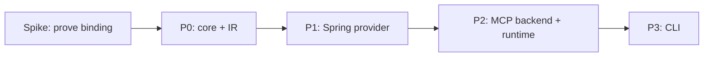

# Volume 17: Implementation Guide

Status: Executed. Every step in this volume, the spike and P0 through P3, was built in the order written here and is complete on the main branch (Volume 13, Tier 1; docs/STATUS.md has the reproduce commands). The volume is preserved as the record of the build order and its reasoning; the sketches remain sketches, and the real code in the modules is what shipped. For what to build next, this volume is not the guide: Volume 13, Tier 2 is. This volume originally read as instructions to a builder starting from nothing, and its imperative voice is kept below unchanged.

> Golden rule of sequencing: prove the hardest assumption before building the architecture around it. The spike (Volume 8) comes first. Do not build the IR, the provider, or the backend until the runtime binding is proven.

---

## 1. The contracts (write these interface shapes first, on paper or in plugin-api)

These four types are the skeleton of the whole system. Everything else implements or produces them.

```java
// tibyan-plugin-api
public interface CapabilityProvider {
    CapabilityModel provide(ProviderInput input);   // source -> IR
}

public interface SourceAnalyzer extends CapabilityProvider { }  // a provider that reads code

public interface Backend {
    void generate(CapabilityModel ir, GenerationContext ctx);   // IR -> output files
}

public interface ExecutionAdapter {
    Object invoke(CapabilityRef capability, Map<String,Object> args);  // run real logic
}
```

```java
// tibyan-core : the IR, plain records, no framework imports
public record CapabilityModel(List<Entity> entities, List<Capability> capabilities) {}
public record Entity(String name, List<Field> fields) {}
public record Field(String name, Type type) {}
public enum Type { STRING, LONG, UUID, BOOLEAN, DECIMAL, TIMESTAMP }   // closed primitive set
public record Capability(String name, Map<String,Type> input, Type output, boolean readOnly) {}
```

The point of starting here is that these shapes encode the rules: the provider returns IR and nothing else; the backend receives IR and a context and returns nothing to the caller; execution is a separate interface, not something the backend calls directly.

---

## 2. Phase -1: the Technical Spike (do this before anything else)

Goal: prove that a generated layer can run inside a real Spring app and call a real bean, by adding one dependency. Success criteria are in Volume 8.

### Step 1: a tiny legacy app you do not own conceptually

```
examples/legacy-spring-app/
  Product.java            // @Entity { Long id; String name; }
  ProductService.java     // @Service, findById(Long) returns a real Product
  ProductController.java   // ordinary REST, proves it is a normal app
  application.yml          // H2 with one seeded product
```

Treat this app as if you cannot edit it, except to add one dependency.

### Step 2: a hand-written runtime starter

Not generated. Hand-write `tibyan-runtime-spring` as a Spring Boot starter:

```java
@AutoConfiguration
public class TibyanAutoConfiguration {

    @Bean
    public McpServer tibyanMcpServer(ApplicationContext ctx) {
        ProductService svc = ctx.getBean(ProductService.class);          // discover real bean
        Tool getProduct = Tool.of("getProduct", args ->                  // one hard-coded tool
            svc.findById(Long.valueOf(args.get("id").toString())));
        return McpServer.builder().tool(getProduct).start();             // start inside this context
    }
}
```

Register it as auto-configuration so adding the dependency activates it. The exact MCP server API depends on the library chosen in Volume 16; the spike pins it.

### Step 3: connect and prove

Add the starter as a dependency to the legacy app, start the app, connect an MCP client (Claude Desktop), and call `getProduct(5)`. Watch it return the real product from H2 through the real `ProductService`.

### Step 4: write down what you learned

The spike's real deliverable is answers: which MCP library, whether the starter is enough, whether bean discovery and tool registration are clean, and the transport (stdio or HTTP). Record them in Volume 16's versions table. If the in-context model does not work cleanly, this is the moment to switch to a separate-process runtime, and the cost is one throwaway spike, not a built platform.

> If the spike fails or is ugly: stop and redesign the runtime (Volume 7) before proceeding. This is the whole reason the spike exists.

---

## 3. P0: Core and IR (only after the spike passes)

1. Create `tibyan-core` with the IR records and the closed `Type` set from section 1. No framework imports allowed.
2. Add `tibyan-plugin-api` with the four contracts. It depends on core only.
3. Implement semantic validation in core: duplicate names, unresolved references, unknown types.
4. Prove it: hand-build a `CapabilityModel` in a test, validate it, and serialize it to JSON and back.

Definition of done: a hand-built IR validates and round-trips, and `tibyan-core` has zero forbidden dependencies (Volume 12 section 4).

## 4. P1: the Spring provider

1. Create `tibyan-provider-spring` depending on plugin-api, core, and JavaParser.
2. Implement `SpringCapabilityProvider` that loads `.java` files into ASTs.
3. Implement `EntityExtractor`: walk the AST, find `@Entity` types, read their fields, map Java types to the closed `Type` set, and emit `Entity` plus a basic read `Capability` such as `getX`.
4. Leave the other extractors as empty placeholders.

```java
public final class EntityExtractor {
    public List<Entity> extract(List<CompilationUnit> units) {
        // for each class annotated @Entity, read fields, map to Type, build Entity
    }
}
```

Definition of done: scanning `examples/legacy-spring-app` produces a valid IR with `Product` and a `getProduct` capability.

## 5. P2: the MCP backend and the real runtime

1. Create `tibyan-backend-mcp` depending on plugin-api and core. It reads IR and emits an MCP tool per capability, where each tool calls `ExecutionAdapter.invoke(...)`, never a service directly.
2. Graduate `tibyan-runtime-spring` from the spike into a real module: auto-configuration, a `ToolRegistrar` that registers generated tools, and `SpringExecutionAdapter` that resolves the target bean and invokes it.
3. Wire the full path: scan, IR, generate MCP, host in the legacy context, agent calls `getProduct`, adapter calls the real `ProductService.findById`.

```java
// generated tool body (sketch): note it calls the adapter, not the service
public Object call(Map<String,Object> args) {
    return executionAdapter.invoke(new CapabilityRef("getProduct"), args);
}
```

```java
// SpringExecutionAdapter (sketch)
public Object invoke(CapabilityRef cap, Map<String,Object> args) {
    Object bean = ctx.getBean(resolveBeanFor(cap));   // the runtime knows the binding
    return reflectivelyCall(bean, resolveMethodFor(cap), args);
}
```

Definition of done: the MVP acceptance criteria in Volume 2, section 5, are met against a real, unmodified Spring system.

## 6. P3: the CLI

Wrap the pipeline with picocli so the flow is usable from a terminal:

```
tibyan scan ./legacy-spring-app          # provider -> IR (inspectable JSON)
tibyan generate --backend mcp            # IR -> generated MCP server
```

`tibyan-pipeline` orchestrates provide, validate, generate; `tibyan-cli` just parses arguments and calls it. Definition of done: a developer can modernize a system using only the CLI.

---

## 7. The build order, summarized



| Step | You are proving | Done when | Status |
|---|---|---|---|
| Spike | The runtime can call a real bean in-context | Agent gets a real result from an unmodified app | Done |
| P0 | The IR can stand alone | A hand-built IR validates and round-trips | Done |
| P1 | A provider can build IR from real source | Scanning the example yields a valid IR | Done |
| P2 | A backend plus adapter execute against the real system | MVP acceptance criteria pass | Done |
| P3 | The flow is usable | A developer modernizes a system from the CLI | Done |

Three hardening steps followed P3 (binding discovery, one-dependency adoption, build-time generation) and are recorded in Volume 13, Tier 1.

## 8. Two failure modes to watch, stated plainly

1. Building the architecture before the spike. The most likely way to waste weeks is to build core, provider, and backend, and only then discover the runtime binding is ugly. Run the spike first.
2. Over-building the IR. The temptation to add workflows, permissions, and events early is strong and wrong (Volume 1, section 9.1). Keep the IR at entities and read capabilities until a phase truly needs more. The MVP is one entity and one read-only capability bound for real (ADR-0014).
